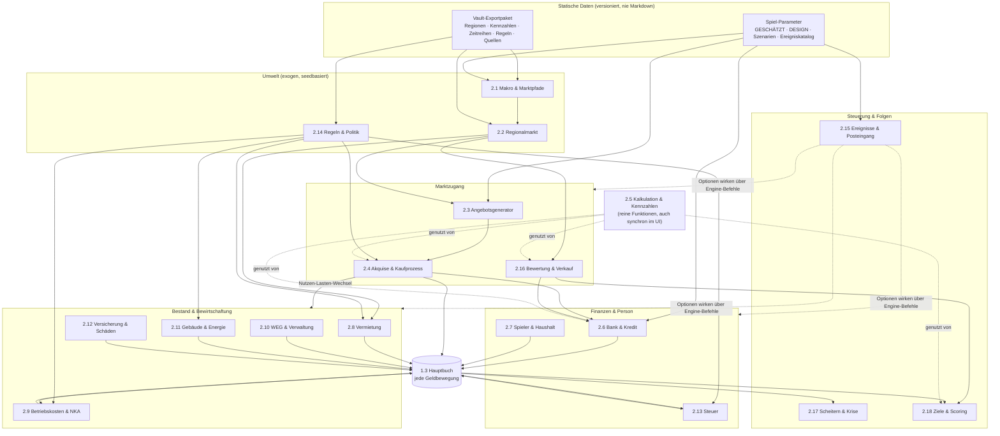

# 02 – Simulationsmodell: verbindliche Architektur- und Fachspezifikation von `packages/sim-core`

| | |
|---|---|
| Stand | 26.11.2026 |
| Status | Entwurf v1 zur Abnahme – nach Abnahme **verbindlich** für P0–P9 |
| Geltungsbereich | Simulationskern (`packages/sim-core`), Datenvertrag zum Exportpaket, Balancing-Werkzeuge (`tools/`) |
| Fachquellen (nicht neu recherchiert, sondern zusammengeführt) | `docs/research/10-…` (Finanzierung, Bank, Kennzahlen) · `11-…` (Steuern, Recht, Regeln) · `12-…` (Bewirtschaftung) · `13-…` (Akquise, Markt, Gebiete) · `14-…` (Fallstudien, Strategie, Kalibrierung) · `20-…` (Marktwerte Nov. 2026, Rechtsänderungen, Datenquellen) · `22-…` Abschn. 3 (sim-core-Technik) · `01-…` Abschn. 4 und 7 (Fehler des Prototyps) |
| Nicht Gegenstand | UI-Gestaltung, Komponenten, Routing, Store (eigene Planteile) |

---

## Lesehinweise

**Verweise.** „→ 10 §2.4“ bedeutet: Dokument `docs/research/10-ic-finanzierung-wirtschaftlichkeit.md`, Abschnitt 2.4.
Detailformeln stehen dort; hier stehen die **verbindlichen Modellentscheidungen**, Schnittstellen und zentralen Formeln.

**MUSS / SOLL / KANN.** „MUSS“ ist verbindlich, „SOLL“ ist der Standard, von dem nur mit ADR abgewichen wird,
„KANN“ ist eine Option.

**Status-Flags** (gelten für jeden Parameter, jede Regel, jede Kennzahl und jede Ereigniswahrscheinlichkeit):

| Flag | Kürzel | Bedeutung | Herkunft | UI-Badge |
|---|---|---|---|---|
| BELEGT | `[BEL]` | Wert steht im IC-Vault mit Quelle und Stand (Sicherheit A/B/C wird mitgeführt, z. B. `[BEL·C]`) | nur aus dem Vault-Exportpaket | „belegt · Stand … · Quelle …“ |
| ABGELEITET | `[ABG]` | aus belegten Werten nachgerechnet oder aus belegten Zeitreihen geschätzt (Rechenweg gespeichert) | Vault-Export oder Spiel-Tool (`tools/calibrate-*`) | „abgeleitet · Rechenweg“ |
| GESCHÄTZT | `[GES]` | Platzhalter für eine **reale** Größe, die nicht belegt ist (Lücke) | Spiel-Repo, `params/geschaetzt/` | „geschätzt“ (auffällig) |
| DESIGN | `[DES]` | reine Spielmechanik, keine Aussage über die Realität (z. B. Aktionspunkte) | Spiel-Repo, `params/design/` | „Spielmechanik“ |

**Übersetzung der Research-Marker:** Vault-Wert → `[BEL]`; „[R]“/„ABGELEITET“/Nachrechnung → `[ABG]`;
„LÜCKE“ mit Platzhalter für eine reale Größe → `[GES]`; „ANNAHME (Design)“/„DESIGN“ für reine Mechanik → `[DES]`;
„ANNAHME“ für eine reale Größe → `[GES]`.

**Sonderfall Web-Recherche (Dok. 20).** Werte, die nur in Dok. 20 stehen (z. B. ESt-Tarif-Eckwerte 2026, BEG-Reform 2026,
Mietpreisbremse „+10 %“), sind fachlich gut gestützt, aber **noch nicht im Vault**. Weil der Vault die einzige Quelle der Wahrheit
ist, laufen sie im Spiel als `[GES]` mit dem Zusatz „extern belegt, Vault-Übernahme ausstehend“. Notation in diesem Dokument:
`[WEB→W]`. Mit der Übernahme durch den Strang W werden sie automatisch `[BEL]` (siehe 1.7).

**Phasen-Tags:** P0 Fundament · P1 Rechenkern · P2 Daten & Regionen · P3 Vertical Slice „Die erste Wohnung“ ·
P4 Bewirtschaftung & Steuern · P5 Skalierung & Finanzen · P6 Lernen & Szenarien · P7 Profi-Inhalte · P8 Release Web ·
P9 Mobile · W Wissens-Härtung (parallel).

**Lücken-IDs:** `LR-nn` verweist auf das Lücken-Register (Abschnitt 5). Vault-Lücken-IDs der Research-Dokumente
(z. B. „L-03“ aus Dok. 12) stehen dort in der Spalte „Herkunft“.

### Leitplanken (gelten für alle Engines)

1. **Deterministisch:** gleicher Seed + gleiches Datenpaket + gleiche Befehle ⇒ bitgleicher Zustand auf allen Engines
   (V8, JavaScriptCore, SpiderMonkey). Geld als Integer-Cent, Sätze in Basispunkten, keine `Math.pow/exp/log`, kein `Date`,
   kein `Math.random` im Kern (→ 22 §3.2–3.3).
2. **Eine Wahrheit je Größe:** ein Hauptbuch für Geld (1.3), ein Wertmodell für Immobilien (2.16), ein Regelauflöser für
   Recht (2.14). Der Prototyp scheiterte an drei Wertmodellen und an Geld ohne Buchungen (→ 01 §3.8, §6.1).
3. **Erklärbar:** Jede angezeigte Kennzahl kann ihren Rechenweg mit Eingabewerten, Status und Quelle liefern (1.8).
4. **Information kostet:** Verdeckte Merkmale werden nur durch Handlungen mit Zeit- oder Geldkosten sichtbar (1.9).
5. **Die Bank ist ein System, kein Würfel:** Kreditentscheidungen sind deterministisch und begründet (2.6).
6. **Werte können fallen:** Kein Preis, keine Miete, kein Bankparameter hat eine eingebaute Aufwärtsgarantie (2.1, 3).
7. **Recht als Daten:** Regionale und zeitabhängige Regeln kommen aus Regeldaten mit Gültigkeit, nicht aus Code-Konstanten (2.14).
8. **Lücken sind sichtbar:** Nichts Geschätztes wird als Fakt angezeigt; jede Lücke hat ein Ziel im Strang W (5).
9. **Kein Survivorship-Bias:** Realistische Risiken führen in einem messbaren Anteil der Läufe zu Zuzahlung, Notverkauf oder
   Scheitern (→ 14 §5.3 S10).
10. **Leistungsbudget (Ziel, [DES]):** `advance(1)` mit 50 Objekten / 250 Einheiten < 5 ms im Worker;
    ein Monte-Carlo-Lauf über 480 Monate < 2 s in Node.

---

## 0. Überblick

### 0.1 Domänenkarte



Lesart: Die Umwelt (Makro, Region, Regeln) läuft unabhängig vom Spieler. Der Spieler greift über Befehle in Marktzugang,
Finanzen und Bestand ein. Alle Geldflüsse laufen durch das Hauptbuch; Steuer, Nebenkostenabrechnung, Krise und Scoring lesen
ausschließlich daraus.

### 0.2 Modul-Layout von `packages/sim-core/src`

```
sim-core/src/
├─ kernel/        Grundtypen & Werkzeuge ohne Fachwissen
│   ├─ money.ts        Cents, Bp, mulBp, roundHalfAwayFromZero, floorToEuro
│   ├─ detmath.ts      powInt, expDet, lnDet, sqrt (nur IEEE-Grundoperationen)
│   ├─ rng.ts          zählerbasierter PRNG, Verteilungen (1.6)
│   ├─ calendar.ts     MonthIndex, Quartal, Steuerjahr, Fristrechnung in Monaten
│   ├─ ids.ts          typisierte IDs, deterministische ID-Vergabe
│   ├─ explain.ts      Tracer/Erklaerung (1.8)
│   └─ result.ts       Result/Validierung, Begründungscodes
├─ params/        Parameter-Registry, Status-Flags, Auflösung nach Zeit/Region, Rechtsjahrgänge (1.7)
├─ world/         Datenpaket-Typen + Lookups: Gebiete (ARS), Struktur, Kennzahlen mit Schätzkaskade, Zeitreihen
├─ rules/         Regelauflösung (Präfix, Vorrang, Stichtag, Objektart), Regel-Effekte, Politik-Ereignisphasen (2.14)
├─ ledger/        Konten, Buchungen, Buchungsarten, Invarianten, Monats-/Jahresaggregate (1.3)
├─ macro/         nationale Pfade: historisches Replay, Regime-Modell, Schocks, Szenario-Overrides (2.1)
├─ region/        Kreis-Indizes, Gemeinde-Offsets, Mikrolage, Vergleichsmiete, Leerstand, Prognose-Zeitung (2.2)
├─ calc/          reine Finanzmathematik & Kennzahlen K01–K35, Kaufnebenkosten, Annuität, Kaskade (2.5)
├─ valuation/     EIN Wertmodell (wertKern) mit Sichten: wahr, Spieler, Gutachter, Beleihung (2.16, Teil 1)
├─ offers/        Angebotsgenerator, Exposé-Schönung, Konkurrenz, Verfall, Off-Market (2.3)
├─ acquisition/   Kaufprozess-Automat, Aufdeckung, Verhandlung, Notar, Nutzen-Lasten-Wechsel (2.4)
├─ sale/          Verkaufsprozess, Notverkauf, Zwangsversteigerung (2.16, Teil 2)
├─ bank/          Bankprofile, Kreditprüfung P0–P9, Konditionen, Darlehen, Anschluss, Sondertilgung, Dispo (2.6)
├─ player/        Haushalt, Einkommen, Lebenshaltung, Rechtsträger (privat/GmbH/Holding), Zeitbudget, Wissen, Netzwerk (2.7)
├─ lease/         Mieter-Automat, Bewerber, Mietverträge, Mieterhöhung, Zahlungsstörung, Kündigung, Kaution (2.8)
├─ opex/          Betriebskosten-Positionen, Umlage-Prüfkette, Heizkosten, CO₂, NKA, Fristen (2.9)
├─ weg/           WEG, Wirtschaftsplan, Hausgeld, Rücklage, Sonderumlage, ETV, Verwalter/SEV (2.10)
├─ building/      Bauteilmodell, Alterung, Ausfälle, Energie, Maßnahmen/Projekte, GModG, Förderung (2.11)
├─ insurance/     Policen, Gefahren, Schadenfälle, Obliegenheiten (2.12)
├─ tax/           Steuerjahr, V+V, AfA, 15-%-Prüfung, § 23, ESt-Tarif, Veranlagung, GmbH/Holding (2.13)
├─ events/        Ereigniskatalog-Laufzeit, Auslöser, Optionen, Folgenvorschau, Posteingang, Fristen (2.15)
├─ crisis/        Liquiditätsüberwachung, Frühwarnung, Rücklastschrift, Eskalation, Verwertung (2.17)
├─ scoring/       Nettovermögen, Meilensteine, Szenario-Bewertung (2.18)
├─ time/          Monats-Pipeline, Zeitplan-Queue (Termine), „Weiter“-Modi, Stoppbedingungen (1.5)
├─ commands/      Befehlskatalog, Validierung, Dispatch, Undo-Barrieren (1.4)
├─ projection/    View-Models, Erklärungen, Vorschau/Was-wäre-wenn (1.8)
├─ save/          Snapshot, Befehls-Log, Keyframes, Migrationen, kanonische Serialisierung, Hash (1.10)
└─ index.ts       öffentliche SimApi
```

### 0.3 Abhängigkeitsrichtung

```
L7  index.ts · projection/ · save/
L6  time/ · commands/
L5  events/ · crisis/ · scoring/
L4  offers/ · acquisition/ · sale/ · bank/ · player/ · lease/ · opex/ · weg/ · building/ · insurance/ · tax/
L3  calc/ · valuation/                       (zustandsfrei: Eingaben → Ergebnis + Erklärung)
L2  macro/ · region/ · rules/ · ledger/
L1  params/ · world/
L0  kernel/
```

- **MUSS:** Importe nur nach unten. Zyklen verboten. CI prüft das (dependency-cruiser oder Biome-Importregeln; → 22 §9).
- **MUSS:** Engines derselben Ebene L4 importieren voneinander **nur** die exportierten Selektoren (`<engine>/select.ts`,
  rein lesend) und Typen. Schreiben dürfen sie nur den eigenen Teilbaum des Zustands, Geld nur über `ledger.post()`,
  Folgen für andere Engines nur über **Domain-Events** an die Pipeline (z. B. `MIETVERTRAG_BEENDET` → `opex` stellt
  Zwischenablesung ein).
- **MUSS:** `calc/` und `valuation/` sind reine Funktionen ohne Zustandszugriff; sie sind die einzigen Module, die das UI
  synchron im Main-Thread aufrufen darf (Live-Rechnung in Formularen, → 22 §3.1).
- **Engine-Vertrag** (jede L4/L5-Engine):

```ts
interface Engine {
  id: EngineId;                                       // 'lease', 'bank', …
  schritte: Partial<Record<PipelineSchritt, (ctx: SchrittKontext) => void>>; // 1.5
  befehle: Partial<Record<CommandType, CommandHandler>>;                     // 1.4
  reaktionen: Partial<Record<DomainEventType, (ctx: SchrittKontext, e: DomainEvent) => void>>;
  invarianten: Array<(s: GameState) => InvariantVerletzung | null>;          // 3
}
interface SchrittKontext {
  readonly s: Readonly<GameState>;      // Lesesicht (vor dem Schritt)
  draft: Draft<GameState>;              // lokale Kopie, nur eigener Teilbaum beschreibbar (Dev-Proxy prüft)
  monat: MonthIndex;
  rng: RngFabrik;                       // 1.6
  p: ParamSicht;                        // 1.7, bereits für Monat/Region auflösbar
  regeln: RegelSicht;                   // 2.14
  ledger: LedgerSchreiber;              // 1.3
  emit(e: DomainEvent): void;           // an Pipeline und Chronik
  post(n: Nachricht): void;             // Posteingang (2.15)
  plane(t: Termin): void;               // Zeitplan-Queue (1.5)
}
```

- **Öffentliche API** (verfeinert gegenüber → 22 §3.7; Fachbegriffe deutsch, technische Verben englisch):

```ts
export interface SimApi {
  newGame(input: NeuesSpiel, daten: DatenPaket): GameState;
  validate(s: GameState, cmd: Command): Validierung;              // ohne Anwendung (Buttons, Formulare)
  apply(s: GameState, cmd: Command): ApplyResult;                 // validiert + wendet an + Events
  advance(s: GameState, modus: WeiterModus): AdvanceResult;       // 1.5
  undo(s: GameState): GameState | UndoVerweigert;                 // 1.10
  preview(s: GameState, plan: WasWaereWenn): Projektion;          // nie mit Spiel-RNG (1.6, 1.9)
  project<K extends ProjektionsTyp>(s: GameState, k: K, a: ProjArgs<K>): ViewModel<K>;
  explain(s: GameState, ref: KennzahlRef): Erklaerung;            // 1.8
  hash(s: GameState): { gesamt: string; jeEngine: Record<EngineId, string> };
  save(s: GameState): SaveEnvelope;  load(e: SaveEnvelope, daten: DatenPaket): GameState | LadeFehler;
}
```

---

## 1. Querschnitt

### 1.1 Grundtypen, Rundung, Kalender

```ts
type Cents  = number & { readonly __b: 'Cents' };  // Integer, Number.isSafeInteger; ±9·10^15 Cent
type Bp     = number & { readonly __b: 'Bp' };     // Basispunkte: 1 bp = 0,01 %; 10_000 = 100 %
type Qm100  = number & { readonly __b: 'Qm100' };  // Fläche in 1/100 m² (Integer)
type CentProQm = number & { readonly __b: 'CentProQm' }; // z. B. 1.862 = 18,62 €/m²
type MonthIndex = number;                          // jahr * 12 + (monat − 1); Nov. 2026 = 24.322
```

- **MUSS:** Zustand, Buchungen und Parameter enthalten nur Integer. Zwischenrechnungen dürfen Float sein (nur `+ − × ÷`,
  `Math.sqrt/floor/round/imul`, `detmath`). Gerundet wird **nur an Buchungsstellen** nach zentral benannten Regeln:

| Buchungsstelle | Regel | Status |
|---|---|---|
| Monatszins Darlehen | `roundHalfAwayFromZero(restschuld × sollzinsBp / 10.000 / 12)` | [DES] (Bankpraxis variiert) |
| Tilgung | `rate − zins`; letzte Rate = Restschuld + Zins | [ABG] → 10 §K22 |
| Miete, Index-/Staffelmiete, Umlage § 559 | Cent, kaufmännisch | [DES] |
| BK-Anteil je Mieter | Cent, kaufmännisch; Rundungsdifferenz trägt der Eigentümer | [DES] |
| Grunderwerbsteuer | auf volle Euro abrunden | [GES] (§ 11 Abs. 2 GrEStG, vom Strang W zu bestätigen, LR-09) |
| Einkommensteuer | zvE und Steuerbetrag auf volle Euro abrunden (`floorToEuro`) | [GES] (§ 32a, LR-21) |
| AfA | Jahresbetrag in Cent; Teiljahr in vollen Monaten (n/12) | [GES] (LR-25) |
| Konto-/Dispozinsen | auf den Monatsend-Saldo | [DES] (Vereinfachung) |

- **Kalender:** Der Kern kennt nur Monate. Tagesgenaue Rechtsfristen werden auf Monate abgebildet; die Abbildung ist je
  Regel dokumentiert. Beispiele: Zugang eines Mieterhöhungsverlangens im Monat *t* ⇒ Wirksamkeit „Beginn des dritten
  Kalendermonats nach Zugang“ = *t+3* (§ 558b BGB, → 12 §1.4); Indexanpassung „übernächster Monat“ = *t+2* (§ 557b);
  Nutzen-Lasten-Wechsel immer am Monatsersten. Quartalstermine (Grundsteuer 15.2./5./8./11., ESt-Vorauszahlung
  10.3./6./9./12.) fallen in den jeweiligen Monat.
- **Zeitmodell:** rundenbasiert, Takt = 1 Monat. Spieleraktionen sind Befehle **zwischen** Monatsabschlüssen.
  Es gibt keine Echtzeit und keine Tagesticks (Lehre aus → 01 §2).

### 1.2 Zustand (GameState-Skizze)

Der Zustand ist **normalisiert** (Entitäten in `Record<Id, …>`), damit 50+ Objekte, Massenaktionen und Teil-Hashes je Engine
effizient sind. Texte stehen nie im Zustand, nur Codes und Parameter (Übersetzung im UI, → 22 §3.6).

```ts
interface GameState {
  meta: {
    schemaVersion: number; rulesVersion: string; dataVersion: string; paramPackHash: string;
    seed: string;                                   // 128 Bit hex
    szenarioId: string; modus: 'FREI' | 'SZENARIO' | 'TUTORIAL';
    schwierigkeit: SchwierigkeitsId; ironman: boolean; lernmodus: boolean;
    startMonat: MonthIndex; endMonat?: MonthIndex;
    eingefroreneParameter: ParamSnapshot;           // 1.7 – aufgelöste Werte, mit denen dieser Spielstand rechnet
  };
  uhr: { monat: MonthIndex; befehlNr: number; undoBarriere: number };
  welt: { regionen: Record<Ars, RegionStatisch> };  // beim Spielstart kopierte, spielrelevante Gebietsparameter (→ 22 §4.3)
  makro: MakroZustand;                              // 2.1
  regionen: Record<KreisArs, RegionZustand>;        // 2.2 (401 Kreise, dynamisch)
  regeln: { politik: Record<PolitikId, PolitikInstanz>; szenarioOverrides: RegelOverride[] }; // 2.14
  markt: { angebote: Record<AngebotId, Angebot>; suchprofile: Record<SuchprofilId, Suchprofil>;
           beobachtet: KreisArs[]; prognosen: Record<PrognoseId, NpcPrognose> };            // 2.3, 2.2
  deals: Record<DealId, Deal>;                      // 2.4 Kaufvorgänge
  verkaeufe: Record<VerkaufId, Verkaufsvorgang>;    // 2.16
  spieler: Spieler;                                 // 2.7 Haushalt, Personen, Zeitbudget, Wissen, Netzwerk
  rechtstraeger: Record<RtId, Rechtstraeger>;       // PRIVAT (1–2 Personen), GMBH, HOLDING (2.7, 2.13)
  konten: Record<KontoId, Konto>;                   // 1.3
  journal: Journal;                                 // 1.3 Buchungen (Detail: laufendes + 2 Vorjahre), Aggregate
  objekte: Record<ObjektId, Objekt>;                // Grundstück + Gebäude + Bauteile (2.11), Lage, Rechtsraum
  einheiten: Record<EinheitId, Einheit>;            // Wohnung/Gewerbe/Stellplatz; SE/GE-Zuordnung
  mietvertraege: Record<MvId, Mietvertrag>;         // 2.8
  mieter: Record<MieterId, Mieter>;                 // 2.8 (sichtbare + latente Merkmale)
  bewerber: Record<BewerberId, Bewerber>;           // 2.8 (nur während Vermarktung)
  wegs: Record<WegId, Weg>;                         // 2.10 inkl. NPC-Eigentümer, Rücklage, Beschlüsse
  dienstleister: Record<DlId, Dienstleister>;       // Verwaltung, SEV, Handwerker, Gutachter, Anwalt, StB
  projekte: Record<ProjektId, Bauprojekt>;          // 2.11 Renovierung/Modernisierung
  policen: Record<PoliceId, Police>;                // 2.12
  schaeden: Record<SchadenId, Schadenfall>;         // 2.12
  banken: Record<BankId, Bank>;                     // 2.6 Profile (beim Start aus Spannen gezogen)
  kreditantraege: Record<AntragId, Kreditantrag>;
  darlehen: Record<DarlehenId, Darlehen>;
  grundschulden: Record<GsId, Grundschuld>;
  abrechnungen: Record<NkaId, Nebenkostenabrechnung>; // 2.9
  steuer: { jahre: Record<number, Steuerjahr>; verlustvortrag: Record<RtId, Cents>;
            bescheide: Record<BescheidId, Bescheid> };                                // 2.13
  ereignisse: { aktiv: Record<EvInstId, EreignisInstanz>; cooldowns: Record<string, MonthIndex> }; // 2.15
  posteingang: Record<NachrichtId, Nachricht>;
  termine: TerminQueue;                             // 1.5 Zeitplan (wirksame Mietänderungen, Fristabläufe, NLW …)
  krise: Krisenzustand;                             // 2.17
  ziele: { meilensteine: Record<MeilensteinId, MeilensteinStatus>; checkpointsGenutzt: number }; // 2.18
  historie: KennzahlenHistorie;                     // spaltenorientiert: Monatswerte je Objekt/Portfolio (Int32)
  wissen: Record<WissensKey, Wissensstand>;         // 1.9 – was der Spieler über verdeckte Merkmale weiß
}
```

Verdeckte Merkmale liegen **im selben Entitätsobjekt** unter `wahr` (z. B. `Angebot.wahr`, `Mieter.latent`,
`Bauteil.zustandWahr`); die Sicht des Spielers ergibt sich nur aus `wissen` (1.9). `projection/` erhält keinen Zugriff auf
`wahr`-Felder (Typ-Trennung, 1.9).

### 1.3 Hauptbuch (Ledger) – die eine Wahrheit für Geld

Jede Geldbewegung ist eine **Buchung**. Kontostände sind die Summe der Buchungen. Cashflow-Kaskade (Ist), Steuer
(Zufluss/Abfluss), Nebenkostenabrechnung, Kontoauszug und Scoring lesen ausschließlich das Hauptbuch.

```ts
interface Buchung {
  id: BuchungId; monat: MonthIndex; konto: KontoId; gegen: KontoId | 'EXTERN';
  betrag: Cents;                      // Vorzeichen aus Sicht von `konto`
  art: BuchungsArt;                   // steuert alle Auswertungen (Tabelle unten)
  rt: RtId;                           // Rechtsträger (privat / GmbH / Holding) – getrennte Kassen
  objekt?: ObjektId; einheit?: EinheitId; mv?: MvId; darlehen?: DarlehenId; projekt?: ProjektId;
  betrkvNr?: BetrKVNr;                // bei Betriebskosten: Position § 2 BetrKV
  ustAnteil?: Cents;                  // für 15-%-Prüfung „netto“ (2.13)
  ursache: UrsacheRef;                // Befehl, Pipeline-Schritt, Ereignis → für Erklärung & Chronik
}
```

| Kontoklasse | Beispiele | Hinweis |
|---|---|---|
| liquide (Aktiva) | Girokonto privat, Tagesgeld, Depot (Kurswert), GmbH-Konto | Dispo nur am Girokonto |
| Treuhand | Kautionskonto je Mietvertrag | **nie** Spielerliquidität (INV-24) |
| Forderungen | Mietrückstände, Erstattungsansprüche (Steuer, Versicherung), Stundungen | für Scoring und Krise |
| Verbindlichkeiten | Darlehen (Restschuld), offene Rechnungen, Steuerschulden | Darlehen werden nur von `bank/` gebucht |
| kalkulatorisch | „Rücklagen-Unterkonto“ (freiwillig vom Spieler gebildet) | reine Umbuchung, kein Aufwand |

**Buchungsarten** (Auszug; vollständiger Katalog in `ledger/arten.ts`). Jede Art trägt drei Klassifikationen:

| BuchungsArt | Cashflow-Stufe (→ 10 §1.7) | Steuer (→ 11 §1.1–1.3) | Umlage (→ 12 §2) |
|---|---|---|---|
| MIETE_KALT | operativ | Einnahme V+V (Zufluss) | – |
| BK_VORAUSZAHLUNG, BK_NACHZAHLUNG_EIN | operativ (durchlaufend) | Einnahme V+V | Gegenstück NKA |
| BK_GUTHABEN_AUS | operativ | Einnahme mindernd | NKA |
| BK_LIEFERANT (je BetrKV-Nr.) | operativ | WK sofort | Prüfkette 2.9 |
| HAUSGELD_UMLAGEF / HAUSGELD_NICHT_UMLAGEF | operativ | WK sofort | Übersetzung 2.10 |
| HAUSGELD_RUECKLAGE_ZUFUEHRUNG | operativ | **[GES]** nicht sofort abziehbar (LR-31) | nie |
| SONDERUMLAGE | operativ | nach Verwendung (Erhaltung/Modernisierung) | nie |
| VERWALTUNG, VERMARKTUNG, RECHTSKOSTEN | operativ | WK sofort | nie |
| INSTANDHALTUNG | operativ | WK sofort **oder** 15-%-Fall | nie |
| MODERNISIERUNG, ANSCHAFFUNG_GEBAEUDETEIL | Investition | 15-%-Prüfung / Herstellungskosten | § 559-Basis |
| VERSICHERUNG_PRAEMIE / _LEISTUNG | operativ | WK / Einnahme | Nr. 13 wenn umlagefähig |
| GRUNDSTEUER | operativ | WK sofort | Nr. 1 |
| ZINS_DARLEHEN, BEREITSTELLUNGSZINS | Finanzierung | WK sofort | nie |
| TILGUNG, SONDERTILGUNG | Finanzierung | nicht abziehbar | nie |
| VORFAELLIGKEITSENTSCHAEDIGUNG | Finanzierung | **[GES]** Veräußerungskosten (LR-29) | nie |
| KAUFPREIS (Gebäude/Boden getrennt) | Investition | AK Gebäude → AfA / AK Boden | nie |
| GREST, NOTAR_GRUNDBUCH, MAKLER_KAUF | Investition | **[GES]** anteilig AK (LR-24) | nie |
| VERKAUFSERLOES, VERKAUFSKOSTEN | Investition | § 23 / GmbH-Gewinn | nie |
| GEHALT_NETTO, LEBENSHALTUNG, EIGENE_WOHNKOSTEN | privat | außerhalb V+V | – |
| EST_NACHZAHLUNG / EST_ERSTATTUNG, KST, GEWST | Steuer | – | – |
| DISPOZINS, GUTHABENZINS | privat | privat / Kapitalerträge [DES: nicht besteuert] | – |
| KAUTION_EIN / KAUTION_AUS | Treuhand | neutral | – |
| FOERDERZUSCHUSS | Investition | mindert AK/Erhaltungsaufwand [GES] | mindert § 559-Basis |

**Invarianten (MUSS, nach jedem Befehl und jedem Pipeline-Schritt im Dev-/Test-Modus):**
Σ Buchungen je Konto = Saldo; jede Buchung hat genau eine BuchungsArt und einen Rechtsträger; Geld entsteht nur über
definierte externe Quellen (Gehalt, Miete, Darlehensauszahlung, Verkauf, Erstattung, Förderung, Versicherungsleistung);
Treuhandkonten fließen nie in Liquiditätskennzahlen.

### 1.4 Befehle

**Lebenszyklus:** `validate` (Ressourcen, Zustand, Recht) → bei Fehler `Validierung{ok:false, gruende:[Code…]}` mit
erklärbaren Gründen → `apply` (Zustandsänderung, Buchungen, Termine, Domain-Events) → Eintrag im Befehls-Log.
Jeder Befehl hat Kosten in **Aktionspunkten (AP, [DES], 2.7)** und ggf. Geld. Befehle mit **Informationsgewinn** oder
**Gegenreaktion eines Akteurs** (Besichtigung, Gutachten, Kaufangebot, Bankanfrage, Mieterhöhungsverlangen) sind
`irreversibel` und setzen eine **Undo-Barriere** (1.10) – sonst wäre Information per Undo gratis (INV-06).

```ts
interface CommandBase { type: CommandType; id: CmdId; monat: MonthIndex; }   // id deterministisch: monat + befehlNr
interface CommandDef<C> {
  validate(s: GameState, c: C, p: ParamSicht): Validierung;
  apply(ctx: SchrittKontext, c: C): void;
  kosten(s: GameState, c: C): { ap: number; geld: Cents };
  irreversibel: boolean | ((s: GameState, c: C) => boolean);
  phase: Phase;
}
```

**Befehlskatalog** (Auszug, verbindlich als Mindestumfang je Phase; Details im jeweiligen Engine-Abschnitt):

| Bereich | Befehl | Validierung (Auszug) | Effekte | AP/Geld | Undo | Phase |
|---|---|---|---|---|---|---|
| Suche | `regionBeobachten(ars)` / `regionEntfernen` | max. N beobachtete Kreise [DES]; Gebiet bewohnt | Angebotsstrom für Region startet nächste Runde | 0 | ja | P3 |
| Suche | `suchprofilSetzen(profil)` | Objektarten freigeschaltet | filtert Angebote, steuert Off-Market-Hinweise | 0 | ja | P3 |
| Suche | `angebotVerwerfen(id, begruendung)` | – | Entscheidungslog (Meilenstein „begründete Absage“) | 0 | ja | P3 |
| Akquise | `dealStarten(angebotId)` | Angebot aktiv | Deal in SICHTUNG | 0 | ja | P3 |
| Akquise | `pruefschritt(dealId, schritt)` | Reihenfolge-Gates (2.4), AP, Geld | deckt Merkmale gemäß Aufdeckungsmatrix auf | je Schritt | **nein** | P3 |
| Akquise | `kaufangebot(dealId, preis, bedingungen)` | Unterlagen-/Finanzierungsstand frei wählbar (Risiko trägt Spieler) | Verkäuferreaktion nächste Runde (2.4) | 1 AP | **nein** | P3 |
| Akquise | `kaufvertragGestalten(dealId, aufteilung, inventar, nlw)` | Einigung erzielt | Vertragsentwurf; Aufteilung → Steuer | 1 AP | ja | P3/P4 |
| Akquise | `beurkunden(dealId)` | Liquidität für KNK; Warnung ohne Zusage | KNK fällig, Fristen starten | 1 AP | **nein** | P3 |
| Akquise | `dealAbbrechen(dealId, grund)` | vor Beurkundung frei; danach Rücktrittsfolgen | Deal ABGELEHNT/Vertragsstrafe | 0 | nein | P3 |
| Bank | `kreditanfrage(ziel, banken \| 'VERMITTLER', wunsch)` | Unterlagen (Rückfrage sonst) | Entscheidung nach Bearbeitungsdauer (2.6) | 2/1 AP | **nein** | P3 |
| Bank | `kreditangebotAnnehmen(angebotId)` | Angebot gültig | Darlehen + Grundschuld angelegt, Auszahlung bei Fälligkeit | 1 AP | ja (vor Auszahlung) | P3 |
| Bank | `sondertilgung(darlehenId, betrag)` | ≤ Sondertilgungsrecht; sonst nur mit VFE | Restschuld ↓ | 0 | ja | P3/P5 |
| Bank | `anschlussWaehlen(darlehenId, option)` | Fenster offen (2.6) | Prolongation/Umschuldung/Forward/Ablösung | 1 AP | ja | P5 |
| Bank | `nachbeleihung(objektId, betrag)` | freier Beleihungsraum; Haushaltsrechnung | neues Darlehen [GES-Mechanik] | 2 AP | **nein** | P5 |
| Bank | `bonitaetPflegen(aktion)` | – | SCHUFA prüfen, Dispo/Kreditkarte kündigen (Haushaltsrechnung) | 1 AP | ja | P3 |
| Vermietung | `inserieren(einheitId, miete, mietart, klauseln)` | Mietpreisbremse/§ 5 WiStrG (Warnung/Block) | Einheit INSERIERT | 1 AP | ja | P3 |
| Vermietung | `bewerberPruefen(id, pruefungen[])` | Einwilligung (DES), AP | deckt Merkmale auf | 0,5 AP je Prüfung | **nein** | P3 |
| Vermietung | `mietvertragSchliessen(einheitId, bewerberId, vertrag)` | Obergrenzen, Kaution ≤ Grenze | Vertrag, Mietbeginn-Termin | 1 AP | ja | P3 |
| Vermietung | `mieterhoehung(mvId, art, betrag, begruendung)` | Fristen, Kappung, Mietart (2.8) | Verlangen zugestellt, Antwort t+2 | 1 AP | **nein** | P4 |
| Vermietung | `mahnen / stundungVereinbaren / kuendigen / raeumungsklage(mvId, …)` | Rückstand, Stufe, Rechtslage | Eskalationspfad (2.8) | 0,5–2 AP + Kosten | **nein** | P4 |
| Betrieb | `nkaErstellen(objektId, jahr)` / `nkaDelegieren` | Periode abgeschlossen | Abrechnung, Zugang, Fristen (2.9) | 3 AP / Gebühr | **nein** | P4 |
| Betrieb | `vorauszahlungAnpassen(mvId, betrag)` | nach Zugang NKA | ab nächstem Monat | 0,5 AP | ja | P4 |
| Betrieb | `verwaltungBeauftragen(objektId, rolle, dlId)` / `kuendigen` | Vertragslaufzeit [DES] | Delegationsmatrix (2.10) | 1 AP | ja | P4 |
| WEG | `wegAbstimmen(beschlussId, stimme)` | ETV offen | Stimme nach MEA (2.10) | 1 AP | ja (bis ETV) | P4 |
| Gebäude | `massnahmePlanen / angeboteEinholen / beauftragen(projekt)` | Duldung/Ankündigung (2.11), Liquidität | Projekt, Kosten, Dauer, Umlagebasis | 1–2 AP | Beauftragung **nein** | P4 |
| Gebäude | `modernisierungAnkuendigen / umlageErklaeren(projektId)` | § 559-Voraussetzungen, Kappung | Mieterhöhung zum Termin | 1 AP | **nein** | P4 |
| Versicherung | `policeAbschliessen / kuendigen / schadenMelden` | Objekt, Deckung | Prämie, Deckung, Regulierung | 0,5–1 AP | ja / **nein** | P4 |
| Steuer | `steuererklaerungAbgeben(jahr, mitStB)` | Jahr abgeschlossen | Bescheid nach Bearbeitungsdauer (2.13) | 3 AP / Honorar | **nein** | P4 |
| Steuer | `rndGutachten`, `gmbhGruenden`, `ausschuetten`, `kuerzungBeantragen` | Freischaltung | 2.13 | variabel | **nein** | P7 |
| Verkauf | `verkaufStarten(objektId, kanal, preis)` / `preisAendern` / `angebotAnnehmen` / `abbrechen` | Objekt im Bestand, keine Sperre | Verkaufsprozess (2.16) | 1 AP | Annahme **nein** | P5 |
| Spieler | `umbuchen(von, nach, betrag)`, `lebenshaltungAnpassen`, `depotVerkaufen` | Grenzen [DES] | Liquidität | 0 | ja | P3 |
| Spieler | `weiterbildung(modul)`, `netzwerkPflegen(kontakt)`, `nebenjob(an/aus)` | Geld/AP | Wissen, Netzwerk, Einkommen | variabel | ja | P5 |
| Ereignis | `ereignisoption(instanzId, optionId)` | Option zulässig, Frist offen | Folgen laut Katalog (2.15) | laut Option | laut Option | P3 |
| Meta | `checkpointSetzen()` | nur Lernmodus | Keyframe (1.10) | 0 | – | P6 |

### 1.5 Monats-Pipeline

Ein Aufruf „Weiter“ führt für den aktuellen Monat *t* den **Abschluss** (Teil A: Flüsse und Zustände von *t*) und danach die
**Eröffnung** von *t+1* (Teil B: neue Umwelt, Termine, Angebote, Posteingang) aus. Der Zustand „Monat *t*“ ist also immer:
Umwelt von *t* bekannt, Entscheidungsfenster offen. Die Reihenfolge ist **verbindlich** und Teil der `rulesVersion`.

**Teil A – Abschluss Monat t**

| Nr. | Schritt | Engine | Inhalt | RNG-Strom |
|---|---|---|---|---|
| A01 | Einkommen & Lebenshaltung | player | Nettogehalt(er), sonstige Einkünfte, Lebenshaltung, eigene Wohnkosten, bestehende Privatkredite | `PLAYER` |
| A02 | Mieteingänge | lease | je Mietvertrag Sollmiete + BK-Vorauszahlung → Zahlungswurf nach Mieterzustand → Ist-Buchung, Rückstände | `PAYMENT` |
| A03 | Objekt- & Betriebskosten | opex, weg, insurance | Hausgeld, BK an Versorger, nicht umlagefähige Kosten, Verwaltung, fällige Prämien, Grundsteuer (Feb/Mai/Aug/Nov), Leerstandsanteile | – |
| A04 | Gebäude | building, insurance | Alterung, Ausfall-/Schadenswürfe, Projektfortschritt + Abschlagszahlungen, Schadenregulierung | `BUILDING`, `INSURANCE` |
| A05 | Kapitaldienst | bank | Zins, Tilgung, Bereitstellungszins, Sondertilgungen, Auszahlungen fälliger Darlehen | – |
| A06 | Mieter-Lebenszyklus | lease | Fluktuation/Kündigungen, Verzugseskalation, Vermarktung → Bewerber, Auszüge, Kautionsabrechnung | `TURNOVER`, `TENANT` |
| A07 | Kaufvorgänge | acquisition, bank | Fortschritt, Verkäuferreaktionen, Wegkauf durch Konkurrenz, fällige Bankentscheidungen, Kaufpreisfälligkeit | `NEGOTIATION`, `COMPETITION`, `BANK` |
| A08 | Verkaufsvorgänge | sale | Interessenten, Gebote, Vollzug, Darlehensablösung | `SALE` |
| A09 | WEG | weg | ETV-Termine, Beschlüsse, Sonderumlagen, Jahresabrechnung (Saison) | `WEG` |
| A10 | Ereignisse | events, rules | Hazard-/Zustands-/Timer-Auslöser, Politik-Phasen, Ereignisinstanzen erzeugen | `EVENTS`, `POLICY` |
| A11 | Steuerzahlungen | tax | fällige Bescheide, Vorauszahlungen (Mrz/Jun/Sep/Dez), GmbH-Steuern | – |
| A12 | Kontozinsen | ledger, bank | Guthabenzins, Dispozins auf Monatsend-Saldo | – |
| A13 | Liquidität & Krise | crisis | Dispo-Grenze, Rücklastschriften nach Priorität, Mahnstufen, Frühwarnstufe, Verwertungsfolgen | `CRISIS` |
| A14 | Monatsabschluss | ledger, scoring | Invarianten, Monatsaggregate (Historie), Meilensteine, Monatsbericht | – |
| A15 | **nur Dezember:** Jahresabschluss *j* | tax, opex, weg, building, scoring | Steuerjahr vorläufig schließen (AfA, 15-%-Prüfung, § 23-Freigrenze), NKA-Perioden schließen → Aufgaben, WEG-Jahresabrechnung planen, Bauteilplan, Jahres-Meilensteine, Keyframe | – |

**Teil B – Eröffnung Monat t+1**

| Nr. | Schritt | Engine | Inhalt | RNG-Strom |
|---|---|---|---|---|
| B01 | Kalender & Rechtsstand | time, rules, params | `monat = t+1`; im Januar neuen Rechtsjahrgang laden; Regeln mit `gueltig_ab = t+1` aktivieren; Politik-Phasenwechsel | `POLICY` |
| B02 | Makro | macro | nationaler Pfad *t+1* (Replay oder Modell) | `MACRO` |
| B03 | Regionen | region | Kreis-Indizes *t+1*, Vergleichsmiete, Leerstand, Prognose-Zeitung | `REGION` |
| B04 | Bankkonditionen | bank | Basiszinsen je Bindung, Spreads, zyklische Profilparameter | `BANK` |
| B05 | **nur Januar:** Jahreseröffnung | player, bank, lease, tax | Gehaltsanpassung, Lebenshaltung indexieren, Sondertilgungsrechte erneuern, Steuererklärungs-Aufgabe *j−1*, II.-BV-/Pauschalen laut Jahrgang | `PLAYER` |
| B06 | Termine | time (alle) | fällige Termine aus der Queue in fester Ordnung: Wirksamkeiten (Miete, Umlage, Vorauszahlung) → Vertragsbeginne/-enden → Zinsbindungsenden (Standardoption) → NLW → Fristabläufe (Standardoptionen) | – |
| B07 | Angebotsmarkt | offers | Verfall, Preissenkungen, neue Angebote je beobachteter Region und Suchprofil, Off-Market-Hinweise | `OFFERS`, `OFFER_TRUTH` |
| B08 | Posteingang & Zeit | events, player | AP-Budget auffrischen, Erinnerungen, offene Entscheidungen, Stoppbedingungen auswerten | – |
| B09 | Sicherung | save | Undo-Snapshot (Monatsanfang), Autosave-Signal | – |

**„Weiter“-Modi.** `{ typ: 'MONAT' }` · `{ typ: 'BIS_EREIGNIS' }` · `{ typ: 'BIS_DATUM', ziel: MonthIndex }`.
Stoppbedingungen nach B08 (jede stoppt jeden Modus außer `MONAT`): neue Nachricht mit `stoppt: true` (Entscheidung mit
Frist ≤ 1 Monat, Kaufvorgang braucht Eingabe, Bankangebot, Bescheid mit Nachzahlung), Frühwarnstufe ≥ ORANGE (2.17),
Szenario-Meilenstein. Nicht stoppende Entscheidungen laufen bis zur Frist und lösen dann ihre **Standardoption** aus
(z. B. Mieterhöhungsfenster ungenutzt = keine Erhöhung; Zinsbindungsende ohne Wahl = variable Anschlusskondition, 2.6).

**MUSS:** `advance(BIS_DATUM, t+n)` ohne Stopp ist bitgleich zu *n* × `advance(MONAT)` (INV-22).

### 1.6 Zufall (RNG-Ströme)

Zählerbasierte Ableitung statt eines fortlaufenden Generators (→ 22 §3.3):

```ts
u = hash128to32(seed, strom, monat, entitaetSchluessel, k) / 2^32   // SplitMix-artig, nur Math.imul/Shifts
```

- **Strom-Registry** (append-only, IDs nie wiederverwenden): `MACRO`, `REGION`, `POLICY`, `OFFERS` (Anzahl/Art neuer
  Angebote), `OFFER_TRUTH` (verdeckte Wahrheit eines Angebots), `EXPOSE` (Schönung), `NEGOTIATION`, `COMPETITION`, `BANK`
  (Profilziehung beim Start, Bearbeitungsdauer), `TENANT` (Bewerber), `PAYMENT`, `TURNOVER`, `BUILDING`, `INSURANCE`, `WEG`,
  `EVENTS`, `TAX_AUDIT`, `SALE`, `PLAYER` (Lebensereignisse, Gehalt), `CRISIS`, `PROGNOSE` (NPC-Prognosefehler), `SETUP`.
- **Schlüsselregel:** Jeder Wurf ist an `(strom, monat, entität, k)` gebunden. Ein neues Objekt verschiebt keine Würfe anderer
  Objekte; neue Ereignistypen verschieben keine anderen Systeme; jeder Monat ist ohne Replay reproduzierbar.
- **Wahrheit vor Blick:** Verdeckte Merkmale eines Angebots werden **bei seiner Erzeugung** aus `OFFER_TRUTH` gezogen
  (Schlüssel `angebotId`) und ändern sich durch Prüfen nicht. Prüfen deckt nur auf.
- **Undo kann nicht neu würfeln:** Gleicher Monat + gleiche Entität + gleicher Zähler ⇒ gleiches Ergebnis (INV-07).
- **Vorschau ohne Spielzufall:** `preview()` und Folgenvorschauen nutzen Erwartungswerte oder einen **eigenen** Vorschau-Seed
  (Hash aus Plan), nie den Spiel-Seed der Zukunft (INV-08).
- **Verteilungen** (`kernel/rng.ts`, nur `detmath`): Bernoulli(p in bp), Gleich, Dreieck(min, modus, max) – Standard für
  `[GES]`-Spannen, PERT, Normal (inverse CDF-Näherung mit `lnDet`/`sqrt`), Lognormal (`expDet`), Poisson (Inversion,
  λ < 30), Kategorial (Gewichte), korrelierte Normale (Cholesky, beim Laden berechnet).

### 1.7 Parameter-Registry, Status und Rechtsjahrgänge

```ts
interface ParamDef<T = number> {
  id: string;                         // 'bank.stresszins', 'lease.fluktuation.etw', 'knk.grest'
  wert: T | ParamZeitreihe<T> | ParamTabelle<T>;   // skalar, zeitabhängig oder je Region/Bank/Objekt
  einheit: Einheit;                   // 'bp' | 'cents' | 'centProQm' | 'monate' | 'jahre' | 'anzahl' | 'ap' | …
  status: 'BELEGT' | 'ABGELEITET' | 'GESCHAETZT' | 'DESIGN';
  sicherheit?: 'A' | 'B' | 'C';       // nur BELEGT/ABGELEITET aus Vault
  quellen: QuellenRef[];              // Vault-Notiz-ID / Q-ID / Datensatz-URI / Research-Abschnitt
  stand?: string;                     // ISO-Datum des inhaltlichen Stands
  gueltigAb?: string; gueltigBis?: string;
  regional?: 'KEIN' | 'LAND' | 'KREIS' | 'GEMEINDE' | 'BANK' | 'OBJEKT';
  spanne?: { min: T; modus?: T; max: T };   // Pflicht bei GESCHAETZT/DESIGN → Sensitivitätsanalyse (4.3)
  herleitung?: string;                // Pflicht bei ABGELEITET: Formel-ID + Eingangs-Param-IDs
  luecke?: string;                    // LR-ID bei GESCHAETZT
  vaultZiel?: string;                 // Zielnotiz/Datei im Vault (Strang W)
  extern?: { dok: '20'; abschnitt: string; sicherheitWeb: 'A' | 'B' | 'C' }; // [WEB→W]
  herkunft: 'VAULT' | 'SPIEL';
}
```

**Zusammenführung (Build-Zeit, `packages/data`):** Vault-Exportpaket (nur `[BEL]`/`[ABG]`) + Spiel-Parameter (`[GES]`/`[DES]`
und vom Spiel kalibrierte `[ABG]`) → `ParamPack` mit Hash. Regeln:

1. Liefert der Vault einen Wert für eine ID, **gewinnt der Vault** immer; der Build meldet „Lücke LR-nn geschlossen“.
2. Ein `[GES]`-Parameter ohne `spanne`, `luecke` und `vaultZiel` bricht den Build.
3. Ein `[BEL]`-Parameter mit `herkunft: 'SPIEL'` bricht den Build (nur der Vault belegt).
4. `[WEB→W]`-Werte sind `GESCHAETZT` mit Feld `extern`; die UI zeigt „extern belegt, Vault-Übernahme ausstehend“.

**Auflösung zur Laufzeit:** `p.get(id, { monat, ars?, bankId?, objektId? })` → Wert + `ParamRef` (für Erklärungen).
Zeitabhängige Werte nach `gueltigAb/Bis`, regionale über die Gebietskette (Gemeinde → Verband → Kreis → Land → DE).

**Versionen – drei Ebenen, sauber getrennt:**

| Ebene | Bedeutung | Wo | Wirkung |
|---|---|---|---|
| `rulesVersion` (z. B. `2026.3`) | Version von Engine-Logik + Pipeline-Reihenfolge + Regelwerk-Code | Save-Envelope | Replay des Befehls-Logs nur innerhalb gleicher `rulesVersion` garantiert (→ 22 §3.6) |
| `paramPackHash` / `dataVersion` | konkrete Parameter- und Datenwerte | Save-Envelope | Ein Spielstand rechnet mit **seinen eingefrorenen Werten** (`meta.eingefroreneParameter`); neues Paket nur auf Wunsch („Spielstand auf neue Daten aktualisieren“ → Log verliert Replay-Garantie) |
| **Rechtsjahrgang** (z. B. `DE-2026`) | in der Spielwelt geltendes Recht eines Steuer-/Rechtsjahres | Daten: `rules/jahrgaenge/<jahr>.json` + datierte Regeln (2.14) | wird im Januar (B01) bzw. zum `gueltig_ab` gewechselt |

Ein **Rechtsjahrgang** bündelt jahresgebundene Werte: ESt-Tarif (Eckwerte, Formel), Soli, Kirchensteuer-Optionen, AfA-Tabelle,
Freigrenze § 23, II.-BV-Sätze, CO₂-Preis bzw. -Korridor, Förderbedingungen, Pauschalen. Datierte regionale Regeln
(GrESt-Satz, Mietpreisbremse, Kappung, Solarpflicht) kommen aus dem Regelauflöser mit Stichtag.

**Jahre ohne belegtes Recht** (Freies Spiel ab 2027, historische Lücken): Jahrgang wird **fortgeschrieben** – Tarif-Eckwerte
mit der simulierten Inflation indexiert, alle anderen Werte konstant – Status `[DES]` „Fortschreibung“; bekannte Vorhaben
(ESt-Reform 2027, Mietrecht II, CO₂ 2027, BEG-Abschmelzung, Ende Mietpreisbremse 2029) laufen als Politik-Ereignisse mit
Ankündigung und Gabelung (2.14). Historische Szenarien brauchen belegte historische Jahrgänge (LR-22, LR-40).

### 1.8 Projektionen und Erklärung

Der Worker liefert dem UI **View-Models**, nie den Gesamtzustand (→ 22 §3.1). Mindestkatalog:

| Projektion | Inhalt | Phase |
|---|---|---|
| `hud` | Datum, Liquidität, Frühwarnstufe, Nettovermögen (Spielersicht), Cashflow Monat, Zins 10 J., AP | P3 |
| `monatsbericht` / `kontoauszug` | Buchungen gruppiert nach Cashflow-Stufe, Objekt, Ursache | P3 |
| `angebotsliste`, `angebotDetail` | nur Exposé + aufgedecktes Wissen mit Wissensstand-Badges | P3 |
| `dealRechner` | Kaufnebenkosten, Kapitalbedarf, Finanzierung, Kaskade Jahr 1, Bierdeckel 1/2, Break-even-Rendite | P3 |
| `bankpruefung` | eigene Rechnung vs. Bankrechnung (P0–P9) mit Begründungscodes | P3 |
| `portfolio` | Tabelle (50+ Objekte): Wert, Restschuld, Beleihung, CF-Stufen, Zinsbindungsende, Leerstand | P3/P5 |
| `objektDetail`, `einheitDetail`, `mieterDetail` | Mietverlauf, Fristen, Rückstände, Bauteilplan | P3/P4 |
| `darlehen` + `zinsbindungskalender` | Tilgungsplan, Restschuld zum Bindungsende, Anschluss-Szenarien | P3/P5 |
| `steuerjahr` | Anlage-V-artige Aufstellung je Objekt, AfA, 15-%-Status, § 23-Fristen | P4 |
| `nka`, `weg`, `bauteilplan` | Abrechnung mit Prüfkette, Hausgeld-Übersetzer, Fälligkeiten | P4 |
| `marktRegion` / `karte` | Kreis-Indizes, Lageklasse, Regeln, Datenpunkt-Badges, Choropleth-Arrays | P2/P3 |
| `posteingang`, `fristen` | Nachrichten, Entscheidungen, Fristenkalender | P3 |
| `risiko` | Liquiditätsreichweite, Stresstests (→ 14 §3.6 Nr. 10), Klumpen, gleichzeitige Bindungsenden | P5 |
| `ziele`, `chronik` | Meilensteine, Score, Ereignisverlauf | P3/P6 |
| `quellen` / `parameter` | Datenquellen & Lizenzen; alle Parameter mit Status | P3/P8 |

**Erklärung (Erklär-Karte der UI).** Jede Kennzahl ist ein `Kennzahl<T>`:

```ts
interface Kennzahl<T> {
  id: KennzahlId; wert: T; einheit: Einheit;
  bezug: 'MONAT' | 'JAHR' | 'STICHTAG';             // Monats- und Jahreswerte nie mischen (→ 10 §0.4)
  art: 'PLAN' | 'IST';                              // Prognose vs. Buchung, immer getrennt
  status: StatusAggregat;                           // schwächstes Glied der Eingaben (s. u.)
  erklaerung?: Erklaerung;                          // lazy: nur auf Anforderung (explain)
}
interface Erklaerung {
  formelId: string;                                 // z. B. 'K26' → 10 §1.7; Formeltext-Key für i18n
  eingaben: Array<{ name: string; wert: number; einheit: Einheit;
                    herkunft: ParamRef | KennzahlRef | ZustandRef | BuchungsSumme;
                    status: Status; wissensstand?: Wissensstand }>;
  schritte: Erklaerung[];                           // Baum, z. B. CF n. Fin. ← op. CF ← Miete, Kosten
  quellen: QuellenRef[]; hinweise: HinweisCode[];   // 'VEREINFACHUNG_OHNE_SOLI', 'LUECKE_LR_21', …
}
```

- **Tracer statt Doppelcode:** Jede `calc/`-Funktion nimmt optional einen `Tracer`. Im Pipeline-Lauf ist er ein No-op
  (keine Kosten); `explain()` ruft dieselbe Funktion mit aufzeichnendem Tracer auf. So kann die Erklärung nie vom Ergebnis
  abweichen.
- **Status-Aggregation:** `BELEGT > ABGELEITET > GESCHAETZT`; das Aggregat ist das Minimum aller Eingaben.
  Zusätzlich Flags `enthaeltDesign` und `enthaeltUnbekannt` (Wissensstand UNBEKANNT/SCHÄTZUNG). Die UI zeigt
  „enthält geschätzte Werte“ bzw. „enthält Spielmechanik“.
- **PLAN vs. IST:** IST-Kennzahlen kommen nur aus dem Hauptbuch; PLAN-Kennzahlen aus `calc/` mit Spielerannahmen.
  Beides nebeneinander ist ein Lernziel (→ 01 §8 Nr. 13).

### 1.9 Sichtbare und verdeckte Wahrheit – Information als Ressource

```ts
type Wissensstand =
  | { stufe: 'UNBEKANNT' }
  | { stufe: 'ANGABE'; quelle: 'EXPOSE' | 'VERKAEUFER' | 'MAKLER' | 'MIETER'; wert: number }      // Parteivortrag
  | { stufe: 'SCHAETZUNG'; spanne: [number, number]; basis: 'REGION' | 'TYP' | 'BESICHTIGUNG' }
  | { stufe: 'GEPRUEFT'; wert: number; genauigkeitBp: Bp; quelle: 'UNTERLAGE' | 'GUTACHTEN'; monat: MonthIndex }
  | { stufe: 'AMTLICH'; wert: number; quelle: 'GRUNDBUCH' | 'BEHOERDE' | 'NOTAR'; monat: MonthIndex };
```

- **Was ist verdeckt?** Bauteilzustände, Feuchte/Übersanierung, wahre Wohnfläche, wahre Ist-Miete und Rückstände,
  latente Mieterqualität, WEG-Rücklage und anstehende Beschlüsse, Grundbuch-/Baulasten, Anliegerbeiträge, Mikrolage-Mängel,
  Reservationspreis und Motiv des Verkäufers, Qualität von Dienstleistern, **die Zukunft** (Makro- und Ereignispfad).
- **Aufdecken kostet** AP und/oder Geld (Aufdeckungsmatrix 2.4, Mieterprüfung 2.8, Gutachten 2.11/2.16). Genauigkeit hängt
  von Wissen und Dienstleisterqualität ab ([DES]).
- **Marktkenntnis je Region** (0–100, [DES]) wächst mit Beobachtungsdauer, Besichtigungen und Bestand vor Ort und verengt die
  Schätzspannen (Lektion „erst vergleichen, dann fokussieren“, → 14 §2.8).
- **MUSS (Leak-Schutz):** `projection/` arbeitet auf einem Typ `SpielerSicht`, der `wahr`-Felder nicht enthält. Property-Test:
  Zustände, die sich nur in verdeckten Werten unterscheiden, liefern identische Projektionen (INV-09). Nettovermögen und
  Portfolio-Werte nutzen den **Spieler-Erwartungswert** (2.16), damit ein plötzlicher Wertsprung keinen verdeckten Mangel verrät.
- **Zukunft bleibt verdeckt:** Auch im historischen Szenario sieht der Spieler nur die Vergangenheit bis *t* (KANN-Option
  „Blindmodus“: Jahreszahlen verfremdet, [DES], P6).

### 1.10 Spielstand, Undo, Checkpoints

- **Format:** Envelope nach → 22 §4.3 (`schemaVersion`, `rulesVersion`, `dataVersion`, `seed`, `snapshot`, `keyframes`,
  `commandLog`, `checksum`). Der Snapshot ist maßgeblich; das Log dient Replay, Debug und Undo.
- **Kanonische Serialisierung:** Schlüssel sortiert, Zahlen als Integer, Records nach ID sortiert → Grundlage von `hash()`
  (SHA-256, gesamt und je Engine-Teilbaum, 4.4).
- **Undo nur im laufenden Monat:** Undo = Monatsanfangs-Snapshot (B09) + Befehle 0…n−1 erneut anwenden. Zurück nur bis zur
  letzten **Undo-Barriere** (irreversibler Befehl, 1.4). Kein Undo über „Weiter“ hinweg.
- **Lernmodus:** Checkpoints (Keyframes) frei setzbar und ladbar; jede Nutzung zählt in `ziele.checkpointsGenutzt` und wird in
  der Bewertung ausgewiesen. **Ironman:** keine Checkpoints, ein Speicherplatz.
- **Keyframes:** automatisch jährlich nach A15 (Zeitreise im Lernmodus, Fehlersuche).
- **Historie:** spaltenorientiert (Int32/Float64-Arrays), Monatswerte der letzten 120 Monate, ältere als Jahreswerte;
  Buchungsdetails für laufendes und zwei Vorjahre (NKA- und Steuerfristen), ältere aggregiert.
- **Migration:** reine Vorwärtsfunktionen je `schemaVersion` mit Fixture-Tests (→ 22 §4.3).

---

## 2. Engines

**Einheitliches Raster** je Engine: Zweck · Zustand · Ablauf (Pipeline-Schritte aus 1.5) · Kernlogik · Parameter (mit Status) ·
Spielerentscheidungen · Ereignisse/Posteingang · LÜCKEN (→ Register, Abschnitt 5) · Tests (→ Abschnitt 3/4) · Phase.
Zentrale Formeln stehen hier; Herleitungen und Randfälle per Verweis. Parameter-IDs folgen 1.7 (`<engine>.<name>`).
Alle Spannen `[GES]`/`[DES]` sind Platzhalter mit Pflicht-`spanne` (1.7 Regel 2) und laufen in die Sensitivitätsanalyse (4.3).

### 2.1 Makro & Marktpfade (`macro/`)

**Zweck.** Exogene nationale Pfade: Bauzins, Inflation, Preis-, Miet-, Baupreisindex. Dreimodus: historisches Replay,
stochastisches Modell ab Nov. 2026, Szenario-Overrides. Keine eingebaute Aufwärtsgarantie (Leitplanke 6).

**Zustand.**
```ts
interface MakroZustand {
  modus: 'REPLAY' | 'MODELL';                         // Replay bis Szenario-Startmonat bzw. historische Szenarien
  regime: 'NORMAL' | 'BOOM' | 'STRESS'; regimeSeit: MonthIndex;   // Markov-Kette im Monatstakt
  leitzinsBp: Bp; bund10Bp: Bp; spreadBp: Bp;         // Bauzins10 = Bund10 + Spread (Bank-Aufschlag, mean-reverting)
  bauzins10Bp: Bp;                                    // effektiv, Konvention Bundesbank SUD119/SU0046 (Bruch 2003 markiert)
  vpiIdx: number; vpiJahresrateBp: Bp;                // Indizes als Integer ×100 (Basis 100,00 = 10.000)
  preisIdxNat: number; mietIdxNat: number; baupreisIdx: number;
  overrides: Array<{ var: MakroVar; op: 'SET'|'ADD'|'MUL'; wert: number; ab: MonthIndex; dauer: number; abklingBp: Bp }>;
}
```

**Ablauf.** Schritt B02 (`MACRO`-Strom, ein Wurfvektor je Monat). Replay: Monatswert aus `zeitreihen/*.json`
(Quartalswerte in log-linearer Interpolation, deterministisch). Modell: Zustandsübergang unten. Overrides werden nach
dem Modellschritt angewandt (Szenario hat Vorrang). Der Pfad ist **nicht** vom Spieler abhängig (INV-18).

**Kernlogik (Modellvorschlag).** Regime-Switching mit regimeabhängigem AR(1) und Mean-Reversion, korrelierte Innovationen:
```text
P(regime_{t+1} = j | regime_t = i) = Π[i][j]                      // 3×3, Verweildauer NORMAL ≈ 5–8 J., STRESS ≈ 1–3 J. [GES→ABG]
bund10_{t+1}   = bund10_t + κ_b·(μ_b[r] − bund10_t) + σ_b[r]·ε₁
spread_{t+1}   = spread_t + κ_s·(μ_s − spread_t) + σ_s·ε₂        // Bank-Aufschlag; Kreditverknappung in STRESS: μ_s ↑
π_{t+1}        = π_t + κ_π·(μ_π[r] − π_t) + σ_π·ε₃              // Inflationsrate, Ziel ≈ 2 % in NORMAL
Δln P_nat,t+1  = α[r] − β_z·Δbauzins_t − β_π·(π_t − π̄) + ρ·Δln P_nat,t + σ_P·ε₄     // Zinswirkung + Momentum (Blase möglich)
Δln M_nat,t+1  = λ·π_t + δ·(Δln P_nat,t) + σ_M·ε₅                // Mieten träge, an Inflation und verzögert an Preisen
Δln B_nat,t+1  = π_t + ξ + σ_B·ε₆                               // Baupreisindex
ε = L·z,  z ~ N(0,I) aus `MACRO`;  L = chol(Σ_corr)   (Σ_corr: Zins↔π +, Zins↔Preis −, π↔Miete +, Preis↔Bau +)
```
Nur `+ − × ÷`, `expDet`, `lnDet` (1.1, 1.6). Regimeübergang aus `u = Bernoulli`-Wurf je Zeile der Matrix (kategorial).
STRESS koppelt an Zinsschock (Δbauzins > 150 bp/12 M) oder Preiskorrektur; BOOM an Momentum + niedrigen Zins.
Kalibrierung (`tools/calibrate-makro`, Status `[ABG]`, Rechenweg im Paket): Bundesbank SUD119 + SU0046 (verkettet,
Bruch 2003), Destatis VPI 61111, HPI 61262, GREIX (Lizenz klären, LR-03), VPI-Teilindex Nettokaltmiete; Regime-Label
regelbasiert auf der Historie 1990–2026 (→ 20 §B.8, §B.9; 05 §5). Backtest: Historie liegt in P5–P95-Band der
Monte-Carlo-Läufe (4.5).

**Startzustand Nov. 2026** `[WEB→W]` (→ 20 Kurzfazit): Leitzins (Einlagesatz) 250 bp; Bund10 ≈ 350 bp; Bauzins10 eff. 400–450 bp
(Startwert 430 bp, Spanne); VPI 2,8 % ggü. Vorjahr; Nettokaltmieten +1,9 %; GREIX ETW −0,2 % ggü. Vorjahr; vdp Neuvertragsmieten +3,5 %;
Regime: NORMAL mit Tendenz STRESS (Zinsanstieg 2026). Ein Szenario kann Startregime und Overrides setzen.

**Szenario-Dateiformat** (`szenarien/<id>.json`, JSON-Schema im Datenpaket, Hash in `meta.paramPackHash`):
```jsonc
{ "id": "H2-zinswende-2022", "schema": 1, "titel": "…", "lernziele": ["ZINSBINDUNG","ANSCHLUSS"],
  "start": "2021-09", "ende": "2026-12", "modus": "HISTORISCH | MODELL | GEMISCHT",   // GEMISCHT: Replay bis `replayBis`, danach Modell
  "makro": { "replayBis": "2026-11", "regimeStart": "NORMAL",
             "overrides": [ { "var": "bauzins10", "op": "ADD", "wert": 200, "ab": "2027-03", "dauer": 12, "abkling": 3000 } ],
             "schocks": [ { "typ": "ZINSSCHOCK", "ab": "2027-03", "staerkeBp": 200 } ] },
  "regeln": { "jahrgangStart": "DE-2021", "politik": ["…"] },            // 2.14
  "startprofil": "S1", "bank": "A | B | AUTO", "ereignisse": { "filter": ["…"], "dichte": "NORMAL" },
  "ziele": [ "…" ], "bewertung": { "raster": "STANDARD" }, "sichtbarkeit": { "blindmodus": false } }
```
Szenario-Overrides sind Daten, kein Code (Leitplanke 7). Ein Szenario ohne `seedFix` erhält den Spiel-Seed.

**Parameter.**

| ID | Wert / Spanne | Status |
|---|---|---|
| `macro.start.*` (Zinsen, VPI, Indexraten Nov. 2026) | siehe oben | `[WEB→W]` LR-01/02 |
| `macro.reihen.*` (Zins, VPI, HPI, Mietindex, Baupreis 1990/2003–2026) | Zeitreihen | `[BEL]` nach W; bis dahin `[GES]` LR-01..04 |
| `macro.regime.matrix`, `κ`, `μ[r]`, `σ[r]`, `Σ_corr` | aus Kalibrierung | `[ABG]` (nach LR-01..03), Platzhalter `[GES]` |
| `macro.preis.beta_zins` (Δln P je 100 bp Zins) | −3 … −8 % (modus −5 %) | `[GES]` aus Historie 2021–24 kalibrierbar |
| `macro.spread.stress_aufschlag` | +30 … +120 bp | `[GES]` |
| `macro.schock.katalog` (Zinsschock, Preiskorrektur, Inflationsschub) | Form + Stärken | `[DES]` |

**Spielerentscheidungen.** Keine direkten; indirekt Zinsbindungswahl, Zeitpunkt von Kauf/Verkauf, Stresstest-Szenarien (`preview`, 2.18).

**Ereignisse.** Nachrichtenstrom „Marktlage“ (Zins-/Preis-/Mietmeldungen mit Quelle `[DES]`, ohne Zukunft); Regimewechsel erscheint **nicht** direkt, nur als Indikatoren
(Zukunft bleibt verdeckt, 1.9). STRESS erzeugt gehäuft Politik-/Bank-Ereignisse (2.14, 2.6).

**LÜCKEN.** LR-01 Zinsreihe, LR-02 VPI/Mietindex, LR-03 HPI/GREIX-Lizenz, LR-04 Baupreisindex, LR-55 Renditeschwellen nach Zinswende.

**Tests.** Replay = Reihe exakt (Golden); Modell: Momente/Quantile im Band (4.5); INV-18 (Pfad unabhängig von Spielerbefehlen); gleicher Seed → gleicher Pfad
auf allen Engines; kein Pfad mit dauerhaftem Drift ohne Rücksprung (Langläufe 40 J.: Realpreis-Drift ∈ Band, 3).

**Phase.** P3 (Startzustand + einfacher Pfad: Replay-frei, AR(1) ohne Regime), P5 (Regime-Modell, Korrelationen, Kalibrierung), P6 (Replay, Szenario-Format).

### 2.2 Regionalmarkt (`region/`)

**Zweck.** Kreis- und Gemeinde-Indizes aus nationalem Pfad × regionalen Faktoren; Quelle von Marktpreis, Marktmiete, Leerstand, Konkurrenzdruck
und Prognosen je Region (→ 13 §2).

**Zustand.**
```ts
interface RegionZustand {                       // je Kreis (401), dynamisch; Gemeinde = Kreis × statischer Offset
  ars: KreisArs; lageklasse: 'A'|'B'|'C'|'D';   // [DES]-Zuordnung aus Struktur (13 §2.3); nie als „bulwiengesa A“ bezeichnen
  preisIdx: number; mietNeuIdx: number; mietBestandIdx: number;     // Basis = Startwert; Niveau in cent/m² aus Kennzahl × Idx
  leerstandBp: Bp; haushalte: number; wohnungen: number;             // v = 1 − H_wohnend/W
  kaufpreisfaktorBp: number; phase: 'ERHOLUNG'|'BOOM'|'UEBERHITZUNG'|'KORREKTUR'|'TAL';
  angebotsdruck: Bp; konkurrenzdruck: Bp; marktkenntnis?: never;    // Marktkenntnis gehört zum Spieler (2.7)
  prognosen: PrognoseId[];                                           // NPC-Prognosen (Zeitung)
}
interface RegionStatisch { /* aus Datenpaket: Einwohner, Fläche, DEGURBA, Kreistyp, bevPrognose2040, Leerstand 2022, alqProxy, hochschule */ }
```

**Ablauf.** B03 (`REGION`): je Kreis `ε_k` aus `(REGION, monat, ars)`; neue Monatswerte. Gemeinden und Mikrolage ändern keinen Zustand (Offsets).

**Kernlogik.**
```text
Δln P_k,t = β_k·Δln P_nat,t + a_k + θ·(v*_k − v_k,t) + η_k,t          β_k = Zyklus-Beta(Lageklasse, DEGURBA): A/B > 1, C/D ≈ 0,6–1 [GES]
a_k = Trendterm aus Bevölkerungs-/Haushaltsprognose (Haushalte +0,58 %/J. Bund [ABG] → 13 §2.1, regional LR-07)
η_k = idiosynkratisch, AR(1), σ_η größer in kleinen Kreisen
m_neu,k,t+1 = m_neu,k,t·(1 + a_m·(v*_k − v_k,t) + b·π_t)             Neuvertragsmiete; Mietpreisbremse deckelt in 2.8, nicht hier
m_best,k,t+1 → konvergiert träge gegen m_neu (§ 558: 15 Mon., Kappung 20/15 %) ⇒ Spread m_neu − m_best entsteht endogen
v_k,t+1 = v_k,t + c·(Fertigstellungen_k − Abgang_k − ΔH_k)/W_k         // Fertigstellungen: Bund 2021–25 BELEGT (13 §2.2), regional LR-06
F_k = p_k / (12·m_k)  = F_lage·g(Zins)·(1 + Erwartungsterm);  Erwartungsterm = Momentum × Kreditverfügbarkeit (bankStrenge aus 2.6)
Phase φ_k: Zustandsautomat aus (ΔP 12M, Zinsänderung, v, Momentum); Korrektur wird durch Zins-/Kreditschock ausgelöst
Angebotsdruck N_k ↑ in KORREKTUR/TAL, ↓ im BOOM (antizyklische Chancen, → 13 §2.1)
```
**Schätzkaskade** (→ 05 §3): Kennzahl der Gemeinde `[BEL]` → sonst Kreis × Strukturfaktor `[GES]` → sonst Bund × Faktor `[GES]` (Erklär-Karte zeigt den Weg).
**Kaufpreisfaktoren:** Startniveau Kreis aus `kennzahlen.json` (Gutachterausschüsse, BORIS, Mietspiegel-Parameter; LR-05); Spanne je Lageklasse [GES]: A 25–35, B 20–28, C 16–24, D 12–20 (Bruttomietrendite 100/F).
**Prognose-Zeitung:** NPC-Quellen (Makler, „Studie“, Amt) publizieren Prognosen mit Fehlerprofil nach 13 §2.2: Richtung meist richtig, Höhe/Zeitpunkt oft falsch, Fremdprognosen schlechter als Amtsdaten (`PROGNOSE`-Strom; Wahrscheinlichkeiten `[DES]`, ausdrücklich keine Statistik, n = 11); nach Ablauf Zielerreichungsgrad.

**Parameter.**

| ID | Wert / Spanne | Status |
|---|---|---|
| `region.start.*` (Preis €/m², Miete €/m², Leerstand, Haushalte je Kreis) | Kennzahlen | `[BEL]`/`[ABG]`/`[GES]` je Region, Fokusländer zuerst (LR-05/06) |
| `region.lageklasse.regel` (EW-Klassen, DEGURBA) | ≥ 500 k EW → A-ähnlich; 100–499 k + DEGURBA 01 → B; 20–99 k → C; sonst D | `[DES]` |
| `region.beta.*`, `region.theta`, `region.a_m`, `region.sigma_eta` | Spannen je Lageklasse | `[GES]` → `[ABG]` (GREIX/HPI-Städte) |
| `region.phase.schwellen` | Regeln aus ΔP, Δzins, v | `[DES]` |
| `region.prognose.fehlerprofil` | Richtung 80 %, Höhe/Zeitpunkt ±-Verteilung | `[DES]` (Vorlage 13 §2.2) |

**Entscheidungen.** `regionBeobachten`; Marktkenntnis-Aufbau (2.7). **Ereignisse.** „Region kippt“ (Phasenwechsel als Zeitungsmeldung mit Verzug), Prognose erschienen/verfehlt, Regelwechsel (2.14).
**LÜCKEN.** LR-05..08. **Tests.** Σ-Konsistenz Kreis → Bund (gewichteter Mittelwert ≈ nat. Index, Toleranz 1 %); kein Kreis mit F < 5 oder > 60; Leerstand ∈ [0, 25 %]; Spread-Entstehung ohne Mietpreisbremse; Fallback-Kaskade liefert Status korrekt.
**Phase.** P2 (statische Region + Datenpaket), P3 (dynamisch v1, Fokusländer), P5 (Phasenautomat, Prognosen), P7 (Gemeinde-/Quartiersebene).

### 2.3 Angebotsgenerator (`offers/`)

**Zweck.** Stetiger Strom realistischer Angebote je beobachteter Region/Suchprofil mit Informationsasymmetrie (Leitplanke 4; → 13 §3).

**Zustand.**
```ts
interface Angebot {
  id: AngebotId; kreis: KreisArs; gemeinde: Ars; objektart: 'ETW'|'MFH'|'EFH'|'WGH'|'MIKRO'|'NEUBAU';
  kanal: 'PORTAL'|'MAKLER'|'OFFMARKET'; eingestelltMonat: MonthIndex; verfallMonat: MonthIndex;
  preisCent: Cents; expose: ExposeDaten;            // was der Verkäufer zeigt (Schönung angewandt)
  wahr: AngebotWahrheit;                            // verdeckt: Zustand je Bauteil, wahre Fläche/Ist-Miete, Mängel, WEG-Lage, Verkäufermotiv, Reservationspreis
  verkaeufer: { motiv: 'EILIG'|'NORMAL'|'FISHING'|'ERBE'|'BAUTRAEGER'; reservationBp: Bp; verhandlungsbereitBp: Bp };
  konkurrenz: { interessenten: number; wegkaufRateBp: Bp };
}
```

**Ablauf.** B07 (`OFFERS` Anzahl/Art, `OFFER_TRUTH` Wahrheit, `EXPOSE` Schönung; Schlüssel `angebotId`). Je Region/Monat:
`N_neu ~ Poisson(λ(kreis, phase, größe, suchprofil))`, Off-Market-Anteil nach Beziehungswert (2.7). Verfall/Preissenkung monatlich.

**Kernlogik.**
```text
Marktmiete_obj   = m_neu(Gemeinde) × f_mikro × f_zustand × f_größe                      // 13 §3.3
Fair-Preis_obj   = p(Gemeinde,Segment) × Fläche_wahr × f_mikro − BarwertStau_wahr       // = wertKern (2.16), nie ein zweites Modell
Angebotspreis    = Fair-Preis × (1 + Aufschlag(phase, motiv))         Aufschlag: BOOM +5…+15 %, TAL −5…+3 % [GES]
Ist-Miete_obj    = Marktmiete × Unterschreitung(Vertragsalter, Kappung)  → „Schnäppchen“ endogen (unter Markt vermietet / Stau / schwache Nachfrage)
Exposé-Schönung  : je Merkmal m: expose_m = wahr_m ⊕ Δ_m,  Δ_m ~ Verteilung(schoenungsgrad(Verkäufertyp, Kanal));
                   Fläche (+0…+8 %), Ist-Miete (Wunschmiete statt Ist, +0…+25 %), Zustand („gepflegt“ trotz Stau), Rücklage („solide“), Lage („ruhig“)
Renditeverteilung: Angebots-Bruttorendite-Mix so, dass ≈ 3 % schnell, ≈ 6 % typisch, ≈ 10 % selten (13 §3.3, Niedrigzins-Beleg; bei 4 % Zins verschoben, LR-16)
Konkurrenz       : wegkaufRate/Monat = f(Preis/Fair, Rendite, phase, Kanal);  OFFMARKET niedriger, PORTAL höher; Kaufangebot erhöht Rate nicht
Verfall          : Alter > τ(phase): Preissenkung −2…−6 %/Stufe, nach Stufe 3 Rücknahme; „Ladenhüter“-Signal als Information
Häufigkeit verdeckter Mängel: Feuchte, Sonderumlage, Mietrückstand, Baulast … je Baujahr/Zustand/Objektart (LR-12)
```
**Aufdeckung** erfolgt nur in `acquisition/` (2.4); der Generator liefert keine UI-Daten außer `expose`. Verteilung der Objektarten: ETW dominant (P3); MFH P5;
EFH/WGH/Mikro/Neubau P7 (Fachwissen LÜCKE → 13 §3.1).

**Parameter.**

| ID | Wert / Spanne | Status |
|---|---|---|
| `offers.lambda.*` (Angebote je 10 k Einwohner/Monat nach Phase) | je Lageklasse | `[GES]` LR-13 |
| `offers.aufschlag.*` | s. o. | `[GES]` LR-14 |
| `offers.schoenung.*` (Anteil geschönter Exposés, Betrag) | 20–60 % der Exposés, Δ s. o. | `[GES]` LR-12 |
| `offers.maengel.*` (Raten verdeckter Mängel) | je Baujahr | `[GES]` LR-12 |
| `offers.wegkauf.*`, `offers.verfall.*`, `offers.offmarket.anteil` | 5–20 %/Mon.; 3–8 % | `[GES]` LR-14 |
| `offers.rendite.mix` | s. o. | `[ABG]` aus 13 §3.3 (Einzelbeleg, Niedrigzins) |

**Entscheidungen.** Suchprofil, Beobachtung, Verwerfen mit Begründung. **Ereignisse.** „Neues Angebot im Suchprofil“ (nicht stoppend), „Angebot weg“ (stoppend nur bei laufendem Deal), Off-Market-Hinweis.
**LÜCKEN.** LR-12..16. **Tests.** Wahrheit unabhängig vom Prüfen (1.6); `expose` leakt `wahr` nicht (INV-09); Renditemix im Band; Fair-Preis-Erwartungswert = wertKern (INV-17); Determinismus bei neuem Objekt (Schlüsselregel).
**Phase.** P3 (ETW, 6–8 Merkmale), P5 (MFH, Konkurrenz-Ausbau), P7 (Off-Market über Netzwerk, Sonderobjekte).

### 2.4 Akquise & Kaufprozess (`acquisition/`)

**Zweck.** Zustandsautomat vom Angebot bis zum Nutzen-Lasten-Wechsel; Prüfschritte decken verdeckte Merkmale gegen Zeit/Geld auf (→ 13 §3.4, §4).

**Zustand.**
```ts
type DealStatus = 'SICHTUNG'|'VORPRUEFUNG'|'BESICHTIGUNG'|'DETAILPRUEFUNG'|'FINANZIERUNG'|'VERHANDLUNG'|'BEURKUNDUNG'|'BESTAND'|'ABGELEHNT'|'VERLOREN'|'VERKAUFT';
interface Deal { id: DealId; angebotId: AngebotId; rt: RtId; status: DealStatus; seit: MonthIndex;
  gepruefteSchritte: PruefSchritt[]; unterlagen: Record<UnterlageId, 'ANGEFORDERT'|'EINGEGANGEN'|'AMTLICH'|'FEHLT'>;
  gebote: Array<{ monat: MonthIndex; preis: Cents; bedingungen: Bedingung[]; antwort?: 'ANGENOMMEN'|'GEGEN'|'ABGELEHNT' }>;
  finanzierung?: AntragId; beurkundungMonat?: MonthIndex; nlwMonat?: MonthIndex; kaufvertrag?: Kaufvertrag; }
```
Statusvokabular = `objekt.schema.json` (13 §4); Unterzustände nur intern. `VERLOREN` = Konkurrent/Verkäufer zieht zurück [DES].

**Ablauf.** Befehle (1.4) schieben `Deal` voran; A07 (`NEGOTIATION`, `COMPETITION`) wertet Verkäuferreaktionen, Wegkauf, Fristen aus; Gebote laufen in
**Runden** (Monatstakt; Gegenangebot = nächste Runde). Beurkundung → Termin: KNK fällig (A07), Kaufpreisfälligkeit nach `kaufpreisFristMonate`, **Nutzen-Lasten-Wechsel
(NLW) immer am Monatsersten** (B06); ab NLW starten Miete, BK, AfA, 15-%-Fenster (2.13).

**Kernlogik.**
- **Aufdeckungsmatrix** (verbindlich; ✓ deckt auf, ◐ nur Parteivortrag/Schätzspanne; Genauigkeit nach 1.9):

| Merkmal ↓ / Schritt → | Exposé | Karte | Erstgespräch (3 Fragen) | Besichtigung | Unterlagen | Gutachter | Bank |
|---|---|---|---|---|---|---|---|
| Mikrolage | – | ✓ | ◐ | ✓ | – | – | – |
| Ist-Miete / Rückstände | ◐ | – | ◐ | – | ✓ Mietverträge, Mieterliste, Zahlungseingang | – | ✓ (Nachweis) |
| Wohnfläche | ◐ | – | – | grob | ✓ WoFlV | – | – |
| Große Gewerke (Heizung, Fenster, Elektrik, Dach) | ◐ | – | ◐ | ◐ sichtbar | ✓ Nachweise | ✓ | – |
| Feuchte/Risse/Übersanierung | – | – | – | Verdacht | – | ✓ Ursache | – |
| WEG-Rücklage, Beschlüsse, Sonderumlagen | ◐ | – | – | – | ✓ Protokolle 3–5 J., Wirtschaftsplan, Vermögensbericht | – | – |
| Grundbuch Abt. II/III, Baulasten, Altlasten, Anliegerbeiträge | – | – | – | – | ✓ Auszug, Behördenauskünfte | – | ✓ (GB) |
| Beleihungswert < Kaufpreis | – | – | – | – | – | – | ✓ |

- **Reihenfolge-Gates** (Warnung, kein Verbot): Finanzierungszusage **vor** `beurkunden` (sonst Risiko-Flag „ohne Zusage“, Folge 2.6/2.17); Unterlagen vor Gebot empfohlen.
- **Verkäuferreaktion:** `reservationspreis` (verdeckt) ← Fair-Preis × (1 − verhandlungsbereitBp(motiv, phase, Verweildauer)); Gebot ≥ Reservation → Annahme (Wahrscheinlichkeit nach Abstand und Bedingungen), sonst
  Gegenangebot (Mitte, gerundet) oder Ablehnung; belegte Mängel (Gutachten) und Beleihungswert unter Kaufpreis wirken als **Verhandlungshebel** (Nachlass auf Mängelbarwert).
- **Konkurrenz:** je Monat Wegkaufwurf (`COMPETITION`) mit `wegkaufRateBp`; zügiges, verbindliches Auftreten senkt die Rate (Bonus `[DES]`).
- **Beurkundung:** Entwurf → Termin → Vorkaufsrecht (Gemeinde-Negativattest; Mieter bei Umwandlung) → Fälligkeit. KNK = 2.5. Aufteilung Kaufpreis Gebäude/Boden/Inventar im Vertrag (`kaufvertragGestalten`) steuert AfA und GrESt-Bemessung (Rücklage-Anteil **nicht** abziehbar, BFH II R 49/17).
- **Kosten/Dauer (Basis, `[GES]`):** Besichtigung 1 Monat inkl. Terminierung; Unterlagen 1–2 Monate (Behördenauskünfte, Vorkaufsrecht); Bankzusage 1–2 Monate; Notarentwurf bis Termin 1 Monat; Fälligkeit 1–2 Monate nach Beurkundung; Gutachter-Honorar nach Objektart.

**Parameter.**

| ID | Wert / Spanne | Status |
|---|---|---|
| `acq.dauer.*` (Besichtigung, Unterlagen, Bank, Notar, Fälligkeit) | s. o. | `[GES]` LR-13 |
| `acq.kosten.*` (Gutachter, Auskünfte, Fahrt, Grundbuch) | je Objektart | `[GES]` LR-10, LR-13 |
| `acq.genauigkeit.*` (Schätzspanne je Schritt/Kenntnis) | z. B. Besichtigung ±20 %, Gutachten ±5 % | `[DES]` |
| `acq.verhandlung.*` (Nachlassspanne je Phase), `acq.wegkauf.*` | TAL 3–10 %, BOOM 0–3 % | `[GES]` LR-14 |
| `acq.ap.*` (AP je Schritt) | Matrix 1.4 | `[DES]` |

**Entscheidungen.** Reihenfolge und Tiefe der Prüfung (jeder Schritt irreversibel, INV-06), Gebotshöhe/Bedingungen, Abbruch, Vertragsgestaltung, Reservierung (im Vault nicht behandelt: nur Mechanik „Option mit Vertragsstrafe“, `[GES]` LR-15).
**Ereignisse.** „Konkurrent kauft weg“, „Verkäufer zieht zurück/erhöht“, „Gutachten findet Mangel“, „Vorkaufsrecht ausgeübt“, „Bank senkt Beleihungswert“, Beurkundungstermin, Fälligkeitsfrist (stoppend).
**LÜCKEN.** LR-10, LR-12..15. **Tests.** Jeder Schritt ändert `wissen`, nie `wahr` (INV-16, INV-32); Undo über irreversiblen Schritt verweigert (INV-06); Gate-Warnungen; NLW immer Monatserster; Zustandsautomat ohne tote Zustände (Property-Test: jeder Zustand erreicht `BESTAND|ABGELEHNT|VERLOREN`).
**Phase.** P3 (ETW-Funnel komplett), P5 (MFH, Paketkauf, Verhandlungsausbau), P7 (Off-Market, Aufteilung, Bauträger/MaBV).

### 2.5 Kalkulation & Kennzahlen (`calc/`, `valuation/` Teil)

**Zweck.** Reine, zustandsfreie Funktionen (Tracer-fähig, 1.8): Kaufnebenkosten, Kapitalbedarf, Annuität, Kennzahlen K01–K35, Kaskade (→ 10 §1).

**Zustand.** Keiner (Eingaben → `Kennzahl<T>`). **Ablauf.** Synchron im UI (Live-Rechnung) und intern von Bank/Scoring/Deal aufgerufen; **dieselbe** Funktion rechnet Plan (Spielerannahmen) und Prüfung.

**Kernlogik.**
```ts
kaufnebenkosten(o, p) = { grest: floorToEuro((kaufpreis − inventarSeparat) × grest[land]),   // Rücklage nicht abziehen; Rundung LR-09
                          notarGb: kaufpreis × qNotarGb [GES: Pauschale ≈ 2 %, später GNotKG-Staffel LR-10],
                          makler: maklerPflichtig ? kaufpreis × käuferSatz : 0 }            // § 656c: ETW/EFH an Verbraucher halbiert; MFH frei
kapitalbedarf = kaufpreis + knk + sofortsanierung + finanzierungskosten + startreserve        // K07; Puffer ≠ Eigenkapital im Objekt (K08 A/B getrennt)
```
**Grunderwerbsteuer je Land, Stand Nov. 2026** (`regeln.json`, Regelauflöser mit Stichtag Beurkundung; `[BEL·C]` Vault 30.09.2026, in 20 §C.2 `[WEB→W]` bestätigt):

| BW | BY | BE | BB | HB | HH | HE | MV | NI | NW | RP | SL | SN | ST | SH | TH |
|---|---|---|---|---|---|---|---|---|---|---|---|---|---|---|---|
| 5,0 | 3,5 | 6,0 | 6,5 | 5,5 (ab 01.07.2025) | 5,5 | 6,0 | 6,0 | 5,0 | 6,5 | 5,0 | 6,5 | 5,5 | 5,0 | 6,5 | 5,0 (ab 01.01.2024) |

Vorwerte für historische Szenarien: HB 5,0 %, TH 6,5 % (bis 2023), SN 3,5 % (bis 2022). Primärquellen je Land `gueltig_ab` offen → LR-09.
**Cashflow-Kaskade** (Pflichtdarstellung, → 10 §1.7): operativer CF → CF nach Finanzierung → Liquidität nach Rücklagen → CF nach Steuern; PLAN (aus `calc/`) und IST (nur Ledger) getrennt (1.8).
**Kennzahlen:** K01–K35 gemäß 10 §1 (Bierdeckel 1/2, Kaufpreisfaktor, Brutto-/Nettorendite, EK-Rendite, K22 Annuität/Restschuld, K25–K30 Cashflow, K31–K35 Bankkennzahlen).
**Break-even-Rendite** (Lerninstrument): `(Zins + Tilgung)/(1 − Kostenquote)`; Referenztabelle 14 §4.6 ist Testorakel (4).
**Haushalts-/Bankkennzahlen** (K31–K35) liegen in `calc/`, die **Entscheidung** in `bank/` (2.6).

**Parameter.**

| ID | Wert | Status |
|---|---|---|
| `knk.grest.<land>` | Tabelle oben | `[BEL·C]` → LR-09 |
| `knk.notar_grundbuch` | ≈ 2 % (1,5–2 %) | `[GES]` LR-10 |
| `knk.makler.kaeufer_satz` | ETW/EFH oft 3,57 % inkl. MwSt. (Halbteilung), MFH verhandelbar | `[GES]` LR-11 (→ 01 §4) |
| `calc.kostenquote.default` | 25–33 % der Kaltmiete (Rücklagen/nicht umlagef.) | `[GES]`/`[ABG]` 10 W12 |
| `calc.bierdeckel.schwellen` (Ampel) | 5/6/8/10 % | `[DES]` (LR-55) |

**Entscheidungen.** Annahmen im Rechner setzen (Miete erzielbar, Kosten, Zins, Tilgung); Rechner **bewertet nie** (kein „gut/schlecht“ außer Bank-/Break-even-Info).
**Ereignisse.** keine. **LÜCKEN.** LR-09..11, LR-55. **Tests.** Golden T1–T13 (→ 10 §1.9, 14 §5.1) bit-/cent-genau; Property: Monats- vs. Jahreswerte nie gemischt, Σ Kaskade konsistent (INV-35); Tracer-Ergebnis = Direktergebnis.
**Phase.** P1 (alles), P3 (UI-Anbindung, `dealRechner`), P4 (Steuerstufe), P5 (Portfolio-Aggregate).

### 2.6 Bank & Kredit (`bank/`)

**Zweck.** Deterministische, erklärbare Kreditentscheidung (Leitplanke 5), Konditionen, Darlehensverwaltung, Anschluss, Portfoliobetrachtung (→ 10 §2).

**Zustand.**
```ts
interface Bank { id: BankId; typ: 'REGIONAL'|'DIREKT_HYPO'|'VERMITTLER'; profil: BankProfil;       // beim Start aus Spannen gezogen (BANK-Strom), Zyklusfaktor strenge
                 beziehung: { score: number; seit: MonthIndex; kredite: DarlehenId[] }; bearbeitungsMonate: [min: number, max: number]; }
interface Darlehen { id: DarlehenId; bank: BankId; objekt: ObjektId; restschuld: Cents; sollzinsBp: Bp; anfTilgungBp: Bp; ratePlan: Cents;
                     bindungEnde: MonthIndex; sondertilgungBp: Bp; stLimitJahr: Cents; bereitstellungsFreiBis?: MonthIndex; status: 'ZUGESAGT'|'AUSGEZAHLT'|'GEKUENDIGT'|'ABGELOEST'; }
```
**Profile** (Auszug → 10 §2.3; Werte aus Vault, Spannen `[BEL·C]`):

| Parameter | A „2021“ (leicht/historisch) | B „2026“ (Standard, Schwer) |
|---|---|---|
| `bwFaktor` (Beleihungswert/Marktwert) | 0,80 | ≈ 0,90 |
| Mietbasis · Anrechnung | Jahresbrutto-Kaltmiete · 75 % | Jahresnetto-Kaltmiete · 60–80 % (ohne Vertrag ≤ anrechenbar, `[GES]` 0) |
| Stresszins · Modus | 8 % · `NUR_STRESSZINS` (`[GES]` Annahme) | 5–6 % · `NUR_STRESSZINS` |
| EK-Anforderung | KNK aus EK, 100 % KP finanzierbar | KNK + 20–30 %; Vollfinanzierung nur bei sehr guter Bonität (Aufschlag) |
| KNK mitfinanziert | nein (Ausnahme sehr kleiner KP) | selten (Ausnahme Kleinpreis, Schwelle `[GES]` LR-17) |
| Portfolio-Schwelle | alle Bestandsobjekte < 80 % beliehen | wie A (Bezugswert offen, `[GES]` LR-19) |
| Person | unbefristet nach Probezeit, Selbständige 2–3 Abschlüsse | wie A, strenger bei Selbständigen |
| Min. Puffer nach Kauf | 10–20 T€ | 10–20 T€ |

Profilzuordnung: Szenario `bank: A|B|AUTO`; `AUTO` interpoliert nach Zinsumfeld/Regime (STRESS ⇒ strenger; „Banken behäbiger“, 20 §A). Zyklusparameter in B04.

**Ablauf.** Befehl `kreditanfrage` → Entscheidung nach `bearbeitungsMonate` (A07, `BANK` für Dauer, nie für Entscheidung). Monatlich A05: Zins/Tilgung/Auszahlung. B04: Basiszins je Bindung, Spreads. B06: Zinsbindungsenden.
**Kernlogik.** Entscheidungsfunktion `pruefe(antrag, bank, markt)` **exakt** wie → 10 §2.4 mit Prüfschritten **PS0–PS9** (dort „P0–P9“; Umbenennung wegen Phasen-Tags):
PS0 Vollständigkeit (Rückfrage = Zeitverlust) · PS1 Person/SCHUFA · PS2 Sicherheit/Beleihungswert (Video-Abschlag 5 % ≤ 600 T€, RND ≥ 40 J.) · PS3 EK/KNK · PS4 Mietansatz · PS5 Haushaltsrechnung zum Stresszins ·
PS6 Liquidität nach Kauf · PS7 Portfoliobetrachtung (nur bei Haushaltsunterdeckung und Bestand; alle Objekte < 80 %, Gesamt-LTV ≤ 100 %, Portfolio-CF zum **Vertragszins** ≥ 0 `[GES]`) · PS8 Konditionen · PS9 Ergebnis
(`ZUSAGE | GEGENANGEBOT | ABSAGE | RUECKFRAGE`, Begründungscodes aus 10 §2.4). `maxDarlehen = min(formal, sehrGuteBonität ? formal : bw, portfolioTraegt ? ∞ : haushaltsMax)`; Gegenangebot nur mit ausreichender Restliquidität.
```text
Zins = Basis(bindung) + Spread_beleihung(LTV) + Spread_überMarktwert + Spread_vollfin − Rabatt_paket ± Verhandlung(≤ Cap)     // Zielband B: 10 J. ≈ 3,9–4,5 % (Nov. 2026)
Staffel Beleihungsauslauf (Aufschlag vs. 80 %, `[GES]`, LR-18): ≤ 60 %: −15 bp (−25…−5) · ≤ 80 %: 0 · ≤ 90 %: +20 (10…40) · ≤ 100 %: +45 (25…80) · ≤ 110 %: +80 (50…150)
```
- **Anschlussfinanzierung** (Fenster 12/6/3 Monate vor `bindungEnde`, Stopp-Regel): Optionen **Prolongation** (Neuprüfung vereinfacht: Beleihung + Zahlungshistorie, `[GES]`), **Umschuldung** (Bankwechsel; Kosten Grundschuldabtretung/-neu `[GES]`), **Forward** (Vorlauf ≤ 60 Mon., Aufschlag `[GES]` LR-20), **Ablösung/Verkauf**; Standardoption bei Nichtwahl: variable Anschlusskondition (= Basiszins + Spread, jederzeit kündbar).
- **Sondertilgung:** jährliches Recht `stLimit` (Vertragsmerkmal 0/5/10 % `[GES]`, 01 §4: „meist 5–10 %“); darüber nur mit **Vorfälligkeitsentschädigung** `VFE = Σ_{Restlaufzeit} Restschuld_t × max(0, Sollzins − Wiederanlagezins(Restlaufzeit))` abgezinst (Näherung Zinsmargenschaden, `[GES]` LR-20); ordentliches Kündigungsrecht nach 10 Jahren (6 Monate Frist, § 489 BGB `[GES]` LR-20). Stichtag Jahresrecht: B05.
- **Nachbeleihung/Cash-out (Eigenkapital-Recycling):** im Vault **nicht beschrieben** (→ 14 §7). Mechanik als eigenes Darlehen auf freien Beleihungsraum mit voller PS5-Prüfung; Status **`[GES]`-Mechanik, im UI Badge „nicht belegt – Spielannahme“**; Befehl `nachbeleihung` erst P5, ohne Lernbehauptung (LR-20).
- **Vermittler:** `viaVermittler` = Anfrage an k aus den Profilspannen gezogene Banken, Spieler sieht beste Angebote; Kosten 0 € (Standard, gekennzeichnet, LR-20). **Bankberater als Deal-Quelle:** Beziehungswert ≥ Schwelle schaltet Off-Market frei (2.3).
- **Preisverfall/Nachbesicherung** (Wertverfall → LTV ↑): nur bei Anschluss oder Zahlungsverzug, selten, Schwellen `[GES]` LR-54; Kreditkündigung → 2.17.

**Parameter.**

| ID | Wert | Status |
|---|---|---|
| `bank.profil.A.*`, `bank.profil.B.*` | Tabelle oben | `[BEL·C]` (10 §2.3) |
| `bank.lebenshaltung.pauschale(personen)` | 1.100 / 1.700 / 2.200 € (1/2/4 Pers., Spanne ±25 %) | `[GES]` LR-17 |
| `bank.einmalzahlung.anrechnung`, `bank.rahmen.belastungsquote`, `bank.depot.abschlag` | 0–50 %, 2–5 %, 20–30 % | `[GES]` LR-17 |
| `bank.spread.*`, `bank.verhandlung.cap` | s. o.; ≤ 50 bp (Einzelfall −100 bp) | `[GES]` LR-18 |
| `bank.sondertilgung.*`, `bank.vfe.*`, `bank.forward.aufschlag` | s. o. | `[GES]` LR-20 |
| `bank.portfolio.*` (Gesamt-LTV, CF-Kriterium, Bezugswert) | s. o. | `[GES]` LR-19 |
| `bank.bearbeitung.monate` | 1–2 (B: „behäbiger“ 2–3) | `[GES]` LR-17 |

**Entscheidungen.** Bankwahl/Vermittler, Zinsbindung, Anfangstilgung, Sondertilgungsrecht, EK-Einsatz, Unterlagen, Bonitätspflege (Dispo/Karten kündigen), Anschlussoption, Nachbeleihung.
**Ereignisse.** Zusage/Gegenangebot/Absage mit Code + Zahlen (Pflicht-Erklärung 1.8), Rückfrage, Bindungsende-Fenster (stoppend), Konditionsänderung, Nachbesicherungsforderung (selten).
**LÜCKEN.** LR-17..20, LR-53, LR-54. **Tests.** Golden-Fälle PS0–PS9 aus 10 §2.4; INV-10..14 (deterministisch, begründet, keine unbegrenzte Vergabe, monotoner Zins, Sondertilgung nur bis Recht); Profil-A- vs. B-Vergleich (14 K12); S1/S2/S4/S5 (14 §5.3).
**Phase.** P3 (Profile A/B, PS0–PS6 + PS8/9, Konditionen), P5 (PS7 Portfolio, Kreditrahmen, Anschluss, Sondertilgung/VFE, Vermittler, Nachbeleihung), P7 (Gewerbe-/GmbH-Finanzierung, Bürgschaft).

### 2.7 Spieler & Haushalt (`player/`)

**Zweck.** Person(en), Einkommen, Lebenshaltung, Zeitbudget, Wissen, Netzwerk, Rechtsträger; Quelle von Liquidität und Bankbonität (→ 14 §4.2, 01-spieldesign Startprofile S1–S6).

**Zustand.**
```ts
interface Spieler { personen: Person[];                        // 1–2 Erwachsene (+ Kinder als Haushaltsgröße)
  einkommen: { nettoMonat: Cents; einmalzahlungJahr: Cents; art: 'UNBEFRISTET'|'PROBEZEIT'|'BEFRISTET'|'SELBSTSTAENDIG'; jahreSelbst?: number; zveUebrigJahr: Cents };
  lebenshaltung: { basisMonat: Cents; wohnkostenMonat: Cents; dispoRahmen: Cents; kartenRahmen: Cents };
  zeit: { apBudget: number; apFrei: number; delegiert: Record<ObjektId, Delegation> };           // [DES]
  netzwerk: Record<KontaktId, { rolle: 'BANKBERATER'|'MAKLER'|'HANDWERKER'|'STEUERBERATER'|'ANWALT'|'GUTACHTER'; beziehung: number /*0–100*/ }>;
  marktkenntnis: Record<KreisArs, number /*0–100*/>; kompetenzen: Record<ModulId, number>;     // Weiterbildung (Wissen), schmälert Fehlerraten
  rechtstraegerIds: RtId[]; }
```
**Ablauf.** A01 monatlich: Netto-Gehalt (+ ½ Einmalzahlung im Dez. [DES]), Lebenshaltung (inkl. eigene Wohnkosten, bestehende Raten) über Ledger; B05 jährlich: Gehaltsanpassung `Δ = π·γ ± Lebensereignis`, Lebenshaltung indexiert (`PLAYER`); B08: AP-Budget auffrischen.
**Kernlogik.**
- **Einkommen:** Startprofile S1–S6 (3.100 € netto/45 T€ EK … ; „S6 Mein echtes Profil“ mit Validierungsgrenzen). **Steuerbezug:** `nettoMonat` ist nach Lohnsteuer; für 2.13 wird `zveUebrigJahr` als Eingabe des Profils geführt (kein Brutto-Netto-Rechner im MVP, Hinweis `VEREINFACHUNG_OHNE_BRUTTO_NETTO`).
- **Lebenshaltung:** Bankpauschale ≠ Ist-Ausgaben; Ist = Basis × Haushaltsfaktor × Preisindex (VPI). Zuzahlungen aus Objekten (negativer CF) laufen ins Girokonto; Dispo → 2.17.
- **Zeitbudget (DESIGN):** AP/Monat (Vollzeit-Angestellter 12 AP `[DES]`, Selbständig 14, Teilzeit 16; Spanne), Kosten je Befehl 1.4; Verwaltung Selbst: Objekt-Zeitbedarf `AP/Monat = a + b·Einheiten` `[DES]`; Delegation tauscht AP gegen Geld und Kontrollverlust (Fehlerrate Dienstleister nach Qualität). Nicht verbrauchte AP verfallen (kein Ansparen über 1 AP hinaus [DES]). Zeit ist **keine Realitätsaussage** → Badge „Spielmechanik“.
- **Netzwerk:** Beziehung wächst durch `netzwerkPflegen`, Geschäfte und Zeit; schaltet Off-Market (Bank/Makler), Handwerker-Preisabschlag (≤ 10 % [DES]), Gutachter-Termine.
- **Marktkenntnis je Region** (1.9): +Beobachtung, +Besichtigung, +Bestand vor Ort; verengt Schätzspannen; Verfall bei Nichtbeachtung [DES].
- **Lebensereignisse** (`PLAYER`): Jobverlust/Kurzarbeit, Gehaltssprung, Kind, Trennung/Scheidung, Krankheit, Erbschaft; Raten `[GES]` LR-56; jeweils Entscheidungsereignis mit Frist.
- **Rechtsträger:** `PRIVAT` (1–2 Personen, Splitting-Option), `GMBH`, `HOLDING` (P7); getrennte Kassen (1.3).

**Parameter.**

| ID | Wert | Status |
|---|---|---|
| `player.start.S1..S6` (Einkommen, EK, Haushalt) | → 01-spieldesign | `[DES]` (Vorbilder 14 §4.2, `[GES]` Zahlenwerte) LR-51 |
| `player.gehalt.anpassung` (γ·π, σ) | γ 0,6–1,0 | `[GES]` LR-51 |
| `player.lebenshaltung.basis(haushalt)` | 1.100–2.600 €/Mon. | `[GES]` LR-17/51 |
| `player.ap.*`, `player.netzwerk.*`, `player.kenntnis.*` | s. o. | `[DES]` |
| `player.lebensereignis.raten` | z. B. Jobverlust 1–3 %/J. | `[GES]` LR-56 |

**Entscheidungen.** Sparen/Umbuchen, Lebenshaltung anpassen, Depot verkaufen, Weiterbildung, Netzwerk pflegen, Nebenjob, Delegation, Rechtsträger gründen (P7).
**Ereignisse.** Gehalts-/Lebensereignisse, Beziehung wächst/verfällt, AP-Engpass-Hinweis. **LÜCKEN.** LR-17, LR-51, LR-56. **Tests.** Σ Liquidität = Ledger; AP nie negativ (INV-31); Lebensereignisse deterministisch je `(PLAYER, monat, k)`; S9-Tempo-Plausibilität (14 §5.3).
**Phase.** P3 (Profile S1–S6, Einkommen, Lebenshaltung, AP-Basis), P5 (Weiterbildung, Netzwerk, Delegation), P7 (Rechtsträger).

### 2.8 Vermietung (`lease/`)

**Zweck.** Mieter-Automat, Vertragsarten, Mieterhöhung, Zahlungsstörung, Kündigung/Räumung, Leerstand (→ 12 §1).

**Zustand.**
```ts
type EinheitStatus = 'LEER_HERRICHTUNG'|'INSERIERT'|'AUSWAHL'|'VERTRAG'|'AKTIV'|'KUENDIGUNG'|'RAEUMUNG'|'AUSZUG';
type AktivUnter = 'REGULAER'|'VERZUG'|'STUNDUNG'|'MINDERUNG'|'STREIT';
interface Mietvertrag { id: MvId; einheit: EinheitId; mieter: MieterId; art: 'STANDARD'|'STAFFEL'|'INDEX'|'MOEBLIERT'|'GEWERBE'|'PREISGEBUNDEN';
  kaltMiete: Cents; bkVorauszahlung: Cents; kaution: Cents; beginn: MonthIndex; letzteErhoehung?: MonthIndex;
  klauseln: { bkUmlage: boolean; nr17Einzeln: string[]; kleinrepKosten: boolean; heizSchluessel: SchluesselId }; staffel?: Staffel[]; indexBasis?: number; unter: AktivUnter; rueckstand: Cents; }
interface Mieter { id: MieterId; sichtbar: { beruf: string; haushalt: HaushaltTyp; angabenEinkommen?: Cents };
  latent: { zahlungsneigungBp: Bp; zahlungsfaehigkeitBp: Bp; quelle: 'ARBEIT'|'AMT'|'FIRMA'; fluktuationBp: Bp; streitBp: Bp; ursacheAusfall?: 'UNFAEHIG'|'UNWILLIG' }; }
```
**Ablauf.** A02 Mieteingang (`PAYMENT`), A06 Lebenszyklus (`TURNOVER`, `TENANT`), B06 Termine (Wirksamkeit Mieterhöhung t+3, Index t+2, Staffelstufe), Befehle 1.4.
**Kernlogik.**
- **Zahlungswurf** je Vertrag/Monat: `P(voll) = 1 − h(latent, zustand, Einkommensschock)`, sonst Teil-/Nullzahlung; Rückstand sammelt; Ursache `UNFAEHIG/UNWILLIG` verdeckt, beeinflusst Eskalationserfolg (Stundung wirkt nur bei Fähigkeit). Bewerberprüfung (Gehaltsnachweis, SCHUFA, Amtsvollmacht) deckt `latent` mit Genauigkeit auf (1.9).
- **Eskalation:** `VERZUG → Mahnung → Mahnung+Abmahnung → Kündigung → Räumung`; Stundung = Ratenplan (`Rückstand = Monate × Anteil × Miete`, `Zusatzrate = Rückstand/Rückzahlungsmonate`, 12 §1.5). Schwellen/Fristen/Schonfrist `[GES]` LR-38; Räumungsdauer 6–18 Mon., Anwalts-/Gerichtskosten `[GES]`; **keine Eigenmacht** (Befehl nicht verfügbar).
- **Mieterhöhung** (Rechtsgrundlage zuerst bestimmen, keine „Minimum-Formel“, 12 §1.4):
  Vergleichsmiete § 558: zulässig, wenn ≥ 15 Mon. unverändert bis Wirksamkeit und ≥ 12 Mon. seit letzter Erhöhung; `Obergrenze = min(Vergleichsmiete[Region, 2.2], Miete vor 3 J. × (1 + Kappung))`, Kappung 20 % bzw. 15 % (Gemeindeliste, 2.14); Zugang *t* ⇒ wirksam *t+3* bei Zustimmung, sonst Klage (Quote `[GES]` LR-39);
  Index § 557b: `Miete_neu = Miete_alt × VPI_neu/VPI_alt` (VPI aus 2.1; Beispiel 720 × 125,8/119,8 = 756,06 €), wirksam *t+2*; Staffel § 557a: Euro-Beträge, ≥ 1 Jahr/Stufe, §§ 558–559b gesperrt; Modernisierung → 2.11.
- **Mietpreisbremse (Neuvertrag):** wo Regel aktiv (2.14) `Miete ≤ ortsübliche Vergleichsmiete × 1,10` (`[WEB→W]`, bis 31.12.2029) außer Neubau (erstmals ab 01.10.2014 genutzt+vermietet), erste Vermietung nach umfassender Modernisierung, höhere Vormiete; Staffel: jede Staffel; § 5 WiStrG (> 20 % über üblich bei geringem Angebot) → Warnung/Rüge-Ereignis. `validate(inserieren)` blockt Verstoß **oder** warnt (Härte `[DES]` je Schwierigkeit).
- **Kaution:** ≤ 3 Nettokaltmieten, Treuhand (INV-24), Abrechnung bei Auszug; Übergang beim Kauf (Vertrag geht über, Kaution mitübernehmen/übergeben `[GES]` LR-39).
- **Fluktuation/Leerstand:** Jahresrate je Segment (≈ 8–10 % p. a. als Anker 01 §4; kleine/möblierte Einheiten höher) `TURNOVER`; Leerstandsdauer = f(Nachfrage-Score Region, Mikrolage, Miete/Markt, Zustand, Inseratsqualität); während Leerstand trägt Eigentümer **alle** Betriebskosten (INV-36). Mietminderung Quote je Mangel `[GES]` LR-39.
- **Gewerbe/Amt/möbliert:** eigene Profile (Ausfall, Leerstand, Fluktuation `[GES]` LR-36/37); Mietrecht II (Index/Möblierung) nur als Politik-Ereignis (2.14).

**Parameter.**

| ID | Wert | Status |
|---|---|---|
| `lease.mieterhoehung.fristen` (15/12/3-Monate, Kappung 20/15 %, Index t+2) | → 11 §3.5 | `[BEL·C]` |
| `lease.mpb.zuschlag` (+10 %), `lease.wistrg.grenze` (20 %) | | `[WEB→W]` / `[BEL·C]` LR-41 |
| `lease.fluktuation.*`, `lease.leerstand.dauer.*`, `lease.vermarktung.*` | Spannen je Segment | `[GES]` LR-36 |
| `lease.zahlung.*` (Verzugs-/Ausfallraten, Anker 3 % Reserve), `lease.eskalation.*`, `lease.raeumung.*` | | `[GES]` LR-37/38 |
| `lease.kaution.*`, `lease.minderung.*` | ≤ 3 NKM; Quoten | `[BEL·C]`/`[GES]` LR-39 |

**Entscheidungen.** Inserat/Miete/Mietart/Klauseln, Bewerberauswahl und -prüfung, Mieterhöhung (Art, Zeitpunkt), Mahn-/Stundungs-/Kündigungspfad, Delegation.
**Ereignisse.** E-01 Zahlungsverzug, E-02 Totalausfall/Räumung, Kündigung Mieter, Mangelanzeige, Mieterhöhung zugestimmt/abgelehnt, Rüge Mietpreisüberhöhung, NKA-Streit (12 §6).
**LÜCKEN.** LR-36..41. **Tests.** INV-27 (Bremse/Kappung), Fristen t+3/t+2, Golden Staffel/Index, Treuhand, Zahlungs-Langzeitquote ≈ Reservenanker (Band 4), Eskalation erreicht immer `AKTIV|AUSZUG`.
**Phase.** P3 (Inserat, Bewerber, Vertrag, Zahlung), P4 (Vollautomat, Erhöhung, Störungen), P5 (MFH), P7 (Gewerbe, möbliert/Mikro, Amt-Profile).

### 2.9 Betriebskosten & Abrechnung (`opex/`)

**Zweck.** Umlagefähigkeit korrekt prüfen, Heiz-/CO₂-Kosten verteilen, NKA fristgerecht erstellen (→ 12 §2).

**Zustand.** `Nebenkostenabrechnung { id, objekt, periode: [von, bis], positionen: Array<{ betrkvNr, betrag, schluessel, umlagefaehig: UmlageErgebnis }>, co2: { kgProQm, stufe, vermieterAnteilBp }, status: 'OFFEN'|'ERSTELLT'|'ZUGEGANGEN'|'FRIST_VERSTRICHEN', fehler: AbrFehler[] }`; je Mietvertrag Anteil/Vorauszahlung/Saldo.
**Ablauf.** A03 monatlich Kosten (Ledger `BK_LIEFERANT` mit `betrkvNr`); A15 Dezember: Periode schließen → Aufgabe `nkaErstellen` (Frist 12 Monate nach Periodenende); `nkaErstellen` → Zugang → Vorauszahlungsanpassung ab Folgemonat (§ 560 Abs. 4); Einwendungsfrist 12 Monate; Verjährung 3 Jahre.
**Kernlogik – Umlagefähigkeits-Prüfkette** (Position bleibt beim Eigentümer, sobald eine Stufe scheitert; Ergebnis mit Code):
`1` in § 2 BetrKV genannt → `2` im Mietvertrag vereinbart (Nr. 17 nur einzeln benannt) → `3` zulässiger Schlüssel (Default Wohnfläche, tatsächliche Fläche maßgeblich; Verbrauch erfasst ⇒ verbrauchsabhängig; WEG-Schlüssel; Wechsel nur zum Verbrauch, vor Periodenbeginn) → `4` Heizkosten-/CO₂-Sonderregeln (HeizkostenV, Warmwasser getrennt, Fernablesung ab 01.01.2027) → `5` formell/fristgerecht (4 Mindestangaben, BGH VIII ZR 93/15).
- **Nicht umlagefähig (Konten):** Verwaltung, Instandhaltung, Modernisierung, Anschaffung, Leerstandsanteile, Rücklagenzuführung, Sonderumlage, Rechtsschutz/Mietausfallpolicen, CO₂-Vermieteranteil, Kabel-Grundgebühr (seit 01.07.2024), Rauchmelder-**Miete**; „Verwaltungspauschale“ unzulässig.
- **CO₂-Stufenmodell** (10 Stufen; Vermieteranteil 0 % bei < 12 kg/(m²·a) bis 95 % bei ≥ 52; Schwellen 12/17/…/52; → 12 §2.5):
  `spez = Brennstoffmenge × Emissionsfaktor / Wohnfläche` (Erdgas 0,201 kg/kWh; Heizöl 2,68 kg/l) → Stufe → `Vermieteranteil = CO₂-Kosten × %`; CO₂-Preis 2026 Korridor 55–65 €/t, 2027 **unverändert** `[WEB→W]` (Bundesrat offen), Sonderfälle Etagenheizung, Denkmal (½), NWG; ab 01.01.2028 § 5a CO2KostAufG (hälftig bei Anlagen nach § 43 Abs. 1 GModG) nur ab diesem Datum. Beispiel (12 §2.5): 500 m², 45.000 kWh → 18,1 kg → Stufe 3 → 99,50 €.
- **Fehlerklassen:** formell (Frist, Mindestangabe, Zeitraum > 12 Mon. ⇒ Nachforderung entfällt, Guthaben bleibt), materiell (Position streichen), HKV/CO₂ (Kürzung 15 %/3 %/3 %), WEG-Übernahme 1:1 (häufigster Fehler); Fehlerrisiko je Position steigt mit Komplexität (Gewerbe, WEG, Nr. 17), sinkt mit Wissen/Verwaltung `[DES]`; Entdeckung durch Mieter innerhalb 12 Monaten.
- Grundsteuer: Land-Modell × Hebesatz (Feb/Mai/Aug/Nov), umlagefähig Nr. 1.

**Parameter.**

| ID | Wert | Status |
|---|---|---|
| `opex.betrkv.katalog`, `opex.fristen.*` (12/12/3-Jahre, 30 Tage Prüffrist) | → 12 §2.1, §2.6 | `[BEL]`/`[BEL·C]` |
| `opex.co2.stufen`, `opex.co2.emissionsfaktoren`, `opex.co2.preis(jahr)` | Tabelle 12 §2.5; 55–65 €/t | `[BEL]`; Preis 2026/27 `[WEB→W]` LR-45 |
| `opex.kuerzung.hkv/co2/verbrauchsinfo` | 15 / 3 / 3 % | `[BEL·C]`, Widerspruch L-39 beachten |
| `opex.fehler.basisrate`, `opex.fehler.komplexitaetsfaktoren` | Raten je Position | `[GES]` LR-36 (Teil von 12 L-39-Familie) |
| `opex.grundsteuer.*` (Modell, Messzahl, Hebesatz) | je Land/Gemeinde | `[GES]` LR-32 |
| `opex.heizkosten.eur_qm.*` | je Energieträger/Zustand | `[GES]` LR-45 |

**Entscheidungen.** Erstellen selbst/delegiert (Gebühr), Zeitpunkt, Schlüsseländerung, Vorauszahlungshöhe, Verbrauchserfassung nachrüsten (Fernablesung), Belegeinsicht, Widerspruchsbearbeitung.
**Ereignisse.** NKA fällig/Frist droht (stoppend ≤ 1 Mon.), Mieterwiderspruch, Nachzahlung/Guthaben, Fehlerfolge, CO₂-Stufenwechsel. **LÜCKEN.** LR-32, LR-36, LR-45. **Tests.** Golden CO₂-Beispiel; Prüfkette je Position (Property: Scheitern ⇒ Eigentümerkonto); Frist verpasst ⇒ Nachforderung 0 (INV-26); Σ Umlage + Eigentümeranteil = Σ Kosten; Leerstand (INV-36).
**Phase.** P3 (Hausgeld-Übersetzung ETW minimal), P4 (komplett), P5 (MFH, Gewerbe-Vorwegabzug), P7 (Contracting, NWG).

### 2.10 WEG & Verwaltung (`weg/`)

**Zweck.** WEG-Rahmen der ETW: Hausgeld, Wirtschaftsplan, Rücklage, Sonderumlage, ETV, Verwalter/SEV/Asset-Manager (→ 12 §3).

**Zustand.** `Weg { id, einheiten: Array<{ eigentuemer: RtId | NpcId; meaBp: Bp }>, ruecklage: Cents, ruecklageSoll: Cents, wirtschaftsplan: Positionen[], beschluesse: Beschluss[], verwalter: DlId, npcProfile: Record<NpcId, 'SPARSAM'|'NEUTRAL'|'SANIERUNGSFREUDIG'> }`; Dienstleister `{ rolle, qualitaetBp, kostenModell, vertragBis }`.
**Ablauf.** A03 monatlich Hausgeld (`HAUSGELD_UMLAGEF/NICHT_UMLAGEF`, `…_RUECKLAGE_ZUFUEHRUNG`); A09 Saison: Wirtschaftsplan, **ETV jährlich** (Quartal je WEG `[DES]`), Jahresabrechnung; Sonderumlage nach Beschluss mit Fälligkeit.
**Kernlogik.**
- `hausgeld = Σ Positionen × MEA-Anteil`; **Übersetzungstabelle** Hausgeld → Mieter-NKA: umlagefähiger Teil (Betriebskosten) → opex-Prüfkette; Verwaltervergütung, Rücklage, Reparaturen, Kontoführung, Versammlung, SEV, Prozesskosten → Eigentümer (nie umlagefähig). Modernisierungs-Sonderumlage nur über § 559.
- **Beschlüsse** (Erneuerung Heizung/Dach, Elementarschutz, Umlageschlüssel § 16 Abs. 2, Solaranlage): Stimme nach `weg.stimmrecht` (Standard `MEA` [DES] bis LR-42 geklärt; Alternative `KOPF`), einfache Mehrheit `[GES]`; NPC stimmen nach Profil × Finanzlage; Ergebnis wahrscheinlichkeitsbasiert aus Profilen (`WEG`-Strom), **verdeckt** bis ETV (WEG-Unterlagen decken Historie auf, 2.4).
- **Rücklage vs. Eigentümer-Reserve:** WEG-Rücklage (Gemeinschaftseigentum) ≠ kalkulatorische `Instandhaltungsreserve` des Spielers; Sondereigentum (Bad, Boden, Küche, Therme) trägt der Eigentümer allein.
- **Verwalter-Qualität** beeinflusst Fehlerraten (opex), Rücklagenplanung, Ausschreibungsdisziplin; **SEV/Hausverwalter/Asset-Manager** gemäß Delegationsmatrix 12 §8.3 (Aufgaben ↔ Kosten ↔ AP).
- **MFH:** keine WEG; Eigentümer allein (Verwaltungsrolle direkt); **Aufteilung MFH → ETW** (P7): Gates Milieuschutz → Abgeschlossenheit → Aufteilungsplan, Vorkaufsrecht § 577, Sperrfrist § 577a (5 J. in gelisteten NI-Gemeinden), § 250 BauGB nur mit VO; Gewinn `Σ Einzelpreise − Gesamtpreis − Kosten`; **gewerblicher Grundstückshandel**-Warnung (2.13).

**Parameter.**

| ID | Wert | Status |
|---|---|---|
| `weg.hausgeld.eur_qm`, `weg.umlagequote` | je Baujahr/Ausstattung | `[GES]` LR-42 |
| `weg.ruecklage.soll`, `weg.sonderumlage.rate/hoehe` | aus Bauteilmodell (2.11) | `[GES]` LR-42/43 |
| `weg.verwaltung.kosten.*` (Hausverwalter, SEV, Asset-Mgr, WEG-Verwalter) | €/Einheit/Mon. | `[GES]` LR-42 (II.-BV-§-26-Sätze nur preisgebunden, **nicht** übernehmen) |
| `weg.beschluss.quorum`, `weg.stimmrecht` | einfache Mehrheit; MEA | `[GES]`/`[DES]` LR-42 |
| `weg.aufteilung.*` (Kosten, Dauer) | | `[GES]` LR-49 |

**Entscheidungen.** Abstimmung, Verwalterwechsel/-kündigung, Verwalter-/SEV-Beauftragung, Rücklagenhöhe beantragen, Aufteilung (P7).
**Ereignisse.** E-22 Sonderumlage, ETV-Einladung (stoppend), Beschluss gefasst/abgelehnt, Verwalterproblem, Abrechnung verspätet. **LÜCKEN.** LR-42, LR-43, LR-49. **Tests.** Σ MEA = 100 %; Hausgeld-Übersetzung vollständig (jede Position genau einmal); Sonderumlage nie umlagefähig; Beschluss deterministisch je `(WEG, monat, beschluss)`.
**Phase.** P3 (Hausgeld ETW), P4 (Wirtschaftsplan, Rücklage, Sonderumlage, ETV, Delegation), P5 (MFH-Verwaltung), P7 (Aufteilung).

### 2.11 Gebäude, Instandhaltung, Energie (`building/`)

**Zweck.** Bauteilmodell mit Alterung und Ausfällen, Maßnahmen/Projekte, energetischer Zustand, Modernisierungsumlage, GModG, Förderung (→ 12 §4).

**Zustand.**
```ts
interface Bauteil { typ: 'DACH'|'FASSADE'|'FENSTER'|'HEIZUNG'|'LEITUNGEN'|'ELEKTRIK'|'BAD'|'BODEN'|'AUFZUG'|'KELLER'|'ZAEHLER'|…; eigentum: 'SE'|'GE';
  einbauJahr: number; lebensdauerJ: number;                  // nominal
  zustandWahr: number; /*0–100, verdeckt*/ restnutzungWahr: number; kostenAustauschCentProQm: CentProQm; faellig?: MonthIndex; }
interface Gebaeude { baujahr: number; bauteile: Bauteil[]; heizung: { traeger: 'GAS'|'OEL'|'FERNWAERME'|'WP'|…; einbauJahr: number };
  co2KgProQm: number; /*→ CO2-Stufe*/ energieausweis?: { kennwert: number; klasse: string }; stauBarwertWahr: Cents; }
interface Bauprojekt { id; objekt; umfang: Massnahme[]; status: 'GEPLANT'|'ANGEKUENDIGT'|'BEAUFTRAGT'|'BAU'|'ABGENOMMEN'; kosten: Cents; dauerMonate: number; mietausfallMonate: number; foerderung?: Cents; }
```
**Ablauf.** A04 monatlich: Alterung (`zustandWahr` sinkt), Ausfall-/Schadenwurf (`BUILDING`), Projektfortschritt mit Abschlägen; A15 Dezember: Bauteilplan neu, 15-%-Fenster prüfen (→ 2.13); B06 Termine (Umlage-Wirksamkeit, Fristen).
**Kernlogik.**
- **Alterung/Hazard:** `h(Bauteil, t) = h₀ × (alter/lebensdauer)^k` je Bauteil (Weibull-artig, `k` 2–4 `[GES]`), Ausfall ⇒ Mangel/Ereignis (Heizung → E-26, Dach/Leitung → Schaden 2.12). Startzustand aus Baujahr, Modernisierungsnachweisen (Unterlagen verändern **Spielerwissen**, nicht reales Risiko, 12 §4.1). Optische Mängel haben keinen Wert-/Hazard-Effekt; Heizung/Fenster/Elektrik/Dach sind finanziell entscheidend.
- **Instandhaltungsplanung:** Hauptrechnung `Bauteilplan = Σ Erneuerungskosten/Restnutzungsdauer`; Plausibilitätsgrenze II.-BV-Satz (ab 01.01.2026: 11,50 / 14,58 / 18,62 €/m²·a für < 22 / ≥ 22 / ≥ 32 J.; +1,63 Aufzug; −1,70 Kleinrep. beim Mieter; +13,75 Schönheitsrep. beim Vermieter; **nur Orientierung**, rechtlich nur preisgebunden) und Peterssche Formel; Rücklagen-Deckung = verfügbare Rücklage / Bedarf Planungszeitraum.
- **Maßnahmen:** `massnahmePlanen → angeboteEinholen (Kosten, Streuung nach Dienstleisterqualität; verdeckte Zusatzkosten) → beauftragen → Bau → Abnahme`; Dauer/Kosten `[GES]` LR-43; Leerstand/Duldung (§ 555d: Ankündigung, Duldungspflicht); **Übersanierung** (komplett gedämmter Keller ohne Lüftung ⇒ Feuchte) als Ereignis; Wert-Effekt nur über Zustand/Miete (2.16, INV-20).
- **Modernisierungsumlage § 559:** `Erhöhung p. a. = 8 % × (anrechenbare Kosten − Erhaltungsanteil − Förderung)`; Kappung 3 €/m² in 6 J. (2 €/m² bei Miete < 7 €/m²); § 559e (geförderter Heizungstausch, wahlweise): 10 % × (Kosten − Förderung), Kappung 0,50 €/m²; § 559c 5-Jahres-Sperre (vereinfachtes Verfahren); § 559d (Beginn innerhalb 12 Mon. nach Ankündigung); ausgeschlossen bei Staffelmiete. Ankündigung/Duldung → `umlageErklaeren` → Wirksamkeit via Termin.
- **Regulatorik (Zeitleiste 12 §4.6):** GEG bis 28.07.2026 nur historisch; **GModG ab 29.07.2026** (65-%-Regel/Betriebsverbote entfallen, Brennstoffquoten Gas/Öl 10 % 2029, 15 % 2030, 30 % 2035, 60 % 2040; § 5a CO2KostAufG ab 01.01.2028; Bundes-Solarpflicht § 106 ab 2027 gestuft); Landes-Solarpflichten (HB, NI § 32a NBauO, NRW) lösen bei Dachsanierung Investitionspflicht aus; Fernablesung 31.12.2026 (sonst 3 % Kürzung ab 2027); Rauchwarnmelder je Land. Alle als **Regeln mit Stichtag** (2.14); Nachrüstpflichten GModG nur wo belegt (LR-45).
- **Förderung BEG (KfW 458) Reform 21.07.2026** `[WEB→W]`: Grundförderung 30 %, förderfähige Kosten 1. WE 28.000 €, Einkommens-/Klimageschwindigkeitsbonus **nur Selbstnutzer** (Vermieter: Grundförderung), Abschmelzung ab 01.02.2027; `Förderbetrag = förderfähige Kosten × Quote`, mindert 15-%-Basis/§-559-Basis (Ledger `FOERDERZUSCHUSS`). Regel nicht Rechtsanspruch (Haushaltsvorbehalt).
- **Energie:** `co2KgProQm` aus Hülle + Heizung (Archetypen: Öl 1955 ≈ 55 kg → Stufe 10; Gas 1985 ≈ 35 → 6; Brennwert 2010 gedämmt ≈ 20 → 3; Neubau KfW 40 ≈ 11 → 1; **Rechenannahmen**), wirkt auf CO₂-Anteil (2.9), Mietbarkeit/Wert (2.16) und Förderfähigkeit.

**Parameter.**

| ID | Wert | Status |
|---|---|---|
| `building.lebensdauer.<bauteil>` | BBSR-Tabelle | `[GES]` LR-43 (Vault verlangt Beleg, nicht Schätzung) |
| `building.kosten.<bauteil>` (€/m², €/Stück), Renovierungs-/Baukosten 2026 | | `[GES]` LR-43 (Datenpunkte 12 §4.3 nur historisch) |
| `building.hazard.*` (h₀, k) | | `[GES]` LR-44 |
| `building.iibv.saetze`, `building.petersche` | 11,50 / 14,58 / 18,62 … | `[BEL]` (Orientierung) |
| `building.umlage.*` (§§ 559, 559c/d/e) | s. o. | `[BEL·C]` |
| `building.gmodg.*`, `building.solar.*`, `building.beg.*` | s. o. | `[BEL·C]`/`[WEB→W]`, Details LR-45/46 |
| `building.archetypen.co2` | s. o. | `[DES]` (Rechenannahme) |

**Entscheidungen.** Maßnahme/Zeitpunkt/Umfang, Angebotswahl, Fördern ja/nein, Umlage ja/nein, Reserve/„Regulierungsreserve“, Heizungswahl nach GModG, Fernablesung nachrüsten, Gutachten (Feuchte).
**Ereignisse.** E-26 Heizungsausfall, Dach-/Leitungsschaden, Feuchtefund, Solarpflicht ausgelöst, Förderstopp/-änderung (Politik), Umlage-Widerspruch, Mehrkosten im Bau. **LÜCKEN.** LR-43..47. **Tests.** Golden § 559 (Kappung, Förderabzug, Staffel-Sperre); Alter↑ ⇒ Hazard monoton; Δ Wert durch Renovierung ≤ Kosten × Faktor (INV-20); Stufenzuordnung CO₂-Archetypen; Regeln stichtagsgenau.
**Phase.** P3 (Bauteile minimal als Zustandsfaktor), P4 (Bauteilmodell, Hazard, Projekte, § 559, Solarpflicht), P5 (MFH-Skalen), P7 (GModG-Details, BEG, Neubau/Sonder-AfA-Kopplung).

### 2.12 Versicherungen & Schäden (`insurance/`)

**Zweck.** Policen, Deckungsprüfung, Schadenregulierung, Obliegenheiten (→ 12 §5).

**Zustand.** `Police { id, objekt, art: 'GEBAEUDE'|'ELEMENTAR'|'HAUS_GRUNDBESITZER_HAFTPFLICHT'|'GEWAESSER'|'GLAS'|'MIETAUSFALL_BAU'|'MIETAUSFALL_ZAHLUNG'|'RECHTSSCHUTZ'|'BAUHERR', praemieJahr: Cents, selbstbehalt: Cents, summe: Cents, umlagefaehig: boolean, obliegenheiten: Obl[] }`, `Schadenfall { gefahr, objekt, betrag, gedeckt: DeckungsErgebnis, meldefristMonat }`.
**Ablauf.** A04 Schadenwürfe (`INSURANCE`, Hazard je Gefahr × Zustand/Lage/ZÜRS-Klasse), `schadenMelden` → Regulierung nach Bearbeitungsdauer; A03 Prämien (WEG: im Hausgeld).
**Kernlogik.** Deckung = Police aktiv ∧ Gefahr versichert ∧ Obliegenheiten erfüllt ∧ Summe ausreichend (**Unterversicherung** ⇒ Quote) ; Leistung = `(Schaden − Selbstbehalt) × Quote`. Wohngebäude deckt **nicht** Überschwemmung/Rückstau (Elementar nötig; ETW: WEG-Beschluss); Leerstand nicht gemeldet ⇒ Leistungskürzung `[GES]`; häufige Leitungswasserschäden ⇒ Sanierungsklausel/Kündigung (E-38); Banken verlangen Gebäudeversicherung (PS2); Mietausfall wegen Zahlungsunfähigkeit: eigene Police mit Wartezeit/Selbstbehalt, **nicht** umlagefähig; Nr. 13 nur bei tatsächlich abgeschlossenen Policen umlagefähig.
Elementar-Versicherungsdichte bundesweit ≈ 57–59 % (Orientierung `[BEL·C]`); gesetzliche Elementarpflicht als Politik-Ereignis (Koalitionsvertrag 2025, kein Entwurf).
**Parameter.** `insurance.praemie.*`, `selbstbehalt.*`, `hazard.*` je Gefahr `[GES]` LR-44; `insurance.obliegenheit.leerstand.kuerzung` `[GES]`; Umlagefähigkeit Nr. 13 `[BEL]`.
**Entscheidungen.** Abschluss/Kündigung/Summe, Leerstand melden, Schaden melden vs. selbst tragen (Prämienfolge), Elementar im WEG beantragen. **Ereignisse.** E-27 Brand, E-28 Leitungswasser, E-29 Starkregen/Elementar, E-35 Haftpflicht, E-36 Gewässerschaden, Kündigung durch Versicherer.
**LÜCKEN.** LR-44, LR-45. **Tests.** Deckungsmatrix (Property: ohne Police/Obliegenheit Leistung 0); Unterversicherungsquote; Prämie in Nr. 13 nur wenn Police existiert.
**Phase.** P3 (Gebäudepolice implizit via WEG), P4 (vollständig), P5 (MFH-Pakete), P7 (Bauherren, Gewässer).

### 2.13 Steuer-Engine (`tax/`)

**Zweck.** Privatperson: V+V, AfA, 15-%-Grenze, ESt-Tarif 2026, § 23; GmbH/Holding in P7; Erstattung/Nachzahlung im Folgejahr (→ 11 §1, §2).

**Zustand.** `Steuerjahr { jahr, rt, einnahmen[o], wkSofort[o], afa[o], ergebnisVV[o], pvg, status: 'OFFEN'|'ERKLAERT'|'BESCHEID' }`, `Verlustvortrag`, `Bescheid { jahr, festgesetzt, vorauszahlungen, saldo, bearbeitungsMonate, vorbehalt }`, je Objekt `AfaBasis { gebaeudeAk, bodenAk, satzBp, methode, rnd?, start }` und `Fenster15 { start, ende, summeNetto, schwelle }`.
**Ablauf.** A03/A05/A04 buchen mit Ledger-Klassifikation (1.3); **Zufluss/Abfluss** nach Buchungsmonat (Ledger-Monat = Steuerjahr); A11 Vorauszahlungen (Mrz/Jun/Sep/Dez) und fällige Bescheide; **A15 Dezember** Jahr vorläufig schließen (AfA, 15-%-Prüfung, § 23); B05 Januar Aufgabe `steuererklaerungAbgeben(j−1)`; Bescheid nach Bearbeitungsdauer (`TAX_AUDIT` nur für Prüfrisiko), **Erstattung/Nachzahlung im Folgejahr**.
**Kernlogik.**
```text
ergebnisVV[o,j] = einnahmen − wkSofort − afa            Tilgung nie, Zinsen/Grundsteuer/Hausgeld(umlf.+Verwaltung) ja; Rücklagenzuführung nicht sofort (LR-31)
steuerwirkung[j] = est(zveÜbrig + Σ ergebnisVV + pvgSteuerpflichtig) − est(zveÜbrig)   // Verlust mindert Steuer auf übriges Einkommen; Erstattung auf dessen Steuer begrenzt (MVP)
cfNachSteuern    = cfNachFinanzierung − steuerwirkung(zeitversetzt im Folgejahr gebucht)
```
- **AfA:** `bmg = AK − Boden` (Kaufpreisaufteilung: Referenz-Bodenanteil = Bodenrichtwert × Grundstücksanteil [DES]; stark abweichende Vertragsaufteilung ⇒ Prüfrisiko-Ereignis `TAX_AUDIT`); Satz linear: Fertigstellung < 1925 **2,5 %**, 1925–2022 **2 %**, ≥ 2023 **3 %**; **RND-Gutachten** (`1/RND`, Anerkennung mit Wahrscheinlichkeit, Honorar `[DES]`); **degressiv § 7 Abs. 5a** 5 % vom Restwert (Neubau, Baubeginn 01.10.2023–30.09.2029, Wechsel zu linear) und **§ 7b** Sonder-AfA 5 % × 4 J. (EH40/QNG, Kostengrenzen) `[WEB→W]` LR-26; Zeitanteil im Erwerbs-/Veräußerungsjahr monatsgenau ab NLW `[GES]` (LR-25); `afa = min(bmg × satz × n/12, Restbuchwert)` (INV-25). Kaufnebenkosten als anteilige AK Gebäude `[GES]` (LR-24). Denkmal-/Sanierungs-AfA §§ 7h/7i: **nicht** modelliert (Hinweis).
- **15-%-Grenze:** Instandsetzung/Modernisierung **netto** innerhalb 3 Jahren ab NLW > 15 % der **Gebäude**-AK (ausgenommen Erweiterung, jährlich übliche Erhaltung) ⇒ Herstellungskosten, in AfA-BMG; Spiel bucht vorläufig sofort und **korrigiert rückwirkend** (Bescheid-Änderung, Nachzahlung) `[DES]`; Stichtag/Rückwirkung `[GES]` LR-30; Beispiel: 200 T€ Gebäude-AK ⇒ Schwelle 30.000 €, 30.001 € überschreitet.
- **ESt-Tarif 2026** `[WEB→W]` (→ 20 §C.1 Nr. 13): Grundfreibetrag 12.348 € (Splitting 24.696 €), Eingangssatz 14 %, 42 % ab 69.879 €, 45 % ab 277.826 €; Zonen-Formel als `ParamTabelle` je Rechtsjahrgang (`y = (zvE − GFB)/10.000`, Zone 2/3 Polynom, Zone 4/5 linear; **Koeffizienten LR-21**, Kontrollpunkte = Eckwerte); `floorToEuro` für zvE und Steuer; Soli/Kirchensteuer MVP **aus** (Hinweis `VEREINFACHUNG_OHNE_SOLI`, LR-23); bis Koeffizienten im Vault: Variante A (Grenzsteuersatz-Avatar 30–45 %, Default 42 %, 11 §1.7). ESt-Reform 2027 nur als Politik-Ereignis (2.14); Fortschreibung ohne Gesetz: Eckwerte × Inflation.
- **Verlustvortrag § 10d** `[GES]` LR-27 (MVP: Verrechnung mit übrigem Einkommen, Warnhinweis); Splitting bei Paar (`est(zvE/2)×2`).
- **§ 23 Spekulationsfrist:** Veräußerung **> 10 Jahre** nach Anschaffung (Stichtag Vertrag/NLW `[GES]` LR-30) steuerfrei; Eigennutzungsausnahme (Veräußerungsjahr + 2 Vorjahre); Gewinn = Erlös − (AK − abgezogene AfA) − Veräußerungskosten; **Freigrenze 1.000 €** je Jahr (alles oder nichts); Warnung „gewerblicher Grundstückshandel“ bei vielen Verkäufen in kurzer Zeit (Schwelle `[DES]`, nicht als Rechtsgrenze; Kriterien LR-28).
- **vvGmbH/Holding (P7):** Gewinnermittlung Bilanz (vereinfacht Zufluss), AfA wie privat `[GES]`, KSt 15 % + GewSt, **erweiterte Kürzung § 9 Nr. 1 GewStG** als jährlicher Ampel-Check (Strom ≤ 20 % der Überlassungseinnahmen, ≤ 5 % sonstige Leistungen, Antrag, kein Dienen für Gesellschafter-Betrieb) mit Wechsel 15 %/30 % Gesamtbelastung (Pauschalen Sicherheit C, LR-33); Beteiligungsprivileg (95 % steuerfrei ⇒ ≈ 1,5 %), Ausschüttung an Privat `[GES]`; Strukturkosten und Bürgschaft `[GES]` LR-34; kein § 23. Entscheidungsdialog „privat oder GmbH“ pro Objekt **ohne Empfehlung**, jede Zeile mit Status/LÜCKE (11 §2.10); Freischaltung nach realen Voraussetzungen (Steuerberater, Gründungskosten).

**Parameter.**

| ID | Wert | Status |
|---|---|---|
| `tax.afa.saetze` (2,5/2/3 %), `tax.afa.degressiv`, `tax.afa7b` | s. o. | `[BEL·C]` / `[WEB→W]` |
| `tax.est.tarif.DE-2026` (GFB, Zonen, Koeffizienten) | s. o. | `[WEB→W]` Eckwerte, Koeffizienten `[GES]` LR-21 |
| `tax.est.rundung` (floorToEuro) | | `[GES]` LR-21 |
| `tax.fenster15.*` (15 %/3 J.) | | `[BEL·C]` |
| `tax.spek.*` (10 J., 1.000 € Freigrenze) | | `[BEL·C]` |
| `tax.pruefrisiko.*` (Aufteilung, 15 %-Nachträge) | Schwellen/Raten | `[DES]` |
| `tax.gmbh.*` (KSt 15 %, Pauschalen 15/30 %, Beteiligungsprivileg, Kosten) | | `[BEL·C]` / `[GES]` LR-33/34 |
| `tax.bescheid.dauer` | 2–6 Mon. | `[GES]` LR-23 |

**Entscheidungen.** Kaufpreisaufteilung, AfA-Methode (RND-Gutachten, Neubau degressiv), Steuerberater ja/nein, Zeitpunkt Verkauf (§ 23), Instandhaltung vor/nach dem Fenster, Struktur (P7).
**Ereignisse.** Steuererklärung fällig (stoppend), Bescheid (Nachzahlung stoppt), Änderungsbescheid (15 %-Korrektur), Betriebsprüfung/Aufteilung, § 23-Warnung, Kürzungsstatus rot (P7). **LÜCKEN.** LR-21..35. **Tests.** Golden T10 (Steuerstufe), 15-%-Grenzfälle (30.000 vs. 30.001), AfA-Summe ≤ BMG (INV-25), Tarif-Stetigkeit an Zonengrenzen, § 23 Randfälle (10 J. + 1 Tag), Verlust/Erstattung im Folgejahr gebucht, Steuer liest nur Ledger (INV-04).
**Phase.** P3 (Variante A als Vorschau im Rechner), P4 (komplett privat: V+V, AfA, 15 %, Tarif 2026, Folgejahr-Erstattung), P5 (§ 23 mit Verkauf, Splitting), P7 (GmbH/Holding, degressiv/§ 7b, Kürzungsampel).

### 2.14 Regeln & Regulierung (`rules/`)

**Zweck.** Regionales und zeitabhängiges Recht als **Daten** mit Stichtag, Vorrang, Konfliktmarkierung; Politik-Ereignisse mit Ankündigung ≠ Umsetzung (→ 11 §3, §4).

**Zustand.** `Regel { id, thema, geltung: { ars: ArsPraefix[]; objektarten?: Objektart[] }, wert: number | boolean | Tabelle, einheit, gueltigAb: MonthIndex, gueltigBis?: MonthIndex, prio, quelle: QuellenRef, konflikt?: string, status: Status }`;
`PolitikInstanz { id, themaId, phase: 'ANKUENDIGUNG'|'BESCHLUSS'|'INKRAFT'|'UEBERGANG'|'AUSLAUF', phasenMonate: Record<Phase, MonthIndex>, abweichung: 'KEINE'|'VERZOEGERT'|'ANDERS'|'ENTFAELLT', effekte: RegelEffekt[] }`.
**Ablauf.** B01 (Stichtag, Jahreswechsel Rechtsjahrgang laden, Regeln `gueltigAb = t+1` aktivieren), A10 Politik-Phasenwürfe (`POLICY`); Regel-Effekte wirken auf Parameter-/Regelauflösung.
**Kernlogik.**
- **Auflösung** `regeln.get(thema, { ars, objektart, stichtag })`: (1) alle Regeln mit `gueltigAb ≤ stichtag < gueltigBis` und passendem Präfix; (2) **längstes ARS-Präfix gewinnt** (Gemeinde > Kreis > Land > Bund); (3) bei Gleichstand höchste `prio`, dann jüngstes `gueltigAb`; (4) kein Treffer ⇒ Bundesregel oder Parameter-Default mit Status `[GES]`. Ergebnis trägt `ParamRef` (Erklärung).
- **Regelkatalog (Start, Fokusländer zuerst):** GrESt (16 Länder), Mietpreisbremse (+ Gemeindeliste: HB-Stadt 01.12.2025–31.12.2029, NI: Achim, Lilienthal, Oyten, Stuhr, Weyhe), Kappungsgrenze (20 %; 15 % HB-Stadt, gelistete NI-Gemeinden; HB-VO bis 31.08.2029, Datum 06.08./01.09.2024 ⇒ Feld `konflikt`), Kündigungssperrfrist nach Umwandlung (3 J.; 5 J. NI-Liste), Umwandlungsgenehmigung § 250 BauGB, Milieuschutz § 172 (Quartier), Zweckentfremdung (HB: > 90 Tage/Jahr, Leerstand > 6 Mon.), Solarpflicht, Rauchwarnmelder, Grundsteuer-Modell/Hebesatz, Straßenausbaubeiträge, Baulasten, Mietspiegel, ESt-Tarif/AfA-Jahrgang.
- **Bekannte Stichtage Nov. 2026** `[WEB→W]`/Vault: GModG seit 29.07.2026 (Stufen 01.01.2027/2028, Brennstoffquote 2029+), Bundes-Solarpflicht ab 2027, BEG-Reform 21.07.2026 mit Abschmelzung ab 01.02.2027, CO₂-Preis 2027 Korridor 55–65 €/t, ETS2 ab 2028, Mietpreisbremse bis 31.12.2029 (**Gabelung**: Verlängerung/Auslaufen), Kappung HB bis 31.08.2029 (Gabelung), Share-Deal-Reform ab 03.07.2026 (nur Late-Game), Grundsteuer-Bundesmodell verfassungsgemäß (BFH 12.11.2025).
- **Offene Vorhaben als Politik-Ereignisse mit Wahrscheinlichkeit** (nicht als Fakt): **Mietrecht II** (BT-Drs. 21/6807: Indexmiete in Gebieten halbe Weitergabe > 3 % p. a., Möblierungszuschlag, Kurzzeitvermietung, Schonfristzahlung; Möblierungsformel widersprüchlich), **ESt-Reform 2027** (BT-Drs. 21/8235, neue 47-%-Stufe, Bundesrat 18.12.2026), CO₂-Preis 2027 (Bundesrat), §§ 5/6 GrEStG ab 2027 (widersprüchlich), Elementarpflicht, Umwandlungs-VO. Phasenverteilung und Abweichung (Muster 11 §4.1: früher/später/anders/gar nicht) `[DES]`; Wirkung erst ab `INKRAFT`, in `ANKUENDIGUNG` nur Nachricht + Quelle.
- **Szenario-Ereignistypen** (fiktiv, im UI so beschriftet): GrESt-Änderung, neue/auslaufende Mieterschutz-VO, Milieuschutzsatzung, Krisenmoratorium (Vorbild Corona), Krisenregel wird Dauerrecht mit Abschlag (BelWertV ≥ 5 %), Energieauflage angekündigt, AfA-Satz-Änderung, Straßenausbaubeitragsbescheid.
- **Rechtsjahrgang:** `DE-2026` (belegt/`[WEB→W]`); Folgejahre **fortgeschrieben** (1.7); historische Szenarien brauchen belegte Jahrgänge (LR-22, LR-40).

**Parameter.** `rules.katalog.*` (siehe oben) `[BEL·C]`/`[WEB→W]`; Bundesländer-Abdeckung außerhalb HB/NI/Fokusländer `[GES]` LR-41; `rules.politik.verteilungen` (Verzug/Abweichung/Entfall) `[DES]` (Vorlage 11 §4.1, keine Statistik); `rules.jahrgang.fortschreibung` `[DES]`.
**Entscheidungen.** Keine direkten; Reaktion in Ankündigungsphasen (Heizung vorziehen, Verkauf, Struktur). **Ereignisse.** Politik-Nachrichten je Phase, Regelwechsel zum Stichtag, Gabelungen (Szenario). **LÜCKEN.** LR-09, LR-22, LR-32, LR-40, LR-41, LR-45, LR-48.
**Tests.** Auflösungs-Property (Vorrang, Stichtag, kein Treffer ⇒ `[GES]`); Stichtagsgenauigkeit (`gueltigAb = t` wirkt erst ab t); Ereignis ohne Wirkung vor `INKRAFT`; Konflikt-Flag erscheint in Erklärung (INV-28).
**Phase.** P1 (Auflöser, GrESt), P2 (Regeln v1 Fokusländer), P4 (Mietrecht-/Solar-/Kappungsregeln), P5 (Politik-Ereignisse), P6 (historische Jahrgänge), P7 (Milieuschutz, § 250, Aufteilung).

### 2.15 Ereignissystem (`events/`)

**Zweck.** Ereignisse sind **Daten** (Katalog) mit Auslöser, Optionen, Folgenvorschau, Frist und Standardfolge; Posteingang als einziger Kanal (→ 12 §6, 11 §4).

**Katalog-Format** (`ereignisse/<id>.json`, Schema im Datenpaket; Katalog-Hash in `paramPackHash`):
```jsonc
{ "id": "E-01-zahlungsverzug", "kategorie": "VERMIETUNG", "schema": 1,
  "ausloeser": { "typ": "HAZARD | ZUSTAND | TIMER | POLITIK | KETTE",
                 "bedingung": "mv.unter == 'VERZUG' && mv.rueckstandMonate >= 1",        // deklarative Ausdrücke, kein Code
                 "rateBpMonat": { "param": "lease.zahlung.verzugsrate", "faktoren": ["mieter.latent.zahlungsneigung"] },
                 "cooldownMonate": 6, "einmalig": false },
  "kontext": ["mv", "einheit", "objekt"], "stoppt": true,
  "text": { "titel": "ev.E01.titel", "koerper": "ev.E01.text", "lerntext": "lern.mietausfall", "wikilinks": ["Prozess-Mietausfall-bearbeiten"] },
  "optionen": [ { "id": "mahnen", "bedingung": "…", "kosten": { "ap": 0.5, "geld": 0 }, "befehl": { "typ": "mahnen", "args": ["$mv"] },
                  "folgenvorschau": { "erwartung": ["rueckstand↓ p≈…", "eskalation→Stufe2"], "spanne": true } } ],
  "frist": { "monate": 2, "standardOption": "mahnen" },                                    // nach Fristablauf wirkt die Standardfolge (1.5)
  "status": "GES | DES | BEL", "luecke": "LR-37", "phase": "P4" }
```
**Zustand.** `EreignisInstanz { id, katalogId, kontextRefs, erzeugtMonat, fristMonat, status: 'OFFEN'|'ENTSCHIEDEN'|'STANDARD'|'VERFALLEN', gewaehlt?: OptionId }` + `cooldowns`.
**Ablauf.** A10: je Katalogeintrag Auslöserprüfung in fester Reihenfolge (Katalog-ID sortiert); `HAZARD` würfelt je `(EVENTS, monat, katalogId+kontextId)`; `ZUSTAND` deterministisch (z. B. Frist läuft ab); `TIMER` aus Terminqueue; `POLITIK` aus 2.14; `KETTE` Folgeereignis einer Option. `ereignisoption(instanzId, optionId)` wendet Option über **Engine-Befehle** an (kein Sonderpfad, 0.1). Offene Instanzen mit `stoppt` oder Frist ≤ 1 Mon. stoppen „Weiter“ (1.5).
**Kernlogik.**
- **Folgenvorschau** je Option aus `preview()` (Erwartungswerte oder Vorschau-Seed, INV-08): Geld, Fristen, Rechtsfolgen, Bandbreite; Pflicht für jede Option mit irreversibler Wirkung (Konsistenz-Check im Katalog-Linter).
- **Standardfolge** bei Fristablauf ist **immer definiert** und fachlich plausibel (z. B. Mieterhöhungsfenster ungenutzt = keine Erhöhung; Zinsbindungsende ohne Wahl = variable Kondition; Beschlussfrist = Beschluss ohne Spielerstimme).
- **Dichte:** Schwierigkeit skaliert nur Auslöserraten (nie die Option-Folgen). Cooldown verhindert Wiederholung; Kettenregeln begrenzen gleichzeitige offene Instanzen je Objekt (`maxOffen` `[DES]`).
- **Linter (Build):** jeder Eintrag hat `status`, `quelle`/`luecke`, Standardoption in `optionen`, Folgenvorschau je Option, übersetzbare Textschlüssel; Raten ohne `spanne` ⇒ Build-Fehler.
- **Start-Katalog** (≥ 25 Typen in P4, → 12 §6 E-01…E-39): Vermietung (E-01 Verzug, E-02 Ausfall/Räumung, E-07 Kündigung, E-09 Mangel, E-11 Mieterhöhung), Gebäude (E-26 Heizungsausfall, E-30 Feuchte), WEG (E-22 Sonderumlage), Versicherung (E-27/28/29/35/36/38), Betrieb (NKA-Fehler, E-19 Grundsteuer), Markt/Bank (Konkurrent kauft weg, Gutachten-Mangel, Beleihungswert niedriger, Bindungsende), Steuer (Bescheid, Prüfung), Politik (2.14), Person (2.7).

**Parameter.** `events.rate.<id>` (Raten je Katalogeintrag; Quelle je Eintrag) `[GES]` LR-36/37/44; `events.maxOffen`, `events.cooldown` `[DES]`; Schwierigkeits-Dichtefaktoren (Leicht 0,5 · Mittel 1 · Schwer 1,0 + Regulierung · Experte 1,5) `[DES]`.
**Entscheidungen.** Optionswahl innerhalb Frist; **Delegation per Regel** („Verwalter entscheidet bis X €“) `[DES]` P5. **Ereignisse.** — (ist die Ereignis-Engine). **LÜCKEN.** je Katalogeintrag (LR-36..46).
**Tests.** Katalog-Linter grün; jede Option erzeugt gültigen Befehl; Fristablauf ⇒ Standardfolge (Property); Determinismus je `(EVENTS, monat, id)`; Folgenvorschau-Erwartung ≈ Mittel der tatsächlichen Läufe (Band, 4); Überlebensbias-Test S10 (3).
**Phase.** P3 (Katalog v0: ~8 Typen, Frist/Standard), P4 (≥ 25 Typen, Linter), P5 (Ketten, Delegation per Regel), P6 (Lern-Ereignisse, Szenario-Filter).

### 2.16 Bewertung & Verkauf (`valuation/`, `sale/`)

**Zweck.** **Ein** Wertmodell für alle Sichten (Marktwert, Spieler-Erwartung, Gutachten, Beleihungswert) und ein Verkaufsprozess ohne Gratis-Flip (→ 01 §3.8, §4; 10 §2.2).

**Zustand.** Wert wird **berechnet**, nicht gespeichert (nur Gutachten-Ergebnisse `{ monat, wert, genauigkeitBp, kosten }` und Verkaufsvorgänge):
`Verkaufsvorgang { id, objekt, kanal: 'MAKLER'|'PRIVAT'|'OFFMARKET'|'ZWANG', listenpreis: Cents, status: 'VORBEREITUNG'|'VERMARKTUNG'|'VERHANDLUNG'|'BEURKUNDET'|'VOLLZOGEN'|'ABGEBROCHEN', interessenten: Interessent[], mindestpreis?: Cents }`.
**Kernlogik – wertKern(obj, t) → Wert wahr** (einzige Quelle; Erwartungswert, keine Zufallsziehung):
```text
W_vergleich = Fläche × p_kreis(t) × f_gemeinde × f_mikro × f_zustandOhneStau × f_größe/alter
W_ertrag    = (Reinertrag_nachhaltig) / Liegenschaftszins(Lageklasse, bauzins10(t), phase)       Reinertrag = Marktmiete×12 − nicht umlagef. Kosten − Leerstandsansatz − Instandhaltung
Marktwert_wahr = ω·W_vergleich + (1−ω)·W_ertrag − BarwertStau_wahr − BarwertRegulierung(offene Pflichten, 2.14)       ω: ETW 0,7 · MFH 0,3 · Gewerbe 0 [DES]
```
- **Sichten:** `wahr` (intern); `Spieler` = Erwartungswert + Band aus `wissen` (1.9), Portfolio-Wert und Nettovermögen nutzen **diese** Sicht (kein Leak, INV-09); `Gutachter(Q)` = `wahr × (1 + δ)`, `δ ~ N(0, σ(Qualität, Aufwand))`, Honorar `[GES]`; **ein Gutachten deckt nur auf und ändert `wahr` nie** (Regression des Prototyp-Exploits, INV-16); `Beleihung` = Bankgutachter-Sicht × `bwFaktor` (A 0,80 · B ≈ 0,90), konservativer `min(Marktwert, nachhaltiger Ertragswert)`; Video-Abschlag ≥ 5 % (2.6).
- **Dynamik:** Marktwert folgt p_kreis (2.2) ⇒ **fällt** bei Zinsanstieg/Korrektur (INV-19); Gebäudealterung/Stau (2.11) mindert; Renovierung hebt nur über Bauteilzustand und Mietpotenzial, **Wertzuwachs ≤ Kosten × Faktor (Faktor ≈ 0,5–1,2 je Maßnahme `[GES]`)** (INV-20) – kein „Zustandsplus +35–80“; **kein Wert hat Aufwärtsgarantie** (Leitplanke 6).
- **Verkauf** (A08, `SALE`): Listenpreis; Nachfrage `Interessenten ~ Poisson(λ(Preis/Marktwert_wahr, phase, kanal, Inserat))`, Gebote um `Marktwert_wahr`-Verteilung (Bieterbereitschaft), Vermarktungsdauer 2–9 Mon. `[GES]` (länger bei Überpreis, TAL); Annahme → Beurkundung → Vollzug (Erlöswasserfall unten); `verkaufStarten/preisAendern/angebotAnnehmen/abbrechen`.
- **Erlös-Wasserfall (immer ausgewiesen):** `Preis − Maklerkosten Verkäufer (Halbteilung ETW/EFH) − Notar/Grundbuch-Löschung − Restschuld − VFE (2.6) − Steuer (§ 23 bzw. GmbH-Gewinn, 2.13) − Rückgabe Kaution/Abgrenzung BK = Netto-Liquidität` (Grundlage `verkaufDebrief`).
- **Notverkauf/Zwang:** Abschlag `[GES]` 10–30 % auf Marktwert (Notverkauf, Frist), **Zwangsversteigerung** Zuschlag in Bandbreite nach Wertgrenzen ZVG `[GES]` LR-54 (Bank verwertet bei Verzug, 2.17); Restschuld bleibt bei Unterdeckung.
- **Anti-Exploit (3):** Kauf zum Marktpreis → Renovierung → Gutachten → Verkauf liefert **keinen** systematischen Gewinn; Mehrfach-Flips erzeugen KNK (GrESt + Notar + Makler), § 23 (< 10 J.), VFE, Leerstand und Zeitverbrauch.

**Parameter.** `val.omega.*`, `val.liegenschaftszins.*` (Lageklasse, Zinskopplung), `val.renovierung.wertfaktor.*`, `val.gutachter.sigma/honorar`, `sale.dauer/lambda/abschlag/notverkauf/ zwang.*`, `sale.kosten.makler_verkaeufer`: überwiegend `[GES]` (LR-52, LR-53); `val.bwFaktor` `[BEL·C]` (10 §2.2); Wertmodell-Struktur `[DES]` (Methodik ImmoWertV: Vergleich/Ertrag/Sach als Orientierung).
**Entscheidungen.** Gutachten ja/nein, Verkaufszeitpunkt, Kanal, Preis/Mindestpreis, Annahme/Gegenangebot, Sanierung vor Verkauf, Notverkauf.
**Ereignisse.** Interessent/Gebot, Preisreduktionsvorschlag, Käufer springt ab, Finanzierung des Käufers scheitert, Vorfälligkeit anfällig, Verkauf vollzogen (Debrief). **LÜCKEN.** LR-52, LR-53, LR-54.
**Tests.** INV-15..17, INV-19..21; Σ Erlös-Wasserfall = Δ Liquidität; ein Wert je Objekt/Monat (kein zweiter Pfad, Property: alle Sichten abgeleitet); Spieler-Sicht leakt nicht (INV-09).
**Phase.** P3 (Marktwert-Sicht für Bank und Nettovermögen, Gutachten-Light), P5 (Verkaufsprozess, Wasserfall, Notverkauf/Zwang), P7 (Ertragswert-Details MFH/Gewerbe, Bauträger).

### 2.17 Scheitern & Krise (`crisis/`)

**Zweck.** Liquiditätsrisiken erzwingen realistische Folgen statt „negative Kasse ohne Folgen“ (→ 14 §5.3 S10; 10 §2.6).

**Zustand.** `Krisenzustand { stufe: 'GRUEN'|'GELB'|'ORANGE'|'ROT'|'SCHWARZ', reichweiteMonate: number, dispoGenutzt: Cents, rueckstaende: Array<{ gl: 'BANK'|'WEG'|'FINANZAMT'|'VERSORGER'|'DL', betrag, seit }>, bankStatus: Record<BankId, 'NORMAL'|'MAHNUNG'|'KUENDIGUNG'|'VERWERTUNG'>, optionenGenutzt: … }`.
**Ablauf.** A13 monatlich nach Cashflows: Reichweite = `liquide Mittel / (Σ fixe Abflüsse − Σ sichere Zuflüsse)`; Dispo-Grenze; bei Fehlbetrag **Rücklastschrift nach Zahlungspriorität** (Standard: Lebenshaltung → Darlehen → Hausgeld → Steuern/Vorauszahlungen → Versorger/Dienstleister `[DES]`, Spieler kann umpriorisieren).
**Kernlogik.**
- **Frühwarnstufen** `[DES]`: GRÜN Reichweite ≥ 6 Mon.; GELB 3–6 oder Stress-CF (Zins +2 Pp./Leerstand) negativ; ORANGE < 3 Mon. oder Dispo > 50 %; ROT Rückstand/Dispo ausgeschöpft; SCHWARZ Kündigung/Verwertung läuft. ORANGE+ stoppt „Weiter“ (1.5).
- **Eskalation Bank** (`CRISIS`, Fristen `[GES]` LR-54): Rücklastschrift → Mahnung → Kündigung des Darlehens → Verwertung/Zwangsversteigerung (2.16); Nachbesicherung bei Wertverfall nur bei Anschluss/Verzug (2.6).
- **Optionen mit Folgenvorschau:** Entnahme Depot/Reserve, Stundung (Bank/Finanzamt/WEG), Umschuldung, Sondertilgung stoppen, Miete anheben/Leerstand beheben, **Verkauf** (Notverkauf-Abschlag), Zuzahlung durch Nebenjob/Einkommen, Familiendarlehen `[DES]`; **Privatinsolvenz** als Endzustand mit Debrief (nicht „Game over“-Bestrafung, sondern Analyse der Entscheidungskette).
- **Spielende/Debrief:** Scheitern ist ein regulärer, ausgewerteter Ausgang; `ziele`/Bewertungsraster zeigen Ursache (Liquiditätsvorsorge, Zinsbindungsklumpen, Klumpenrisiko).

**Parameter.** `crisis.schwellen.*` `[DES]`; `crisis.prioritaet.*` `[DES]`; Bankkündigung/ZVG-Fristen `[GES]` LR-54; Insolvenz-/Entschuldungsfolgen (nur vereinfacht) `[GES]` LR-54.
**Entscheidungen.** Umpriorisieren, Optionen oben, Verkauf, Struktur. **Ereignisse.** Frühwarnung je Stufe, Rücklastschrift, Bankmahnung/-kündigung, Verwertungsankündigung, Insolvenz. **LÜCKEN.** LR-54.
**Tests.** INV-29 (negative Liquidität ⇒ Folge), Stufenmonotonie bei verschlechterter Reichweite, S10-Verteilung (3, 4.2), Eskalationspfad endet in definiertem Zustand, Treuhandkonto nie Liquidität (INV-24).
**Phase.** P3 (Dispo, Frühwarnung GELB/ORANGE, Rücklastschrift), P5 (komplette Eskalation, Verwertung, Optionen), P6 (Debrief), P7 (GmbH-Haftung/Bürgschaft).

### 2.18 Ziele, Meilensteine, Scoring (`scoring/`)

**Zweck.** Ziele selbst wählen, Fortschritt messen, **Bewertungsraster statt Highscore** (→ 14 §4.3; 01-spieldesign §9).

**Zustand.** `ziele { gewaehlt: Ziel[], meilensteine: Record<MeilensteinId, 'OFFEN'|'ERREICHT'|{ monat }>, checkpointsGenutzt }`, `historie` (1.2).
**Ablauf.** A14 monatlich (Meilensteine, Aggregate), A15 jährlich (Jahresbericht, Raster). Nur Ledger/Zustand lesen (keine Manipulation durch Spielerbefehle möglich).
**Kernlogik.**
- **Nettovermögen** (verbindlich): `Σ Marktwerte (Spieler-Sicht mit Bandbreite, 2.16) − Σ Restschulden − latente Verkaufskosten (optional) + Liquidität`, in Euro des Spieljahres, zweite Ansicht real (VPI-bereinigt); Treuhand ausgeschlossen (INV-24).
- **Meilensteine** (Messgrößen aus 14 §4.3):

| ID | Meilenstein | Messgröße | Phase |
|---|---|---|---|
| M1 | Bankfähig | Haushaltsplan + Vermögensaufstellung vollständig, PS0–PS6 bestanden | P3 |
| M2 | Erstes Objekt | Kauf nach Bierdeckel → Detailprüfung → Vollkalkulation | P3 |
| M3 | Selbst abzahlend | CF nach Finanzierung inkl. Rücklagen ≥ 0 (K29 streng) | P3 |
| M4 / M6 | Erstes MFH / 10 Einheiten | ≥ 3 WE in einem Gebäude / Anzahl WE | P5 |
| M5 | 1.000 €/Mon. Portfolio-CF vor Steuern | Σ CF n. Fin. | P5 |
| M7 | Portfoliobetrachtung | Kreditrahmen ausgeschöpft **und** Bestand < 80 % beliehen ⇒ Bank finanziert weiter | P5 |
| M8 / M14 | 1 Mio. € Bestand / Nettovermögen | Σ Marktwerte / Definition oben | P5 |
| M9 | Positiver CF n. Steuern (Jahr) | Ledger-Jahr | P4 |
| M10 | Erstes entschuldetes Objekt | Restschuld = 0 | P5 |
| M11 | Off-Market-Deal | Kauf über Bank/Netzwerk | P7 |
| M12 | Krise überstanden | Anschluss/Abschwung ohne Zwangsverkauf | P5 |
| M13 | Steuerstruktur | vvGmbH/Holding wirtschaftlich nach Strukturkosten | P7 |
| M15 | „Davon leben“ | Portfolio-CF n. Steuern ≥ Lebenshaltung über 12 Monate | P5 |
| M16 | Legendenstufen | 40 Objekte / 80 WE / 400 Immobilien (Rivalen-Benchmark, nicht erwartet) | P7 |

- **Bewertungsraster** (Begründung je Kategorie, kein Urteil über die Person): Liquiditätsvorsorge (Reichweite, Puffer-Verlauf) · Prüfungssorgfalt (Schritte je Kauf, Aufdeckungsquote, Gate-Verstöße) · Finanzierungsstruktur (LTV, Bindungsstaffelung, Stresstest) · Risikostreuung (Klumpen Standort/Mieter/Bindungsende) · Ertrag (EK-Rendite, IRR, Netto-CF) ; Szenario-Bewertung nach Szenario-`bewertung`.
- **Anti-Manipulation:** Keine Highscore-Ranglisten, Streaks, Login-Belohnungen; Auszeichnungen nur für Sorgfalt/Kompetenz („5 Käufe mit bestandenem Zinsstresstest“); Meilensteine nicht durch Scheinaktionen erreichbar (z. B. Wertsprung durch Gutachten wirkt nicht, INV-16); Checkpoints im Lernmodus werden ausgewiesen.

**Parameter.** `score.raster.gewichte`, `score.schwellen.*` `[DES]`; Meilenstein-Schwellen M6/M8 etc. `[DES]` (14: „Designwerte“); Benchmarks M5/M15/M16 `[BEL·C]` (Fallstudien).
**Entscheidungen.** Zielwahl/-änderung (mit Verlauf), Checkpoint (Lernmodus), Szenario beenden. **Ereignisse.** Meilenstein erreicht, Jahresbericht, Debrief. **LÜCKEN.** keine eigenen (abhängig von LR-52 Bewertung). 
**Tests.** Nettovermögen = Σ Ledger/Zustand (Property); Meilenstein-Idempotenz; Raster reproduzierbar; keine Score-Änderung durch reine Informationsaktionen außer Sorgfalt-Kategorie.
**Phase.** P3 (M1–M3, Nettovermögen, Monatsbericht), P4 (M9, Jahresbericht), P5 (M4–M8, M10, M12, M14, M15), P6 (Raster, Szenario-Bewertung, Debrief), P7 (M11, M13, M16).

---

## 3. Balancing-Invarianten & Anti-Exploit-Regeln

**Prinzip.** Jede Invariante ist eine **testbare Eigenschaft** (Property-Test mit `fast-check` über zufällige Befehlsfolgen und Seeds, oder Monte-Carlo-Band in `tools/balance`, Abschnitt 4).
Invarianten laufen im Dev-/Test-Modus nach jedem Befehl bzw. Pipeline-Schritt (1.3); Band-Invarianten nightly (4.1). Verletzung ⇒ CI rot bzw. Warnung (je Spalte „Art“).
Art: **P** Property/Unit (hart), **B** Band (Monte-Carlo, weich: Warnung + Review), **G** Golden. IDs sind stabil (nie wiederverwenden); INV-06…09, 22, 24 sind in Abschnitt 1 bereits referenziert.

| ID | Eigenschaft (testbar) | Engine | Art |
|---|---|---|---|
| INV-01 | Σ Buchungen je Konto = Saldo; jede Buchung hat genau eine Art und einen Rechtsträger | ledger | P |
| INV-02 | Geld entsteht nur aus definierten externen Quellen (Gehalt, Miete, Darlehen, Verkauf, Erstattung, Förderung, Versicherung) | ledger | P |
| INV-03 | Alle Zustandsgrößen sind Integer (`Number.isSafeInteger`); Rundung nur an Buchungsstellen laut 1.1 | kernel | P |
| INV-04 | Steuer, NKA, Krise, Scoring lesen ausschließlich das Hauptbuch; IST-Kennzahl = Σ Buchungen | tax, opex, crisis, scoring | P |
| INV-05 | Darlehen werden nur von `bank/` gebucht; Σ Tilgung + Sondertilgung ≤ Auszahlung; letzte Rate = Restschuld + Zins | bank | P |
| INV-06 | Befehle mit Informationsgewinn/Gegenreaktion setzen eine Undo-Barriere; Undo davor verweigert (Information nicht gratis) | commands | P |
| INV-07 | Undo + Wiederholung desselben Befehls ⇒ identisches Zufallsergebnis (kein Neuwürfeln) | kernel/rng | P |
| INV-08 | `preview()`/Folgenvorschau verbraucht keinen Spiel-RNG und ändert den Zustand nicht (Hash vorher = nachher) | projection, events | P |
| INV-09 | Zustände, die sich nur in verdeckten Feldern unterscheiden, liefern identische `SpielerSicht`-Projektionen | projection | P |
| INV-10 | Gleiche Eingaben ⇒ gleiche Bankentscheidung; jede Absage/jedes Gegenangebot trägt Code + Zahlen | bank | P |
| INV-11 | **Keine unbegrenzte Kreditvergabe:** Zusage ⇒ (Haushaltsüberschuss zum Stresszins ≥ 0) **oder** (Portfolio-Bedingung PS7 erfüllt) **und** Gesamt-LTV ≤ Grenze; bei beliebiger Objektzahl endet jede Kaufserie | bank | P + B |
| INV-12 | Zins ist monoton nicht fallend in Beleihungsauslauf, Überpreis-, Vollfinanzierungsaufschlag (ceteris paribus) | bank | P |
| INV-13 | Sondertilgung ≤ Jahresrecht; Überschuss nur mit VFE > 0 oder abgelehnt | bank | P |
| INV-14 | **Kein Schwellenwert gewährt Freibrief:** Es gibt keinen Score/Zustand, der PS3–PS7 abschaltet; Bonität (Beziehung, Historie) verändert nur Spreads/Fristen/Off-Market, nie die Haushaltsrechnung | bank, player | P |
| INV-15 | **Kein Gratis-Flip:** für jede Befehlsfolge „Kauf → beliebige Renovierung/Gutachten → Verkauf < 24 Mon.“ ist der erwartete Netto-Liquiditätseffekt < 0 bei Marktpreis-Kauf (Monte-Carlo, 95-%-Konfidenz) | valuation, sale | B |
| INV-16 | Gutachten, Besichtigung, Prüfung ändern `wahr` nie, nur `wissen` | valuation, acquisition | P |
| INV-17 | Es gibt genau eine Wertfunktion `wertKern`; Fair-Preis, Marktwert, Beleihung, Verkaufsnachfrage leiten daraus ab (Property: Sichten stimmen im Erwartungswert) | valuation, offers | P |
| INV-18 | Der Makro-/Regionalpfad ist unabhängig von Spielerbefehlen (gleicher Seed ⇒ gleicher Pfad bei beliebigen Befehlsfolgen) | macro, region | P |
| INV-19 | Ceteris paribus: Zinsanstieg senkt den Marktwert (Monotonie von `wertKern` in `bauzins10`) | valuation | P |
| INV-20 | Wertzuwachs durch Maßnahme ≤ Kosten × Faktor (Parameter); kein Wertzuwachs ohne Bauteil-/Mietänderung | building, valuation | P |
| INV-21 | **Halten ist kein Selbstmord:** Buy-and-Hold einer ETW zum Marktpreis hat in Szenario „Nov. 2026, Modell“ einen Median-Nettovermögenspfad ≥ Eigenkapital nach 15 J. (Band), aber P10 < Start (Verlustläufe existieren) | Gesamt | B |
| INV-22 | `advance(BIS_DATUM, t+n)` ohne Stopp ist bitgleich zu *n* × `advance(MONAT)` | time | P |
| INV-23 | `load(save(s))` hat gleichen Hash; Replay des Befehls-Logs reproduziert den Hash innerhalb `rulesVersion` | save | P |
| INV-24 | Treuhandkonten (Kaution) fließen nie in Liquidität, Nettovermögen, Bankhaushalt | ledger | P |
| INV-25 | AfA: Σ AfA je Objekt ≤ AfA-BMG; Grund und Boden nie abschreibbar; Teiljahr n/12 | tax | P |
| INV-26 | Betriebskostenabrechnung nach Fristablauf ⇒ Nachforderung = 0, Guthaben bleibt | opex | P |
| INV-27 | Kein Befehl setzt eine Miete über Mietpreisbremse/Kappung/§ 5 WiStrG ohne Warnung bzw. Block (je Härte) | lease, rules | P |
| INV-28 | Regelauflösung ist deterministisch und stichtagsgenau (Vorrang: Präfixlänge > prio > gueltigAb) | rules | P |
| INV-29 | Negative Liquidität über Dispo-Grenze hat immer Folge (Rücklastschrift, Eskalation); kein stiller Negativsaldo | crisis | P |
| INV-30 | **Survivorship (S10):** In Schwer/Experte endet ein messbarer Anteil der Läufe mit Zuzahlung, Notverkauf oder Scheitern (Bänder 4.2) | Gesamt | B |
| INV-31 | AP ≥ 0 nach jedem Befehl; Befehle über Budget verweigert (nicht stillschweigend gekappt) | player | P |
| INV-32 | `wissen` steigt nur durch Handlungen (Schritt, Unterlage, Gutachten, Zeit/Beobachtung); nie sinkt es ohne definierte Alterung | acquisition, lease | P |
| INV-33 | Jede Kennzahl liefert `explain()` mit Status-Aggregat (schwächstes Glied) und Quellen | calc, projection | P |
| INV-34 | Kein `[GES]`/`[DES]` ohne `spanne`; kein `[BEL]` mit `herkunft: SPIEL`; GES-Anteil je Kern-Engine wird berichtet (Release-Ziel < 20 %) | params (Build) | P |
| INV-35 | Cashflow-Kaskade ist konsistent: Stufen addieren sich; Monats-/Jahreswerte nie gemischt | calc | P/G |
| INV-36 | Leerstand: Eigentümer trägt Leerstandsanteil der Betriebskosten; Umlage auf Restmieter nie > deren Anteil | opex, lease | P |
| INV-37 | Information über die Zukunft (Makropfad, Ereignislose) ist aus `SpielerSicht` nicht ableitbar | projection | P |

### 3.1 Regressionstests der Prototyp-Exploits (→ 01 §4, Fehlerliste)

Jeder Exploit ist ein **benannter Regressionstest** (`tests/regression/proto-*.test.ts` bzw. `tools/balance/regression/*.yml`); er MUSS vor Release P3/P5 grün sein.

| ID | Prototyp-Exploit | Beobachtung im Prototyp | Test (Soll) | Invarianten |
|---|---|---|---|---|
| R-01 | **Gutachten-Bonus:** Gutachten-ARV mit Renovierungs-„Zustandsplus“ (+23…+53 % Wert für 500–1.000 €) | Fix & Flip, umfassende Renovierung + Gutachten: Ø +45.800 € in 7,3 Mon. | Strategie „Flip“ (Kauf zum Marktpreis, Voll-/Teilrenovierung, Gutachten, Verkauf) über 1.000 Seeds: Median-Netto ≤ 0, P90 ≤ +x % des EK (Band), Gutachten ändert `wahr` nicht | INV-15, 16, 17, 20 |
| R-02 | **Bonität ≥ 800 = unbegrenzt:** nach 4 J. Nichtstun 0 % EK, unbegrenzt kaufen (23 Objekte, 7,8 Mio. € Schulden bei 2.000 € netto) | Strategie „Nichtstun 4 J., dann Dauerkauf“: Kaufserie endet spätestens, wenn Haushaltsrechnung/Portfolio-Kriterium (PS5/PS7) scheitert; Schulden ≤ Kreditrahmen(Einkommen); EK ≥ KNK | INV-11, 14 |
| R-03 | **Halten verliert immer:** Zeitwert fiel monoton (−16 %), Kosten > Ertrag, Zufallspreise statt Marktmodell | Strategie „Buy & Hold ETW“ (S1, Nov. 2026): Median-CF n. Fin. und Nettovermögen im Band aus 14 §5 (Bruttorendite 5–6 % ⇒ Zuzahlung wie T6/K11, bei ≥ 8–9 % selbst abzahlend); Verlustläufe vorhanden, aber nicht die Regel | INV-21, INV-19 |
| R-04 | **Kasse < 0 ohne Folgen**, Dispo nutzlos | Negativsaldo erzeugt Dispozins, Warnstufe, Rücklastschrift/Eskalation | INV-29 |
| R-05 | **Drei Wertmodelle**, Zeitwert kann nie fallen | alle Sichten aus `wertKern`; Wert fällt bei Zinsanstieg (+200 bp ⇒ Median-Marktwert < Ausgang) | INV-17, 19 |
| R-06 | **Score statt Haushaltsrechnung**, Zins nur vom Score, 100 % + NK ohne Aufschlag | Zinsaufschlag steigt mit LTV/Vollfinanzierung; EK ≥ KNK (außer Ausnahme); Zins unabhängig von „Score“ | INV-12, 14 |
| R-07 | **Unbegrenzte kostenlose Sondertilgung** | Sondertilgung > Recht ⇒ VFE | INV-13 |
| R-08 | **Information gratis:** Undo nach Gutachten/Besichtigung, Preview verändert RNG | Undo verweigert; Vorschau hash-neutral | INV-06, 07, 08 |
| R-09 | **Grunderwerbsteuer fix 3 %**, Miete „für immer eingefroren“, Mietpreisbremse fehlt | Golden GrESt 16 Länder; § 558/Index/Staffel-Pfade; MPB-Block/Warnung | INV-27, G |
| R-10 | **Autosave speichert Zustand vor Monatsabschluss, `running` mitgespeichert** (Prototyp-Fehlerliste, → 01) | `save` nach `advance` spiegelt Monat *t+1*; kein Laufzeit-Flag im Snapshot | INV-23 |

### 3.2 Weitere Anti-Exploit-Regeln (Design, als Tests formuliert)

- **Zeit-Exploit:** Befehle ohne Zeit/AP-Kosten dürfen keinen Informationsgewinn liefern (INV-06, INV-31). **Wiederholungs-Exploit:** gleiche Prüfung zweimal deckt nichts Neues auf (idempotent, INV-32).
- **Rundungs-Exploit:** keine Gewinnerzielung durch Mikrotransaktionen (Property: Σ Rundungsdifferenzen je Buchungsstelle ≤ 1 Cent × Anzahl; kein systematischer Drift).
- **Verhandlungs-Exploit:** wiederholtes Gebot senkt Annahmewahrscheinlichkeit nicht unter die erste Runde ohne Folgen; Dauerverhandeln kostet Wegkaufrisiko (INV-08 gilt für Vorschau).
- **Delegations-Exploit:** vollständige Delegation macht Bestand nicht fehlerfrei und nicht kostenlos (Kosten ≥ Vault-/Parametermenge, Fehlerrate > 0).
- **Steuer-Exploit:** 15-%-Grenze nicht durch Rechnungssplittung umgehbar (Σ Fenster); § 23 nicht durch Teilverkäufe umgehbar (Σ Jahr, Freigrenze alles-oder-nichts).
- **Seed-Mining:** In „Challenge“ ist der Seed fix; Ergebnisse hängen nur von Befehlen ab (Replay-Test); Online-Ranglisten gibt es nicht.

---

## 4. Kalibrierung & Validierung

### 4.1 Monte-Carlo-Harness (`tools/balance`)

- **Werkzeug:** Node-CLI auf `sim-core` (kein UI, kein Netz): `pnpm balance run --szenario <id> --strategie <id> --seeds N --jahre J --out report.json`.
  Seeds `0…N−1` ⇒ deterministisch, parallel über Worker-Threads; Leistungsziel 480 Monate < 2 s je Lauf (Leitplanke 10).
- **Strategie-Bots** (regelbasierte Spieler, in `tools/balance/strategien/`, nutzen nur die öffentliche `SimApi`): `buy-hold-etw` · `value-add` · `flip` (Anti-Exploit, R-01) · `hochhebel` (100 % + Folgekäufe, R-02) ·
  `nichtstun-dann-kaufen` (R-02) · `antizyklisch` · `mfh-klumpen` vs. `streuung` (S3) · `vorsichtig` (hoher Puffer) · `zufall` (Fuzz auf Befehle). Bots dürfen weder `wahr` lesen noch den RNG vorhersagen (Typtrennung).
- **Läufe:** PR-Gate: 200 Seeds × 3 Strategien × 20 J. (< 5 min); nightly: 2.000 Seeds × alle Strategien × 40 J. × Szenarien {Nov-2026-Modell, Zinsschock, Hochzins, Niedrigzins-Historie} × Schwierigkeit {Leicht, Mittel, Schwer, Experte}.
- **Ausgaben (je Lauf → Aggregat P10/P50/P90, Anteile):** Nettovermögen-Pfad (nominal/real), EK-Rendite/IRR, CF-Stufen, Anzahl Objekte, Zeit bis Erstkauf, Bankabsagequote je Code, Zuzahlungsmonate, Notverkäufe, Zwangsversteigerungen, Scheitern, Steuerquote, Ereignisse/Jahr, AP-Auslastung, Hash.
- **Band-Datei** (`tools/balance/baender/*.yml`): `{ metrik, szenario, strategie, schwierigkeit, min, max, quelle, status }` – jedes Band hat Quelle (14 §5, 13 §3.3, 20) oder ist `[DES]` mit Begründung; Verletzung ⇒ Warnung im nightly, Block bei Regression-Tests R-01…R-10.

### 4.2 Benchmarks und Plausibilitätsbänder (→ 14 §5)

| Gruppe | Test | Quelle | Art | Toleranz |
|---|---|---|---|---|
| Deterministisch | T1–T13 (Bierdeckel, Modellobjekt 2 %/2 %, Rate 333,34/500 €, Restschuld 192 T€ ⇒ ≈ 146.110 €, Tiefenrecherche CF −3.320 €/J., KNK Bremen 15.000 €/EK 50.000 €, Hebel, Bank-Mindestrendite 10,7 %, Steuerstufe 210/290 €) | 10 §1.9, 14 §5.1 | G | cent-genau |
| Fallstudien | K1 Gründer-Duo (CF ≈ +40 ±30 €/Mon.), K2/K3 (Restschuld ≈ 35.300 €, Entschuldung ≈ 22 J. – Quellenabweichung dokumentieren), K4/K5 Hildesheim, K6 (8 % bei leicht negativem CF zulassen), K7 Adele (Rückrechnung KP-Korridor), K9/K10 Jochen, K11 (Einsteiger 2026: CF ≈ −3.000 €/J. bei 250 T€; selbst abzahlend erst ≈ 8–9 % brutto), K12 (Profil A vs. B) | 14 §5.2 | B | wie dort |
| Nicht als Ziel | Dominiks 1.000 €, Daniels „Millionär“, 40 Mio. € Umsatz, „400+ Immobilien“, „36 Einheiten/Jahr“ | 14 §5.4 | – | nicht kalibrieren |
| Verhalten | S1 Kreditrahmen/Portfolio, S2 Wertverfall ⇒ Beleihung ↑, S3 Klumpen verliert stärker, S4 Zinsbindungsende bei Hochzins, S5 Überpreis ⇒ Zins/EK, S6 Möblierung, S7 Krise (mehr Angebote, Bank strenger), S8 Neuvermietung, **S9 Tempo** (Privathaushalt ohne Netzwerk ≤ ≈ 3,6 Objekte/Jahr), **S10 Survivorship** | 14 §5.3 | B | qualitativ + Bänder |
| Break-even | `(Zins + Tilg)/(1 − Kosten)` entspricht Tabelle 14 §4.6 (z. B. 2 %+2 %, 33 % ⇒ 6,0 %; 4 %+2 %, 33 % ⇒ 9,0 %) | 14 §4.6 | G | ±0,05 Pp. |
| Angebotsstrom | Anteil Angebote nach Bruttorendite: ≈ 3 % häufig, ≈ 6 % typisch, ≈ 10 % selten; „Schnäppchen“ korrelieren mit Stau/Unter-Markt-Miete | 13 §3.3 | B | Band `[DES]` |
| Kostenquote | nicht umlagefähige Kosten + Rücklagen ≈ 25–35 % der Kaltmiete (Median) | 10 W12, 14 §4.6 | B | `[GES]` |
| Markt | 20-J.-Realpreisdrift Kreis ∈ Band um 0 (−1…+2 % p. a.), Zinspfad P5–P95 enthält Historie 2003–2026 | 20 §B.8–B.9, 4.5 | B | `[ABG]` |
| Survivorship | Schwer: Anteil Läufe mit ≥ 1 Notverkauf/Scheitern in 20 J. für `hochhebel` 25–60 %, `vorsichtig` < 10 %, `buy-hold` 5–25 % (Platzhalter `[DES]`, nach Sensitivität justieren) | 14 §5.3 S10 | B | `[DES]` |
| Anti-Exploit | R-01…R-10 (Abschnitt 3.1) | 01 §4 | B/P | hart |

Bänder `[DES]` werden **nicht** zur Optimierung von Zielergebnissen verändert: Änderung nur mit Begründung im PR (Quelle oder Designentscheidung) und Eintrag im Entscheidungslog (`08-…`).

### 4.3 Sensitivitätsanalyse

- **Zweck:** Priorisierung des Strangs W: Welche `[GES]`/`[DES]`-Parameter bewegen die Kernaussagen am stärksten?
- **Verfahren:** jede Parameter-`spanne` (1.7) einzeln auf min/modus/max (One-at-a-time, Tornado) und gemeinsam (Latin Hypercube / Morris, 500 Punkte) über die Standardstrategien; Zielgrößen: Anteil Läufe mit Zuzahlung/Notverkauf, Median-Nettovermögen nach 20 J., Bankabsagequote, Zeit bis Erstkauf.
- **Ausgabe:** Rangliste `luecke → Δ Zielgröße`; **Regel:** Parameter mit Effekt > X % (Platzhalter 10 %) auf eine Kernaussage **müssen** vor dem Release durch `[BEL]`/`[ABG]` ersetzt oder im UI als „stark unsicher“ ausgewiesen sein; das Ergebnis speist die Spalte „blockiert Phase“ in Abschnitt 5.

### 4.4 Determinismus-Hash

- `hash(s)` = SHA-256 über die kanonische Serialisierung (1.10), gesamt und je Engine-Teilbaum. `golden/hashes.json` hält pro `(rulesVersion, paramPackHash, seed, Befehlsskript, Monat)` den erwarteten Hash.
- **Pflicht-CI** (P1): identische Hashes in Node, Chromium, WebKit, Firefox (Worker-Modus); Mismatch bricht den Build. Pro Pipeline-Schritt (A01…B09) Teil-Hash zur schnellen Lokalisierung (Bisektion).
- Änderung eines Golden-Hashs erfordert Bump von `rulesVersion` (und Migration/Replay-Hinweis) bzw. `paramPackHash`; ein Hash-Diff ohne Versionsänderung = Fehler. Zusätzlich: `advance`-Äquivalenz (INV-22), Save/Load (INV-23), Undo-Replay (INV-07).
- **Fuzz:** zufällige Befehlsfolgen (`zufall`-Bot) × 50 Seeds × 120 Monate: keine Invariantenverletzung, kein `NaN`/Nicht-Integer im Zustand, keine Exception.

### 4.5 Kalibrierung und Backtest des Marktmodells

- `tools/calibrate-makro`, `calibrate-region`: Parameter aus Zeitreihen (05 §5) schätzen (Momente, Regimeklassifikation, Kreis-Betas aus GREIX-Städten); Ergebnis = `[ABG]`-Parameter **mit gespeichertem Rechenweg** und Datenstand; reproduzierbar per Hash der Eingangsreihen.
- **Backtest:** 2.000 Modellpfade ab Stützdatum (z. B. 2003, 2010, 2021) ⇒ Historie liegt in P5–P95 für Bauzins, VPI, Preisindex, Mietindex; Autokorrelation und Regime-Verweildauer im Toleranzband; Preis-Korrektur 2022–24 muss als STRESS-Pfad mit positiver Wahrscheinlichkeit auftreten (kein „unmöglicher“ Pfad).
- **Out-of-sample:** Kalibrierung ≤ 2019 ⇒ Pfade 2020–2026 prüfen (Zinswende als Tail-Ereignis, nicht Ausschluss).
- **Regionalmodell:** Rückrechnung der Kreis-Indizes: gewichteter Kreis-Mittelwert ≈ Bundesindex (Toleranz 1 %); Lageklassen-Betas liefern Korrelationsstruktur A/B > C/D im Zyklus.

---

## 5. Lücken-Register

Vollständig (Strang W, `05-…` §6.1 Prozess). Priorität = **früheste blockierte Phase**; „blockiert Phase“ bedeutet: ohne Schließung läuft die Engine nur mit `[GES]`-Platzhalter (sichtbar, mit Spanne), **nicht** gar nicht. Herkunft: Research-Lückennummer (10 L…, 11 L…, 12 L-…, 13 §8 Nr…, 14 §7) bzw. Doc 20 / Plan 05 §6.2.
„Ziel im IC-Vault“ nennt Datei/Notiz-Typ (Q-Notiz + Fachnotiz/CSV in `40-Daten/`, `20-Regeln`).

| ID | Parameter | benötigt für Engine | blockiert Phase | vorgeschlagene Quelle | Ziel im IC-Vault | Herkunft |
|---|---|---|---|---|---|---|
| LR-01 | Zinsreihe Wohnungsbaukredit (SUD119, SU0046 verkettet, Bruch 2003) + Bund10 | 2.1 | P2/P6 | Bundesbank SDMX | `40-Daten/zinsen.csv` + Q-Notiz | 10 L3/L4, 13 §8.4, 05 A2 |
| LR-02 | VPI, VPI-Nettokaltmiete, Mietindizes (Neuvertrags-/Bestand) | 2.1, 2.2, 2.8 | P2 | Destatis 61111, GREIX/vdp (Lizenz) | `40-Daten/vpi.csv`, `mietindex.csv` | 10 L24, 13 §8.4 |
| LR-03 | Preisindizes (HPI Destatis, GREIX, vdp, Europace) inkl. **Lizenzklärung** | 2.1, 2.2 | P2/P5 | Destatis 61262; GREIX/vdp Lizenz | `40-Daten/hpi.csv`, Lizenz-Notiz | 05 A2, 20 §B.8 |
| LR-04 | Baupreisindex, aktuelle Bau-/Renovierungskosten | 2.1, 2.11 | P4 | Destatis Baupreisindex | `40-Daten/baupreisindex.csv` | 12 L-19, 13 §8.4 |
| LR-05 | Regionale Kaufpreise und Mieten (Kreis, Segment), Kaufpreisfaktoren je Lage/Objektart | 2.2, 2.3, 2.16 | P2/P3 | Gutachterausschüsse/BORIS (offen: NRW, Berlin), Zensus-Bestandsmiete, Mietspiegel-Parameter | `kennzahlen.json` (`40-Daten/datenpunkte.csv`) | 13 §8.1/6, 05 A3 |
| LR-06 | Leerstand, Wohnungsbestand, Fertigstellungen regional | 2.2, 2.8 | P2/P3 | Zensus 2022, Destatis, CBRE-empirica (nur Orientierung) | `kennzahlen.json` | 13 §8.3, 12 L-01 |
| LR-07 | Bevölkerungsprognose (Kreis), Haushaltsprognose, Arbeitslosenquote, Kaufkraft | 2.2 | P2/P3 | BBSR Raumordnungsprognose, Destatis, Statistik der BA | `kennzahlen.json` | 13 §8.3, 05 A4 |
| LR-08 | Lageklassen-Kriterien A–D (Primärquelle), Gewichte/Schwellen Standortindikatoren | 2.2 | P3 | bulwiengesa-Methodik (Lizenz), BBSR Raumtypen | Q-Notiz + `regeln` | 13 §8.6 |
| LR-09 | Grunderwerbsteuer: Primärquellen/`gueltig_ab` 16 Länder, Rundung (§ 11 Abs. 2), Bemessung (Inventar, Rücklage) | 2.5, 2.4 | P1 | Landesgesetze, BFH | `20-Regeln` + Q-Notiz | 11 L22, 10 W10, 05 A5 |
| LR-10 | Notar-/Grundbuchkosten nach GNotKG-Staffel (statt 2 %-Pauschale), Grundschuldkosten | 2.5, 2.6 | P3 | GNotKG-Tabelle | Parameter + Q-Notiz | 10 L9, 05 B4 |
| LR-11 | Maklerprovisionssätze (Käufer/Verkäufer, regional), Halbteilung | 2.5, 2.16 | P3 | Marktberichte, § 656c BGB | Parameter + Q-Notiz | 10 L10, 13 §8.8 |
| LR-12 | Häufigkeiten: geschönte Exposés, verdeckte Mängel (Feuchte, Sonderumlage, Rückstände), Abweichung Fläche/Miete | 2.3 | P3 | Gutachter-/Verbandsstatistik, Studien | Parameter `[GES]` + Q-Notiz | 13 §3.2/§8.7 |
| LR-13 | Funnel-Dauern und Konversion (Besichtigung, Behördenauskünfte, Bankzusage, Notar, Grundbuch), Angebotsraten je Region | 2.3, 2.4 | P3 | Praxisquellen, Notar-/Bankinfos, Portale (nur Orientierung) | Parameter + Q-Notiz | 13 §8.8, 05 B4 |
| LR-14 | Verhandlungsspannen je Marktphase, Wegkauf-/Off-Market-Wahrscheinlichkeiten, Preisreduktionsverhalten | 2.3, 2.4 | P3 | Gutachterausschüsse (Preis/Angebot), Marktberichte | Parameter + Q-Notiz | 13 §8.10, 05 B5 |
| LR-15 | Reservierung (Ablauf, Kosten, Verbindlichkeit), Vorkaufsrechte (Gemeinde, Mieter) | 2.4 | P3/P5 | BGB/BauGB, Notarpraxis | Fachnotiz | 13 §8.9 |
| LR-16 | Rendite-/Faktor-Verteilung der Angebote nach Zinswende | 2.3 | P3 | Marktberichte 2025/26 | Parameter | 13 §8.12, 14 §7 |
| LR-17 | Bankparameter 2026: Lebenshaltungspauschalen, Einmalzahlungs-/Rahmen-/Depotansatz, KNK-Mitfinanzierung, Bearbeitungszeit | 2.6, 2.7 | P3 | Selbstauskunftsformulare, Vermittler, Bundesbank BLS | Q-Notizen „Bankpraxis 2026“ | 10 L1/L13/L26 |
| LR-18 | Zinsaufschläge (Beleihungsauslauf, Bonität, Vollfinanzierung, Überpreis), Zinsstruktur 5/10/15/20 J., Paketrabatt, Verhandlungsspanne | 2.6 | P3 | Vermittler-Staffeln, Bundesbank MFI-Zins | Parameter + Q-Notiz | 10 L2/L3 |
| LR-19 | Portfoliobetrachtung: Kriterien, Bezugswert der 80-%-Grenze, Kreditrahmen-Spanne | 2.6 | P5 | Bankpraxis/Vermittler | Fachnotiz | 10 L11/L12, 14 §7 |
| LR-20 | Anschlussfinanzierung (Forward-Aufschlag/Vorlauf, Prolongation vs. Umschuldung, Kosten), Sondertilgung/Tilgungssatzwechsel, **Vorfälligkeitsentschädigung** (Formel), § 489 BGB, **Nachbeleihung/Cash-out**, Vermittlervergütung, Min./Max.-Tilgung | 2.6 | P5 | BGB, Banken-/Vermittlerinfos, Verbraucherzentrale | Fachnotizen | 10 L5–L8/L17/L22/L23, 14 §7 |
| LR-21 | **ESt-Tarif § 32a 2026**: Zonen-Koeffizienten, Rundung | 2.13 | P4 | EStG § 32a, BMF | `20-Regeln` Jahrgang `DE-2026` | 11 L1, 20 §C.1 Nr. 13 |
| LR-22 | Historische Steuer-Jahrgänge (Tarif, AfA, Soli, Freigrenze) für H-Szenarien | 2.13, 2.14 | P6 | EStG-Fassungen | `20-Regeln` Jahrgänge | 11 L1, 05 A5 |
| LR-23 | Soli, Kirchensteuer, Splitting/Zusammenveranlagung, Bescheid-/Vorauszahlungsdauern | 2.13 | P4/P5 | SolZG, EStG | Fachnotiz | 11 L1/L2/L12 |
| LR-24 | Kaufnebenkosten in AfA-Bemessungsgrundlage (Gebäudeanteil) vs. sofort | 2.13 | P4 | BMF/BFH | Fachnotiz | 11 L3 |
| LR-25 | AfA-Zeitanteil Erwerbs-/Veräußerungsjahr, Bodenwertermittlung, Grenzen der Kaufpreisaufteilung (BMF-Arbeitshilfe) | 2.13 | P4 | BMF, BFH | Fachnotiz | 11 L4 |
| LR-26 | Degressive AfA § 7 Abs. 5a (Voraussetzungen), Sonder-AfA § 7b, §§ 7h/7i/10f | 2.13 | P7 | EStG, BMF | Fachnotiz + Regel | 11 L5, 20 Nr. 11/12 |
| LR-27 | Verlustverrechnung § 10d, Grenzen, Liebhaberei | 2.13 | P4/P5 | EStG | Fachnotiz | 11 L2 |
| LR-28 | Gewerblicher Grundstückshandel (Kriterien, Objektgrenze) | 2.13 | P5/P7 | BMF-Schreiben, BFH | Fachnotiz | 11 L8, 05 C1 |
| LR-29 | **Vorfälligkeitsentschädigung steuerlich** (Veräußerungskosten ja/nein) | 2.13, 2.16 | P5 | BFH/BMF | Fachnotiz | 10 L7, 11 L8 |
| LR-30 | 15-%-Grenze: Stichtag (Vertrag vs. NLW), Rückwirkung, Mehrrechnungen; § 23-Stichtag, Veräußerungskosten, Verluste | 2.13 | P4 | BMF/BFH | Fachnotiz | 11 L7/L8 |
| LR-31 | WEG-Rücklagenzuführung/Hausgeld steuerlich (nicht sofort abziehbar); Fahrtkosten, verbilligte Vermietung | 2.13, 2.10 | P4 | BMF/BFH | Fachnotiz | 11 L9 |
| LR-32 | Grundsteuer: Modelle 16 Länder (Messzahlen), Hebesätze, Umlage reformierter Grundsteuer | 2.9, 2.14 | P4/P7 | Landesgesetze, Destatis Hebesätze | `hebesaetze.csv` + Regeln | 11 L23, 12 L-25, 05 C1 |
| LR-33 | GmbH/Holding: Gesamtbelastung (KSt, Soli, GewSt-Messzahl/Hebesatz), Ausschüttung an Privat (Abgeltung/Teileinkünfte), Pauschalen 15/30 % | 2.13 | P7 | KStG, GewStG, EStG | Fachnotiz | 11 L13/L14 |
| LR-34 | GmbH-Strukturkosten (Gründung, Buchführung, Jahresabschluss), Bürgschaft, Finanzierungspraxis, Einbringung (GrESt, § 23), Schwelle „ab wann lohnt sich“ | 2.13, 2.6 | P7 | Steuerberaterverbände, Bankpraxis | Fachnotiz | 11 L15/L16/L19 |
| LR-35 | RND-Gutachten (Anerkennung, Kosten) | 2.13 | P4 | BMF/BFH | Fachnotiz | 11 L6 |
| LR-36 | Leerstandsdauer, Fluktuationsraten, Mietdauerverteilung, NKA-Fehlerhäufigkeit | 2.8, 2.9 | P4 | GdW, Haus & Grund, Destatis | Parameter + Q-Notiz | 12 L-01/L-02, 05 B1 |
| LR-37 | Zahlungsverzug-/Ausfallwahrscheinlichkeit, Wirkung Bonitätsprüfung, Gewerbe-Ausfall | 2.8, 2.15 | P4 | Studien, Corona-Ausfallquote | Parameter + Q-Notiz | 12 L-03/L-38 |
| LR-38 | Kündigung bei Zahlungsverzug (Schwellen, Fristen, Schonfrist), Räumungsdauer/-kosten | 2.8, 2.17 | P4 | BGB, Gerichtsstatistik, Anwaltsinfos | Fachnotiz | 12 L-04, 05 B1 |
| LR-39 | Kaution (Anlage, Abrechnung, Übergang), Mietminderung (Quoten), Klage-/Zustimmungsquote Mieterhöhung | 2.8 | P4 | BGB, BGH | Fachnotiz | 12 L-05/L-06/L-09 |
| LR-40 | Historische Regelstände (Mietrecht, Kappung, MPB, Regionalregeln) für H-Szenarien | 2.14 | P6 | BGBl., Landes-VO-Archive | `20-Regeln` mit `gueltig_bis` | 11 L21, 05 A5 |
| LR-41 | Mietpreisbremse-/Kappungs-/Sperrfrist-Gemeindelisten bundesweit; MPB-Höhe (+10 %), Ausnahmen; Möblierung/Befristung | 2.8, 2.14 | P3 (Fokusländer) / P5 | Landesverordnungen, § 556d ff. | `20-Regeln` | 11 L24, 12 L-07, 13 §8.5 |
| LR-42 | Hausgeldhöhen, umlagefähiger Anteil, Verwalter-/SEV-/Asset-Manager-Gebühren, WEG-Quoren/Stimmrecht/Anfechtung, Soll-Rücklage | 2.10 | P4 | Verbände, WEG-Abrechnungen, WEG | Parameter + Fachnotiz | 12 L-13–L-16, 10 L19, 05 B3 |
| LR-43 | Bauteil-Nutzungsdauern (BBSR), Austauschkosten je Gewerk, Renovierungskosten 2026, Dauer von Maßnahmen | 2.11 | P4 | BBSR, Baupreisindex, Handwerkerpreise | Parameter + Q-Notiz | 12 L-18/L-19, 05 B2 |
| LR-44 | Ausfall-/Schadenhäufigkeiten (Heizung, Leitungswasser, Sturm, Starkregen), Versicherungsprämien/Selbstbehalte | 2.11, 2.12, 2.15 | P4 | GDV-Statistik, Versicherer | Parameter + Q-Notiz | 12 L-20/L-23, 05 B3 |
| LR-45 | CO₂-Preis 2026/27, Heizkosten €/m², GModG-Details (Nachrüstpflichten, WP-Standard, Grüngasquote, § 106), Nichtwohn-Stufenmodell | 2.9, 2.11, 2.14 | P4/P7 | BEHG, GModG-Text, Heizspiegel | Fachnotizen | 12 L-26–L-28, 20 Nr. 5/7 |
| LR-46 | Förderquoten/Obergrenzen BEG/KfW 458 (Reform 21.07.2026, Abschmelzung), Zusammenspiel § 559e | 2.11 | P7 | KfW-Merkblatt, BAFA | Fachnotiz | 12 L-29, 10 L21, 20 Nr. 6 |
| LR-47 | Instandhaltungsquote frei finanzierter Wohnraum, Defaults des Kalkulationstools, Kostenquote | 2.5, 2.11 | P4 | Verbände, Fachliteratur | Parameter | 12 L-21, 10 L18 |
| LR-48 | Mietrecht II (Index, Möblierung, Kurzzeit) – Verfahrensstand/Inhalt, Möblierungsformel | 2.8, 2.14 | P7 | Bundestag (BT-Drs. 21/6807) | Regel `zukuenftig` | 20 Nr. 3/4 |
| LR-49 | Aufteilung in WEG: Kosten, Dauer, Mehrerlös, § 250 BauGB, Milieuschutz-Satzungen, Vorkaufsrecht | 2.10 | P7 | Behörden, Fachliteratur | Fachnotiz | 12 L-17, 11 L25, 13 §8.9 |
| LR-50 | Zeitaufwand Vermieter (AP-Kalibrierung), Mikroapartment-/Möblierungswirtschaftlichkeit | 2.7, 2.8 | P5/P7 | Verwalterdaten, Fachliteratur | Parameter (`[DES]`-Begründung) | 12 L-32/L-22 |
| LR-51 | Haushaltsprofile: Einkommen, Gehaltsentwicklung, Lebenshaltung nach Haushaltsgröße | 2.7 | P3 | Destatis (EVS), Tarifdaten | Parameter | 14 §4.2, 01 Startprofile |
| LR-52 | Bewertung: Wertfaktoren Renovierung, Liegenschaftszinsen, Gutachter-Genauigkeit/Honorar, Verkaufsnebenkosten, Vermarktungsdauern | 2.16 | P5 | Gutachterausschüsse (Liegenschaftszins), Praxis | Parameter + Q-Notiz | 10 L25, 01 §4 |
| LR-53 | Beleihungswertmethodik (BelWertV-Novelle 2022, Ertragswert, Kapitalisierungszins) | 2.6, 2.16 | P5 | BelWertV | Fachnotiz | 10 L25 |
| LR-54 | Zahlungsverzug Darlehen: Kündigung, Verwertung, ZVG (Wertgrenzen, Zuschlag), Nachbesicherung bei Preisverfall, Insolvenz-Vereinfachung | 2.6, 2.16, 2.17 | P5 | BGB, ZVG, AGB-Banken | Fachnotiz | 10 L15 |
| LR-55 | Renditeschwellen nach Zinswende, Fallstudien 2023–2026 | 2.5, 2.1 | P6 | immocation 2025/26, eigene Recherche | Q-Notizen | 13 §8.12, 14 §7, 05 C2 |
| LR-56 | Lebensereignis-Raten (Jobverlust, Trennung, Krankheit), Gehaltsschocks | 2.7 | P5 | Destatis/IAB, SOEP | Parameter | – (Design, `[GES]`) |

**Pflege:** Das Register ist maschinenlesbar zu führen (`docs/luecken.yml` = `{ id, parameterIds[], engine, phase, quelle, vaultZiel, status }`); der Parameter-Build (1.7) verknüpft `luecke` ↔ Parameter, meldet geschlossene Lücken und den GES-Anteil je Engine (Release-Ziel < 20 %).

---

## 6. Umsetzungsreihenfolge in `sim-core` je Phase (minimaler Umfang)

Grundsatz: Je Phase nur das, was die Demo der Phase trägt; jede Engine **vertikal** (Befehl → Pipeline-Schritt → Ledger → Projektion → Test), Rechenmodule vor Zustandsmodulen, Datenmodule vor Daten-Konsumenten. Abnahme = Tests aus Abschnitt 3/4 für die genannten Module.

| Phase | Module (Reihenfolge) | Minimaler Umfang | Abnahme-Tests |
|---|---|---|---|
| **P1** | `kernel` (money, detmath, rng, calendar, ids, explain, result) → `params` → `ledger` → `rules` (Auflöser, GrESt) → `calc` (Annuität, KNK, Kennzahlen, Kaskade, Tracer) → `time` (Pipeline-Gerüst, leere Welt) → `commands` (Gerüst) → `save` (Hash) → `tools/balance` (Gerüst) | Objekt über 30 J. durchrechnen (CLI); GrESt 16 Länder; Golden T1–T13; Determinismus-Hash in Node + 3 Browsern | INV-01…05, 22, 23, 33–35; Golden T1–T13; Hash-CI |
| **P2** | `world` (Datenpaket-Typen, Lookups, Schätzkaskade) → `region` (statisch) → `rules` (Regeln v1: GrESt, Kappung/MPB Fokusländer, AfA, ESt-Eckwerte) → `macro` (Replay-Lader) | Regionen mit Kennzahlen/Status; Zeitreihen im Paket; keine Dynamik | Datenpaket-Schema; Kaskaden-Status (BEL/ABG/GES); INV-28, 34 |
| **P3** | `macro` (Startzustand Nov. 2026, AR(1)) → `region` (dynamisch v1) → `valuation` (Marktwert-Sicht, Gutachten-Light) → `offers` (ETW) → `player` (S1–S6, Einkommen, AP) → `bank` (Profile A/B, PS0–PS6, PS8/9) → `acquisition` (ETW-Funnel, Aufdeckungsmatrix) → `lease` (Inserat bis Zahlung) → `weg`/`opex` (Hausgeld-Übersetzung minimal) → `events` (Katalog v0) → `crisis` (Dispo, GELB/ORANGE) → `scoring` (M1–M3, Nettovermögen) → `projection` (hud, deal, bank, portfolio-Basis) | „Die erste Wohnung“: finden, prüfen, finanzieren, kaufen, vermieten, 12 Monate | INV-06…10, 12, 14, 16–19, 24, 29, 31, 32; R-02/R-04/R-05/R-06/R-08 (soweit Funktion vorhanden); K1/K11/K12; Funnel-Property |
| **P4** | `lease` (Vollautomat, § 558/Index/Staffel, MPB) → `opex` (Prüfkette, Heiz/CO₂, NKA, Fristen) → `weg` (Plan, Rücklage, Sonderumlage, ETV) → `building` (Bauteile, Hazard, Projekte, § 559, Solarpflicht) → `insurance` → `events` (≥ 25 Typen, Linter, Folgenvorschau) → `tax` (privat: V+V, AfA, 15 %, Tarif 2026, Folgejahr) → Jahresabschluss A15 → Delegation/AP | 2 Jahre mit Mieterwechsel, Mieterhöhung, NKA, Sonderumlage, Steuerbescheid | INV-20, 25–27, 35, 36; Golden Steuer (T10, 15-%-Grenzfälle), § 559, CO₂-Beispiel; Katalog-Linter; R-09 |
| **P5** | `bank` (PS7, Kreditrahmen, Anschluss, Sondertilgung/VFE, Vermittler, Nachbeleihung) → `sale` (Verkauf, Wasserfall, Notverkauf/Zwang) → `valuation` (Ertragswert MFH) → `macro` (Regime-Modell, Kalibrierung) + `region` (Phasenautomat, Prognosen) → MFH in `offers`/`acquisition`/`lease`/`opex` → `crisis` (volle Eskalation) → `tax` (§ 23, Splitting) → `scoring` (M4–M15, Stresstest-`preview`) | 1 ETW → 10 Einheiten; Zinsbindungsende bei höherem Zins; Szenario-Labor; kein Gratis-Flip | INV-11, 13, 15, 21, 30; R-01, R-02, R-03, R-07; S1–S10; Monte-Carlo-Bänder (4.2), Backtest (4.5), Sensitivität (4.3) |
| **P6** | `macro` (Szenarioformat, Replay), `rules` (historische Jahrgänge, Politik-Ereignisse), `scoring` (Raster, Szenario-Bewertung), `save` (Keyframes/Checkpoints), Lern-Ereignisse | H2/H4 mit echten Reihen; Lernpfad K1–K5; Challenges | Replay = Reihe; Szenario-Schema; INV-23, 37; Hash je Szenario |
| **P7** | `tax` (vvGmbH/Holding, § 7b/degressiv, Kürzungsampel), `weg` (Aufteilung), `building` (GModG-Details, BEG), `offers` (EFH/WGH/Mikro/Neubau, Off-Market), `lease` (Gewerbe, möbliert, Amt-Profile), `region` (Gemeinde-/Quartiersebene), `player` (Rechtsträger, Netzwerk), `acquisition` (Bauträger) | Profi-Inhalte hinter realen Voraussetzungen | Golden GmbH-Fälle; Kürzungs-Ampel-Property; Entscheidungsdialog „privat/GmbH“ ohne Empfehlung |

**Querschnitt je Phase:** Jede Engine liefert mit dem ersten Merge (a) Parameter mit Status, Spanne und `luecke`, (b) `invarianten`, (c) mindestens einen Golden-/Property-Test, (d) `explain()`-Pfad der Kernkennzahl, (e) Eintrag im Lücken-Register. Fachliche Abnahme (Spielwirkung, Texte) durch `fach-pruefer` (→ `07-ki-workflow.md`); Balancing-Änderungen nur mit Bänder-Review (4.2).
