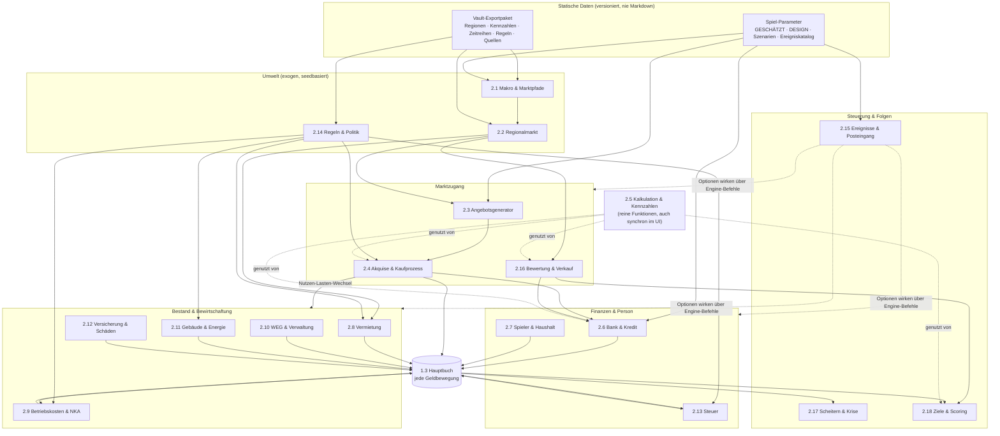

# 02 – Simulationsmodell: verbindliche Architektur- und Fachspezifikation von `packages/sim-core`

| | |
|---|---|
| Stand | 26.11.2026 |
| Status | Entwurf v1 zur Abnahme – nach Abnahme **verbindlich** für P0–P9 |
| Geltungsbereich | Simulationskern (`packages/sim-core`), Datenvertrag zum Exportpaket, Balancing-Werkzeuge (`tools/`) |
| Fachquellen (nicht neu recherchiert, sondern zusammengeführt) | `docs/research/10-…` (Finanzierung, Bank, Kennzahlen) · `11-…` (Steuern, Recht, Regeln) · `12-…` (Bewirtschaftung) · `13-…` (Akquise, Markt, Gebiete) · `14-…` (Fallstudien, Strategie, Kalibrierung) · `20-…` (Marktwerte Nov. 2026, Rechtsänderungen, Datenquellen) · `22-…` Abschn. 3 (sim-core-Technik) · `01-…` Abschn. 4 und 7 (Fehler des Prototyps) |
| Nicht Gegenstand | UI-Gestaltung, Komponenten, Routing, Store (eigene Planteile) |

---

## Lesehinweise

**Verweise.** „→ 10 §2.4“ bedeutet: Dokument `docs/research/10-ic-finanzierung-wirtschaftlichkeit.md`, Abschnitt 2.4.
Detailformeln stehen dort; hier stehen die **verbindlichen Modellentscheidungen**, Schnittstellen und zentralen Formeln.

**MUSS / SOLL / KANN.** „MUSS“ ist verbindlich, „SOLL“ ist der Standard, von dem nur mit ADR abgewichen wird,
„KANN“ ist eine Option.

**Status-Flags** (gelten für jeden Parameter, jede Regel, jede Kennzahl und jede Ereigniswahrscheinlichkeit):

| Flag | Kürzel | Bedeutung | Herkunft | UI-Badge |
|---|---|---|---|---|
| BELEGT | `[BEL]` | Wert steht im IC-Vault mit Quelle und Stand (Sicherheit A/B/C wird mitgeführt, z. B. `[BEL·C]`) | nur aus dem Vault-Exportpaket | „belegt · Stand … · Quelle …“ |
| ABGELEITET | `[ABG]` | aus belegten Werten nachgerechnet oder aus belegten Zeitreihen geschätzt (Rechenweg gespeichert) | Vault-Export oder Spiel-Tool (`tools/calibrate-*`) | „abgeleitet · Rechenweg“ |
| GESCHÄTZT | `[GES]` | Platzhalter für eine **reale** Größe, die nicht belegt ist (Lücke) | Spiel-Repo, `params/geschaetzt/` | „geschätzt“ (auffällig) |
| DESIGN | `[DES]` | reine Spielmechanik, keine Aussage über die Realität (z. B. Aktionspunkte) | Spiel-Repo, `params/design/` | „Spielmechanik“ |

**Übersetzung der Research-Marker:** Vault-Wert → `[BEL]`; „[R]“/„ABGELEITET“/Nachrechnung → `[ABG]`;
„LÜCKE“ mit Platzhalter für eine reale Größe → `[GES]`; „ANNAHME (Design)“/„DESIGN“ für reine Mechanik → `[DES]`;
„ANNAHME“ für eine reale Größe → `[GES]`.

**Sonderfall Web-Recherche (Dok. 20).** Werte, die nur in Dok. 20 stehen (z. B. ESt-Tarif-Eckwerte 2026, BEG-Reform 2026,
Mietpreisbremse „+10 %“), sind fachlich gut gestützt, aber **noch nicht im Vault**. Weil der Vault die einzige Quelle der Wahrheit
ist, laufen sie im Spiel als `[GES]` mit dem Zusatz „extern belegt, Vault-Übernahme ausstehend“. Notation in diesem Dokument:
`[WEB→W]`. Mit der Übernahme durch den Strang W werden sie automatisch `[BEL]` (siehe 1.7).

**Phasen-Tags:** P0 Fundament · P1 Rechenkern · P2 Daten & Regionen · P3 Vertical Slice „Die erste Wohnung“ ·
P4 Bewirtschaftung & Steuern · P5 Skalierung & Finanzen · P6 Lernen & Szenarien · P7 Profi-Inhalte · P8 Release Web ·
P9 Mobile · W Wissens-Härtung (parallel).

**Lücken-IDs:** `LR-nn` verweist auf das Lücken-Register (Abschnitt 5). Vault-Lücken-IDs der Research-Dokumente
(z. B. „L-03“ aus Dok. 12) stehen dort in der Spalte „Herkunft“.

### Leitplanken (gelten für alle Engines)

1. **Deterministisch:** gleicher Seed + gleiches Datenpaket + gleiche Befehle ⇒ bitgleicher Zustand auf allen Engines
   (V8, JavaScriptCore, SpiderMonkey). Geld als Integer-Cent, Sätze in Basispunkten, keine `Math.pow/exp/log`, kein `Date`,
   kein `Math.random` im Kern (→ 22 §3.2–3.3).
2. **Eine Wahrheit je Größe:** ein Hauptbuch für Geld (1.3), ein Wertmodell für Immobilien (2.16), ein Regelauflöser für
   Recht (2.14). Der Prototyp scheiterte an drei Wertmodellen und an Geld ohne Buchungen (→ 01 §3.8, §6.1).
3. **Erklärbar:** Jede angezeigte Kennzahl kann ihren Rechenweg mit Eingabewerten, Status und Quelle liefern (1.8).
4. **Information kostet:** Verdeckte Merkmale werden nur durch Handlungen mit Zeit- oder Geldkosten sichtbar (1.9).
5. **Die Bank ist ein System, kein Würfel:** Kreditentscheidungen sind deterministisch und begründet (2.6).
6. **Werte können fallen:** Kein Preis, keine Miete, kein Bankparameter hat eine eingebaute Aufwärtsgarantie (2.1, 3).
7. **Recht als Daten:** Regionale und zeitabhängige Regeln kommen aus Regeldaten mit Gültigkeit, nicht aus Code-Konstanten (2.14).
8. **Lücken sind sichtbar:** Nichts Geschätztes wird als Fakt angezeigt; jede Lücke hat ein Ziel im Strang W (5).
9. **Kein Survivorship-Bias:** Realistische Risiken führen in einem messbaren Anteil der Läufe zu Zuzahlung, Notverkauf oder
   Scheitern (→ 14 §5.3 S10).
10. **Leistungsbudget (Ziel, [DES]):** `advance(1)` mit 50 Objekten / 250 Einheiten < 5 ms im Worker;
    ein Monte-Carlo-Lauf über 480 Monate < 2 s in Node.

---

## 0. Überblick

### 0.1 Domänenkarte



Lesart: Die Umwelt (Makro, Region, Regeln) läuft unabhängig vom Spieler. Der Spieler greift über Befehle in Marktzugang,
Finanzen und Bestand ein. Alle Geldflüsse laufen durch das Hauptbuch; Steuer, Nebenkostenabrechnung, Krise und Scoring lesen
ausschließlich daraus.

### 0.2 Modul-Layout von `packages/sim-core/src`

```
sim-core/src/
├─ kernel/        Grundtypen & Werkzeuge ohne Fachwissen
│   ├─ money.ts        Cents, Bp, mulBp, roundHalfAwayFromZero, floorToEuro
│   ├─ detmath.ts      powInt, expDet, lnDet, sqrt (nur IEEE-Grundoperationen)
│   ├─ rng.ts          zählerbasierter PRNG, Verteilungen (1.6)
│   ├─ calendar.ts     MonthIndex, Quartal, Steuerjahr, Fristrechnung in Monaten
│   ├─ ids.ts          typisierte IDs, deterministische ID-Vergabe
│   ├─ explain.ts      Tracer/Erklaerung (1.8)
│   └─ result.ts       Result/Validierung, Begründungscodes
├─ params/        Parameter-Registry, Status-Flags, Auflösung nach Zeit/Region, Rechtsjahrgänge (1.7)
├─ world/         Datenpaket-Typen + Lookups: Gebiete (ARS), Struktur, Kennzahlen mit Schätzkaskade, Zeitreihen
├─ rules/         Regelauflösung (Präfix, Vorrang, Stichtag, Objektart), Regel-Effekte, Politik-Ereignisphasen (2.14)
├─ ledger/        Konten, Buchungen, Buchungsarten, Invarianten, Monats-/Jahresaggregate (1.3)
├─ macro/         nationale Pfade: historisches Replay, Regime-Modell, Schocks, Szenario-Overrides (2.1)
├─ region/        Kreis-Indizes, Gemeinde-Offsets, Mikrolage, Vergleichsmiete, Leerstand, Prognose-Zeitung (2.2)
├─ calc/          reine Finanzmathematik & Kennzahlen K01–K35, Kaufnebenkosten, Annuität, Kaskade (2.5)
├─ valuation/     EIN Wertmodell (wertKern) mit Sichten: wahr, Spieler, Gutachter, Beleihung (2.16, Teil 1)
├─ offers/        Angebotsgenerator, Exposé-Schönung, Konkurrenz, Verfall, Off-Market (2.3)
├─ acquisition/   Kaufprozess-Automat, Aufdeckung, Verhandlung, Notar, Nutzen-Lasten-Wechsel (2.4)
├─ sale/          Verkaufsprozess, Notverkauf, Zwangsversteigerung (2.16, Teil 2)
├─ bank/          Bankprofile, Kreditprüfung P0–P9, Konditionen, Darlehen, Anschluss, Sondertilgung, Dispo (2.6)
├─ player/        Haushalt, Einkommen, Lebenshaltung, Rechtsträger (privat/GmbH/Holding), Zeitbudget, Wissen, Netzwerk (2.7)
├─ lease/         Mieter-Automat, Bewerber, Mietverträge, Mieterhöhung, Zahlungsstörung, Kündigung, Kaution (2.8)
├─ opex/          Betriebskosten-Positionen, Umlage-Prüfkette, Heizkosten, CO₂, NKA, Fristen (2.9)
├─ weg/           WEG, Wirtschaftsplan, Hausgeld, Rücklage, Sonderumlage, ETV, Verwalter/SEV (2.10)
├─ building/      Bauteilmodell, Alterung, Ausfälle, Energie, Maßnahmen/Projekte, GModG, Förderung (2.11)
├─ insurance/     Policen, Gefahren, Schadenfälle, Obliegenheiten (2.12)
├─ tax/           Steuerjahr, V+V, AfA, 15-%-Prüfung, § 23, ESt-Tarif, Veranlagung, GmbH/Holding (2.13)
├─ events/        Ereigniskatalog-Laufzeit, Auslöser, Optionen, Folgenvorschau, Posteingang, Fristen (2.15)
├─ crisis/        Liquiditätsüberwachung, Frühwarnung, Rücklastschrift, Eskalation, Verwertung (2.17)
├─ scoring/       Nettovermögen, Meilensteine, Szenario-Bewertung (2.18)
├─ time/          Monats-Pipeline, Zeitplan-Queue (Termine), „Weiter“-Modi, Stoppbedingungen (1.5)
├─ commands/      Befehlskatalog, Validierung, Dispatch, Undo-Barrieren (1.4)
├─ projection/    View-Models, Erklärungen, Vorschau/Was-wäre-wenn (1.8)
├─ save/          Snapshot, Befehls-Log, Keyframes, Migrationen, kanonische Serialisierung, Hash (1.10)
└─ index.ts       öffentliche SimApi
```

### 0.3 Abhängigkeitsrichtung

```
L7  index.ts · projection/ · save/
L6  time/ · commands/
L5  events/ · crisis/ · scoring/
L4  offers/ · acquisition/ · sale/ · bank/ · player/ · lease/ · opex/ · weg/ · building/ · insurance/ · tax/
L3  calc/ · valuation/                       (zustandsfrei: Eingaben → Ergebnis + Erklärung)
L2  macro/ · region/ · rules/ · ledger/
L1  params/ · world/
L0  kernel/
```

- **MUSS:** Importe nur nach unten. Zyklen verboten. CI prüft das (dependency-cruiser oder Biome-Importregeln; → 22 §9).
- **MUSS:** Engines derselben Ebene L4 importieren voneinander **nur** die exportierten Selektoren (`<engine>/select.ts`,
  rein lesend) und Typen. Schreiben dürfen sie nur den eigenen Teilbaum des Zustands, Geld nur über `ledger.post()`,
  Folgen für andere Engines nur über **Domain-Events** an die Pipeline (z. B. `MIETVERTRAG_BEENDET` → `opex` stellt
  Zwischenablesung ein).
- **MUSS:** `calc/` und `valuation/` sind reine Funktionen ohne Zustandszugriff; sie sind die einzigen Module, die das UI
  synchron im Main-Thread aufrufen darf (Live-Rechnung in Formularen, → 22 §3.1).
- **Engine-Vertrag** (jede L4/L5-Engine):

```ts
interface Engine {
  id: EngineId;                                       // 'lease', 'bank', …
  schritte: Partial<Record<PipelineSchritt, (ctx: SchrittKontext) => void>>; // 1.5
  befehle: Partial<Record<CommandType, CommandHandler>>;                     // 1.4
  reaktionen: Partial<Record<DomainEventType, (ctx: SchrittKontext, e: DomainEvent) => void>>;
  invarianten: Array<(s: GameState) => InvariantVerletzung | null>;          // 3
}
interface SchrittKontext {
  readonly s: Readonly<GameState>;      // Lesesicht (vor dem Schritt)
  draft: Draft<GameState>;              // lokale Kopie, nur eigener Teilbaum beschreibbar (Dev-Proxy prüft)
  monat: MonthIndex;
  rng: RngFabrik;                       // 1.6
  p: ParamSicht;                        // 1.7, bereits für Monat/Region auflösbar
  regeln: RegelSicht;                   // 2.14
  ledger: LedgerSchreiber;              // 1.3
  emit(e: DomainEvent): void;           // an Pipeline und Chronik
  post(n: Nachricht): void;             // Posteingang (2.15)
  plane(t: Termin): void;               // Zeitplan-Queue (1.5)
}
```

- **Öffentliche API** (verfeinert gegenüber → 22 §3.7; Fachbegriffe deutsch, technische Verben englisch):

```ts
export interface SimApi {
  newGame(input: NeuesSpiel, daten: DatenPaket): GameState;
  validate(s: GameState, cmd: Command): Validierung;              // ohne Anwendung (Buttons, Formulare)
  apply(s: GameState, cmd: Command): ApplyResult;                 // validiert + wendet an + Events
  advance(s: GameState, modus: WeiterModus): AdvanceResult;       // 1.5
  undo(s: GameState): GameState | UndoVerweigert;                 // 1.10
  preview(s: GameState, plan: WasWaereWenn): Projektion;          // nie mit Spiel-RNG (1.6, 1.9)
  project<K extends ProjektionsTyp>(s: GameState, k: K, a: ProjArgs<K>): ViewModel<K>;
  explain(s: GameState, ref: KennzahlRef): Erklaerung;            // 1.8
  hash(s: GameState): { gesamt: string; jeEngine: Record<EngineId, string> };
  save(s: GameState): SaveEnvelope;  load(e: SaveEnvelope, daten: DatenPaket): GameState | LadeFehler;
}
```

---

## 1. Querschnitt

### 1.1 Grundtypen, Rundung, Kalender

```ts
type Cents  = number & { readonly __b: 'Cents' };  // Integer, Number.isSafeInteger; ±9·10^15 Cent
type Bp     = number & { readonly __b: 'Bp' };     // Basispunkte: 1 bp = 0,01 %; 10_000 = 100 %
type Qm100  = number & { readonly __b: 'Qm100' };  // Fläche in 1/100 m² (Integer)
type CentProQm = number & { readonly __b: 'CentProQm' }; // z. B. 1.862 = 18,62 €/m²
type MonthIndex = number;                          // jahr * 12 + (monat − 1); Nov. 2026 = 24.322
```

- **MUSS:** Zustand, Buchungen und Parameter enthalten nur Integer. Zwischenrechnungen dürfen Float sein (nur `+ − × ÷`,
  `Math.sqrt/floor/round/imul`, `detmath`). Gerundet wird **nur an Buchungsstellen** nach zentral benannten Regeln:

| Buchungsstelle | Regel | Status |
|---|---|---|
| Monatszins Darlehen | `roundHalfAwayFromZero(restschuld × sollzinsBp / 10.000 / 12)` | [DES] (Bankpraxis variiert) |
| Tilgung | `rate − zins`; letzte Rate = Restschuld + Zins | [ABG] → 10 §K22 |
| Miete, Index-/Staffelmiete, Umlage § 559 | Cent, kaufmännisch | [DES] |
| BK-Anteil je Mieter | Cent, kaufmännisch; Rundungsdifferenz trägt der Eigentümer | [DES] |
| Grunderwerbsteuer | auf volle Euro abrunden | [GES] (§ 11 Abs. 2 GrEStG, vom Strang W zu bestätigen, LR-09) |
| Einkommensteuer | zvE und Steuerbetrag auf volle Euro abrunden (`floorToEuro`) | [GES] (§ 32a, LR-21) |
| AfA | Jahresbetrag in Cent; Teiljahr in vollen Monaten (n/12) | [GES] (LR-25) |
| Konto-/Dispozinsen | auf den Monatsend-Saldo | [DES] (Vereinfachung) |

- **Kalender:** Der Kern kennt nur Monate. Tagesgenaue Rechtsfristen werden auf Monate abgebildet; die Abbildung ist je
  Regel dokumentiert. Beispiele: Zugang eines Mieterhöhungsverlangens im Monat *t* ⇒ Wirksamkeit „Beginn des dritten
  Kalendermonats nach Zugang“ = *t+3* (§ 558b BGB, → 12 §1.4); Indexanpassung „übernächster Monat“ = *t+2* (§ 557b);
  Nutzen-Lasten-Wechsel immer am Monatsersten. Quartalstermine (Grundsteuer 15.2./5./8./11., ESt-Vorauszahlung
  10.3./6./9./12.) fallen in den jeweiligen Monat.
- **Zeitmodell:** rundenbasiert, Takt = 1 Monat. Spieleraktionen sind Befehle **zwischen** Monatsabschlüssen.
  Es gibt keine Echtzeit und keine Tagesticks (Lehre aus → 01 §2).

### 1.2 Zustand (GameState-Skizze)

Der Zustand ist **normalisiert** (Entitäten in `Record<Id, …>`), damit 50+ Objekte, Massenaktionen und Teil-Hashes je Engine
effizient sind. Texte stehen nie im Zustand, nur Codes und Parameter (Übersetzung im UI, → 22 §3.6).

```ts
interface GameState {
  meta: {
    schemaVersion: number; rulesVersion: string; dataVersion: string; paramPackHash: string;
    seed: string;                                   // 128 Bit hex
    szenarioId: string; modus: 'FREI' | 'SZENARIO' | 'TUTORIAL';
    schwierigkeit: SchwierigkeitsId; ironman: boolean; lernmodus: boolean;
    startMonat: MonthIndex; endMonat?: MonthIndex;
    eingefroreneParameter: ParamSnapshot;           // 1.7 – aufgelöste Werte, mit denen dieser Spielstand rechnet
  };
  uhr: { monat: MonthIndex; befehlNr: number; undoBarriere: number };
  welt: { regionen: Record<Ars, RegionStatisch> };  // beim Spielstart kopierte, spielrelevante Gebietsparameter (→ 22 §4.3)
  makro: MakroZustand;                              // 2.1
  regionen: Record<KreisArs, RegionZustand>;        // 2.2 (401 Kreise, dynamisch)
  regeln: { politik: Record<PolitikId, PolitikInstanz>; szenarioOverrides: RegelOverride[] }; // 2.14
  markt: { angebote: Record<AngebotId, Angebot>; suchprofile: Record<SuchprofilId, Suchprofil>;
           beobachtet: KreisArs[]; prognosen: Record<PrognoseId, NpcPrognose> };            // 2.3, 2.2
  deals: Record<DealId, Deal>;                      // 2.4 Kaufvorgänge
  verkaeufe: Record<VerkaufId, Verkaufsvorgang>;    // 2.16
  spieler: Spieler;                                 // 2.7 Haushalt, Personen, Zeitbudget, Wissen, Netzwerk
  rechtstraeger: Record<RtId, Rechtstraeger>;       // PRIVAT (1–2 Personen), GMBH, HOLDING (2.7, 2.13)
  konten: Record<KontoId, Konto>;                   // 1.3
  journal: Journal;                                 // 1.3 Buchungen (Detail: laufendes + 2 Vorjahre), Aggregate
  objekte: Record<ObjektId, Objekt>;                // Grundstück + Gebäude + Bauteile (2.11), Lage, Rechtsraum
  einheiten: Record<EinheitId, Einheit>;            // Wohnung/Gewerbe/Stellplatz; SE/GE-Zuordnung
  mietvertraege: Record<MvId, Mietvertrag>;         // 2.8
  mieter: Record<MieterId, Mieter>;                 // 2.8 (sichtbare + latente Merkmale)
  bewerber: Record<BewerberId, Bewerber>;           // 2.8 (nur während Vermarktung)
  wegs: Record<WegId, Weg>;                         // 2.10 inkl. NPC-Eigentümer, Rücklage, Beschlüsse
  dienstleister: Record<DlId, Dienstleister>;       // Verwaltung, SEV, Handwerker, Gutachter, Anwalt, StB
  projekte: Record<ProjektId, Bauprojekt>;          // 2.11 Renovierung/Modernisierung
  policen: Record<PoliceId, Police>;                // 2.12
  schaeden: Record<SchadenId, Schadenfall>;         // 2.12
  banken: Record<BankId, Bank>;                     // 2.6 Profile (beim Start aus Spannen gezogen)
  kreditantraege: Record<AntragId, Kreditantrag>;
  darlehen: Record<DarlehenId, Darlehen>;
  grundschulden: Record<GsId, Grundschuld>;
  abrechnungen: Record<NkaId, Nebenkostenabrechnung>; // 2.9
  steuer: { jahre: Record<number, Steuerjahr>; verlustvortrag: Record<RtId, Cents>;
            bescheide: Record<BescheidId, Bescheid> };                                // 2.13
  ereignisse: { aktiv: Record<EvInstId, EreignisInstanz>; cooldowns: Record<string, MonthIndex> }; // 2.15
  posteingang: Record<NachrichtId, Nachricht>;
  termine: TerminQueue;                             // 1.5 Zeitplan (wirksame Mietänderungen, Fristabläufe, NLW …)
  krise: Krisenzustand;                             // 2.17
  ziele: { meilensteine: Record<MeilensteinId, MeilensteinStatus>; checkpointsGenutzt: number }; // 2.18
  historie: KennzahlenHistorie;                     // spaltenorientiert: Monatswerte je Objekt/Portfolio (Int32)
  wissen: Record<WissensKey, Wissensstand>;         // 1.9 – was der Spieler über verdeckte Merkmale weiß
}
```

Verdeckte Merkmale liegen **im selben Entitätsobjekt** unter `wahr` (z. B. `Angebot.wahr`, `Mieter.latent`,
`Bauteil.zustandWahr`); die Sicht des Spielers ergibt sich nur aus `wissen` (1.9). `projection/` erhält keinen Zugriff auf
`wahr`-Felder (Typ-Trennung, 1.9).

### 1.3 Hauptbuch (Ledger) – die eine Wahrheit für Geld

Jede Geldbewegung ist eine **Buchung**. Kontostände sind die Summe der Buchungen. Cashflow-Kaskade (Ist), Steuer
(Zufluss/Abfluss), Nebenkostenabrechnung, Kontoauszug und Scoring lesen ausschließlich das Hauptbuch.

```ts
interface Buchung {
  id: BuchungId; monat: MonthIndex; konto: KontoId; gegen: KontoId | 'EXTERN';
  betrag: Cents;                      // Vorzeichen aus Sicht von `konto`
  art: BuchungsArt;                   // steuert alle Auswertungen (Tabelle unten)
  rt: RtId;                           // Rechtsträger (privat / GmbH / Holding) – getrennte Kassen
  objekt?: ObjektId; einheit?: EinheitId; mv?: MvId; darlehen?: DarlehenId; projekt?: ProjektId;
  betrkvNr?: BetrKVNr;                // bei Betriebskosten: Position § 2 BetrKV
  ustAnteil?: Cents;                  // für 15-%-Prüfung „netto“ (2.13)
  ursache: UrsacheRef;                // Befehl, Pipeline-Schritt, Ereignis → für Erklärung & Chronik
}
```

| Kontoklasse | Beispiele | Hinweis |
|---|---|---|
| liquide (Aktiva) | Girokonto privat, Tagesgeld, Depot (Kurswert), GmbH-Konto | Dispo nur am Girokonto |
| Treuhand | Kautionskonto je Mietvertrag | **nie** Spielerliquidität (INV-24) |
| Forderungen | Mietrückstände, Erstattungsansprüche (Steuer, Versicherung), Stundungen | für Scoring und Krise |
| Verbindlichkeiten | Darlehen (Restschuld), offene Rechnungen, Steuerschulden | Darlehen werden nur von `bank/` gebucht |
| kalkulatorisch | „Rücklagen-Unterkonto“ (freiwillig vom Spieler gebildet) | reine Umbuchung, kein Aufwand |

**Buchungsarten** (Auszug; vollständiger Katalog in `ledger/arten.ts`). Jede Art trägt drei Klassifikationen:

| BuchungsArt | Cashflow-Stufe (→ 10 §1.7) | Steuer (→ 11 §1.1–1.3) | Umlage (→ 12 §2) |
|---|---|---|---|
| MIETE_KALT | operativ | Einnahme V+V (Zufluss) | – |
| BK_VORAUSZAHLUNG, BK_NACHZAHLUNG_EIN | operativ (durchlaufend) | Einnahme V+V | Gegenstück NKA |
| BK_GUTHABEN_AUS | operativ | Einnahme mindernd | NKA |
| BK_LIEFERANT (je BetrKV-Nr.) | operativ | WK sofort | Prüfkette 2.9 |
| HAUSGELD_UMLAGEF / HAUSGELD_NICHT_UMLAGEF | operativ | WK sofort | Übersetzung 2.10 |
| HAUSGELD_RUECKLAGE_ZUFUEHRUNG | operativ | **[GES]** nicht sofort abziehbar (LR-31) | nie |
| SONDERUMLAGE | operativ | nach Verwendung (Erhaltung/Modernisierung) | nie |
| VERWALTUNG, VERMARKTUNG, RECHTSKOSTEN | operativ | WK sofort | nie |
| INSTANDHALTUNG | operativ | WK sofort **oder** 15-%-Fall | nie |
| MODERNISIERUNG, ANSCHAFFUNG_GEBAEUDETEIL | Investition | 15-%-Prüfung / Herstellungskosten | § 559-Basis |
| VERSICHERUNG_PRAEMIE / _LEISTUNG | operativ | WK / Einnahme | Nr. 13 wenn umlagefähig |
| GRUNDSTEUER | operativ | WK sofort | Nr. 1 |
| ZINS_DARLEHEN, BEREITSTELLUNGSZINS | Finanzierung | WK sofort | nie |
| TILGUNG, SONDERTILGUNG | Finanzierung | nicht abziehbar | nie |
| VORFAELLIGKEITSENTSCHAEDIGUNG | Finanzierung | **[GES]** Veräußerungskosten (LR-29) | nie |
| KAUFPREIS (Gebäude/Boden getrennt) | Investition | AK Gebäude → AfA / AK Boden | nie |
| GREST, NOTAR_GRUNDBUCH, MAKLER_KAUF | Investition | **[GES]** anteilig AK (LR-24) | nie |
| VERKAUFSERLOES, VERKAUFSKOSTEN | Investition | § 23 / GmbH-Gewinn | nie |
| GEHALT_NETTO, LEBENSHALTUNG, EIGENE_WOHNKOSTEN | privat | außerhalb V+V | – |
| EST_NACHZAHLUNG / EST_ERSTATTUNG, KST, GEWST | Steuer | – | – |
| DISPOZINS, GUTHABENZINS | privat | privat / Kapitalerträge [DES: nicht besteuert] | – |
| KAUTION_EIN / KAUTION_AUS | Treuhand | neutral | – |
| FOERDERZUSCHUSS | Investition | mindert AK/Erhaltungsaufwand [GES] | mindert § 559-Basis |

**Invarianten (MUSS, nach jedem Befehl und jedem Pipeline-Schritt im Dev-/Test-Modus):**
Σ Buchungen je Konto = Saldo; jede Buchung hat genau eine BuchungsArt und einen Rechtsträger; Geld entsteht nur über
definierte externe Quellen (Gehalt, Miete, Darlehensauszahlung, Verkauf, Erstattung, Förderung, Versicherungsleistung);
Treuhandkonten fließen nie in Liquiditätskennzahlen.

### 1.4 Befehle

**Lebenszyklus:** `validate` (Ressourcen, Zustand, Recht) → bei Fehler `Validierung{ok:false, gruende:[Code…]}` mit
erklärbaren Gründen → `apply` (Zustandsänderung, Buchungen, Termine, Domain-Events) → Eintrag im Befehls-Log.
Jeder Befehl hat Kosten in **Aktionspunkten (AP, [DES], 2.7)** und ggf. Geld. Befehle mit **Informationsgewinn** oder
**Gegenreaktion eines Akteurs** (Besichtigung, Gutachten, Kaufangebot, Bankanfrage, Mieterhöhungsverlangen) sind
`irreversibel` und setzen eine **Undo-Barriere** (1.10) – sonst wäre Information per Undo gratis (INV-06).

```ts
interface CommandBase { type: CommandType; id: CmdId; monat: MonthIndex; }   // id deterministisch: monat + befehlNr
interface CommandDef<C> {
  validate(s: GameState, c: C, p: ParamSicht): Validierung;
  apply(ctx: SchrittKontext, c: C): void;
  kosten(s: GameState, c: C): { ap: number; geld: Cents };
  irreversibel: boolean | ((s: GameState, c: C) => boolean);
  phase: Phase;
}
```

**Befehlskatalog** (Auszug, verbindlich als Mindestumfang je Phase; Details im jeweiligen Engine-Abschnitt):

| Bereich | Befehl | Validierung (Auszug) | Effekte | AP/Geld | Undo | Phase |
|---|---|---|---|---|---|---|
| Suche | `regionBeobachten(ars)` / `regionEntfernen` | max. N beobachtete Kreise [DES]; Gebiet bewohnt | Angebotsstrom für Region startet nächste Runde | 0 | ja | P3 |
| Suche | `suchprofilSetzen(profil)` | Objektarten freigeschaltet | filtert Angebote, steuert Off-Market-Hinweise | 0 | ja | P3 |
| Suche | `angebotVerwerfen(id, begruendung)` | – | Entscheidungslog (Meilenstein „begründete Absage“) | 0 | ja | P3 |
| Akquise | `dealStarten(angebotId)` | Angebot aktiv | Deal in SICHTUNG | 0 | ja | P3 |
| Akquise | `pruefschritt(dealId, schritt)` | Reihenfolge-Gates (2.4), AP, Geld | deckt Merkmale gemäß Aufdeckungsmatrix auf | je Schritt | **nein** | P3 |
| Akquise | `kaufangebot(dealId, preis, bedingungen)` | Unterlagen-/Finanzierungsstand frei wählbar (Risiko trägt Spieler) | Verkäuferreaktion nächste Runde (2.4) | 1 AP | **nein** | P3 |
| Akquise | `kaufvertragGestalten(dealId, aufteilung, inventar, nlw)` | Einigung erzielt | Vertragsentwurf; Aufteilung → Steuer | 1 AP | ja | P3/P4 |
| Akquise | `beurkunden(dealId)` | Liquidität für KNK; Warnung ohne Zusage | KNK fällig, Fristen starten | 1 AP | **nein** | P3 |
| Akquise | `dealAbbrechen(dealId, grund)` | vor Beurkundung frei; danach Rücktrittsfolgen | Deal ABGELEHNT/Vertragsstrafe | 0 | nein | P3 |
| Bank | `kreditanfrage(ziel, banken \| 'VERMITTLER', wunsch)` | Unterlagen (Rückfrage sonst) | Entscheidung nach Bearbeitungsdauer (2.6) | 2/1 AP | **nein** | P3 |
| Bank | `kreditangebotAnnehmen(angebotId)` | Angebot gültig | Darlehen + Grundschuld angelegt, Auszahlung bei Fälligkeit | 1 AP | ja (vor Auszahlung) | P3 |
| Bank | `sondertilgung(darlehenId, betrag)` | ≤ Sondertilgungsrecht; sonst nur mit VFE | Restschuld ↓ | 0 | ja | P3/P5 |
| Bank | `anschlussWaehlen(darlehenId, option)` | Fenster offen (2.6) | Prolongation/Umschuldung/Forward/Ablösung | 1 AP | ja | P5 |
| Bank | `nachbeleihung(objektId, betrag)` | freier Beleihungsraum; Haushaltsrechnung | neues Darlehen [GES-Mechanik] | 2 AP | **nein** | P5 |
| Bank | `bonitaetPflegen(aktion)` | – | SCHUFA prüfen, Dispo/Kreditkarte kündigen (Haushaltsrechnung) | 1 AP | ja | P3 |
| Vermietung | `inserieren(einheitId, miete, mietart, klauseln)` | Mietpreisbremse/§ 5 WiStrG (Warnung/Block) | Einheit INSERIERT | 1 AP | ja | P3 |
| Vermietung | `bewerberPruefen(id, pruefungen[])` | Einwilligung (DES), AP | deckt Merkmale auf | 0,5 AP je Prüfung | **nein** | P3 |
| Vermietung | `mietvertragSchliessen(einheitId, bewerberId, vertrag)` | Obergrenzen, Kaution ≤ Grenze | Vertrag, Mietbeginn-Termin | 1 AP | ja | P3 |
| Vermietung | `mieterhoehung(mvId, art, betrag, begruendung)` | Fristen, Kappung, Mietart (2.8) | Verlangen zugestellt, Antwort t+2 | 1 AP | **nein** | P4 |
| Vermietung | `mahnen / stundungVereinbaren / kuendigen / raeumungsklage(mvId, …)` | Rückstand, Stufe, Rechtslage | Eskalationspfad (2.8) | 0,5–2 AP + Kosten | **nein** | P4 |
| Betrieb | `nkaErstellen(objektId, jahr)` / `nkaDelegieren` | Periode abgeschlossen | Abrechnung, Zugang, Fristen (2.9) | 3 AP / Gebühr | **nein** | P4 |
| Betrieb | `vorauszahlungAnpassen(mvId, betrag)` | nach Zugang NKA | ab nächstem Monat | 0,5 AP | ja | P4 |
| Betrieb | `verwaltungBeauftragen(objektId, rolle, dlId)` / `kuendigen` | Vertragslaufzeit [DES] | Delegationsmatrix (2.10) | 1 AP | ja | P4 |
| WEG | `wegAbstimmen(beschlussId, stimme)` | ETV offen | Stimme nach MEA (2.10) | 1 AP | ja (bis ETV) | P4 |
| Gebäude | `massnahmePlanen / angeboteEinholen / beauftragen(projekt)` | Duldung/Ankündigung (2.11), Liquidität | Projekt, Kosten, Dauer, Umlagebasis | 1–2 AP | Beauftragung **nein** | P4 |
| Gebäude | `modernisierungAnkuendigen / umlageErklaeren(projektId)` | § 559-Voraussetzungen, Kappung | Mieterhöhung zum Termin | 1 AP | **nein** | P4 |
| Versicherung | `policeAbschliessen / kuendigen / schadenMelden` | Objekt, Deckung | Prämie, Deckung, Regulierung | 0,5–1 AP | ja / **nein** | P4 |
| Steuer | `steuererklaerungAbgeben(jahr, mitStB)` | Jahr abgeschlossen | Bescheid nach Bearbeitungsdauer (2.13) | 3 AP / Honorar | **nein** | P4 |
| Steuer | `rndGutachten`, `gmbhGruenden`, `ausschuetten`, `kuerzungBeantragen` | Freischaltung | 2.13 | variabel | **nein** | P7 |
| Verkauf | `verkaufStarten(objektId, kanal, preis)` / `preisAendern` / `angebotAnnehmen` / `abbrechen` | Objekt im Bestand, keine Sperre | Verkaufsprozess (2.16) | 1 AP | Annahme **nein** | P5 |
| Spieler | `umbuchen(von, nach, betrag)`, `lebenshaltungAnpassen`, `depotVerkaufen` | Grenzen [DES] | Liquidität | 0 | ja | P3 |
| Spieler | `weiterbildung(modul)`, `netzwerkPflegen(kontakt)`, `nebenjob(an/aus)` | Geld/AP | Wissen, Netzwerk, Einkommen | variabel | ja | P5 |
| Ereignis | `ereignisoption(instanzId, optionId)` | Option zulässig, Frist offen | Folgen laut Katalog (2.15) | laut Option | laut Option | P3 |
| Meta | `checkpointSetzen()` | nur Lernmodus | Keyframe (1.10) | 0 | – | P6 |

### 1.5 Monats-Pipeline

Ein Aufruf „Weiter“ führt für den aktuellen Monat *t* den **Abschluss** (Teil A: Flüsse und Zustände von *t*) und danach die
**Eröffnung** von *t+1* (Teil B: neue Umwelt, Termine, Angebote, Posteingang) aus. Der Zustand „Monat *t*“ ist also immer:
Umwelt von *t* bekannt, Entscheidungsfenster offen. Die Reihenfolge ist **verbindlich** und Teil der `rulesVersion`.

**Teil A – Abschluss Monat t**

| Nr. | Schritt | Engine | Inhalt | RNG-Strom |
|---|---|---|---|---|
| A01 | Einkommen & Lebenshaltung | player | Nettogehalt(er), sonstige Einkünfte, Lebenshaltung, eigene Wohnkosten, bestehende Privatkredite | `PLAYER` |
| A02 | Mieteingänge | lease | je Mietvertrag Sollmiete + BK-Vorauszahlung → Zahlungswurf nach Mieterzustand → Ist-Buchung, Rückstände | `PAYMENT` |
| A03 | Objekt- & Betriebskosten | opex, weg, insurance | Hausgeld, BK an Versorger, nicht umlagefähige Kosten, Verwaltung, fällige Prämien, Grundsteuer (Feb/Mai/Aug/Nov), Leerstandsanteile | – |
| A04 | Gebäude | building, insurance | Alterung, Ausfall-/Schadenswürfe, Projektfortschritt + Abschlagszahlungen, Schadenregulierung | `BUILDING`, `INSURANCE` |
| A05 | Kapitaldienst | bank | Zins, Tilgung, Bereitstellungszins, Sondertilgungen, Auszahlungen fälliger Darlehen | – |
| A06 | Mieter-Lebenszyklus | lease | Fluktuation/Kündigungen, Verzugseskalation, Vermarktung → Bewerber, Auszüge, Kautionsabrechnung | `TURNOVER`, `TENANT` |
| A07 | Kaufvorgänge | acquisition, bank | Fortschritt, Verkäuferreaktionen, Wegkauf durch Konkurrenz, fällige Bankentscheidungen, Kaufpreisfälligkeit | `NEGOTIATION`, `COMPETITION`, `BANK` |
| A08 | Verkaufsvorgänge | sale | Interessenten, Gebote, Vollzug, Darlehensablösung | `SALE` |
| A09 | WEG | weg | ETV-Termine, Beschlüsse, Sonderumlagen, Jahresabrechnung (Saison) | `WEG` |
| A10 | Ereignisse | events, rules | Hazard-/Zustands-/Timer-Auslöser, Politik-Phasen, Ereignisinstanzen erzeugen | `EVENTS`, `POLICY` |
| A11 | Steuerzahlungen | tax | fällige Bescheide, Vorauszahlungen (Mrz/Jun/Sep/Dez), GmbH-Steuern | – |
| A12 | Kontozinsen | ledger, bank | Guthabenzins, Dispozins auf Monatsend-Saldo | – |
| A13 | Liquidität & Krise | crisis | Dispo-Grenze, Rücklastschriften nach Priorität, Mahnstufen, Frühwarnstufe, Verwertungsfolgen | `CRISIS` |
| A14 | Monatsabschluss | ledger, scoring | Invarianten, Monatsaggregate (Historie), Meilensteine, Monatsbericht | – |
| A15 | **nur Dezember:** Jahresabschluss *j* | tax, opex, weg, building, scoring | Steuerjahr vorläufig schließen (AfA, 15-%-Prüfung, § 23-Freigrenze), NKA-Perioden schließen → Aufgaben, WEG-Jahresabrechnung planen, Bauteilplan, Jahres-Meilensteine, Keyframe | – |

**Teil B – Eröffnung Monat t+1**

| Nr. | Schritt | Engine | Inhalt | RNG-Strom |
|---|---|---|---|---|
| B01 | Kalender & Rechtsstand | time, rules, params | `monat = t+1`; im Januar neuen Rechtsjahrgang laden; Regeln mit `gueltig_ab = t+1` aktivieren; Politik-Phasenwechsel | `POLICY` |
| B02 | Makro | macro | nationaler Pfad *t+1* (Replay oder Modell) | `MACRO` |
| B03 | Regionen | region | Kreis-Indizes *t+1*, Vergleichsmiete, Leerstand, Prognose-Zeitung | `REGION` |
| B04 | Bankkonditionen | bank | Basiszinsen je Bindung, Spreads, zyklische Profilparameter | `BANK` |
| B05 | **nur Januar:** Jahreseröffnung | player, bank, lease, tax | Gehaltsanpassung, Lebenshaltung indexieren, Sondertilgungsrechte erneuern, Steuererklärungs-Aufgabe *j−1*, II.-BV-/Pauschalen laut Jahrgang | `PLAYER` |
| B06 | Termine | time (alle) | fällige Termine aus der Queue in fester Ordnung: Wirksamkeiten (Miete, Umlage, Vorauszahlung) → Vertragsbeginne/-enden → Zinsbindungsenden (Standardoption) → NLW → Fristabläufe (Standardoptionen) | – |
| B07 | Angebotsmarkt | offers | Verfall, Preissenkungen, neue Angebote je beobachteter Region und Suchprofil, Off-Market-Hinweise | `OFFERS`, `OFFER_TRUTH` |
| B08 | Posteingang & Zeit | events, player | AP-Budget auffrischen, Erinnerungen, offene Entscheidungen, Stoppbedingungen auswerten | – |
| B09 | Sicherung | save | Undo-Snapshot (Monatsanfang), Autosave-Signal | – |

**„Weiter“-Modi.** `{ typ: 'MONAT' }` · `{ typ: 'BIS_EREIGNIS' }` · `{ typ: 'BIS_DATUM', ziel: MonthIndex }`.
Stoppbedingungen nach B08 (jede stoppt jeden Modus außer `MONAT`): neue Nachricht mit `stoppt: true` (Entscheidung mit
Frist ≤ 1 Monat, Kaufvorgang braucht Eingabe, Bankangebot, Bescheid mit Nachzahlung), Frühwarnstufe ≥ ORANGE (2.17),
Szenario-Meilenstein. Nicht stoppende Entscheidungen laufen bis zur Frist und lösen dann ihre **Standardoption** aus
(z. B. Mieterhöhungsfenster ungenutzt = keine Erhöhung; Zinsbindungsende ohne Wahl = variable Anschlusskondition, 2.6).

**MUSS:** `advance(BIS_DATUM, t+n)` ohne Stopp ist bitgleich zu *n* × `advance(MONAT)` (INV-22).

### 1.6 Zufall (RNG-Ströme)

Zählerbasierte Ableitung statt eines fortlaufenden Generators (→ 22 §3.3):

```ts
u = hash128to32(seed, strom, monat, entitaetSchluessel, k) / 2^32   // SplitMix-artig, nur Math.imul/Shifts
```

- **Strom-Registry** (append-only, IDs nie wiederverwenden): `MACRO`, `REGION`, `POLICY`, `OFFERS` (Anzahl/Art neuer
  Angebote), `OFFER_TRUTH` (verdeckte Wahrheit eines Angebots), `EXPOSE` (Schönung), `NEGOTIATION`, `COMPETITION`, `BANK`
  (Profilziehung beim Start, Bearbeitungsdauer), `TENANT` (Bewerber), `PAYMENT`, `TURNOVER`, `BUILDING`, `INSURANCE`, `WEG`,
  `EVENTS`, `TAX_AUDIT`, `SALE`, `PLAYER` (Lebensereignisse, Gehalt), `CRISIS`, `PROGNOSE` (NPC-Prognosefehler), `SETUP`.
- **Schlüsselregel:** Jeder Wurf ist an `(strom, monat, entität, k)` gebunden. Ein neues Objekt verschiebt keine Würfe anderer
  Objekte; neue Ereignistypen verschieben keine anderen Systeme; jeder Monat ist ohne Replay reproduzierbar.
- **Wahrheit vor Blick:** Verdeckte Merkmale eines Angebots werden **bei seiner Erzeugung** aus `OFFER_TRUTH` gezogen
  (Schlüssel `angebotId`) und ändern sich durch Prüfen nicht. Prüfen deckt nur auf.
- **Undo kann nicht neu würfeln:** Gleicher Monat + gleiche Entität + gleicher Zähler ⇒ gleiches Ergebnis (INV-07).
- **Vorschau ohne Spielzufall:** `preview()` und Folgenvorschauen nutzen Erwartungswerte oder einen **eigenen** Vorschau-Seed
  (Hash aus Plan), nie den Spiel-Seed der Zukunft (INV-08).
- **Verteilungen** (`kernel/rng.ts`, nur `detmath`): Bernoulli(p in bp), Gleich, Dreieck(min, modus, max) – Standard für
  `[GES]`-Spannen, PERT, Normal (inverse CDF-Näherung mit `lnDet`/`sqrt`), Lognormal (`expDet`), Poisson (Inversion,
  λ < 30), Kategorial (Gewichte), korrelierte Normale (Cholesky, beim Laden berechnet).

### 1.7 Parameter-Registry, Status und Rechtsjahrgänge

```ts
interface ParamDef<T = number> {
  id: string;                         // 'bank.stresszins', 'lease.fluktuation.etw', 'knk.grest'
  wert: T | ParamZeitreihe<T> | ParamTabelle<T>;   // skalar, zeitabhängig oder je Region/Bank/Objekt
  einheit: Einheit;                   // 'bp' | 'cents' | 'centProQm' | 'monate' | 'jahre' | 'anzahl' | 'ap' | …
  status: 'BELEGT' | 'ABGELEITET' | 'GESCHAETZT' | 'DESIGN';
  sicherheit?: 'A' | 'B' | 'C';       // nur BELEGT/ABGELEITET aus Vault
  quellen: QuellenRef[];              // Vault-Notiz-ID / Q-ID / Datensatz-URI / Research-Abschnitt
  stand?: string;                     // ISO-Datum des inhaltlichen Stands
  gueltigAb?: string; gueltigBis?: string;
  regional?: 'KEIN' | 'LAND' | 'KREIS' | 'GEMEINDE' | 'BANK' | 'OBJEKT';
  spanne?: { min: T; modus?: T; max: T };   // Pflicht bei GESCHAETZT/DESIGN → Sensitivitätsanalyse (4.3)
  herleitung?: string;                // Pflicht bei ABGELEITET: Formel-ID + Eingangs-Param-IDs
  luecke?: string;                    // LR-ID bei GESCHAETZT
  vaultZiel?: string;                 // Zielnotiz/Datei im Vault (Strang W)
  extern?: { dok: '20'; abschnitt: string; sicherheitWeb: 'A' | 'B' | 'C' }; // [WEB→W]
  herkunft: 'VAULT' | 'SPIEL';
}
```

**Zusammenführung (Build-Zeit, `packages/data`):** Vault-Exportpaket (nur `[BEL]`/`[ABG]`) + Spiel-Parameter (`[GES]`/`[DES]`
und vom Spiel kalibrierte `[ABG]`) → `ParamPack` mit Hash. Regeln:

1. Liefert der Vault einen Wert für eine ID, **gewinnt der Vault** immer; der Build meldet „Lücke LR-nn geschlossen“.
2. Ein `[GES]`-Parameter ohne `spanne`, `luecke` und `vaultZiel` bricht den Build.
3. Ein `[BEL]`-Parameter mit `herkunft: 'SPIEL'` bricht den Build (nur der Vault belegt).
4. `[WEB→W]`-Werte sind `GESCHAETZT` mit Feld `extern`; die UI zeigt „extern belegt, Vault-Übernahme ausstehend“.

**Auflösung zur Laufzeit:** `p.get(id, { monat, ars?, bankId?, objektId? })` → Wert + `ParamRef` (für Erklärungen).
Zeitabhängige Werte nach `gueltigAb/Bis`, regionale über die Gebietskette (Gemeinde → Verband → Kreis → Land → DE).

**Versionen – drei Ebenen, sauber getrennt:**

| Ebene | Bedeutung | Wo | Wirkung |
|---|---|---|---|
| `rulesVersion` (z. B. `2026.3`) | Version von Engine-Logik + Pipeline-Reihenfolge + Regelwerk-Code | Save-Envelope | Replay des Befehls-Logs nur innerhalb gleicher `rulesVersion` garantiert (→ 22 §3.6) |
| `paramPackHash` / `dataVersion` | konkrete Parameter- und Datenwerte | Save-Envelope | Ein Spielstand rechnet mit **seinen eingefrorenen Werten** (`meta.eingefroreneParameter`); neues Paket nur auf Wunsch („Spielstand auf neue Daten aktualisieren“ → Log verliert Replay-Garantie) |
| **Rechtsjahrgang** (z. B. `DE-2026`) | in der Spielwelt geltendes Recht eines Steuer-/Rechtsjahres | Daten: `rules/jahrgaenge/<jahr>.json` + datierte Regeln (2.14) | wird im Januar (B01) bzw. zum `gueltig_ab` gewechselt |

Ein **Rechtsjahrgang** bündelt jahresgebundene Werte: ESt-Tarif (Eckwerte, Formel), Soli, Kirchensteuer-Optionen, AfA-Tabelle,
Freigrenze § 23, II.-BV-Sätze, CO₂-Preis bzw. -Korridor, Förderbedingungen, Pauschalen. Datierte regionale Regeln
(GrESt-Satz, Mietpreisbremse, Kappung, Solarpflicht) kommen aus dem Regelauflöser mit Stichtag.

**Jahre ohne belegtes Recht** (Freies Spiel ab 2027, historische Lücken): Jahrgang wird **fortgeschrieben** – Tarif-Eckwerte
mit der simulierten Inflation indexiert, alle anderen Werte konstant – Status `[DES]` „Fortschreibung“; bekannte Vorhaben
(ESt-Reform 2027, Mietrecht II, CO₂ 2027, BEG-Abschmelzung, Ende Mietpreisbremse 2029) laufen als Politik-Ereignisse mit
Ankündigung und Gabelung (2.14). Historische Szenarien brauchen belegte historische Jahrgänge (LR-22, LR-40).

### 1.8 Projektionen und Erklärung

Der Worker liefert dem UI **View-Models**, nie den Gesamtzustand (→ 22 §3.1). Mindestkatalog:

| Projektion | Inhalt | Phase |
|---|---|---|
| `hud` | Datum, Liquidität, Frühwarnstufe, Nettovermögen (Spielersicht), Cashflow Monat, Zins 10 J., AP | P3 |
| `monatsbericht` / `kontoauszug` | Buchungen gruppiert nach Cashflow-Stufe, Objekt, Ursache | P3 |
| `angebotsliste`, `angebotDetail` | nur Exposé + aufgedecktes Wissen mit Wissensstand-Badges | P3 |
| `dealRechner` | Kaufnebenkosten, Kapitalbedarf, Finanzierung, Kaskade Jahr 1, Bierdeckel 1/2, Break-even-Rendite | P3 |
| `bankpruefung` | eigene Rechnung vs. Bankrechnung (P0–P9) mit Begründungscodes | P3 |
| `portfolio` | Tabelle (50+ Objekte): Wert, Restschuld, Beleihung, CF-Stufen, Zinsbindungsende, Leerstand | P3/P5 |
| `objektDetail`, `einheitDetail`, `mieterDetail` | Mietverlauf, Fristen, Rückstände, Bauteilplan | P3/P4 |
| `darlehen` + `zinsbindungskalender` | Tilgungsplan, Restschuld zum Bindungsende, Anschluss-Szenarien | P3/P5 |
| `steuerjahr` | Anlage-V-artige Aufstellung je Objekt, AfA, 15-%-Status, § 23-Fristen | P4 |
| `nka`, `weg`, `bauteilplan` | Abrechnung mit Prüfkette, Hausgeld-Übersetzer, Fälligkeiten | P4 |
| `marktRegion` / `karte` | Kreis-Indizes, Lageklasse, Regeln, Datenpunkt-Badges, Choropleth-Arrays | P2/P3 |
| `posteingang`, `fristen` | Nachrichten, Entscheidungen, Fristenkalender | P3 |
| `risiko` | Liquiditätsreichweite, Stresstests (→ 14 §3.6 Nr. 10), Klumpen, gleichzeitige Bindungsenden | P5 |
| `ziele`, `chronik` | Meilensteine, Score, Ereignisverlauf | P3/P6 |
| `quellen` / `parameter` | Datenquellen & Lizenzen; alle Parameter mit Status | P3/P8 |

**Erklärung (Erklär-Karte der UI).** Jede Kennzahl ist ein `Kennzahl<T>`:

```ts
interface Kennzahl<T> {
  id: KennzahlId; wert: T; einheit: Einheit;
  bezug: 'MONAT' | 'JAHR' | 'STICHTAG';             // Monats- und Jahreswerte nie mischen (→ 10 §0.4)
  art: 'PLAN' | 'IST';                              // Prognose vs. Buchung, immer getrennt
  status: StatusAggregat;                           // schwächstes Glied der Eingaben (s. u.)
  erklaerung?: Erklaerung;                          // lazy: nur auf Anforderung (explain)
}
interface Erklaerung {
  formelId: string;                                 // z. B. 'K26' → 10 §1.7; Formeltext-Key für i18n
  eingaben: Array<{ name: string; wert: number; einheit: Einheit;
                    herkunft: ParamRef | KennzahlRef | ZustandRef | BuchungsSumme;
                    status: Status; wissensstand?: Wissensstand }>;
  schritte: Erklaerung[];                           // Baum, z. B. CF n. Fin. ← op. CF ← Miete, Kosten
  quellen: QuellenRef[]; hinweise: HinweisCode[];   // 'VEREINFACHUNG_OHNE_SOLI', 'LUECKE_LR_21', …
}
```

- **Tracer statt Doppelcode:** Jede `calc/`-Funktion nimmt optional einen `Tracer`. Im Pipeline-Lauf ist er ein No-op
  (keine Kosten); `explain()` ruft dieselbe Funktion mit aufzeichnendem Tracer auf. So kann die Erklärung nie vom Ergebnis
  abweichen.
- **Status-Aggregation:** `BELEGT > ABGELEITET > GESCHAETZT`; das Aggregat ist das Minimum aller Eingaben.
  Zusätzlich Flags `enthaeltDesign` und `enthaeltUnbekannt` (Wissensstand UNBEKANNT/SCHÄTZUNG). Die UI zeigt
  „enthält geschätzte Werte“ bzw. „enthält Spielmechanik“.
- **PLAN vs. IST:** IST-Kennzahlen kommen nur aus dem Hauptbuch; PLAN-Kennzahlen aus `calc/` mit Spielerannahmen.
  Beides nebeneinander ist ein Lernziel (→ 01 §8 Nr. 13).

### 1.9 Sichtbare und verdeckte Wahrheit – Information als Ressource

```ts
type Wissensstand =
  | { stufe: 'UNBEKANNT' }
  | { stufe: 'ANGABE'; quelle: 'EXPOSE' | 'VERKAEUFER' | 'MAKLER' | 'MIETER'; wert: number }      // Parteivortrag
  | { stufe: 'SCHAETZUNG'; spanne: [number, number]; basis: 'REGION' | 'TYP' | 'BESICHTIGUNG' }
  | { stufe: 'GEPRUEFT'; wert: number; genauigkeitBp: Bp; quelle: 'UNTERLAGE' | 'GUTACHTEN'; monat: MonthIndex }
  | { stufe: 'AMTLICH'; wert: number; quelle: 'GRUNDBUCH' | 'BEHOERDE' | 'NOTAR'; monat: MonthIndex };
```

- **Was ist verdeckt?** Bauteilzustände, Feuchte/Übersanierung, wahre Wohnfläche, wahre Ist-Miete und Rückstände,
  latente Mieterqualität, WEG-Rücklage und anstehende Beschlüsse, Grundbuch-/Baulasten, Anliegerbeiträge, Mikrolage-Mängel,
  Reservationspreis und Motiv des Verkäufers, Qualität von Dienstleistern, **die Zukunft** (Makro- und Ereignispfad).
- **Aufdecken kostet** AP und/oder Geld (Aufdeckungsmatrix 2.4, Mieterprüfung 2.8, Gutachten 2.11/2.16). Genauigkeit hängt
  von Wissen und Dienstleisterqualität ab ([DES]).
- **Marktkenntnis je Region** (0–100, [DES]) wächst mit Beobachtungsdauer, Besichtigungen und Bestand vor Ort und verengt die
  Schätzspannen (Lektion „erst vergleichen, dann fokussieren“, → 14 §2.8).
- **MUSS (Leak-Schutz):** `projection/` arbeitet auf einem Typ `SpielerSicht`, der `wahr`-Felder nicht enthält. Property-Test:
  Zustände, die sich nur in verdeckten Werten unterscheiden, liefern identische Projektionen (INV-09). Nettovermögen und
  Portfolio-Werte nutzen den **Spieler-Erwartungswert** (2.16), damit ein plötzlicher Wertsprung keinen verdeckten Mangel verrät.
- **Zukunft bleibt verdeckt:** Auch im historischen Szenario sieht der Spieler nur die Vergangenheit bis *t* (KANN-Option
  „Blindmodus“: Jahreszahlen verfremdet, [DES], P6).

### 1.10 Spielstand, Undo, Checkpoints

- **Format:** Envelope nach → 22 §4.3 (`schemaVersion`, `rulesVersion`, `dataVersion`, `seed`, `snapshot`, `keyframes`,
  `commandLog`, `checksum`). Der Snapshot ist maßgeblich; das Log dient Replay, Debug und Undo.
- **Kanonische Serialisierung:** Schlüssel sortiert, Zahlen als Integer, Records nach ID sortiert → Grundlage von `hash()`
  (SHA-256, gesamt und je Engine-Teilbaum, 4.4).
- **Undo nur im laufenden Monat:** Undo = Monatsanfangs-Snapshot (B09) + Befehle 0…n−1 erneut anwenden. Zurück nur bis zur
  letzten **Undo-Barriere** (irreversibler Befehl, 1.4). Kein Undo über „Weiter“ hinweg.
- **Lernmodus:** Checkpoints (Keyframes) frei setzbar und ladbar; jede Nutzung zählt in `ziele.checkpointsGenutzt` und wird in
  der Bewertung ausgewiesen. **Ironman:** keine Checkpoints, ein Speicherplatz.
- **Keyframes:** automatisch jährlich nach A15 (Zeitreise im Lernmodus, Fehlersuche).
- **Historie:** spaltenorientiert (Int32/Float64-Arrays), Monatswerte der letzten 120 Monate, ältere als Jahreswerte;
  Buchungsdetails für laufendes und zwei Vorjahre (NKA- und Steuerfristen), ältere aggregiert.
- **Migration:** reine Vorwärtsfunktionen je `schemaVersion` mit Fixture-Tests (→ 22 §4.3).
