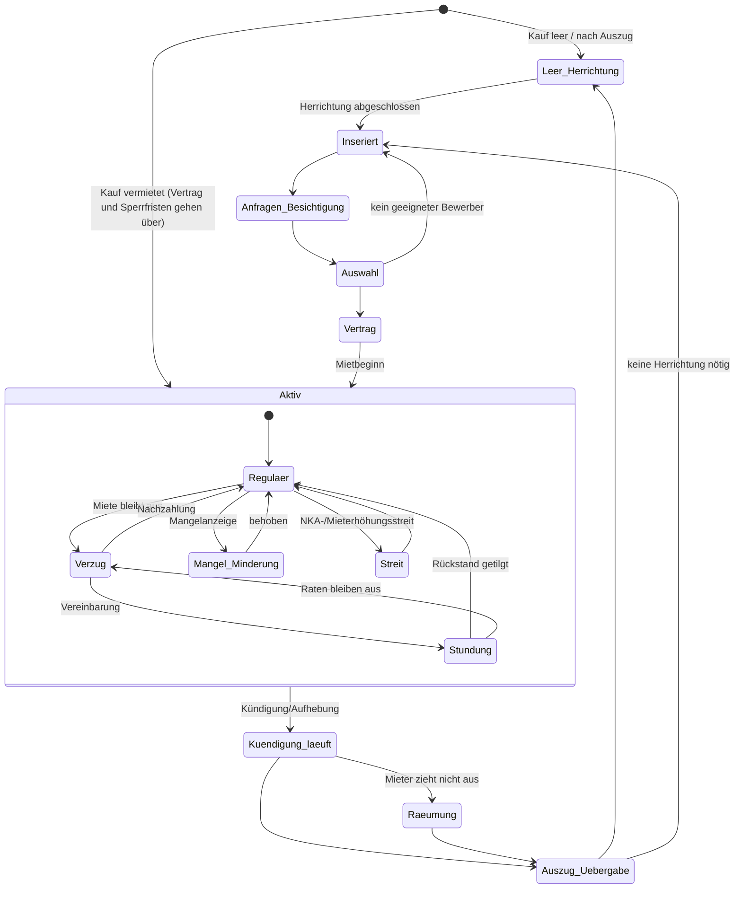

# 12 – Fachspezifikation Bewirtschaftungs-Engine (Vermietung, Verwaltung/WEG, Instandhaltung, Versicherung, Bau & Energie)

> Was passiert nach dem Kauf – Monat für Monat? Diese Spezifikation leitet Zustände, Regeln, Ereignisse
> und Parameter der Bewirtschaftungs-Engine ausschließlich aus dem Obsidian-Vault `/home/user/IC/vault`
> ab. Werte, die der Vault nicht hergibt, sind als **LÜCKE** markiert. Vorschläge für Spielmechaniken
> ohne Vault-Beleg sind als **DESIGN** markiert und müssen im Spiel als Annahme/konfigurierbar erkennbar sein.

| | |
|---|---|
| Ausgewertet am | 26.11.2026 |
| Vault-Stand der Notizen | überwiegend erstellt/aktualisiert 21.09.–01.10.2026; inhaltlicher Stand je Notiz siehe Spalte „Stand“ |
| Fachgebiet | Vermietung, Bewirtschaftung, Verwaltung/WEG, Instandhaltung, Versicherung, Bau & Energie |
| Nachbar-Engines | Finanzierung (Kapitaldienst), Steuern (Werbungskosten, AfA, 15-%-Grenze), Markt/Standort (Vergleichsmiete, VPI, Energie- und CO₂-Preise, Nachfrage, Rechtsraum) |

---

## 0. Lesehinweise und Kernmodell

### 0.1 Kennzeichnung

| Kürzel | Bedeutung |
|---|---|
| **(A)** | Notiz mit `gueltigkeit: aktuell` |
| **(P)** | Notiz mit `gueltigkeit: pruefen` **oder** `unbekannt` (der Vault benutzt `unbekannt` häufig, obwohl es nicht im Vokabular der [[Vault-Regeln]] steht – hier wie „pruefen“ behandelt) |
| **(H)** | Notiz mit `gueltigkeit: historisch` – im Spiel nur als historisches Szenario/Lerninhalt, nie als geltende Regel |
| **LÜCKE L-nn** | Wert/Regel fehlt im Vault; Liste in Kap. 9 |
| **DESIGN** | Spielmechanik-Vorschlag ohne Vault-Beleg |
| **[extern, ungeprüft]** | reiner Recherchehinweis, keine Vault-Aussage |

### 0.2 Quellenqualität (wichtig für die Kalibrierung)

- Die Rechtsnotizen zur Betriebskostenabrechnung ([[Betriebskosten]], [[Nebenkostenabrechnung]], [[Umlageschluessel]], [[Heizkostenabrechnung]], [[Sonstige-Betriebskosten]], [[BGH-Urteile-zu-Betriebskosten]]) sind (A), Stand 30.09.2026, aber `status: entwurf` und ohne Quellennotiz (`quellen: []`). Sie stützen sich auf die in `rechtsgrundlage` genannten Normen/Urteile; mehrere Aktenzeichen sind laut [[Recherche-Backlog]] noch nicht am Urteilstext geprüft.
- immocation-Quellen sind Stufe 5 / Sicherheit C, meist undatiert, Praxisberichte und Marketingseiten – **keine Statistik**. Wahrscheinlichkeiten lassen sich daraus nicht ableiten.
- GModG-, Versicherungs- und Mieterhöhungsinhalte stützen sich auf die interne Tiefenrecherche vom 27.09.2026 ([[Q-Interne-Recherche-Vault-Tiefenrecherche-2026-09-27]], Sicherheit C).
- Regionale Detailwerte existieren nur für Bremen, Bremerhaven, das niedersächsische Bremer Umland und teilweise NRW ([[Regionale-Rechtsmatrix]]).

**Konsequenz für das Spiel:** Die Engine kann Regeln (Fristen, Schlüssel, Kappungen, Stufentabellen) weitgehend belegt abbilden. Fast alle **Häufigkeiten, Dauern und Marktpreise** (Leerstand, Fluktuation, Ausfallquoten, Bauteil-Lebensdauern, Verwalter- und Versicherungskosten) sind LÜCKEN und müssen als konfigurierbare Platzhalter mit sichtbarer Kennzeichnung geführt werden.

### 0.3 Entitäten der Engine

| Entität | Wichtige Attribute (Auswahl) | Beleg |
|---|---|---|
| Portfolio | Liquidität, [[Liquiditaetspuffer]], kalkulatorische Reserven ([[Instandhaltungsreserve]], [[Mietausfallreserve]]), Zeitbudget (DESIGN) | – |
| Objekt | Typ: ETW in WEG / MFH / gemischt mit Gewerbe; Standort → Rechtsraum (Mietpreisbremse, Kappungsgrenze, Solarpflicht, Zweckentfremdung, Grundsteuermodell, Rauchwarnmelderpflicht, Kündigungssperrfrist) | [[Eigentumswohnung-oder-Mehrfamilienhaus]], [[Regionale-Rechtsmatrix]] |
| Gebäude | Baujahr, Bauteile (Kap. 4.1), Heizung (Träger, Einbaujahr, Typ), spezifische CO₂-Emission → CO₂-Stufe, Zähler (fernablesbar ja/nein), Versicherungspolice, ZÜRS-Klasse | [[Instandhaltungsplanung]], [[CO2-Kostenaufteilung]], [[Versicherungen-fuer-Vermieter]] |
| Einheit | Wohnfläche **tatsächlich** und **laut Vertrag**, Zustand/Ausstattung, möbliert ja/nein, Sondereigentum/Gemeinschaftseigentum je Bauteil | [[Umlageschluessel]], [[Renovierungskosten]] |
| Mietvertrag | Mietart, Kaltmiete, BK-Vorauszahlung, Umlagevereinbarung (Nr. 17 einzeln benannt?), Kleinreparatur-Kostenklausel, Heizkostenschlüssel, Mieterhöhungshistorie, Kaution (LÜCKE L-05) | [[Prozess-Unterlagen-beim-Objektkauf]] |
| Mieter | latentes Zahlungsverhalten, Zahlungsquelle (Arbeit/Amt/Firma), Sicherheiten (Schweigepflichtentbindung, Amtsvollmacht, Abtretung), Haushaltstyp | [[Miete-vom-Amt]], [[Prozess-Mietausfall-bearbeiten]] |
| WEG | Miteigentumsanteil (MEA), Hausgeld/Wirtschaftsplan, Erhaltungsrücklage, WEG-Verwalter, Beschlusssammlung, WEG-Police | [[Hausgeld-und-Nebenkosten]], [[Sonderumlage]] |
| Dienstleister | Hausverwaltung, Sondereigentumsverwaltung (SEV), Asset-Manager, Messdienst, Hauswart, Handwerker, Anwalt | [[Hausverwalter]], [[Asset-Manager]], [[Verwaltungskosten]] |

### 0.4 Monatlicher Tick (DESIGN, Regeln mit Beleg)

```text
für jeden Monat m:
  1. Fristen/Timer prüfen → Optionen/Ereignisse erzeugen
     - Mieterhöhung § 558 möglich? (15 Monate unverändert bis Wirksamkeit; Verlangen ≥ 12 Monate nach letzter Erhöhung)   [[Mieterhoehung]]
     - Indexanpassung möglich? Staffelstufe fällig?                                                                       [[Mieterhoehung]]
     - Nebenkostenabrechnung: Zugang spätestens 12 Monate nach Periodenende                                                [[Nebenkostenabrechnung]]
     - Regulatorische Stichtage (Kap. 4.6), Versicherungs- und Wartungstermine
  2. Mietzahlung je Einheit: Sollmiete (kalt + BK-Vorauszahlung) → Zahlungswurf nach Mieterzustand → Ist-Miete          [[Sollmiete]], [[Ist-Miete]]
       Leerstand: 0 | Verzug: 0/teilweise | Stundung: vereinbarter Anteil | Minderung: gekürzt (Quote LÜCKE L-06)
  3. Objektkosten zahlen
       ETW: Hausgeld an WEG (umlagefähiger + nicht umlagefähiger Teil)                                                      [[Hausgeld-und-Nebenkosten]]
       MFH: Betriebskosten an Versorger/Dienstleister; nicht umlagefähige Kosten (Verwaltung, SEV, Instandhaltung,
            Leerstandsanteile, CO2-Vermieteranteil, Rechtsschutz-/Mietausfallpolicen)                                       [[Nicht-umlagefaehige-Kosten]]
  4. Gebäude: Bauteile altern, Schadens-/Ausfallwürfe (Raten LÜCKE L-20) → Ereignisse; Versicherungsdeckung prüfen
  5. Spielerentscheidungen (Mahnung, Vermarktung, Aufträge, Delegation, WEG-Abstimmungen)
  6. Buchung:
       operativer Cashflow = tatsächlich vereinnahmte Miete − tatsächlich bezahlte laufende Objektkosten                    [[Operativer-Cashflow]]
       Liquidität nach Rücklagen = operativer Cashflow − geplante Rücklagenzuführung (getrennt ausweisen)
       danach Kapitaldienst (Finanz-Engine)
  7. Zeitbudget des Spielers abbuchen (DESIGN, Kap. 8.2)

jährlich (je Abrechnungsperiode, max. 12 Monate):
  - Betriebskosten- und Heizkostenabrechnung inkl. CO2-Aufteilung erstellen → Nachzahlung/Guthaben → Vorauszahlung anpassen (§ 560 Abs. 4 BGB)
  - ETW: WEG-Jahresabrechnung, Wirtschaftsplan, Eigentümerversammlung (Beschlüsse, Kap. 3.5)
  - Versicherungsprämien, Grundsteuer (Beträge LÜCKE L-25), Wartungen
```

**Kernregel der Kostenlogik:** Eine Kostenposition ist nur dann an den Mieter durchreichbar, wenn sie (1) in § 2 BetrKV steht, (2) im Mietvertrag vereinbart ist (Nr. 17 nur bei Einzelbenennung), (3) mit zulässigem Schlüssel verteilt wird, (4) Heizkosten-/CO₂-Sonderregeln einhält und (5) formell korrekt und fristgerecht abgerechnet wird ([[Betriebskosten]], Prüfreihenfolge). Scheitert eine Stufe, bleibt die Position beim Eigentümer.

---

## 1. Mieter-Lebenszyklus als Zustandsautomat

### 1.1 Zustände



| Zustand | Bedeutung | Laufende Kosten-/Ertragswirkung | Beleg |
|---|---|---|---|
| Leer_Herrichtung | leer, Renovierung/Möblierung nötig | keine Miete; Leerstandsanteil der Betriebskosten und Beheizung trägt der Vermieter; Renovierungskosten (Kap. 4.3) | [[Nicht-umlagefaehige-Kosten]], [[Umlageschluessel]] (BGH VIII ZR 159/05) |
| Inseriert | Vermarktung läuft | wie oben + Vermarktungskosten (Anzeigen, Makler = Verwaltungskosten, nicht umlagefähig; Betrag LÜCKE L-10) | [[Verwaltungskosten]] |
| Anfragen_Besichtigung | Interessenten, Besichtigungen | Zeitaufwand (DESIGN) | – |
| Auswahl | Bonitäts-/Unterlagenprüfung | Zeitaufwand; Qualität beeinflusst späteres Ausfallrisiko (qualitativ) | [[Mietausfallreserve]] |
| Vertrag | unterschrieben, Mietbeginn steht aus | noch keine Miete | – |
| Aktiv.Regulaer | Miete fließt | Sollmiete = Ist-Miete | [[Sollmiete]] |
| Aktiv.Verzug | Rückstand | Ist < Soll; Bankrate läuft weiter | [[Prozess-Mietausfall-bearbeiten]] |
| Aktiv.Stundung | Rückstand mit Rückzahlungsplan | reduzierte Zahlung, später Zuschlagsraten | [[Teilstundung]] |
| Aktiv.Mangel_Minderung | Mangel angezeigt | Reparaturkosten (nicht umlagefähig); Minderung LÜCKE L-06 | – |
| Aktiv.Streit | Einwendungen gegen NKA oder Mieterhöhung | ggf. Kürzung/Korrektur, Rechtskosten nicht umlagefähig | [[Nebenkostenabrechnung]] |
| Kuendigung_laeuft | gekündigt/aufgehoben, Mieter noch drin | Miete geschuldet; Ausfallrisiko bei Zahlungsverzugskündigung | [[Q-immocation-Seite-Vorlagen-Mietermanagement]] |
| Raeumung | Mieter bleibt trotz Kündigung | „Verfahren über Monate“, „hohe Kosten“ (keine Beträge); Rechtsverfolgung nicht umlagefähig | [[Q-immocation-Blog-Mietnomade]] |
| Auszug_Uebergabe | Rückgabe, Zwischenablesung | Nutzerwechselgebühr 30–80 EUR (Vermieter trägt ohne wirksame Klausel); Kaution LÜCKE L-05 | [[Heizkostenabrechnung]] |

### 1.2 Übergänge: Dauer, Kosten, Wahrscheinlichkeit

| # | Übergang | Dauer | Kosten | Wahrscheinlichkeit / Einflussfaktoren | Beleg (Gültigkeit, Stand) |
|---|---|---|---|---|---|
| T01 | Kauf vermietet → Aktiv | sofort | Kautionsübergang regeln (LÜCKE L-05) | Mietvertrag geht über; **Sperrfristen und Kappungsgrenze laufen weiter**, letzte Erhöhung des Verkäufers zählt | [[Mieterhoehung]] (P, 2026-09-30); [[Prozess-Unterlagen-beim-Objektkauf]] |
| T02 | Auszug → Leer_Herrichtung | LÜCKE L-01 | Nutzerwechselgebühr 30–80 EUR; Renovierung je Umfang (Kap. 4.3); Möblierung LÜCKE L-22 | Zustand der Einheit; Ziel: vermietbar, nicht übersaniert | [[Heizkostenabrechnung]] (A); [[Prozess-Renovierung-planen]] (P, 2021) |
| T03 | Leer_Herrichtung → Inseriert | Bauzeit LÜCKE L-19 | „Leerstand während der Arbeiten“ in Kalkulation | Reihenfolge: Heizung/Leitungen/Elektrik → Bad → Wände/Boden | [[Prozess-Renovierung-planen]] (P, 2021) |
| T04 | Inseriert → Anfragen | **LÜCKE L-01/L-10** (Vermarktungsdauer, Anfragezahl) | Anzeigen/Makler: Verwaltungskosten, Betrag LÜCKE | qualitativ: Lage und Anbindung oft wichtiger als Mietpreis (Mikroapartments); kleine Wohnungen „besser vermietbar“; geringe Standortnachfrage → Leerstand; heller, fester Boden und schöner Wandputz wirken; aussagekräftiges Exposé ermöglicht Vermietung sogar ohne Besichtigung | [[Mikroapartment]] (P, ~2021); [[Eigentumswohnung-oder-Mehrfamilienhaus]] (Quelle 2020-11); [[Q-immocation-Blog-Standortanalyse]]; [[Q-immocation-Blog-Wohnung-renovieren]]; [[Q-immocation-News-Corona-Update-2]] (H, 2020-03) |
| T05 | Anfragen → Auswahl | LÜCKE | Zeitaufwand | unbesichtigte Vermietung: vorsorglich Widerrufsbelehrung beifügen (Rechtsgrundlage ungeklärt) | [[Widerrufsrecht-bei-unbesichtigter-Vermietung]] (P, 2020-03) |
| T06 | Auswahl → Vertrag | LÜCKE | ggf. Auskünfte (Kosten LÜCKE) | Prüfung mit **Gehaltsnachweisen und SCHUFA-Auskunft** senkt Ausfallrisiko (Höhe LÜCKE L-03); zulässiger Umfang der Selbstauskunft LÜCKE L-11. Amtsmieter: Schweigepflichtentbindung, Amtsvollmacht, Abtretung **bei Vertragsschluss** einholen; eine Bewilligung ist **keine Bonitätsgarantie** | [[Q-immocation-Blog-Risiken-der-Kapitalanlage]] (2020-12); [[Miete-vom-Amt]] (P); [[Auskunftsanspruch-gegenueber-Aemtern]] (P) |
| T07 | Auswahl → Inseriert | – | – | kein geeigneter Bewerber (DESIGN: abhängig von Nachfrage-Score der Markt-Engine) | – |
| T08 | Vertrag → Aktiv | bis Mietbeginn | Kaution LÜCKE L-05 | Neuvertragsmiete: in Gebieten mit Mietpreisbremse begrenzt (zulässige Höhe LÜCKE L-07); Ausnahmen: Neubau (erstmals nach 01.10.2014 genutzt und vermietet), erste Vermietung nach umfassender Modernisierung, höhere Vormiete | [[Mieterhoehung]] (P, 2026-09-30); [[Regionale-Rechtsmatrix]] (P) |
| T09 | Aktiv → Aktiv (Mieterhöhung) | Wirksamkeit ab Beginn des 3. Kalendermonats nach Zugang (bei Zustimmung) | Rechtskosten bei Klage LÜCKE | Timer und Kappung, Kap. 1.4 | [[Mieterhoehung]] (P) |
| T10 | Regulaer → Verzug | – | Ist-Miete fällt aus | **Wahrscheinlichkeit LÜCKE L-03.** Anker: Mietrücklage ≈ 3 % der Kaltmiete „stark abhängig von Lage und Objekt“; Mietausfall „etwa beim Mieterwechsel“ nicht vermeidbar | [[Mietausfallreserve]] (A, Stand 2020-12) |
| T11 | Verzug → Regulaer | LÜCKE | Mahnkosten (Verwaltungskosten) | zeitnah schriftlich mahnen, dann Gespräch; „zu lange warten“ = typischer Fehler | [[Prozess-Mietausfall-bearbeiten]] (P) |
| T12 | Verzug → Stundung | Vereinbarungslaufzeit | Liquiditätslücke beim Vermieter | nur mit Summe, Zeitraum, Rückzahlungsplan; Form/Zinsen LÜCKE L-36 | [[Teilstundung]] (A, Stand 2020-04) |
| T13 | Stundung → Verzug | – | – | Raten bleiben aus → Eskalation | [[Prozess-Mietausfall-bearbeiten]] |
| T14 | Verzug → Kuendigung_laeuft | Eskalation: 1. Mahnung → 2. Mahnung mit Abmahnung → Kündigung | Anwalt (LÜCKE) | **Rückstandsschwellen, Fristen, Schonfristzahlung LÜCKE L-04** | [[Q-immocation-Seite-Vorlagen-Mietermanagement]]; [[Recherche-Backlog]] |
| T15 | Regulaer → Mangel_Minderung | – | Instandsetzung (nicht umlagefähig) | Ursachen u. a. Heizungsausfall, Wasserschaden, Feuchte (Kap. 6); Minderungsregeln LÜCKE L-06; Flächenabweichung > 10 % ist für Minderung relevant (BGH VIII ZR 266/14) | [[Umlageschluessel]] (A) |
| T16 | Aktiv → Kuendigung_laeuft (Mieter) | Kündigungsfrist LÜCKE L-02 | – | **Fluktuationsrate LÜCKE L-02**; qualitativ: hohe Fluktuation bei kleinen (möblierten) Einheiten; Firmenmieter möblierter Wohnungen kündigten 2020 vorzeitig | [[Fallstudie-Jochen]] (P); [[Q-immocation-News-Corona-Update-3]] (H) |
| T17 | Aktiv → Kuendigung_laeuft (Vermieter) | LÜCKE | Anwalt (LÜCKE) | Gründe laut Vorlagenpaket: Zahlungsverzug, sonstige Vertragsverletzung, Eigenbedarf, Verwertung; Alternative: Mietaufhebungsvereinbarung. Verwertungskündigung: hohe Hürden, Mieterhöhungswunsch reicht nicht. In gelisteten NI-Gemeinden **5 Jahre Kündigungssperrfrist nach Umwandlung** (§ 577a Abs. 2 BGB) | [[Verwertungskuendigung]] (P); [[Regionale-Rechtsmatrix]] (P) |
| T18 | Kuendigung_laeuft → Raeumung | „über Monate“ (keine Zahl, LÜCKE L-04) | „hohe Kosten“, nicht umlagefähig | Mieter zahlt nicht, verweigert Zutritt; **keine Eigenmacht** (Schloss tauschen, Zutritt erzwingen, Verrechnung ohne Grundlage) | [[Q-immocation-Blog-Mietnomade]] (P); [[Prozess-Mietausfall-bearbeiten]] |
| T19 | Kuendigung/Raeumung → Auszug | LÜCKE | Zwischenablesung; unterjährige Abrechnung tageweise (Fläche/Person) bzw. per Zwischenablesung (Verbrauch) | – | [[Umlageschluessel]] (A) |

### 1.3 Mietarten (Vertragstypen)

| Mietart | Engine-Regeln | Spielwirkung | Beleg (Gültigkeit) |
|---|---|---|---|
| **Standard (Vergleichsmiete)** | Erhöhung nur nach §§ 558–558b (Kap. 1.4) | langsames Anpassen an Markt, Kappung | [[Mieterhoehung]] (P, 2026-09-30) |
| **Staffelmiete** (§ 557a) | Staffeln in Euro, mindestens 1 Jahr Abstand; währenddessen Erhöhungen nach §§ 558–559b **ausgeschlossen** (auch Modernisierung); in Mietpreisbremse-Gebieten muss **jede Staffel** die Bremse einhalten | planbar, aber keine Modernisierungsumlage | [[Mieterhoehung]] |
| **Indexmiete** (§ 557b) | schriftliche Vereinbarung; Anpassung per Textform, wirksam ab übernächstem Monat; § 558 ausgeschlossen; Bremse gilt nur für Ausgangsmiete. Formel: `Miete_neu = Miete_alt × Index_neu / Index_alt` (Beispiel 720 × 125,8 / 119,8 = 756,06 EUR) | koppelt an VPI der Makro-Engine | [[Mieterhoehung]] |
| **Möbliert** | Möblierungszuschlag gesondert ausweisen; Mietpreisbremse gilt grundsätzlich auch; Inventar des Vermieters gesondert versichern | Datenpunkt: 1-Zi-Wohnungen 180–250 EUR kalt → möbliert ab 400 EUR kalt bei Neuvermietung (Heilbronn/Ludwigsburg/Stuttgart, 2014–2017); Möblierungskosten, Leerstand, Verwaltungsaufwand LÜCKE | [[Mieterhoehung]]; [[Fallstudie-Jochen]] (P); [[Versicherungen-fuer-Vermieter]] (P) |
| **Sondervermietung / temporär / Mikroapartment** | keine feste Definition im Vault; Wohnraum zum vorübergehenden Gebrauch (§ 549 Abs. 2 BGB): viele Schutzregeln gelten nicht, **enge Voraussetzungen**; Ferienvermietung oft genehmigungspflichtig (nicht behandelt); Bremen: Ferienwohnungsnutzung > 90 Tage/Jahr anzeigepflichtig (Sicherheit C) | mehr Verwaltungsaufwand, häufigere Wechsel; Mikroapartments 18–42 m², Zielgruppen Studierende, Berufstätige, Pendler, Senioren | [[Sondervermietung]] (P); [[Ready-to-move-in-Prinzip]] (A); [[Mikroapartment]] (P); [[Regionale-Rechtsmatrix]] |
| **Teilwarmmiete** | **kein geltendes Recht** – nur 2021 im Koalitionsvertrag „zu prüfen“; HeizkostenV verlangt verbrauchsabhängige Abrechnung | nur als Politik-Szenario (Ereignis E-32) | [[Teilwarmmiete]] (P, Stand 2021-11) |
| **Gewerbe** | Vertragsfreiheit, §§ 557 ff. gelten nicht; NKA mit Vorwegabzug Gewerbe; Lockdown-Fall: Anpassung nach § 313 BGB nur nach Einzelfallprüfung (BGH XII ZR 8/21 v. 12.01.2022) | eigenes Ausfall-/Leerstandsprofil (LÜCKE L-38) | [[Mieterhoehung]]; [[Stoerung-der-Geschaeftsgrundlage]] (Stand 2022-01) |
| **Miete vom Amt** (Zahlungsquelle, keine Mietart) | Instrumente: Schweigepflichtentbindung, Amtsvollmacht, Abtretung der Amtsansprüche – vorab; ohne sie kein Auskunftsanspruch | Datenpunkt: 2 Familien, je 480 EUR kalt/Monat vom Arbeitsamt (Neunkirchen); Angemessenheitsgrenzen LÜCKE L-12 | [[Miete-vom-Amt]] (P); [[Fallstudie-Dominik-Neunkirchen]] |
| **Preisgebundener Wohnraum** | Kostenmiete statt Vergleichsmiete; II.-BV-Pauschalen gelten rechtlich nur hier | Sonderfall | [[Mieterhoehung]]; [[Verwaltungskosten]] (A) |

**Vertragsklauseln mit Engine-Wirkung** (beim Abschluss wählbar):

| Klausel | Wirkung | Beleg |
|---|---|---|
| Betriebskostenumlage vereinbart | ohne Vereinbarung keine Umlage | [[Betriebskosten]] (A) |
| Nr.-17-Positionen **einzeln** benannt | sonst alle Nr.-17-Kosten beim Vermieter | [[Sonstige-Betriebskosten]] (A) |
| Kleinreparatur-**Kosten**klausel | wirksam bei kumulativen Voraussetzungen, Höchstgrenze 120 EUR (BGH VIII ZR 129/91 v. 06.05.1992), angepasst bis 150 EUR (LG Berlin 67 S 153/23); **Vornahmeklausel unwirksam** (BGH VIII ZR 91/17) | [[BGH-Urteile-zu-Betriebskosten]] (A) |
| Nutzerwechselgebühr-Umlage | nur mit ausdrücklicher, wirksamer Klausel | [[Heizkostenabrechnung]] (A) |
| Schönheitsreparaturen | Wirksamkeit von Klauseln **LÜCKE L-33**; II. BV nennt +13,75 EUR/m²·a Instandhaltungszuschlag, wenn der Vermieter sie trägt | [[Instandhaltungsplanung]] (P) |

### 1.4 Mieterhöhungs-Engine

```text
Vergleichsmiete (§§ 558–558b BGB):
  zulässig, wenn  Monate_unverändert(bis Wirksamkeit) ≥ 15  UND  Monate_seit_letzter_Erhöhung(bei Verlangen) ≥ 12
  Obergrenze      = min( ortsübliche Vergleichsmiete [Markt-Engine, LÜCKE L-08],
                         Miete vor 3 Jahren × (1 + Kappung) )      Kappung 20 % bzw. 15 % in ausgewiesenen Gebieten
  Form            : Textform + Begründung; bei einschlägigem qualifiziertem Mietspiegel dessen Angaben mitteilen
  Ergebnis        : Zustimmung → neue Miete ab Beginn des 3. Kalendermonats nach Zugang
                    keine Zustimmung → Klage auf Zustimmung „innerhalb der gesetzlichen Frist“ (Frist/Kosten LÜCKE L-09)

Modernisierung (§§ 559, 559e BGB):
  Erhöhung p. a.  = 8 % × (anrechenbare wohnungsbezogene Modernisierungskosten − Erhaltungsanteil)
  Kappung         : Σ in 6 Jahren ≤ 3 EUR/m² Wohnfläche; ≤ 2 EUR/m², wenn Miete vor Erhöhung < 7 EUR/m²
  § 559e (geförderter Heizungstausch, wahlweise): 10 % × (Kosten − Fördermittel); Kappung 0,50 EUR/m² in 6 Jahren
  § 559c (vereinfachtes Verfahren): weitere Erhöhungen nach §§ 559/559e grundsätzlich 5 Jahre gesperrt (mit Ausnahmen)
  § 559d: Pflichtverletzung vermutet, wenn Maßnahme nicht binnen 12 Monaten nach angekündigtem Beginn begonnen wird
  Wärmepumpe nach GModG (ab 29.07.2026): volle Umlage nur bei Effizienz-Mindeststandard (Kennwert LÜCKE L-28)
```

Weitere Engine-Regeln aus [[Mieterhoehung]] (P, Stand 2026-09-30):
- **Keine „Minimum-Formel“ über alle Erhöhungsarten**: Zuerst die Rechtsgrundlage (Vergleichsmiete, Index, Staffel, Modernisierung, Betriebskostenänderung) bestimmen. Welche Erhöhungsarten in die 3-Jahres-Kappung einzurechnen sind, sagt der Vault nicht (LÜCKE L-09).
- **Leitplanken:** Mietpreisüberhöhung § 5 WiStrG bei mehr als 20 % über den üblichen Entgelten infolge Ausnutzung geringen Angebots (weitere Voraussetzungen); Mietwucher § 291 StGB ohne feste 50-%-Schwelle. DESIGN: Spieler wird bei Überschreitung gewarnt; Ereignis „Behörde/Mieter rügt“.
- **Regional (Stand 30.09.2026):** Stadtgemeinde Bremen Mietpreisbremse 01.12.2025–31.12.2029 und Kappung 15 %; Bremerhaven keine Bremse, Kappung 20 %; Achim, Lilienthal, Oyten, Stuhr, Weyhe Bremse + 15 %; Delmenhorst 20 %. Bundesermächtigung zur Mietpreisbremse bis 31.12.2029 ([[Regionale-Rechtsmatrix]]).
- **Begründungsmittel:** Der Vault nennt nur den (qualifizierten) Mietspiegel ausdrücklich; eine generelle Pflicht, einen Mietspiegelauszug beizufügen, besteht nicht. Weitere Begründungsmittel (z. B. Gutachten, Vergleichswohnungen) sind nicht beschrieben → LÜCKE L-09 (Recherche: § 558a BGB, im Vault als Normzitat vorhanden).
- **Kalkulation:** Erhöhungspotenzial nur als Szenario, nie als sichere Ist-Miete; Mietspiegelwerte nicht ungeprüft als Zielmiete.

### 1.5 Störungen

**Zahlungsverzug** – Ablauf nach [[Prozess-Mietausfall-bearbeiten]] (P, Quellen überwiegend 2020/undatiert):
1. Rückstand dokumentieren (Mietkonto, Kaution, Monate) → 2. Vertrag/Sicherheiten prüfen (Kaution, Bürgschaft, Versicherung) → 3. zeitnah schriftlich mahnen → 4. Gespräch, Sachlage klären → 5. Vereinbarung schriftlich (Stundung/Raten) → 6. gestuft eskalieren (1. Mahnung, 2. Mahnung + Abmahnung, Kündigung nach fachlicher Prüfung) → 7. Verwaltung/Asset-Manager/Anwalt → 8. Nachbereitung (Reserve und Mieterprüfung anpassen).

**Teilstundung** ([[Teilstundung]], A, Stand 2020-04):
```text
Rückstand        = Stundungsmonate × gestundeter Anteil × Monatsmiete
Zusatzrate/Monat = Rückstand / Rückzahlungsmonate
Beispiel (Gewerbe 2020): 1/3 gezahlt, 3 Monate, 6 Monate Nachfrist → Rückstand 2 Monatsmieten, Zusatzrate 1/3 Monatsmiete
```

**Mietnomade/Totalausfall** ([[Q-immocation-Blog-Mietnomade]], P): Kaution und Miete bleiben vollständig aus, Zutritt wird verweigert, Rückstände wachsen über Monate; Lösung im Praxisfall nur über eine Person vor Ort. Der Vault weist darauf hin, dass der Fall eigentlich ein gescheiterter Existenzgründer war, kein Betrüger – die Engine sollte „zahlungsunfähig“ und „zahlungsunwillig“ als Ursachen unterscheiden (DESIGN). Eine 3-%-Reserve deckt einen Totalausfall „bei weitem nicht“.

**Krisenrecht als Szenario-Vorlage** ([[Corona-Mietmoratorium]], H): Für Rückstände aus 01.04.–30.06.2020 war die Kündigung ausgeschlossen, wenn die pandemiebedingte Ursache glaubhaft gemacht wurde ([[Glaubhaftmachung]]); die Miete blieb geschuldet, Ausgleich bis 30.06.2022; der Zinssatz von 4 % ist nicht bestätigt. Nur als historisches/hypothetisches Krisenereignis verwenden.

**Mängel und Minderung:** Der Vault enthält keine Minderungsregeln oder -quoten (LÜCKE L-06). Belegt sind nur: Instandsetzung ist nie umlagefähig; Flächenabweichung > 10 % ist für Minderung und Mieterhöhung relevant (BGH VIII ZR 266/14, zitiert in [[Umlageschluessel]]); bei der Betriebskostenumlage zählt stets die tatsächliche Fläche (BGH VIII ZR 220/17).

### 1.6 Leerstand

| Aspekt | Regel/Wert | Beleg |
|---|---|---|
| Betriebskosten leerer Einheiten | Anteil trägt der Vermieter, nicht die übrigen Mieter | [[Umlageschluessel]], [[BGH-Urteile-zu-Betriebskosten]] (BGH VIII ZR 159/05 v. 31.05.2006) |
| Beheizung Leerstand | nicht umlagefähig (Vermieterrisiko) | [[Nicht-umlagefaehige-Kosten]] (A) |
| Versicherung | Leerstand melden – sonst Obliegenheitsverletzung | [[Versicherungen-fuer-Vermieter]] (P) |
| Bremen | Leerstand > 6 Monate kann nach Bremischem Wohnraumschutzgesetz genehmigungspflichtig sein (nur mit Ortsgesetz; Sicherheit C) | [[Regionale-Rechtsmatrix]] |
| Dauer | **LÜCKE L-01** | – |
| Stressannahme | Investment-Memo-Vorlage rechnet „3 Monate Leerstand“ als Stressszenario (Vorlage, kein Erfahrungswert) | [[Prozess-Investment-Memo-fuer-die-Bank]] |
| Strukturdaten | Zensus 2022 (Leerstand bis Gitterzelle) als mögliche Datenquelle gelistet, aber nicht als Datenpunkte erfasst | [[Marktdaten-Quellenkatalog]] |

---

## 2. Betriebskosten und Nebenkostenabrechnung

### 2.1 Katalog § 2 BetrKV für die Engine

Quelle: [[Betriebskosten]] (A, Stand 30.09.2026), [[Umlageschluessel]] (A), [[Sonstige-Betriebskosten]] (A).

| Nr. | Kostenart | Umlagefähig | Default-Schlüssel | Sonderregel / typischer Fehler (Fehlerereignis-Quelle) | Regional |
|---|---|---|---|---|---|
| 1 | Grundsteuer (B) | ja | Wohnfläche | Erhöhung rechtzeitig umlegen; Grundsteuer A statt B | ja: Ländermodell, Hebesatz |
| 2 | Wasser | ja | Verbrauch (Pflicht bei Wohnungszählern), sonst Fläche/Person | Rohrreparatur fälschlich umgelegt | ja: kommunale Gebühren |
| 3 | Entwässerung | ja | wie Nr. 2 | fehlender Gewerbe-Vorwegabzug | ja: Satzung |
| 4a | Zentralheizung (Brennstoff, Betriebsstrom, Wartung, Messung, Abrechnung, CO₂-Mieteranteil) | ja, nach HeizkostenV | 50–70 % Verbrauch / Rest Fläche | Reparatur im Wartungsvertrag versteckt (Schätzung Wartung/Reparatur 80/20) | – |
| 4c | Wärmelieferung (Contracting) | ja (§ 556c BGB) | wie 4a | Umstellung nur mit Ankündigung und Kostenneutralität (BGH VIII ZR 47/25, VIII ZR 46/25) | – |
| 4d | Etagenheizung/Gaseinzelfeuerstätte | nur Wartung | Einheit/Fläche/Person | Reparaturanteil mitumgelegt | Schornsteinfeger landesrechtlich |
| 5/6 | Warmwasser, verbundene Anlagen | ja | 50 % Verbrauch / 50 % Fläche; rechnerische Trennung § 9 HKV | fehlende Trennung → 15 % Kürzung | – |
| 7 | Aufzug | ja | Fläche (Erdgeschoss zahlt mit, außer Vertrag schließt aus) | Modernisierung als Wartung deklariert | – |
| 8 | Straßenreinigung, Müll, Winterdienst | ja | Fläche oder Personen | Winterdienst doppelt (Nr. 8 und 17) | ja: Anliegerpflichten |
| 9 | Gebäudereinigung, Ungeziefer (präventiv) | ja | Fläche | Grundreinigung nach Bau/Wasserschaden umgelegt | – |
| 10 | Gartenpflege | ja | Fläche | Baumfällung/Ersatzpflanzung nach Sturm = Instandsetzung | – |
| 11 | Allgemeinstrom/Beleuchtung | ja | Fläche | LED-Anschaffung als Beleuchtung | – |
| 12 | Schornsteinreinigung | ja | Einheit/Fläche | Doppelabrechnung mit 4a | ja |
| 13 | Sach- und Haftpflichtversicherung | ja | Fläche | Rechtsschutz mitumgelegt; Elementar umgelegt, obwohl nicht abgeschlossen | – |
| 14 | Hauswart | ja, mit Abzug | Fläche | Abzug 20–50 % für Instandhaltung/Verwaltung fehlt | – |
| 15a/b | Antenne/Breitband | nur Betriebsstrom/Prüfung | Einheit | **Kabelgrundgebühr seit 01.07.2024 nicht mehr umlagefähig** | – |
| 15c | Glasfaser | Betriebsstrom + Bereitstellungsentgelt § 72 TKG unter § 556 Abs. 3a BGB | Einheit | ≤ 60 EUR/Jahr, ≤ 540 EUR je WE, bis 5 (max. 9) Jahre; ab 300 EUR Gesamtkosten Begründungspflicht | – |
| 16 | Wäschepflege | ja | Verbrauch/Einheit | Anschaffung Waschmaschine umgelegt | – |
| 17 | Sonstige (Rauchmelder-**Wartung**, Legionellenprüfung, Dachrinne, Feuerlöscher, Blitzschutz, Sprinkler, Lüftung, RWA, Mülltrennungsdienst, E-Check) | nur bei **Einzelbenennung** im Vertrag | Einheit/Fläche | Rauchwarnmelder-**Miete** nicht umlagefähig (BGH VIII ZR 379/20); pauschaler Verweis → alle Nr.-17-Positionen fallen weg | teils: Rauchmelderpflicht je Land |

**Grundregeln:** Wartung ja (wenn im Katalog/Nr. 17); Instandhaltung, Instandsetzung, Reparatur, Erneuerung, Anschaffung, Ersatz **nie**; Modernisierung nur über § 559 BGB; Verwaltung **nie**; Kleinreparaturen gehören nicht in die NKA ([[Betriebskosten]]).

### 2.2 Nicht umlagefähige Kosten (Eigentümerlast)

Aus [[Nicht-umlagefaehige-Kosten]] (A, Stand 2026-09) – Kostenkategorien der Engine:

| Kategorie | Beispiele | Engine-Konto |
|---|---|---|
| Verwaltung | Verwalter, SEV, Kontoführung, Buchhaltung, Porto, Eigentümerversammlung, Rechtsverfolgung, Vermarktung | `kosten_verwaltung` |
| Instandhaltung/Instandsetzung | Fassade, Dach, Rohrbruch, Heizungsreparatur, Türschließer | `kosten_instandhaltung` |
| Modernisierung | Dämmung, Fenster, Heizungstausch | `invest_modernisierung` (ggf. § 559-Umlage) |
| Anschaffung/Ersatz | Aufzug, Boiler, Rauchwarnmelder (Kauf **und** Miete), Erstinstallation Heizkostenverteiler | `invest_anschaffung` |
| Leerstand | anteilige Betriebskosten, Beheizung | `kosten_leerstand` |
| Rücklagen (WEG) | Zuführung Erhaltungsrücklage, Sonderumlage | `hausgeld_ruecklage`, `sonderumlage` |
| Versicherungen außerhalb Nr. 13 | Rechtsschutz, Mietausfall wegen Zahlungsunfähigkeit | `kosten_versicherung_nu` |
| CO₂-Vermieteranteil | nach Stufe | `kosten_co2` |
| Finanzierung, Steuern | Zins, Tilgung, Einkommensteuer | Finanz-/Steuer-Engine |

„Verwaltungspauschale“ in der NKA ist unzulässig; höhere Bewirtschaftungskosten müssen in die Kaltmiete eingepreist werden (Grenzen § 558 BGB) ([[Verwaltungskosten]], A).

### 2.3 Umlageschlüssel

Aus [[Umlageschluessel]] (A, Stand 30.09.2026):

| Regel | Engine-Umsetzung |
|---|---|
| Default ohne Vereinbarung | Wohnfläche (§ 556a Abs. 1 S. 1 BGB) |
| Verbrauch erfasst | verbrauchsabhängig Pflicht (§ 556a Abs. 1 S. 2; §§ 7, 8 HKV) |
| WEG-Wohnung ohne abweichende Vereinbarung | WEG-Schlüssel (MEA oder Beschluss § 16 Abs. 2 WEG); bei Unbilligkeit Rückfall auf Wohnfläche (§ 556a Abs. 3 BGB) |
| Einseitiger Wechsel | nur **hin zum Verbrauch**, in Textform, vor Beginn des Abrechnungszeitraums |
| Wechsel Fläche/Person/Einheit | nur mit Zustimmung |
| Schlüsselwechsel mitten im Zeitraum | fehlerhaft |
| Leerstand | Anteil beim Vermieter |
| Gewerbe | Vorwegabzug, wenn Kosten erheblich unterschiedlich verursacht (BGH VIII ZR 78/06) |
| Mieterwechsel | tageweise (Fläche/Person) bzw. Zwischenablesung (Verbrauch) |
| Fläche | tatsächliche Fläche (BGH VIII ZR 220/17) |

### 2.4 Heizkostenabrechnung (HeizkostenV)

Aus [[Heizkostenabrechnung]] (A, Stand 30.09.2026):

```text
umzulegende Heizkosten = Heizkosten gesamt − CO2-Vermieteranteil
Anteil Mieter i        = umzulegende Heizkosten × [ v × Verbrauch_i / Σ Verbrauch + (1 − v) × Fläche_i / Σ Fläche ]
                         v ∈ {50 %, 60 %, 70 %}; 70 % Pflicht bei Gebäuden unter Wärmeschutzverordnung-1994-Niveau,
                         Öl-/Gasheizung und überwiegend gedämmten freiliegenden Leitungen; 100/0 und 0/100 unzulässig
Warmwasser             : 50 % Verbrauch / 50 % Fläche; ohne Zähler rechnerische Trennung § 9 HKV:
                         Q_ww (kWh) = 2,5 kWh/(m³·K) × V_ww (m³) × (t_ww − 10 °C)
Rohrwärme              : bei überwiegend ungedämmten Leitungen Verbrauch nach VDI 2077 bestimmen
```

| Kürzungsrecht Mieter | Höhe | Auslöser |
|---|---|---|
| verbrauchsabhängige Verteilung fehlt | 15 % | § 12 HKV |
| keine fernablesbare Ausstattung | 3 % | Nachrüstung aller Zähler bis **31.12.2026**, Kürzung ab 01.01.2027 |
| monatliche Verbrauchsinformation fehlt (bei fernablesbaren Zählern, seit 01.01.2022) | 3 % | § 6a HKV |
| CO₂-Vermieteranteil nicht ausgewiesen | 3 % | § 7 Abs. 4 CO2KostAufG |
| mehrere Verstöße | kumulierbar | – |
| WEG-Innenverhältnis | nicht anwendbar | § 12 Abs. 1 S. 4 HKV |

Weitere Regeln: Wärmepumpen mussten bis 30.09.2025 Verbrauchserfassung haben, sonst Übergangsregel (Durchschnitt 2022–2024, Verteilung nach Fläche); Ausnahmen § 11 HKV (u. a. Zweifamilienhaus mit Vermieterwohnung, Passivhaus < 15 kWh/(m²·a), Amortisation > 10 Jahre); Messdienstrechnungen enthalten oft die nicht umlagefähige Nutzerwechselgebühr (30–80 EUR).

Heizkosten als Marktgröße: [[Heizspiegel]] (P) enthält nur Veränderungsraten 2020/2021 (Erdgas +20 %, Heizöl +51 %, Fernwärme +11 %, Wärmepumpe +15 %, Pellets +5 % tatsächlich 2021), keine absoluten Werte → LÜCKE L-26.

### 2.5 CO₂-Kostenaufteilung (Stufenmodell)

Aus [[CO2-Kostenaufteilung]] (P, Stand 30.09.2026; Gesetz zuletzt geändert 23.07.2026):

| Stufe | kg CO₂/(m²·a) | Mieter | Vermieter |
|---|---|---|---|
| 1 | < 12 | 100 % | 0 % |
| 2 | 12 – < 17 | 90 % | 10 % |
| 3 | 17 – < 22 | 80 % | 20 % |
| 4 | 22 – < 27 | 70 % | 30 % |
| 5 | 27 – < 32 | 60 % | 40 % |
| 6 | 32 – < 37 | 50 % | 50 % |
| 7 | 37 – < 42 | 40 % | 60 % |
| 8 | 42 – < 47 | 30 % | 70 % |
| 9 | 47 – < 52 | 20 % | 80 % |
| 10 | ≥ 52 | 5 % | 95 % |

```text
Gesamt-CO2 (kg)      = Brennstoffmenge × Emissionsfaktor   (Erdgas 0,201 kg/kWh; Heizöl 2,68 kg/l)
spezifisch           = Gesamt-CO2 / Wohnfläche  (1 Nachkommastelle) → Stufe
CO2-Kosten (EUR)     = Gesamt-CO2 (t) × CO2-Preis (EUR/t)
Vermieteranteil      = CO2-Kosten × Vermieter-% der Stufe   → vor Verteilung nach § 7 HKV abziehen
Beispiel: 500 m², 45.000 kWh Gas → 9.045 kg → 18,1 kg/m² → Stufe 3 → bei 55 EUR/t: 497,48 EUR; Vermieter 99,50 EUR
```

Engine-Sonderfälle: Etagenheizung – Mieter beantragt Erstattung des Vermieteranteils in Textform binnen 12 Monaten; Denkmal/Erhaltungssatzung/Fernwärme-Anschlusszwang → Vermieteranteil halbiert (§ 9 Abs. 1); kumulative öffentlich-rechtliche Hindernisse → entfällt (§ 9 Abs. 2); Nichtwohngebäude bis 2024 50/50, danach Stufenmodell (Details LÜCKE L-27); Abrechnungszeitraum < 12 Monate → Schwellen anteilig kürzen.

Archetypen zur Gebäudeinitialisierung (im Vault ausdrücklich **Rechenannahmen, keine Marktwerte**): Öl 1955 unsaniert ≈ 55 kg → Stufe 10; Gas 1985 mit neuen Fenstern ≈ 35 kg → Stufe 6; Gasbrennwert 2010 gedämmt ≈ 20 kg → Stufe 3; Neubau KfW 40 Gas-Hybrid ≈ 11 kg → Stufe 1.

CO₂-Preispfad (BEHG): 30 EUR/t (2023), 45 (2024), 55 (2025), ab 2026 Korridor 55–65 EUR/t (tatsächlicher Preis 2026 LÜCKE L-27).

**Ab 2028 (GModG-Folgeänderung, § 5a CO2KostAufG):** Bei nach § 43 Abs. 1 GModG eingebauten Gas-/Ölheizungen tragen Vermieter und Mieter **hälftig** das Gas-Netzentgelt und die CO₂-Kosten ab 01.01.2028 sowie ab 01.01.2029 den Preisbestandteil verpflichtend genutzter (erneuerbarer) Brennstoffe, begrenzt auf höchstens 30 % Brennstoffanteil. Ausnahme: Einbau wegen irreparablen Ausfalls weniger als 12 Monate vor dem 01.01.2028 → 12 Monate ab Einbau keine Anwendung. § 5b analog für Neubauten bis 31.12.2029 (nicht bei Bauantrag vor 13.05.2026). Nicht auf heutige Abrechnungen anwenden.

### 2.6 Fristen und Jahreskalender

| Meilenstein | Frist | Folge bei Versäumnis | Beleg |
|---|---|---|---|
| Abrechnungszeitraum | max. 12 Monate | längerer Zeitraum unwirksam | [[Nebenkostenabrechnung]] (A) |
| Zugang NKA beim Mieter | 12 Monate nach Periodenende | **Nachforderung ausgeschlossen** (Guthaben bleibt erstattungsfähig); Beweislast Zugang beim Vermieter | dto. |
| WEG rechnet spät ab | kein Entschuldigungsgrund, außer echte Ausnahmesituation | Nachforderungsausschluss | BGH VIII ZR 249/15, [[Hausgeld-und-Nebenkosten]] |
| Fälligkeit Nachzahlung | Zugang + angemessene Prüffrist (i. d. R. 30 Tage) | Verzug erst danach | [[Nebenkostenabrechnung]] |
| Einwendungen Mieter | 12 Monate ab Zugang (gilt auch für Wirtschaftlichkeitsrüge) | danach ausgeschlossen | BGH VIII ZR 6/24 v. 20.05.2026 |
| Belegeinsicht | jederzeit; elektronisch zulässig seit 01.01.2025 | Verweigerung → Zurückbehaltungsrecht des Mieters | BGH VIII ZR 78/05 |
| Verjährung Nachzahlung | 3 Jahre ab Ende des Jahres der Abrechnung | Anspruch verjährt | §§ 195, 199 BGB |
| Vorauszahlungsanpassung | nach Zugang der Abrechnung, durch Erklärung | – | § 560 Abs. 4 BGB |
| Praxis-Empfehlung | Versand im ersten Halbjahr des Folgejahres mit Fristenkalender | – | [[Nebenkostenabrechnung]] |

### 2.7 BGH-Urteile mit Spielrelevanz

| Urteil | Engine-Regel |
|---|---|
| VIII ZR 93/15 (20.01.2016) | vier Mindestangaben: Gesamtkosten, Verteilerschlüssel, Anteilsberechnung, Abzug Vorauszahlungen → fehlt eine: **formell unwirksam** |
| VIII ZR 244/18 (29.01.2020) | „Fläche“ als Schlüssel ohne Erläuterung reicht; Mehrhausanlagen zusammenfassbar |
| VIII ZR 220/17 (30.05.2018) | tatsächliche Wohnfläche maßgeblich; frühere 10-%-Toleranz aufgegeben |
| VIII ZR 6/24 (20.05.2026) | Wirtschaftlichkeitsgebot: fehlende Vergleichsangebote allein kein Verstoß; Mieter muss konkrete Überschreitung beweisen → Kürzung auf Marktniveau |
| VIII ZR 47/25, VIII ZR 46/25 (20.05.2026) | Umstellung auf Wärmelieferung nur bei vorheriger Vermieterkostentragung, Ankündigung, Kostenneutralität |
| VIII ZR 117/21 (05.10.2022) | Mülltrennungsdienst (und laut Vault Rauchmelder-Wartung, nicht am Volltext geprüft) als Nr. 17 bei Einzelbenennung |
| VIII ZR 379/20 (11.05.2022) | Rauchwarnmelder-**Miete** nicht umlagefähig → Spielertipp: kaufen + Wartung umlegen |
| VIII ZR 159/05 (31.05.2006) | Leerstandsanteil trägt Vermieter |
| VIII ZR 78/06 (13.06.2007) | Gewerbe-Vorwegabzug bei erheblich unterschiedlicher Verursachung |
| VIII ZR 103/06 (20.09.2006) | Erdgeschoss zahlt Aufzug mit, außer vertraglich ausgeschlossen |
| VIII ZR 249/15 (25.01.2017) | späte WEG-Abrechnung entschuldigt nur ausnahmsweise |
| VIII ZR 240/07 (30.04.2008) | Frist läuft ab Ende Kalenderjahr auch bei abweichendem Zeitraum der Verbrauchsabrechnung |
| VIII ZR 129/91, VIII ZR 91/17 | Kleinreparatur-Kostenklausel mit Höchstgrenze wirksam; Vornahmeklausel unwirksam |

Alle aus [[BGH-Urteile-zu-Betriebskosten]] (A, Stand 30.09.2026); laut [[Recherche-Backlog]] sind mehrere Aktenzeichen noch nicht am Volltext geprüft.

### 2.8 Abrechnungsfehler als Ereignis

| Fehlerklasse | Beispiele | Folge | Engine |
|---|---|---|---|
| **formell** | Frist verpasst; Mindestangabe fehlt; Zeitraum > 12 Monate | ganze Abrechnung unwirksam; nach Fristablauf keine Nachforderung | Verlust der gesamten Nachzahlung |
| **materiell** | Rechenfehler; nicht umlagefähige Position (Verwalter, Kabelgebühr, Rauchmeldermiete, Verwaltungspauschale); falsche Fläche; fehlender Gewerbe-/Leerstandsabzug; Hauswart ohne Kürzung; Reparatur im Wartungsvertrag | betroffene Position streichen/korrigieren, Rest wirksam | Teilverlust + Korrekturaufwand |
| **HKV/CO₂** | falscher Schlüssel (70/30-Pflicht übersehen), Warmwasser nicht getrennt, CO₂ nicht ausgewiesen, Zähler nicht fernablesbar | 15 % / 3 % / 3 % Kürzung des Heizkostenanteils | prozentuale Kürzung |
| **WEG-Übernahme** | Hausgeldabrechnung 1:1 weitergegeben (inkl. Rücklage, Verwaltung, Reparaturen) | materielle Fehler in Serie | häufigster Fehler laut Vault |

Fehlerwahrscheinlichkeit: **LÜCKE** (keine Häufigkeiten). DESIGN: Fehlerrisiko je Position steigt mit Komplexität (Gewerbe, WEG, Nr. 17, Contracting) und sinkt mit Spielerwissen/geprüfter Verwaltung; Entdeckung durch Mieter innerhalb der 12-Monats-Einwendungsfrist.

---

## 3. Verwaltung und WEG

### 3.1 Objektart als Verwaltungsrahmen

Aus [[Eigentumswohnung-oder-Mehrfamilienhaus]] (Quelle 11/2020):

| Merkmal | ETW in WEG | MFH |
|---|---|---|
| Verwaltung | bestehende Gemeinschaft mit Verwalter, Rücklagen, Protokollen („gemachtes Nest“) | Eigentümer für das ganze Gebäude verantwortlich |
| Zeitaufwand | geringer | höher |
| Entscheidungen | Beschlüsse der Gemeinschaft nötig | eigenständig (z. B. Balkonanbau, energetische Maßnahmen) |
| Kostenrisiko Gemeinschaftseigentum | über Hausgeld/Rücklage oder [[Sonderumlage]] | voll beim Eigentümer |
| Ertragspotenzial | begrenzt | voll ausschöpfbar (soweit gesetzlich zulässig) |
| Standortstreuung | möglich | alle Einheiten an einem Ort |

### 3.2 Hausgeld

- Hausgeld = laufende Zahlung an die WEG; enthält umlagefähige Betriebskosten **und** nicht umlagefähige Posten (Verwaltervergütung, Zuführung Erhaltungsrücklage, Reparaturen, Kontoführung, Eigentümerversammlung, SEV, Prozesskosten). Für die Kalkulation zählt das **volle** Hausgeld; der nicht umlagefähige Teil bleibt beim Eigentümer ([[Hausgeld-und-Nebenkosten]], A, Stand 2026-09).
- Engine: `hausgeld = Σ Positionen × MEA-Anteil (bzw. WEG-Schlüssel)`; Übersetzung jeder Position in die Mieter-NKA nach Übersetzungstabelle (Kap. 2.1). CO₂-Ausweis muss auf Wohnungsebene erfolgen.
- **Höhe des Hausgelds (EUR/m² oder je Einheit) und typischer umlagefähiger Anteil: LÜCKE L-13.**

### 3.3 Erhaltungsrücklage und Sonderumlage

| Element | Regel | Beleg |
|---|---|---|
| Erhaltungsrücklage | Zuführung über Hausgeld (§ 19 Abs. 2 Nr. 4 WEG), nicht umlagefähig; Stand im Vermögensbericht prüfen | [[Hausgeld-und-Nebenkosten]], [[Instandhaltungsplanung]] (P) |
| Sonderumlage | einmaliger Zusatzbeitrag, wenn Rücklage für Maßnahme am Gemeinschaftseigentum nicht reicht; jeder zahlt nach Anteil; nicht umlagefähig; Modernisierungs-Sonderumlage nur über § 559 BGB | [[Sonderumlage]] (A) |
| Datenpunkt | 3.000 EUR Dach-Sonderumlage für 60-m²-ETW (11 Einheiten, gekauft 2013 für 92.000 EUR als „komplett saniert“) ≈ 3,3 % des Kaufpreises ≈ 86 Monate des damaligen Monatsdefizits | [[Fallstudie-Sebastian-Hildesheim]] |
| Eigentümerbereich | Sondereigentum (Bad, Boden, Küche, Heizkörper) trägt der Eigentümer allein; Gemeinschaftseigentum (Dach, Fassade, zentrale Heizung, oft Fenster lt. Teilungserklärung) die WEG | [[Instandhaltungsreserve]] (A) |
| Soll-Rücklage, Sonderumlagehäufigkeit | **LÜCKE L-15** | – |

Eigentümer-Planungsgröße: Die [[Instandhaltungsreserve]] (kalkulatorisch, Eigentümer) ist nicht dasselbe wie die Erhaltungsrücklage der WEG. II.-BV-Orientierung für Gemeinschafts- **und** Sondereigentum zusammen (Beispiel 65 m², Baujahr 1972: 65 × 18,62 = 1.210,30 EUR/Jahr ≈ 101 EUR/Monat; Hausgeldrücklage deckt einen Teil) ([[Instandhaltungsplanung]]).

### 3.4 Rollen und Kosten der Verwaltung

| Rolle | Aufgaben laut Vault | Kosten | Beleg |
|---|---|---|---|
| Selbstverwaltung | alle Aufgaben selbst | Zeit (DESIGN) | – |
| Hausverwalter / Mietverwaltung | Betriebskostenabrechnungen, Hausordnung, Mietbuchungen, gemeinschaftliche Gelder; bei Zahlungsverzug „Mietverwaltung einschalten“ | **LÜCKE L-14**; nicht umlagefähig | [[Hausverwalter]] (P) |
| WEG-Verwalter | verwaltet Gemeinschaft, Rücklagen, Protokolle, WEG-Police | Teil des Hausgelds, nicht umlagefähig; Betrag LÜCKE | [[Eigentumswohnung-oder-Mehrfamilienhaus]], [[Hausgeld-und-Nebenkosten]] |
| Sondereigentumsverwaltung (SEV) | Mietverhältnis der einzelnen ETW (Praxisunterscheidung; die Quelle trennt die Rollen nicht) | **LÜCKE L-14**; nicht umlagefähig, auch nicht über Nr. 17 | [[Hausverwalter]], [[Verwaltungskosten]] (A) |
| Asset-Manager | wie Hausverwalter **plus** Steuerung der Mietsituation, Optimierungsmöglichkeiten, gebündelte Steuerinformationen inkl. vorbereitender Buchhaltung | **LÜCKE L-14** | [[Asset-Manager]] (P) |
| Anwalt | Kündigung, Räumung | LÜCKE; nicht umlagefähig | [[Prozess-Mietausfall-bearbeiten]] |

Einziger belegter Betrag: Verwaltungskostenpauschalen nach § 26 II. BV ab 01.01.2026 – 372,46 EUR je Wohnung/Jahr, 445,32 EUR je Eigentumswohnung/Jahr, 48,58 EUR je Garage (Sicherheit A) – **nur für preisgebundenen Wohnraum**, ausdrücklich nicht auf frei finanzierten Wohnraum übertragbar ([[Verwaltungskosten]], A).

### 3.5 Eigentümerversammlung und Beschlüsse als Spielmechanik

Belegte Bausteine:
- Unterlagen: Beschlusssammlung, Protokolle 3–5 Jahre (Maßnahmen, Sonderumlagen, Streit, Hausgeldrückstände anderer Eigentümer), Wirtschaftsplan, Jahresabrechnung, Vermögensbericht ([[Prozess-Unterlagen-beim-Objektkauf]]).
- Beschlussgegenstände mit Vault-Beleg: Erneuerung gemeinsamer Anlagen (z. B. Ölzentralheizung als Gemeinschaftseigentum → Kosten über Sonderumlage) ([[Renovierungskosten]]); Elementarschadenschutz „über WEG – Beschluss nötig“ ([[Versicherungen-fuer-Vermieter]]); Umlageschlüssel per Beschluss nach § 16 Abs. 2 WEG ([[Umlageschluessel]]); Solaranlage – „WEG-Beschlusslage“ prüfen ([[Solarpflicht]]).
- Kosten der Versammlung (Saalmiete, Einladungen, Notar) = Verwaltungskosten.
- Kehrseite der WEG: Abhängigkeit von Mehrheitsbeschlüssen und mögliche Sonderumlagen.

**Beschlussquoren, Ladungsfristen, Anfechtung: LÜCKE L-16.** DESIGN-Vorschlag: jährliche Versammlung als Ereignisbündel; Spieler-Stimmgewicht = MEA-Anteil; andere Eigentümer als NPC-Profile (sparsam/sanierungsfreudig); Ergebnis wahrscheinlichkeitsbasiert, bis Quoren belegt sind.

### 3.6 Abgeschlossenheit, Aufteilungsplan, Aufteilung

Strategieoption „MFH in ETW aufteilen“ mit drei Gates ([[Aufteilung-in-Wohnungseigentum]], P, ca. 2022):
1. [[Milieuschutz]] prüfen (kann Aufteilung untersagen; Norm in Quelle nicht genannt).
2. [[Abgeschlossenheit]]: bauliche Trennung durch Wände/Decken, eigener Zugang, Kochstelle, Bad und WC in der Wohnung (§ 3 Abs. 3 WEG als `rechtsgrundlage`). Fehlt ein Merkmal → Umbau nötig.
3. [[Aufteilungsplan]] der Baubehörde vorlegen (§ 7 Abs. 4 WEG).

Gewinnformel: `Aufteilungsgewinn = Σ Einzelverkaufspreise − Preis Gesamtobjekt − Aufteilungskosten` (keine Zahlen). Folgeregeln: Mieter-Vorkaufsrecht nach Umwandlung (§ 577 BGB), 5-jährige Kündigungssperrfrist in gelisteten NI-Gemeinden, § 250 BauGB nur wo Landesverordnung ([[Regionale-Rechtsmatrix]]). **Kosten, Dauer, Behördenverfahren: LÜCKE L-17.**

---

## 4. Instandhaltung, Bau und Energie

### 4.1 Bauteil-/Zustandsmodell des Gebäudes

Bauteilliste aus der Vorlage in [[Instandhaltungsplanung]] (P, Stand 30.09.2026), ergänzt um im Vault genannte Komponenten. Attribute je Bauteil: `eigentumsart (SE/GE)`, `letzte_erneuerung (Jahr, Beleg)`, `zustand`, `restnutzung (Jahre, Quelle)`, `kostenansatz (EUR, Quelle, Datum)`, `faelligkeitsjahr`. Der Vault verlangt ausdrücklich: Restnutzungsdauern **nicht schätzen**, sondern belegen (z. B. BBSR-Tabelle „Nutzungsdauern von Bauteilen“) – diese Tabelle ist **nicht** im Vault (LÜCKE L-18).

| Bauteil | SE/GE (ETW) | Lebensdauer | Austauschkosten | Ausfallfolgen im Spiel | Regulatorik-Kopplung | Beleg |
|---|---|---|---|---|---|---|
| Dach | GE | LÜCKE | LÜCKE (Datenpunkt: 3.000 EUR Sonderumlagenanteil einer 60-m²-ETW) | Sturm-/Wasserschaden, Sonderumlage | **Solarpflicht** bei (grundlegender) Dachsanierung je Land; ab 2027 Bund | [[Sonderumlage]], [[Solarpflicht]] |
| Fassade/Dämmung | GE | LÜCKE | LÜCKE | CO₂-Stufe, Heizkosten | CO₂-Stufe; EH-Standards (Vorhaben) | [[CO2-Kostenaufteilung]] |
| Fenster | GE/SE laut Teilungserklärung | LÜCKE | LÜCKE | CO₂-Stufe | – | [[Instandhaltungsplanung]] |
| Heizung (Erzeuger) | GE (zentral) / SE (Therme) | LÜCKE (alte 30-Jahres-Grenze war eine **historische Rechtsregel**, keine technische Lebensdauer) | LÜCKE | Ausfall → Mangel, Tauschentscheidung (E-26) | GModG §§ 42–46, Brennstoffquoten, § 5a CO2KostAufG, Förderung | [[Gebaeudemodernisierungsgesetz]], [[Betriebsverbot-Heizkessel]] (H) |
| Heizkörper | SE | LÜCKE | **80–120 EUR/Stück Material** (Selbsteinkauf); ~1.000 EUR Material für 70 m² (Stand ≤ 2021) | „in den meisten Fällen“ nur Heizkörpertausch nötig | – | [[Renovierungskosten]] (P) |
| Leitungen (Wasser/Abwasser) | GE | LÜCKE | LÜCKE | Rohrbruch/Leitungswasserschaden | GModG-Leitungsdämmung (Notiz fehlt, L-28) | [[Renovierungskosten]] |
| Elektrik | GE (Steigleitung) / SE | LÜCKE | LÜCKE | – | – | dto. |
| Bad | SE | LÜCKE | LÜCKE | Vermietbarkeit | – | dto. |
| Bodenbeläge | SE | LÜCKE | LÜCKE („mit kleinen Mitteln viel erreichbar“) | Vermietbarkeit | – | [[Q-immocation-Blog-Wohnung-renovieren]] |
| Aufzug | GE | LÜCKE | LÜCKE | – | II.-BV-Zuschlag +1,63 EUR/m²·a | [[Instandhaltungsplanung]] |
| Keller/Abdichtung | GE | – | Lüftungsanlage als Abhilfe, Kosten LÜCKE | **Übersanierung** → Feuchte | – | [[Uebersanierung]] (P) |
| Rückstausicherung | GE | – | LÜCKE | Rückstauschaden; Obliegenheit der Versicherung | – | [[Versicherungen-fuer-Vermieter]] |
| Zähler/Heizkostenverteiler | – | – | Erstinstallation nicht umlagefähig | ohne Fernablesung 3 % Kürzung ab 2027 | HKV-Frist 31.12.2026 | [[Heizkostenabrechnung]] |
| Rauchwarnmelder | – | – | Kauf nicht umlagefähig, Wartung Nr. 17 | Miete nicht umlagefähig | Pflicht je Land | [[Sonstige-Betriebskosten]] |
| Öltank | GE | – | – | Gewässerschaden | Gewässerschadenhaftpflicht | [[Versicherungen-fuer-Vermieter]] |

**Ausfallrisiken je Bauteil: LÜCKE L-20.** DESIGN: altersabhängige Hazard-Funktion je Bauteil mit konfigurierbaren Parametern; Startzustand aus Kaufunterlagen (Energieausweis, Heizung Baujahr/Typ/Wartung/Feuerstättenbescheid, Modernisierungsrechnungen) – fehlende Unterlagen erhöhen die Unsicherheit für den Spieler, nicht das reale Risiko ([[Prozess-Unterlagen-beim-Objektkauf]]). Die großen Gewerke Heizung, Fenster, Elektrik und Dach sind laut Vault finanziell entscheidend; optische Mängel nicht ([[Detailpruefung]]).

### 4.2 Instandhaltungsplanung: Pauschalen und Formeln

```text
Pauschale (EUR/Jahr)   = Wohnfläche × Satz II. BV ± Zu-/Abschläge
Peterssche Formel      = Herstellungskosten (EUR/m²) × 1,5 / 80 Jahre   [je m²·a; bei WEG × Anteil GE, oft 65–70 %]
Bauteilplan (EUR/Jahr) = Σ (Erneuerungskosten Bauteil / Restnutzungsdauer Bauteil)
Rücklagen-Deckung (%)  = verfügbare Rücklage / erwarteter Bedarf im Planungszeitraum × 100
Empfehlung Vault: Bauteilplan als Hauptrechnung, II.-BV-Satz als Plausibilitätsgrenze
```

| II. BV ab 01.01.2026 (je m² Wohnfläche und Jahr) | Satz |
|---|---|
| Bezugsfertigkeit < 22 Jahre | 11,50 EUR |
| ≥ 22 Jahre | 14,58 EUR |
| ≥ 32 Jahre | 18,62 EUR |
| Zuschlag Aufzug | +1,63 EUR |
| Abschlag gewerbliche Wärmelieferung | −0,31 EUR |
| Abschlag, wenn Mieter Kleinreparaturen trägt | −1,70 EUR |
| Schönheitsreparaturen durch Vermieter | +13,75 EUR |

Indexiert alle 3 Jahre nach VPI (+8,37 % Okt. 2025 ggü. Okt. 2022), nächste Anpassung 01.01.2029; rechtlich nur für preisgebundenen Wohnraum ([[Instandhaltungsplanung]], [[Instandhaltungsreserve]] (A)).

**Widersprüchliche Quoten im Vault** ([[Instandhaltungsreserve]], „Unterschiedliche Ansätze“): 3 % der Kaltmiete (nur Mietausfall) vs. 2.000 EUR von 6.000 EUR Jahresmiete = 33 % für „Rücklagen, Instandhaltung usw.“ (alle laufenden Kosten). Keine belegte Instandhaltungsquote für frei finanzierten Wohnraum (LÜCKE L-21).

### 4.3 Renovierung, Baukosten, Übersanierung

- **Reihenfolge** ([[Prozess-Renovierung-planen]], P, Stand 2021): Bestand aufnehmen → Eigentumsgrenzen klären → Kostentreiber Heizung/Leitungen/Elektrik mit Fachperson → Heizung einordnen → Rechtsstand Heizung → Bad (Teil- vs. Komplettsanierung) → Wände/Boden (Elektrik mitprüfen) → Maß halten → Kalkulation inkl. Leerstand während der Arbeiten → Nachweise.
- **Datenpunkte:** Heizkörper 80–120 EUR/Stück Material; ~1.000 EUR Material für 70 m² (Stand ≤ 2021); Komplettsanierung 15.000 EUR für 63 m² (Kauf 2011, 63.000 EUR) ≈ 238 EUR/m² ≈ 24 % des Kaufpreises ([[Renovierungskosten]], [[Fallstudie-Sebastian-Hildesheim]]). Kosten für Bad, Wände, Boden, Elektrik, Leitungen: **LÜCKE L-19**.
- **Baukosten Neubau:** 1.700–2.000 EUR/m² **inklusive Grundstück**, Stand 10/2018, vor den Baukostensteigerungen ab 2021 – nur historisch verwenden ([[Baukosten-je-Quadratmeter]], P). Aktueller Wert LÜCKE L-19.
- **Übersanierung:** komplett isolierter Keller ohne Luftaustausch → Feuchtigkeit; Abhilfe Lüftungsanlage (Kosten nicht genannt). Bei feuchten Flecken/Rissen Gutachter ([[Uebersanierung]], [[Fallstudie-Daniel-Bad-Freienwalde]]).
- **Steuerkopplung:** Instandsetzungs-/Modernisierungsaufwand binnen 3 Jahren nach Anschaffung > 15 % der Gebäude-Anschaffungskosten (netto) → anschaffungsnahe Herstellungskosten (§ 6 Abs. 1 Nr. 1a EStG) – Übergabe an Steuer-Engine ([[Anschaffungsnahe-Herstellungskosten-15-Prozent]]).

### 4.4 Instandhaltung vs. Modernisierung

| Maßnahmentyp | Umlage auf Mieter | Engine |
|---|---|---|
| Instandhaltung/Instandsetzung | nie | Eigentümerkosten; WEG über Rücklage/Sonderumlage |
| Modernisierung | § 559 BGB: 8 % p. a. (Erhaltungsanteil abziehen), Kappungen; ausgeschlossen bei Staffelmiete | Mieterhöhung (Kap. 1.4) |
| Geförderter Heizungstausch | § 559e: 10 % nach Abzug der Fördermittel, Kappung 0,50 EUR/m² in 6 Jahren | dto. |
| Gesetzlich ausgelöste Maßnahmen | eigene Zeile im Bauteilplan; Reserveanteil dafür im Vault nicht bemessen | [[Regulatorisches-Bestandsrisiko]] (P) |

### 4.5 Energetischer Zustand

Gebäudezustand (Hülle + Heizung) → spezifische CO₂-Emission → CO₂-Stufe → Vermieteranteil (Kap. 2.5). Laut [[Foerderung-Heizungsumstieg]] ist der energetische Zustand „mindestens genauso wichtig wie der Energieträger“. Heizungsbestand (2021): knapp jede zweite Wohnung Gas, jede vierte Öl ([[Heizspiegel]], P). Einfache Maßnahmen (Lüften, Thermostate, Sparduschköpfe) senken den Verbrauch (ohne Quantifizierung).

### 4.6 Regulatorische Pflichten mit Fristen (Zeitleiste)

| Datum / Auslöser | Pflicht / Regel | Engine-Wirkung | Gültigkeit | Beleg |
|---|---|---|---|---|
| bis 28.07.2026 | GEG: 65-%-EE-Regel für neue Heizungen (Bestand gestaffelt: Großstädte ab 30.06.2026, übrige ab 30.06.2028); Betriebsverbot Öl-/Gaskessel vor 01.01.1991 bzw. nach 30 Jahren; Bußgelder bis 10.000/50.000 EUR | **nur historische Szenarien** | (H) | [[Gebaeudeenergiegesetz]], [[Heizungsregel-65-Prozent-EE]], [[Betriebsverbot-Heizkessel]], [[Q-immocation-Blog-Gesetzesaenderungen-2024]] |
| 29.07.2026 | GModG in Kraft; pauschale 65-%-Regel und Betriebsverbote entfallen; Heizungsanforderungen §§ 42–46 GModG | Heizungswahl frei(er), aber Brennstoffquoten | (P) | [[Gebaeudemodernisierungsgesetz]] |
| neue Gas-/Ölheizung | Erneuerbare Brennstoffanteile **10 % ab 2029, 15 % ab 2030, 30 % ab 2035, 60 % ab 2040** (alternative Erfüllungswege für bestimmte Kombinationen) | steigende Brennstoffkosten (Preis LÜCKE) | (P) | dto. |
| 01.01.2028 / 01.01.2029 | § 5a CO2KostAufG: hälftige Teilung Netzentgelt + CO₂ bzw. Brennstoffanteil (≤ 30 %) bei Anlagen nach § 43 Abs. 1 GModG | Vermieterkosten steigen | (P) | [[CO2-Kostenaufteilung]] |
| ab 2027 | weitere EPBD-Stufen; gestufte Bundes-Solarpflicht § 106 GModG (Details LÜCKE L-28) | Solarpflicht-Ereignisse | (P) | [[Gebaeudemodernisierungsgesetz]], [[Solarpflicht]] |
| 2028 / 2030 | Nullemissionsstandard öffentliche Neubauten / Neubauten allgemein | nur Neubau-Szenarien | (P) | dto. |
| Bremen | Neubau (Anträge ab 07/2025): Module auf ≥ 50 % der maßgeblichen Dachfläche; **grundlegende Dachsanierung ab 07/2024 → binnen 2 Jahren ≥ 1 kW Modul-/1.000 VA Wechselrichterleistung** | Dachsanierung löst Pflicht aus | (P) | [[Solarpflicht]] (Achtung Widerspruch zur 2024-Quelle, L-39) |
| Niedersachsen seit 01.01.2025 | § 32a NBauO: Neubau, Erneuerung Dachhaut bis wasserführende Schicht, Aufstockung, Anbau; ab 50 m² Dachfläche ≥ 50 % belegen; Ausnahmen (Denkmal, Unmöglichkeit, Unwirtschaftlichkeit, Solarthermie); Errichtungszeitpunkt maßgeblich | dto. | (P) | [[Solarpflicht]], [[Regionale-Rechtsmatrix]] |
| NRW | Nichtwohn-Neubau seit 2024, Wohn-Neubau seit 2025, vollständige Dachhauterneuerung im Bestand seit 2026 (Teilreparatur nicht automatisch) | dto. | (P) | [[Solarpflicht]] |
| 30.09.2025 | Wärmepumpen mit Verbrauchserfassung, sonst Übergangsregel | Abrechnung | (A) | [[Heizkostenabrechnung]] |
| 31.12.2026 | alle Zähler fernablesbar, sonst 3 % Kürzung ab 01.01.2027 | Investitionsentscheidung | (A) | dto. |
| 01.07.2024 | Kabel-TV-Grundgebühr nicht mehr umlagefähig | Lernereignis | (A) | [[Betriebskosten]] |
| seit 2023 | CO₂-Kostenaufteilung Stufenmodell | jährliche Kosten | (P) | [[CO2-Kostenaufteilung]] |
| geplant | Elementarschutz nur noch in Neuverträgen, Umstellung Bestand (Koalitionsvertrag 2025; kein Gesetzentwurf, Stand 30.09.2026) | Politik-Ereignis | (P) | [[Versicherungen-fuer-Vermieter]] |
| angekündigt 2021 | EH70 bei wesentlichen Bestandsumbauten ab 2025, EH40 für Neubau – Umsetzung unbelegt | nur Politik-Szenario | (P, 2021-11) | [[Effizienzhausstandard]] |
| fehlt im Vault | GModG-Nachrüstpflichten (oberste Geschossdecke, ungedämmte Leitungen) – „Notiz fehlt“ | LÜCKE L-28 | – | [[Recherche-Backlog]] |

**Förderung Heizungsumstieg** ([[Foerderung-Heizungsumstieg]], P, Stand 27.09.2026): historisch „bis zu 45 %“ (2021, Höchstwert, kein Regelsatz); aktuell Verweis auf KfW-Programm 458, Quote/Obergrenzen **LÜCKE L-29**; Haushaltsvorbehalt, kein allgemeiner Rechtsanspruch; gesetzliche Zulässigkeit ≠ Förderfähigkeit. Formel: `Förderbetrag = förderfähige Kosten × Quote; Eigenanteil = Kosten − Förderbetrag`.

---

## 5. Versicherungen

Aus [[Versicherungen-fuer-Vermieter]] (P, Stand 30.09.2026). **Prämien, Selbstbehalte und Schadenquoten: LÜCKE L-23.**

| Versicherung | ETW | MFH | Umlagefähig (Nr. 13) | Deckt (Ereignisse) | Hinweise/Obliegenheiten |
|---|---|---|---|---|---|
| Wohngebäude (Feuer, Leitungswasser, Sturm/Hagel) | über WEG | selbst | ja | E-27, E-28, Brand | gleitender Neuwert, Unterversicherungsverzicht, Versicherungssumme (Wert 1914/Wohnflächenmodell); deckt **nicht** Überschwemmung/Rückstau |
| Elementarschaden (Überschwemmung, Starkregen, Rückstau, Erdsenkung, Schneedruck) | über WEG – Beschluss nötig | selbst | ja, **nur wenn abgeschlossen** | E-29 | Versicherungsdichte bundesweit nur ≈ 57–59 %; ZÜRS GK 1–4; Rückstausicherung |
| Haus- und Grundbesitzerhaftpflicht | Gemeinschaft über WEG | selbst | ja | E-35 (Winterdienst, Bäume, Treppen) | Verkehrssicherung |
| Gewässerschadenhaftpflicht | selten | bei Öltank | ja | E-36 | Pflichtthema bei Ölheizung |
| Glas | optional | optional | ja | Glasbruch | nur Gemeinschaftsflächen sinnvoll |
| Mietausfall nach versichertem Gebäudeschaden | Baustein | ja | ja (Teil der Police) | Mietausfall infolge E-27–E-29 | Leistungsdauer oft 12–24 Monate; Leistung bei behördlicher Unbewohnbarkeit nach Starkregen offen |
| Mietausfall wegen Zahlungsunfähigkeit („Mietnomaden“) | eigene Police | eigene Police | **nein** | E-01, E-02 | enge Bedingungen, Wartezeit, Selbstbehalt |
| Vermieter-Rechtsschutz | eigene | eigene | **nein** | Rechtskosten E-02, E-11, E-15 | Wartezeit; bestehende Streitigkeiten nicht versichert |
| Bauherrenhaftpflicht / Bauleistung | bei Sanierung | bei Sanierung | nein | Bauschäden | vor Baubeginn abschließen |
| Hausrat | Mieter | Mieter | – | – | bei möblierter Vermietung Inventar des Vermieters gesondert |

Engine-Regeln: Leerstand nicht gemeldet → Obliegenheitsverletzung (Leistungskürzung, Umfang LÜCKE); viele Leitungswasserschäden → Sanierungsklausel oder Kündigung durch den Versicherer (E-38); Banken verlangen Gebäudeversicherung als Kreditbedingung; keine Deckung → Kaufentscheidung neu bewerten.

---

## 6. Ereigniskatalog

Wahrscheinlichkeiten sind – sofern nicht anders angegeben – **LÜCKE L-03/L-20** (keine belastbaren Häufigkeiten im Vault). DESIGN: alle Raten als konfigurierbare Parameter mit Kennzeichnung „Annahme“.

| ID | Ereignis | Auslöser / Wahrscheinlichkeit | Kosten / Effekt | Spielerreaktionen → Folgen | Quelle |
|---|---|---|---|---|---|
| E-01 | Miete bleibt aus (Zahlungsverzug) | Mieterzustand; Rate LÜCKE. Anker: Rücklage ≈ 3 % der Kaltmiete (lage-/objektabhängig) | Ist-Miete ↓, Bankrate läuft weiter; Mahn-/Anwaltskosten nicht umlagefähig | (a) sofort schriftlich mahnen + Gespräch → Lösung möglich; (b) Stundung/Raten schriftlich → Rückstand gestreckt; (c) 2. Mahnung + Abmahnung → Kündigung nach Prüfung; (d) Verwaltung/Anwalt einschalten → Kosten, weniger Zeit; (e) abwarten → typischer Fehler, Rückstand wächst; Eigenmacht → verboten (DESIGN: Strafereignis) | [[Prozess-Mietausfall-bearbeiten]] (P); [[Mietausfallreserve]] (A, 2020-12) |
| E-02 | Mietnomade / Totalausfall | selten (keine Rate); höheres Risiko ohne Bonitätsprüfung (qualitativ) | Kaution + Miete fehlen vollständig, Zutritt verweigert, „Monate“ Verfahren, „hohe Kosten“ | Kündigung + Räumung (Dauer/Kosten LÜCKE L-04); Mietausfallversicherung nur wenn vorher abgeschlossen; Kontaktperson vor Ort; Liquiditätspuffer 10.000–20.000 EUR nötig | [[Q-immocation-Blog-Mietnomade]] (P); [[Liquiditaetspuffer]] |
| E-03 | Amtsmieter: Zahlung/Bewilligung endet, Amt schweigt | Leistungsänderung (Rate LÜCKE) | Ausfall; ohne Vorab-Erklärungen kein Auskunftsanspruch | mit Schweigepflichtentbindung/Amtsvollmacht/Abtretung: Auskunft bzw. Direktzahlung möglich (Voraussetzungen LÜCKE L-12); ohne: wie E-01 | [[Miete-vom-Amt]], [[Auskunftsanspruch-gegenueber-Aemtern]] (P) |
| E-04 | Stundungsanfrage | Einkommensschock des Mieters (DESIGN: Makro-Krise erhöht Rate) | Liquiditätslücke; Rückstand = Monate × Anteil × Miete | annehmen (schriftlich, Rückzahlungsplan) → Mieter bleibt, später Zuschlagsraten; ablehnen → E-01-Pfad | [[Teilstundung]] (A, 2020-04) |
| E-05 | Krisenrecht (Moratorium-Szenario) | nur als historisches/hypothetisches Makroereignis | Kündigung wegen Rückständen eines Zeitraums ausgeschlossen; Miete bleibt geschuldet | überbrücken mit Reserve; Nachzahlung überwachen | [[Corona-Mietmoratorium]] (H) |
| E-06 | Gewerbemieter: behördliche Schließung | Makroereignis | Mieter verlangt Anpassung (§ 313 BGB); keine pauschale 50/50-Teilung, Einzelfall (Hilfen, Betriebsschließungsversicherung) | außergerichtliche Einigung (Teilverzicht; steuerliche Folgen LÜCKE) → Zeit/Nerven gespart; Klage → Einzelfallausgang | [[Stoerung-der-Geschaeftsgrundlage]] (Stand 2022-01); [[Q-immocation-News-50-50-Regel-Gewerbemiete]] (H) |
| E-07 | Mieter kündigt | Fluktuation (LÜCKE L-02); höher bei kleinen/möblierten Einheiten (qualitativ) | Leerstand, Herrichtung, Vermarktung | Neuvermietung zu Marktmiete (Mietpreisbremse beachten); möbliert neu vermieten (Datenpunkt 180–250 → ≥ 400 EUR) | [[Fallstudie-Jochen]] (P); [[Mieterhoehung]] |
| E-08 | Firmenmieter (möbliert) kündigt vorzeitig | Krise (2020 beobachtet) | Leerstand | wie E-07 | [[Q-immocation-News-Corona-Update-3]] (H) |
| E-09 | Mangelanzeige | Bauteilausfall/Schaden (E-26–E-30) | Instandsetzung (nicht umlagefähig); Minderung LÜCKE L-06 | sofort beheben (Kosten) vs. aufschieben (DESIGN: Minderungs-/Streitrisiko); Versicherung prüfen | [[Nicht-umlagefaehige-Kosten]] |
| E-10 | Wohnflächenabweichung entdeckt | Mieter/Prüfung | NKA nach tatsächlicher Fläche korrigieren; > 10 % relevant für Minderung/Mieterhöhung | Korrektur; Mieterhöhungsbasis anpassen | [[Umlageschluessel]], [[BGH-Urteile-zu-Betriebskosten]] (A) |
| E-11 | Mieterhöhungsfenster § 558 öffnet | Timer (15/12 Monate) | potenzielle Mehreinnahme bis min(Vergleichsmiete, Kappung) | verlangen (Textform, Begründung) → Zustimmung: ab 3. Kalendermonat; Ablehnung → Klage (Frist/Kosten LÜCKE) oder verzichten | [[Mieterhoehung]] (P) |
| E-12 | Indexstand ändert sich | VPI (Makro-Engine) | Miete × Index_neu/Index_alt | Erklärung in Textform → ab übernächstem Monat; nicht erklären → keine Anpassung | [[Mieterhoehung]] |
| E-13 | Staffelstufe fällig | Vertragskalender | neue Staffelmiete | automatisch; in Bremse-Gebieten muss Staffel zulässig sein | [[Mieterhoehung]] |
| E-14 | NKA-Frist läuft ab | 12 Monate nach Periodenende | bei Versäumnis: Nachforderung verloren, Guthaben bleibt | rechtzeitig selbst erstellen (Zeit) / Verwaltung (Kosten); WEG-Abrechnung abwarten ist kein Entschuldigungsgrund | [[Nebenkostenabrechnung]] (A); BGH VIII ZR 249/15 |
| E-15 | Einwendung gegen NKA / Fehler entdeckt | Fehler in Abrechnung (Rate LÜCKE), Einwendungsfrist 12 Monate | formell: ganze Abrechnung unwirksam; materiell: Position gestrichen | korrigieren; Rechtsstreit (Kosten nicht umlagefähig) | [[BGH-Urteile-zu-Betriebskosten]] (A) |
| E-16 | Heizkostenkürzung durch Mieter | HKV-/CO₂-Verstoß | 15 % / 3 % / 3 % des Heizkostenanteils, kumulierbar | Zähler nachrüsten, monatliche Info, CO₂-Ausweis | [[Heizkostenabrechnung]] (A) |
| E-17 | Belegeinsicht verlangt | jederzeit | Zeitaufwand; Kopierkosten trägt Mieter | gewähren (auch elektronisch) / verweigern → Zurückbehaltungsrecht des Mieters | [[Nebenkostenabrechnung]] |
| E-18 | Hohe Nachzahlung | Energie-/Gebührenanstieg | Fälligkeit nach ~30 Tagen Prüffrist; Zahlungsrisiko | Vorauszahlung anpassen (§ 560 Abs. 4); Raten | [[Nebenkostenabrechnung]] |
| E-19 | Grundsteuer/Gebühren steigen | Kommune/Land (Beträge LÜCKE L-25) | umlagefähig nur bei Vereinbarung; Leerstandsanteil beim Vermieter | Erhöhung rechtzeitig umlegen (typischer Fehler: vergessen) | [[Betriebskosten]] (A) |
| E-20 | CO₂-Preis steigt / Einstufung schlecht | BEHG-Pfad (Korridor 2026: 55–65 EUR/t) | Vermieteranteil bis 95 % | energetisch sanieren → niedrigere Stufe; Sonderfall § 9 nur mit Nachweis | [[CO2-Kostenaufteilung]] (P) |
| E-21 | Energiepreisschock | Makro; Kalibrierung historisch (2021: Gas +20 %, Öl +51 %) | Nachzahlungen ↑, Mieterbelastung ↑ | Vorauszahlungen anheben; Effizienzmaßnahmen | [[Heizspiegel]] (P), [[Basiseffekt]] |
| E-22 | ETV beschließt Sonderumlage | Rücklage reicht nicht für GE-Maßnahme (Rate LÜCKE L-15) | Betrag × Anteil; Datenpunkt 3.000 EUR (Dach) | aus Puffer zahlen; finanzieren (Finanz-Engine); dagegen stimmen (Quoren LÜCKE) | [[Sonderumlage]] (A), [[Fallstudie-Sebastian-Hildesheim]] |
| E-23 | ETV: Wirtschaftsplan/Hausgeld steigt | jährlich (Höhe LÜCKE) | Hausgeld ↑ (umlagefähiger Teil nur via NKA weitergebbar) | zustimmen/ablehnen; Kaltmiete-Kalkulation anpassen | [[Hausgeld-und-Nebenkosten]] |
| E-24 | ETV: Elementarschutz abschließen? | Beschlussvorlage | Prämie ↑ (umlagefähig, wenn abgeschlossen) | ja → Deckung E-29; nein → Restrisiko | [[Versicherungen-fuer-Vermieter]] (P) |
| E-25 | ETV/MFH: Erneuerung zentrale Heizung | Bauteilzustand | Sonderumlage oder Eigentümerinvestition | siehe E-26 | [[Renovierungskosten]] |
| E-26 | Heizung fällt irreparabel aus | Bauteil-Hazard (LÜCKE) | Mangel (Minderung LÜCKE), Notfallkosten, Tauschinvestition (LÜCKE) | **Gas/Öl neu** → Brennstoffquoten 10/15/30/60 %, § 5a hälftige Teilung ab 2028/2029 (Ausnahme Havarie < 12 Monate vor 01.01.2028); **Wärmepumpe** → Förderung KfW 458 (Quote LÜCKE), § 559e-Umlage, volle § 559-Umlage nur mit Effizienzstandard; **Fernwärme/Contracting** → § 556c (Ankündigung, Kostenneutralität); nur Heizkörpertausch, wenn Erzeuger intakt | [[Gebaeudemodernisierungsgesetz]] (P), [[CO2-Kostenaufteilung]], [[Foerderung-Heizungsumstieg]], [[Mieterhoehung]] |
| E-27 | Rohrbruch / Leitungswasserschaden | Bauteil Leitungen (LÜCKE) | Reparatur nicht umlagefähig; Reinigung danach = Instandsetzung; ggf. Mietausfall | Gebäudeversicherung (Selbstbehalt LÜCKE); Mietausfall-Baustein (12–24 Monate); Häufung → E-38 | [[Versicherungen-fuer-Vermieter]], [[Betriebskosten]] |
| E-28 | Sturm/Hagel am Dach | Wetter (LÜCKE) | Ziegelersatz/Baumfällung = Instandsetzung | Gebäudeversicherung; bei grundlegender Dachsanierung → E-31 | dto.; [[Nicht-umlagefaehige-Kosten]] |
| E-29 | Starkregen / Überschwemmung / Rückstau | ZÜRS GK 1–4, Rückstauebene, Kellernutzung; auch fern von Gewässern | ohne Elementarschutz volle Kosten | Elementar (wenn abgeschlossen); Rückstausicherung (Obliegenheit) | [[Versicherungen-fuer-Vermieter]] |
| E-30 | Feuchte/Schimmel durch Übersanierung | dichte Abdichtung ohne Lüftung | Schaden + Lüftungsanlage (Kosten LÜCKE) | Gutachter; Lüftungsanlage | [[Uebersanierung]] (P) |
| E-31 | Dachsanierung löst Solarpflicht aus | Land (Bremen, NI, NRW), ab 2027 Bund | PV-Investition (Kosten LÜCKE) | installieren innerhalb der Frist; Ausnahmen prüfen; Teilreparatur statt Vollerneuerung (Abgrenzung offen) | [[Solarpflicht]] (P) |
| E-32 | Politische Ankündigung / Rechtsänderung | Makro-/Politik-Engine | erst Gesetz wirkt | abwarten vs. vorbeugen; Ankündigung ≠ Recht (Teilwarmmiete, EH70, Elementarpflicht, Grüngasquote-Gesetz bis 01.12.2026) | [[Teilwarmmiete]], [[Effizienzhausstandard]], [[Regulatorisches-Bestandsrisiko]] |
| E-33 | Frist fernablesbare Zähler | 31.12.2026 | ab 2027 3 % Kürzung | nachrüsten (Kosten LÜCKE; Erstinstallation nicht umlagefähig) | [[Heizkostenabrechnung]] (A) |
| E-34 | Rauchwarnmelder-Umlage beanstandet | Miete statt Kauf / Nr. 17 nicht einzeln benannt | Position gestrichen | Melder kaufen, Wartung einzeln vereinbaren | [[Sonstige-Betriebskosten]] (A) |
| E-35 | Haftpflichtfall Verkehrssicherung | Winterdienst/Baum/Treppe | Schadenersatz | Grundbesitzerhaftpflicht | [[Versicherungen-fuer-Vermieter]] |
| E-36 | Ölaustritt / Gewässerschaden | Öltank | Sanierungskosten | Gewässerschadenhaftpflicht | dto. |
| E-37 | Leerstand > 6 Monate (Bremen) | Leerstandsdauer + Ortsgesetz | Genehmigungspflicht nach Wohnraumschutzgesetz (Sicherheit C) | vermieten / Genehmigung | [[Regionale-Rechtsmatrix]] |
| E-38 | Versicherer kündigt/saniert Vertrag | mehrere Leitungswasserschäden | höhere Prämie/Deckungslücke (LÜCKE) | Leitungen sanieren; neuen Versicherer suchen | [[Versicherungen-fuer-Vermieter]] |
| E-39 | Förderbedingungen ändern sich | Haushaltsvorbehalt | Förderquote fällt/steigt | vor Beauftragung beantragen/prüfen | [[Foerderung-Heizungsumstieg]] (P) |
| E-40 | Modernisierung angekündigt, nicht begonnen | > 12 Monate nach angekündigtem Beginn | Pflichtverletzung vermutet (§ 559d, widerleglich) | fristgerecht beginnen | [[Mieterhoehung]] |
| E-41 | Wartungsvertrag mit verstecktem Reparaturanteil / Hauswart ohne Kürzung | Dienstleistervertrag | materieller NKA-Fehler | Reparaturanteil herausrechnen (Schätzung 80/20), Hauswart 20–50 % kürzen | [[Nicht-umlagefaehige-Kosten]] (A) |
| E-42 | Kleinreparatur in der Wohnung | Bauteil SE | Mieter zahlt nur bei wirksamer Kostenklausel (≤ 120/150 EUR) | Klausel im Vertrag (Kap. 1.3) | [[BGH-Urteile-zu-Betriebskosten]] (A) |
| E-43 | Glasfaser-Angebot | Netzbetreiber | Bereitstellungsentgelt umlegbar ≤ 60 EUR/Jahr, ≤ 540 EUR je WE, mit Wirtschaftlichkeitsprüfung/3 Angeboten | annehmen/ablehnen | [[Betriebskosten]] (A) |
| E-44 | Umstellung auf Wärmelieferung (Contracting) | Spielerentscheidung | Umlage nur bei Kostenneutralität und vorheriger Vermieterkostentragung | dokumentieren; sonst Umlage (teil-)unwirksam | [[BGH-Urteile-zu-Betriebskosten]] |

---

## 7. Parameter-Tabelle

| ID | Parameter | Wert / Spanne | Einheit | Quelle | Stand / Gültigkeit | regional? |
|---|---|---|---|---|---|---|
| P-01 | Mietausfallreserve (kalkulatorisch) | ≈ 3 | % der Kaltmiete (Monats- oder Jahresbezug unklar) | [[Mietausfallreserve]], [[Q-immocation-Blog-Risiken-der-Kapitalanlage]] | 2020-12; (A), Quelle C | ja (lage-/objektabhängig) |
| P-02 | Liquiditätspuffer zu Beginn | 10.000–20.000 | EUR | [[Liquiditaetspuffer]] | undatiert; pro Objekt/Bestand offen | nein |
| P-03 | Bank-Sicherheitsabschlag Mieteinnahmen | 25 | % | [[Sicherheitsabschlag-auf-Mieteinnahmen]] (zitiert in [[Mietausfallreserve]]) | Bankrechnung, keine Ausfallquote | nein |
| P-04 | Corona-Betroffenenquote | ≈ 6,7 (200 von 3.000) | % der Einheiten mit Mieterschreiben | [[Asset-Manager]], [[Q-immocation-News-Corona-Update-3]] | (H) 2020-04; keine Ausfallquote | – |
| P-05 | Laufende Kosten im Modell | 2.000 bei 6.000 Jahresmiete (≈ 33 %) | EUR/Jahr | [[Bewirtschaftungskosten]] | (P), Modell ohne Aufschlüsselung | – |
| P-06 | Stress Leerstand (Vorlage) | 3 | Monate | [[Prozess-Investment-Memo-fuer-die-Bank]] | Vorlage/Annahme | – |
| P-07 | Stress nicht umlagefähige Kosten/Rücklagen (Vorlage) | +30 | % | dto. | Vorlage/Annahme | – |
| P-08 | Sperrfristen § 558 | 15 Monate unverändert bis Wirksamkeit; Verlangen ≥ 12 Monate nach letzter Erhöhung | Monate | [[Mieterhoehung]] | (P) 2026-09-30 | nein |
| P-09 | Kappungsgrenze § 558 | 20 / 15 (ausgewiesene Gebiete) | % in 3 Jahren | [[Mieterhoehung]], [[Regionale-Rechtsmatrix]] | (P) 2026-09-30 | **ja** (Gemeindeliste) |
| P-10 | Wirksamkeit nach Zustimmung | Beginn 3. Kalendermonat nach Zugang | – | [[Mieterhoehung]] | (P) | nein |
| P-11 | Indexmiete Wirksamkeit | übernächster Monat nach Textform-Erklärung | – | dto. | (P) | nein |
| P-12 | Staffel-Mindestabstand | 1 | Jahr | dto. | (P) | nein |
| P-13 | Modernisierungsumlage § 559 | 8 | % p. a. der anrechenbaren Kosten | dto. | (P) | nein |
| P-14 | Kappung Modernisierung | 3 (2 bei Miete < 7 EUR/m²) | EUR/m² in 6 Jahren | dto. | (P) | nein |
| P-15 | § 559e geförderter Heizungstausch | 10 % nach Förderabzug; Kappung 0,50 EUR/m² in 6 Jahren | – | dto. | (P) | nein |
| P-16 | § 559c Sperre | 5 | Jahre | dto. | (P) | nein |
| P-17 | § 559d Vermutungsfrist | 12 | Monate | dto. | (P) | nein |
| P-18 | Mietpreisbremse: Bundesermächtigung | bis 31.12.2029 | Datum | dto. | (P) | ja (Landesverordnung) |
| P-19 | Mietpreisbremse: Neubauausnahme | erstmals nach 01.10.2014 genutzt und vermietet | Datum | dto. | (P) | – |
| P-20 | Mietpreisbremse: zulässige Höhe | **LÜCKE L-07** | – | – | – | ja |
| P-21 | Mietpreisüberhöhung § 5 WiStrG | > 20 über üblichen Entgelten (+ weitere Voraussetzungen) | % | [[Mieterhoehung]] | (P) | nein |
| P-22 | Bremen (Stadtgemeinde) | Mietpreisbremse 01.12.2025–31.12.2029; Kappung 15 % bis 31.08.2029 | – | [[Regionale-Rechtsmatrix]] | (P) 2026-09-30 (Verordnungsdatum widersprüchlich) | Bremen |
| P-23 | Bremerhaven | keine Bremse; Kappung 20 % | – | dto. | (P) | Bremerhaven |
| P-24 | NI-Umland (Achim, Lilienthal, Oyten, Stuhr, Weyhe) | Bremse; Kappung 15 %; Kündigungssperrfrist 5 Jahre nach Umwandlung; bis 31.12.2029 | – | dto. | (P) | NI |
| P-25 | Miete vom Amt (Datenpunkt) | 480 | EUR kalt/Monat je Familie | [[Fallstudie-Dominik-Neunkirchen]] | undatiert (P) | Neunkirchen |
| P-26 | Möbliert vs. unmöbliert (Datenpunkt) | 180–250 → ≥ 400 | EUR kalt/Monat, 1-Zi | [[Fallstudie-Jochen]] | 2014–2017 (P) | Heilbronn/Ludwigsburg/Stuttgart |
| P-27 | Mikroapartment-Größe | 18–42 | m² | [[Mikroapartment]] | ~2021 (P) | – |
| P-28 | Vorlagenpaket Mietermanagement | 69 EUR / 12 Vorlagen | EUR | [[Q-immocation-Seite-Vorlagen-Mietermanagement]] | undatiert | – |
| P-29 | Stundungsbeispiel | 1/3 Zahlung, 3 Monate, 6 Monate Nachfrist | – | [[Teilstundung]] | 2020-04 | – |
| P-30 | Corona-Moratorium | Rückstände 01.04.–30.06.2020; Ausgleich bis 30.06.2022; 4 % Zins unbestätigt | – | [[Corona-Mietmoratorium]] | (H) | – |
| P-31 | Kleinreparatur-Höchstgrenze | 120 (BGH 1992), bis 150 (LG Berlin) | EUR je Reparatur | [[BGH-Urteile-zu-Betriebskosten]] | (A) | – |
| P-32 | Nutzerwechselgebühr | 30–80 | EUR je Wechsel | [[Heizkostenabrechnung]] | (A) | – |
| P-33 | NKA-Zugangsfrist | 12 | Monate nach Periodenende | [[Nebenkostenabrechnung]] | (A) 2026-09-30 | nein |
| P-34 | Abrechnungszeitraum max. | 12 | Monate | dto. | (A) | nein |
| P-35 | Einwendungsfrist Mieter | 12 | Monate ab Zugang | dto. | (A) | nein |
| P-36 | Verjährung Nachzahlung | 3 | Jahre ab Jahresende | dto. | (A) | nein |
| P-37 | Prüffrist vor Fälligkeit | i. d. R. 30 | Tage | dto. | (A) | nein |
| P-38 | Heizkosten Verbrauchsanteil | 50–70 (70 Pflicht im Altbau-Fall); Warmwasser 50 | % | [[Heizkostenabrechnung]] | (A) | nein |
| P-39 | HKV-/CO₂-Kürzungsrechte | 15 / 3 / 3 / 3 (kumulierbar) | % des Heizkostenanteils | dto.; [[CO2-Kostenaufteilung]] | (A)/(P) | nein |
| P-40 | Frist fernablesbare Zähler | 31.12.2026 | Datum | [[Heizkostenabrechnung]] | (A) | nein |
| P-41 | Wärmepumpe Verbrauchserfassung | 30.09.2025; sonst Ø 2022–2024 nach Fläche | Datum | dto. | (A) | nein |
| P-42 | Warmwasser-Faktor § 9 HKV | 2,5 kWh/(m³·K); Bezug 10 °C | – | dto. | (A) | nein |
| P-43 | Hauswart-Kürzung | 20–50 | % | [[Nicht-umlagefaehige-Kosten]] | (A) | nein |
| P-44 | Heizungswartung: Wartung/Reparatur-Schätzung | 80/20 | % | dto. | (A) | nein |
| P-45 | Glasfaser-Bereitstellungsentgelt | ≤ 60/Jahr, ≤ 540 je WE, 5 (max. 9) Jahre; Begründungspflicht ab 300 EUR | EUR | [[Betriebskosten]] | (A) | nein |
| P-46 | Ende Kabel-Umlage | 30.06.2024 | Datum | dto. | (A) | nein |
| P-47 | Elektronische Belegeinsicht | seit 01.01.2025 | Datum | [[Nebenkostenabrechnung]] | (A) | nein |
| P-48 | CO₂-Stufentabelle | 10 Stufen, Vermieteranteil 0–95 % | % | [[CO2-Kostenaufteilung]] | (P) 2026-09-30 | nein |
| P-49 | CO₂-Preis | 30 (2023), 45 (2024), 55 (2025), 55–65 Korridor (2026) | EUR/t | dto. | (P); Preis 2026 offen | nein |
| P-50 | Emissionsfaktoren | Erdgas 0,201 kg/kWh; Heizöl 2,68 kg/l | – | dto. | (P) | nein |
| P-51 | Etagenheizung CO₂-Erstattungsantrag | 12 | Monate | dto. | (P) | nein |
| P-52 | § 9 CO2KostAufG | Halbierung (Denkmal/Erhaltungssatzung/Fernwärmezwang) bzw. Entfall | – | dto. | (P) | ja (Satzungen) |
| P-53 | § 5a CO2KostAufG | 50 % Teilung ab 01.01.2028 / Brennstoffanteil ab 01.01.2029, ≤ 30 % | – | dto. | (P) | nein |
| P-54 | Nichtwohngebäude CO₂ | 50/50 bis 2024; Stufenmodell danach (offen) | – | dto. | (P) | nein |
| P-55 | II. BV Verwaltungspauschale (nur preisgebunden) | 372,46 Whg. / 445,32 ETW / 48,58 Garage | EUR/Jahr | [[Verwaltungskosten]] | (A) ab 01.01.2026 | nein |
| P-56 | Hausverwaltung/SEV/Asset-Manager frei finanziert | **LÜCKE L-14** | EUR/Einheit/Monat | – | – | vermutl. ja |
| P-57 | Hausgeld | **LÜCKE L-13** | EUR/m²·Monat | – | – | ja |
| P-58 | Sonderumlage (Datenpunkt) | 3.000 (≈ 3,3 % KP) | EUR je 60-m²-ETW | [[Sonderumlage]] | 2013ff. | – |
| P-59 | II. BV Instandhaltung | 11,50 / 14,58 / 18,62; +1,63 Aufzug; −0,31; −1,70; +13,75 | EUR/m²·Jahr | [[Instandhaltungsplanung]], [[Instandhaltungsreserve]] | (A)/(P) ab 01.01.2026; nächste Anpassung 01.01.2029 | nein |
| P-60 | Peterssche Formel | × 1,5 / 80; GE-Anteil 65–70 % | – | [[Instandhaltungsplanung]] | (P), Faustregel | – |
| P-61 | Heizkörper (Material) | 80–120 je Stück; ~1.000 für 70 m² | EUR | [[Renovierungskosten]] | ≤ 2021 (P) | – |
| P-62 | Komplettsanierung (Datenpunkt) | 15.000 für 63 m² (≈ 238 EUR/m², ≈ 24 % KP) | EUR | [[Fallstudie-Sebastian-Hildesheim]] | 2011 | Hildesheim |
| P-63 | Baukosten Neubau inkl. Grundstück | 1.700–2.000 | EUR/m² | [[Baukosten-je-Quadratmeter]] | 10/2018, veraltet | ja |
| P-64 | 15-%-Grenze | 15 % der Gebäude-AK netto, 3 Jahre | – | [[Anschaffungsnahe-Herstellungskosten-15-Prozent]] | Stand 27.09.2026 | nein |
| P-65 | GModG Brennstoffanteile neue Gas-/Ölheizung | 10 (2029) / 15 (2030) / 30 (2035) / 60 (2040) | % | [[Gebaeudemodernisierungsgesetz]] | (P) 2026-09-27 | nein |
| P-66 | GModG Inkrafttreten | 29.07.2026 | Datum | dto. | (P) | nein |
| P-67 | Nullemission Neubau | 2028 (öffentlich) / 2030 (allgemein) | Jahr | dto. | (P) | nein |
| P-68 | Solarpflicht Bremen | Neubau ≥ 50 % Dachfläche; Dachsanierung ab 07/2024 → ≥ 1 kW binnen 2 Jahren | – | [[Solarpflicht]] | (P) 2026-09-30 | Bremen/Bremerhaven |
| P-69 | Solarpflicht Niedersachsen | ≥ 50 % ab 50 m² Dachfläche; seit 01.01.2025 | – | dto. | (P) | NI |
| P-70 | Solarpflicht NRW | Nichtwohn-NB 2024, Wohn-NB 2025, Dachhaut Bestand 2026 | – | dto. | (P) | NRW |
| P-71 | Solarpflicht Bund | gestuft ab 2027 (§ 106 GModG) | – | dto. | (P), Details offen | Bund |
| P-72 | Förderquote Heizungsumstieg | historisch bis 45 (2021); aktuell **LÜCKE L-29** | % | [[Foerderung-Heizungsumstieg]] | (P) | nein |
| P-73 | Heizkostenveränderung 2021 (tatsächlich) | Gas +20, Öl +51, Fernwärme +11, WP +15, Pellets +5 | % ggü. Vorjahr | [[Heizspiegel]] | (P), veraltet | nein |
| P-74 | Heizungsbestand | ≈ 1/2 Gas, ≈ 1/4 Öl | Anteil Wohnungen | dto. | 2021 | nein |
| P-75 | GEG-Bußgelder (historisch) | bis 10.000 / 50.000 | EUR | [[Q-immocation-Blog-Gesetzesaenderungen-2024]] | (H) 2024-07 | nein |
| P-76 | Elementar-Versicherungsdichte | 57–59 | % | [[Versicherungen-fuer-Vermieter]] | (P) 2026-09-30 | bundesweit |
| P-77 | Mietausfall nach Gebäudeschaden | oft 12–24 | Monate Leistungsdauer | dto. | (P) | – |
| P-78 | ZÜRS-Gefährdungsklassen | GK 1–4 | Klasse | dto. | (P) | **ja** (Standort) |
| P-79 | Versicherungsprämien/Selbstbehalte | **LÜCKE L-23** | EUR/Jahr | – | – | ja |
| P-80 | Bremer Wohnraumschutz | Ferienwohnung > 90 Tage/Jahr anzeigepflichtig; Leerstand > 6 Monate genehmigungspflichtig | – | [[Regionale-Rechtsmatrix]] | Sicherheit C, Prüfung 25.09.2026 | Bremen (mit Ortsgesetz) |
| P-81 | Grunderwerbsteuer (Schnittstelle Kauf) | 3,5–6,5 je Land | % | [[Regionale-Rechtsmatrix]] | 2026 | ja |

---

## 8. Spielerentscheidungen, Zeitaufwand, Delegation, Lerninhalte

### 8.1 Entscheidungen

| Bereich | Entscheidung | Optionen | Belegte Folgen | Beleg |
|---|---|---|---|---|
| Portfolio | Objektart | ETW / MFH | ETW: weniger Zeit, WEG-Abhängigkeit, Sonderumlagen; MFH: mehr Zeit, volle Verantwortung, mehr Gestaltung | [[Eigentumswohnung-oder-Mehrfamilienhaus]] |
| Portfolio | Standortstreuung | ein Standort / mehrere | mehrere: Risikostreuung, aber jeder Markt beobachten und jede Verwaltung organisieren | [[Risikostreuung-ueber-Standorte]] |
| Herrichtung | Renovierungsumfang | minimal / Bad / komplett | Kostentreiber zuerst; Übersanierung vermeiden; 15-%-Grenze | [[Prozess-Renovierung-planen]] |
| Herrichtung | Möblierung | ja / nein | höhere Miete (Datenpunkt), mehr Wechsel, Inventarversicherung | [[Fallstudie-Jochen]], [[Sondervermietung]] |
| Vermietung | Mieterprüfung | Gehaltsnachweis, SCHUFA, Amtserklärungen | senkt Ausfallrisiko (Höhe LÜCKE) | [[Q-immocation-Blog-Risiken-der-Kapitalanlage]], [[Miete-vom-Amt]] |
| Vermietung | Mietart, Klauseln | Kap. 1.3 | Erhöhungspfade, Umlagefähigkeit | [[Mieterhoehung]], [[Sonstige-Betriebskosten]] |
| Laufend | Mieterhöhung | wann, welche Begründung | Kap. 1.4 | [[Mieterhoehung]] |
| Laufend | Mahnwesen | sofort / spät / delegiert | Kap. 1.5 | [[Prozess-Mietausfall-bearbeiten]] |
| Abrechnung | NKA selbst / Verwaltung | – | Frist- und Fehlerrisiko vs. Kosten | [[Nebenkostenabrechnung]] |
| Abrechnung | Heizkostenmodell, Zähler, Schlüsselwechsel auf Verbrauch | 50/50–70/30; Nachrüstung | Kürzungsrechte vermeiden | [[Heizkostenabrechnung]], [[Umlageschluessel]] |
| Gebäude | Instandhaltung präventiv (Bauteilplan) vs. reaktiv | – | planbare Kosten vs. Schadens-/Sonderumlagerisiko | [[Instandhaltungsplanung]] |
| Gebäude | Modernisierung (umlagefähig) vs. Instandhaltung | – | § 559/559e | [[Mieterhoehung]] |
| Gebäude | Heizungsstrategie | Gas/Öl, Wärmepumpe, Fernwärme, Contracting | GModG, CO₂-Stufe, § 5a, Förderung | Kap. 4.6, E-26 |
| Risiko | Versicherungsumfang | Elementar, Rechtsschutz, Mietausfall | Deckung vs. nicht umlagefähige Prämien | [[Versicherungen-fuer-Vermieter]] |
| Risiko | Reserven | Mietausfall-/Instandhaltungsreserve, Puffer | Liquidität im Schadensfall | [[Liquiditaetspuffer]] |
| Verwaltung | Delegation | selbst / HV / SEV / Asset-Manager | Kap. 8.3 | [[Hausverwalter]], [[Asset-Manager]] |
| WEG | Abstimmungsverhalten | zustimmen / ablehnen | Kap. 3.5 | [[Sonderumlage]] |
| Strategie | Aufteilung MFH → ETW | ja / nein | Gates Kap. 3.6 | [[Aufteilung-in-Wohnungseigentum]] |

### 8.2 Vermieter-Zeit als Ressource

Vault-Belege (nur qualitativ):
- MFH verlangt mehr Zeit und Verantwortung als ETW ([[Eigentumswohnung-oder-Mehrfamilienhaus]]).
- Mehrere Standorte bedeuten mehr Aufwand ([[Risikostreuung-ueber-Standorte]]); Investor-Rat, anfangs Standorte auch nach „Zeitaufwand“ zu vergleichen ([[Fallstudie-Jochen]]).
- Sondervermietung und kleine Einheiten mit häufigem Wechsel verursachen mehr Verwaltungsaufwand ([[Sondervermietung]], [[Mikroapartment]]).
- Die Bank-Memo-Vorlage fragt: „Wie viel Zeit investiere ich in Verwaltung, oder beauftrage ich eine Verwaltung?“ ([[Prozess-Investment-Memo-fuer-die-Bank]]).
- Fernverwaltung ist möglich: erste Wohnung 500 km entfernt neben zwei Vollzeitjobs; Besichtigung an Verwandte/Freunde/Studenten delegierbar ([[Q-immocation-Blog-Standortanalyse]]).

**Stunden je Tätigkeit/Einheit: LÜCKE L-32.**

DESIGN-Vorschlag: monatliches Zeitbudget (Punkte) abhängig vom Spielerprofil (Vollzeitjob ja/nein). Tätigkeiten kosten Punkte (Vermarktung, Besichtigung, Mahnung, NKA, Handwerkerkoordination, ETV, Entfernungsaufschlag). Zeitmangel erhöht Fehler- und Verzögerungsrisiken (verspätete NKA, späte Mahnung). Delegation wandelt Zeitkosten in EUR-Kosten (Beträge LÜCKE) und verschiebt Fehlerrisiko auf die Qualität des Dienstleisters.

### 8.3 Delegationsmatrix

| Aufgabe | Selbst | Hausverwaltung / Mietverwaltung | WEG-Verwalter | SEV | Asset-Manager | Beleg |
|---|---|---|---|---|---|---|
| Mietbuchungen, Mietkonto | ✓ | ✓ | – | ✓ (Praxis) | ✓ | [[Hausverwalter]] |
| Betriebskostenabrechnung | ✓ | ✓ | WEG-Jahresabrechnung | Mieter-NKA (Praxis) | ✓ | dto. |
| Hausordnung | ✓ | ✓ | ✓ | – | ✓ | dto. |
| Gemeinschaftliche Gelder/Rücklage | – | ✓ | ✓ | – | ✓ | dto.; [[Eigentumswohnung-oder-Mehrfamilienhaus]] |
| Mahnwesen/Zahlungsverzug | ✓ | ✓ („Mietverwaltung einschalten“) | – | ✓ | ✓ | [[Prozess-Mietausfall-bearbeiten]] |
| Mietsituation steuern, Optimierung | ✓ | – | – | – | ✓ | [[Asset-Manager]] |
| Steuerinfos, vorbereitende Buchhaltung | ✓ | – | – | – | ✓ | dto. |
| Kosten | Zeit | LÜCKE | im Hausgeld, LÜCKE | LÜCKE | LÜCKE | [[Verwaltungskosten]] |
| Umlagefähig? | – | nein | nein | nein | nein | dto. |

Hinweis: Die Quelle trennt WEG-Verwaltung und SEV nicht; die Unterscheidung ist laut [[Hausverwalter]] Praxis. Berufsrechtliche Abgrenzung offen ([[Recherche-Backlog]]).

### 8.4 Lerninhalte / Tooltips

| Thema | Tooltip (1–3 Sätze) |
|---|---|
| Soll vs. Ist | Die Sollmiete ist geschuldet, die Ist-Miete ist das, was wirklich ankommt. Die Lücke entsteht durch Leerstand und Zahlungsausfälle. → [[Sollmiete]], [[Ist-Miete]] |
| Mietausfallreserve | immocation nennt rund 3 % der Kaltmiete als übliche Rücklage, abhängig von Lage und Objekt. Ein einzelner Totalausfall kann mehrere Jahresrücklagen verbrauchen. → [[Mietausfallreserve]] |
| Liquiditätspuffer | Gerade zu Beginn sollten 10.000–20.000 EUR auf dem Konto bleiben – für Mietausfall und Reparaturen. → [[Liquiditaetspuffer]] |
| Betriebskosten | Umlegen darf man nur, was § 2 BetrKV aufzählt und der Mietvertrag vereinbart. Verwaltung und Reparaturen gehören nie dazu. → [[Betriebskosten]] |
| Nr. 17 | „Sonstige Betriebskosten“ wirken nur, wenn jede Kostenart im Mietvertrag einzeln genannt ist. → [[Sonstige-Betriebskosten]] |
| Nicht umlagefähig | Verwaltung, Instandhaltung, Rücklagen und Leerstandsanteile trägt der Eigentümer – sie mindern die Rendite. → [[Nicht-umlagefaehige-Kosten]] |
| Umlageschlüssel | Standard ist die Wohnfläche; wird Verbrauch gemessen, muss nach Verbrauch verteilt werden. Einseitig wechseln darf der Vermieter nur hin zum Verbrauch. → [[Umlageschluessel]] |
| 12-Monats-Frist | Kommt die Nebenkostenabrechnung später als zwölf Monate nach Periodenende an, ist jede Nachforderung verloren – ein Guthaben des Mieters nicht. → [[Nebenkostenabrechnung]] |
| Formell vs. materiell | Formelle Fehler kippen die ganze Abrechnung, materielle nur die betroffene Position. → [[BGH-Urteile-zu-Betriebskosten]] |
| Heizkosten | 50–70 % nach Verbrauch, der Rest nach Fläche; Verstöße erlauben dem Mieter 15 % Kürzung. → [[Heizkostenabrechnung]] |
| CO₂-Stufenmodell | Je mehr CO₂ das Haus je m² ausstößt, desto mehr CO₂-Kosten trägt der Vermieter – bis 95 %. → [[CO2-Kostenaufteilung]] |
| Hausgeld ≠ Nebenkosten | Das Hausgeld enthält auch Rücklage und Verwaltung; eine WEG-Abrechnung 1:1 weiterzugeben ist der häufigste Fehler. → [[Hausgeld-und-Nebenkosten]] |
| Sonderumlage | Reicht die Rücklage der WEG nicht, zahlen alle Eigentümer einmalig nach Anteil – der Mieter nie. → [[Sonderumlage]] |
| Reserve vs. Rücklage | Die Instandhaltungsreserve ist deine eigene Planungsgröße; die Erhaltungsrücklage gehört der WEG. → [[Instandhaltungsreserve]] |
| Bauteilplan | Ein Bauteilplan zeigt, wann welche Erneuerung fällig wird; Pauschalen dienen nur der Plausibilisierung. → [[Instandhaltungsplanung]] |
| Vergleichsmiete | Erhöhen geht frühestens nach 15 Monaten unveränderter Miete und höchstens um 20 % (bzw. 15 %) in drei Jahren. → [[Mieterhoehung]] |
| Index-/Staffelmiete | Bei Index- oder Staffelmiete gibt es keine Erhöhung auf die Vergleichsmiete; bei der Staffel ist auch die Modernisierungsumlage ausgeschlossen. → [[Mieterhoehung]] |
| Modernisierungsumlage | 8 % der anrechenbaren Kosten pro Jahr, gedeckelt auf 3 EUR/m² (bzw. 2 EUR/m²) in sechs Jahren. Instandhaltung ist nie umlagefähig. → [[Mieterhoehung]] |
| Regionale Regeln | Mietpreisbremse und Kappungsgrenze gelten gemeindeweise – Nachbarorte können verschieden sein. → [[Regionale-Rechtsmatrix]] |
| Mietausfall-Ablauf | Dokumentieren, schriftlich mahnen, reden, Vereinbarung schriftlich festhalten, gestuft eskalieren – nie eigenmächtig handeln. → [[Prozess-Mietausfall-bearbeiten]] |
| Amtsmieter | Ohne Schweigepflichtentbindung des Mieters gibt das Amt dir keine Auskunft. Eine Bewilligung ist keine Bonitätsgarantie. → [[Miete-vom-Amt]], [[Auskunftsanspruch-gegenueber-Aemtern]] |
| Teilstundung | Bei einer Stundung bleibt die Schuld bestehen – nur die Fälligkeit verschiebt sich. → [[Teilstundung]] |
| Verwaltungsrollen | Der Hausverwalter verwaltet, der Asset-Manager optimiert zusätzlich und bereitet Steuerinfos auf. → [[Hausverwalter]], [[Asset-Manager]] |
| Verwaltungskosten | Verwaltungskosten darfst du nicht umlegen – auch nicht als Pauschale; preise sie in die Kaltmiete ein. → [[Verwaltungskosten]] |
| ETW oder MFH | Die ETW ist überschaubarer, das MFH gibt mehr Freiheit, kostet aber mehr Zeit und Verantwortung. → [[Eigentumswohnung-oder-Mehrfamilienhaus]] |
| Renovierungsreihenfolge | Erst Heizung, Leitungen, Elektrik prüfen lassen, dann Bad, zuletzt Wände und Boden. → [[Prozess-Renovierung-planen]] |
| Übersanierung | Zu viel Abdichtung ohne Lüftung kann Feuchteschäden verursachen. → [[Uebersanierung]] |
| 15-%-Grenze | Hohe Sanierungskosten in den ersten drei Jahren können steuerlich zu Herstellungskosten werden. → [[Anschaffungsnahe-Herstellungskosten-15-Prozent]] |
| GModG | Seit 29.07.2026 gilt das GModG; die pauschale 65-%-Regel ist entfallen, neue Gas-/Ölheizungen brauchen steigende erneuerbare Brennstoffanteile. → [[Gebaeudemodernisierungsgesetz]] |
| 65-%-Regel (historisch) | Die 65-%-Regel des GEG galt bis 28.07.2026 und ist heute keine Pflicht mehr. → [[Heizungsregel-65-Prozent-EE]] |
| Solarpflicht | Ob eine Dachsanierung eine PV-Pflicht auslöst, hängt vom Bundesland ab; ab 2027 kommt eine Bundesregel hinzu. → [[Solarpflicht]] |
| Förderung | Förderquoten ändern sich und stehen unter Haushaltsvorbehalt – vor der Beauftragung prüfen. → [[Foerderung-Heizungsumstieg]] |
| Elementarschaden | Die normale Wohngebäudeversicherung deckt keine Überschwemmung und keinen Rückstau. → [[Versicherungen-fuer-Vermieter]] |
| Regulatorisches Risiko | Gesetze können Investitionen auslösen, die keine Instandhaltungsreserve abdeckt. → [[Regulatorisches-Bestandsrisiko]] |
| Leerstand | Den Betriebskostenanteil leerer Wohnungen trägt der Vermieter, nicht die anderen Mieter. → [[Umlageschluessel]] |
| Kleinreparaturen | Der Mieter zahlt Kleinreparaturen nur mit wirksamer Kostenklausel mit Höchstgrenze; eine Pflicht, selbst zu reparieren, ist unwirksam. → [[BGH-Urteile-zu-Betriebskosten]] |
| Wartung vs. Reparatur | Wartung ist umlagefähig, Reparatur nie – auch nicht, wenn sie im Wartungsvertrag steckt. → [[Betriebskosten]] |
| Möbliert | Möblierte Kleinwohnungen erzielen oft höhere Mieten, wechseln aber häufiger den Mieter. → [[Fallstudie-Jochen]], [[Sondervermietung]] |

---

## 9. Lücken

| ID | Lücke | Warum spielrelevant | Platzhalter-Empfehlung (DESIGN) | Recherche-Ziel |
|---|---|---|---|---|
| L-01 | Leerstands-/Vermarktungsdauer je Lage und Segment | Kern des Leerstandsmodells | Parameter je Nachfrage-Score, sichtbar als Annahme | Zensus 2022, Wohnungsmarktberichte ([[Marktdaten-Quellenkatalog]]) |
| L-02 | Fluktuationsrate, Mietdauerverteilung, Kündigungsfristen | Häufigkeit von E-07 | konfigurierbare Jahresrate je Segment | Verbands-/Amtsstatistik; BGB |
| L-03 | Zahlungsausfall-/Verzugswahrscheinlichkeit; Wirkung der Bonitätsprüfung | E-01, Reserve-Kalibrierung | Rate so wählen, dass Langfrist-Ausfall ≈ Reserveannahme; kennzeichnen | [[Recherche-Backlog]] („Ausfallquote Corona-Zeit“, „Bezugsgröße 3-%-Reserve“) |
| L-04 | Kündigung bei Zahlungsverzug (Schwellen, Fristen, Schonfrist); Räumungsdauer und -kosten; Mietnomaden-Häufigkeit | E-02, T14/T18 | Dauer-/Kostenparameter | Backlog „Kündigung bei Zahlungsverzug“ (BGB, Kommentierung) |
| L-05 | Kaution: Höhe, Anlage, Abrechnung, Übergang beim Kauf | Vertragsabschluss, Sicherheit bei Ausfall | Feld vorsehen, Wert leer | [extern, ungeprüft] BGB-Kautionsregel |
| L-06 | Mietminderung: Rechtsgrundlage, Quoten je Mangel | E-09, E-26 | Minderungsquote als Annahme | Mietrechtsliteratur, BGH |
| L-07 | Mietpreisbremse: zulässige Höhe; Möblierungszuschlag; Befristung/§ 549 | Neuvertragsmiete | blockieren, bis belegt; nur Warnung | § 556d ff. BGB; Backlog „Definition Sondervermietung“ |
| L-08 | Ortsübliche Vergleichsmiete je Gemeinde | Obergrenze § 558 | aus Markt-Engine | Mietspiegel; [[Marktdaten-Bremen-und-Umland]] |
| L-09 | Begründungsmittel außer Mietspiegel; Klagefrist/-kosten; Anrechnung auf die 3-Jahres-Kappung | E-11 | vereinfachte Zustimmungswahrscheinlichkeit | § 558a/§ 558b BGB |
| L-10 | Anfragen/Besichtigungen je Inserat; Vermarktungskosten (Anzeigen, Makler) | T04 | Parameter | Portale, Fachliteratur |
| L-11 | Zulässiger Umfang der Mieterselbstauskunft | Auswahlmechanik | nur generische „Prüftiefe“ | Datenschutz-/Mietrecht |
| L-12 | Miete vom Amt: Angemessenheitsgrenzen KdU, Direktzahlung/Abtretung, Auskunft (SGB X) | E-03 | Amtsmieter als Profil ohne Zahlen | Backlog „Auskunftsanspruch gegenüber Ämtern“ |
| L-13 | Hausgeldhöhe, umlagefähiger Anteil | ETW-Cashflow | Parameter je Baujahr/Ausstattung | WEG-Abrechnungen, Verbandsdaten |
| L-14 | Gebühren Hausverwaltung, SEV, WEG-Verwalter, Asset-Manager | Delegationskosten | Parameter, im UI als Annahme | [[Verwaltungskosten]] (offene Frage) |
| L-15 | Soll-Erhaltungsrücklage; Häufigkeit/Höhe von Sonderumlagen | E-22 | aus Bauteilmodell ableiten | Fachliteratur, Protokolle |
| L-16 | WEG-Beschlussquoren, Ablauf ETV, Anfechtung; Folgen einer WEG-Schlüsseländerung für den Mietvertrag | Kap. 3.5 | einfache Mehrheit als Annahme | WEG; Backlog „WEG-Schlüsseländerung“ |
| L-17 | Aufteilung: Kosten/Dauer Abgeschlossenheitsbescheinigung, Aufteilungsplan, § 250 BauGB | Strategieoption | Option sperren oder Annahmewerte | Backlog „Milieuschutz und Aufteilung“ |
| L-18 | Bauteil-Nutzungsdauern (BBSR-Tabelle erwähnt, nicht im Vault) | Bauteilmodell | Parameter je Bauteil | BBSR „Nutzungsdauern von Bauteilen“ |
| L-19 | Austauschkosten je Bauteil/Gewerk; aktuelle Renovierungs- und Baukosten | Investitionsentscheidungen | Parameter je m²/Stück | Backlog „Renovierungskosten aktuell“; Baupreisindex |
| L-20 | Ausfall-/Schadenshäufigkeiten (Heizung, Leitungswasser, Sturm, Starkregen) | Ereignisraten | Hazard-Parameter | Versicherungsstatistik |
| L-21 | Instandhaltungsquote für frei finanzierten Wohnraum; Defaults des immocation-Kalkulationstools | Reserveempfehlung | II. BV als Orientierung kennzeichnen | Backlog „Instandhaltungsquote“, „Kalkulationstool“ |
| L-22 | Möblierungskosten, Verschleiß, Leerstand möbliert | Option Möblierung | Parameter | Backlog „Mikroapartment-Wirtschaftlichkeit“ |
| L-23 | Versicherungsprämien, Selbstbehalte, Bedingungen Mietausfallpolice | Kap. 5 | Parameter je Police | Versicherer, Verbände |
| L-24 | Gesetzliche Elementarpflicht; Mietausfall-Bausteine bei behördlicher Unbewohnbarkeit | E-29, E-32 | Politik-Ereignis | Backlog „Elementarschaden-Gesetzgebung“ |
| L-25 | Grundsteuer-Beträge, Hebesätze, Ländermodelle; Gebührenentwicklung | E-19 | Parameter je Gemeinde | Backlog „Grundsteuer-Ländermodelle“ |
| L-26 | Absolute Heizkosten (EUR/m²) und Entwicklung ab 2022 | NK-Vorauszahlung, E-21 | Parameter | Backlog „Heizspiegel ab 2022“ |
| L-27 | CO₂-Preis 2026 im Korridor; Stufenmodell Nichtwohngebäude | Kap. 2.5 | Korridormitte als Annahme | Backlog „CO₂-Preis 2026“, „NWG-Stufenmodell“ |
| L-28 | GModG-Details: Übergänge, Nachrüstpflichten (oberste Geschossdecke, Leitungen), Effizienz-Mindeststandard Wärmepumpe, Grüngasquote, § 106 Solar-Details | Kap. 4.6, E-26 | nur belegte Stufen modellieren | Backlog „GModG-Übergänge“, „GModG-Nachrüstpflichten“, „Effizienz-Mindeststandard Wärmepumpe“ |
| L-29 | Förderquoten/Obergrenzen KfW 458; Zusammenspiel mit § 559e | E-26, E-39 | Förderquote als Parameter | Backlog „Förderbedingungen Heizungsumstieg“ |
| L-30 | Umsetzung EH70/EH40; Mehrkosten | Politik-Szenario | nur als Ankündigung | [[Effizienzhausstandard]] |
| L-31 | Rauchwarnmelderpflicht und Wartungslast je Land | E-34 | Land-Flag | Backlog „Rauchwarnmelder-Pflicht“ |
| L-32 | Zeitaufwand des Vermieters (Stunden je Tätigkeit/Einheit) | Zeitressource | Punktebudget (DESIGN) | Fachliteratur, Verwalterdaten |
| L-33 | Schönheitsreparaturen: Klauselwirksamkeit, Auszugsrenovierung | Auszug/Herrichtung | Vermieter trägt (Annahme) | BGH-Rechtsprechung |
| L-34 | Widerrufsrecht bei unbesichtigter Vermietung | T05 | Hinweis-Ereignis | [[Widerrufsrecht-bei-unbesichtigter-Vermietung]] (offene Fragen) |
| L-35 | Kosten Lüftungsanlage/Feuchtesanierung; bauphysikalische Prüfpunkte | E-30 | Parameter | [[Uebersanierung]] (offene Frage) |
| L-36 | Stundungsvereinbarung: Form, Zinsen, Verfallklausel | E-04 | ohne Zins | Backlog „Formerfordernisse Stundungsvereinbarung“ |
| L-37 | Eigenbedarfs-/Verwertungskündigung (Norm, Voraussetzungen, Fristen); Zweckentfremdung außerhalb Bremens | T17 | Option mit hoher Hürde | Backlog „Verwertungskündigung“, „Zweckentfremdung Bremen“ |
| L-38 | Gewerbe: Leerstandsdauern, Ausfallraten, steuerliche Folgen eines Mietverzichts | E-06 | eigenes Profil | Fachliteratur |
| L-39 | **Vault-interne Widersprüche:** (a) CO₂-Ausweis: 3 % Kürzung in [[CO2-Kostenaufteilung]]/[[BGH-Urteile-zu-Betriebskosten]]-Tabelle vs. „Rechtsfolge genau ungeklärt“ in deren offenen Fragen; (b) Solarpflicht Bremen bei Dachsanierung: „≥ 50 % Dachfläche“ ([[Q-immocation-Blog-Gesetzesaenderungen-2024]], 2024) vs. „≥ 1 kW binnen 2 Jahren“ ([[Solarpflicht]], 2026 – neuer, hier verwendet); (c) Datum der Bremer Kappungsgrenzenverordnung (06.08. vs. 01.09.2024); (d) Personennamen in [[Corona-Mietmoratorium]] weichen von der Quelle ab (Christian/Stefan statt Julia Moslener/Jochen Mulfinger); (e) Bestandsangabe der Asset-Managerin 3.000 vs. 5.000 Einheiten | Datenqualität | jeweils neuere/primärnähere Angabe nutzen, Widerspruch im Code dokumentieren | Vault-Pflege ([[Recherche-Backlog]]) |

---

## Anhang A – Genutzte Vault-Notizen (Gültigkeit, Stand)

| Notiz | Gültigkeit | Stand |
|---|---|---|
| [[Betriebskosten]] | aktuell | 2026-09-30 |
| [[Nebenkostenabrechnung]] | aktuell | 2026-09-30 |
| [[Umlageschluessel]] | aktuell | 2026-09-30 |
| [[Heizkostenabrechnung]] | aktuell | 2026-09-30 |
| [[Sonstige-Betriebskosten]] | aktuell | 2026-09 |
| [[Nicht-umlagefaehige-Kosten]] | aktuell | 2026-09 |
| [[BGH-Urteile-zu-Betriebskosten]] | aktuell | 2026-09-30 |
| [[CO2-Kostenaufteilung]] | unbekannt (→ P) | 2026-09-30 |
| [[Mieterhoehung]] | unbekannt (→ P) | 2026-09-30 |
| [[Heizspiegel]] | unbekannt (→ P) | Zahlen 2020/2021 |
| [[Miete-vom-Amt]], [[Auskunftsanspruch-gegenueber-Aemtern]] | unbekannt (→ P) | undatiert |
| [[Teilstundung]] | aktuell | 2020-04 |
| [[Glaubhaftmachung]] | aktuell | 2020-04 |
| [[Teilwarmmiete]] | unbekannt (→ P) | 2021-11 |
| [[Sondervermietung]], [[Ready-to-move-in-Prinzip]], [[Mikroapartment]] | unbekannt / aktuell | ~2021 |
| [[Verwertungskuendigung]] | unbekannt (→ P) | undatiert |
| [[Hausgeld-und-Nebenkosten]] | aktuell | 2026-09 |
| [[Verwaltungskosten]] | aktuell | 2026-09-30 |
| [[Sonderumlage]] | aktuell | undatiert |
| [[Hausverwalter]], [[Asset-Manager]] | unbekannt (→ P) | undatiert |
| [[Abgeschlossenheit]], [[Aufteilungsplan]], [[Milieuschutz]], [[Aufteilung-in-Wohnungseigentum]] | unbekannt (→ P) | ca. 2022 |
| [[Instandhaltungsplanung]] | unbekannt (→ P) | 2026-09-30 |
| [[Instandhaltungsreserve]] | aktuell | 2026-09-30 |
| [[Mietausfallreserve]] | aktuell | 2020-12 |
| [[Bewirtschaftungskosten]] | unbekannt (→ P) | undatiert |
| [[Ist-Miete]], [[Sollmiete]], [[Operativer-Cashflow]] | aktuell | 2026-09 |
| [[Versicherungen-fuer-Vermieter]] | unbekannt (→ P) | 2026-09-30 |
| [[Renovierungskosten]], [[Prozess-Renovierung-planen]] | unbekannt (→ P) | 2021 |
| [[Baukosten-je-Quadratmeter]] | unbekannt (→ P) | 2018-10 |
| [[Uebersanierung]] | unbekannt (→ P) | undatiert |
| [[Gebaeudemodernisierungsgesetz]] | unbekannt (→ P) | 2026-09-27 |
| [[Gebaeudeenergiegesetz]], [[Heizungsregel-65-Prozent-EE]], [[Betriebsverbot-Heizkessel]] | historisch | bis 28.07.2026 |
| [[Solarpflicht]] | unbekannt (→ P) | 2026-09-30 |
| [[Effizienzhausstandard]] | unbekannt (→ P) | 2021-11 |
| [[Foerderung-Heizungsumstieg]] | unbekannt (→ P) | 2026-09-27 |
| [[Regulatorisches-Bestandsrisiko]] | unbekannt (→ P) | 2026-09-27 |
| [[Regionale-Rechtsmatrix]] | unbekannt (→ P) | 2026-09-30 |
| [[Corona-Mietmoratorium]] | historisch | 2020-04 |
| [[Stoerung-der-Geschaeftsgrundlage]] | – | 2022-01 |
| [[Widerrufsrecht-bei-unbesichtigter-Vermietung]] | unbekannt (→ P) | 2020-03 |
| [[Prozess-Mietausfall-bearbeiten]] | unbekannt (→ P) | Quellen 2020/undatiert |
| [[Prozess-Unterlagen-beim-Objektkauf]], [[Prozess-Investment-Memo-fuer-die-Bank]] | – | 2026-09-30 |
| [[Eigentumswohnung-oder-Mehrfamilienhaus]], [[Risikostreuung-ueber-Standorte]], [[Liquiditaetspuffer]], [[Detailpruefung]], [[Anschaffungsnahe-Herstellungskosten-15-Prozent]] | – | verschieden |
| Fallstudien: [[Fallstudie-Jochen]], [[Fallstudie-Sebastian-Hildesheim]], [[Fallstudie-Daniel-Bad-Freienwalde]], [[Fallstudie-Dominik-Neunkirchen]] | unbekannt (→ P) | undatiert/2011–2017 |
| immocation-Quellen: [[Q-immocation-Blog-Mietnomade]], [[Q-immocation-Seite-Mieter-zahlt-nicht]], [[Q-immocation-Seite-Vorlagen-Mietermanagement]], [[Q-immocation-Blog-Wohnung-renovieren]], [[Q-immocation-Blog-Microliving]], [[Q-immocation-News-Heizkostenprognose-2021]], [[Q-immocation-News-50-50-Regel-Gewerbemiete]], [[Q-immocation-News-Aenderungen-2022-fuer-Vermieter]] (nur Titel/Anriss, keine Inhalte), [[Q-immocation-News-Corona-Update-2]], [[Q-immocation-News-Corona-Update-3]], [[Q-immocation-Blog-Risiken-der-Kapitalanlage]], [[Q-immocation-Blog-Gesetzesaenderungen-2024]] | meist historisch/unbekannt | 2020–2024 bzw. undatiert; Stufe 5, Sicherheit C |
| [[Q-Interne-Recherche-Vault-Tiefenrecherche-2026-09-27]] | unbekannt | 2026-09-27, Sicherheit C |
